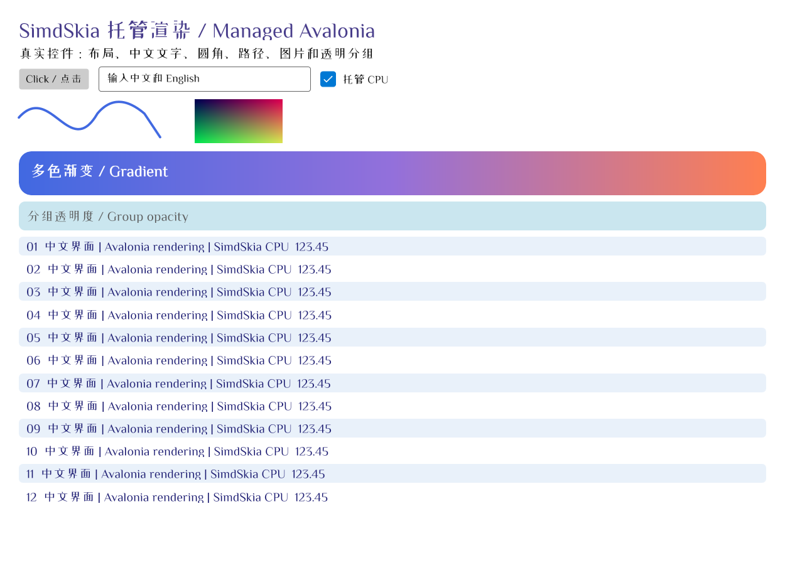

# SimdSkia

**Draw images in C# or switch your Avalonia app's rendering backend.**

SimdSkia is a .NET 2D rendering engine that runs without Google's native Skia library. In a console app or service, use `SKCanvas` to draw and save a PNG. In an Avalonia app, change the package references and startup code to switch the renderer while keeping your XAML and view models.

[简体中文](README.md) · English · .NET 10 · [Release 0.1.4](docs/RELEASE-0.1.4.md) · [MIT](LICENSE)

## Choose your starting point

| What you want to do | Package to install | Where to start |
| --- | --- | --- |
| Draw and generate a PNG in a .NET app | [SimdSkia](https://www.nuget.org/packages/SimdSkia/0.1.4) | [Run the drawing example](#generate-a-png) |
| Switch the Avalonia renderer on Windows, Linux, or macOS | [SimdSkia.Avalonia.Desktop](https://www.nuget.org/packages/SimdSkia.Avalonia.Desktop/0.1.4) | [Migrate an existing app](#migrate-an-existing-app) · [Run the window example](#run-the-desktop-window-example) |
| Render an Avalonia Android app on the CPU | [SimdSkia.Avalonia.Android](https://www.nuget.org/packages/SimdSkia.Avalonia.Android/0.1.4) | [Set up the Android project](#avalonia-android) |
| Convert pages from an existing PDF to images | [SimdSkia.Pdf](https://www.nuget.org/packages/SimdSkia.Pdf/0.1.4) | [Read and render PDFs](src/SimdSkia.Pdf/README.md) |

If your project directly references multiple `SimdSkia.*` packages, use the same version for each.

## Generate a PNG

Install `SimdSkia` to run this example. It draws a rounded rectangle and a circle on a bitmap, then saves it as a PNG.

```sh
dotnet new console --framework net10.0 -o SimdSkiaDemo
cd SimdSkiaDemo
dotnet add package SimdSkia --version 0.1.4
```

Replace `Program.cs` with the following code. SimdSkia's compatibility layer provides the `SkiaSharp` namespace.

```csharp
using SkiaSharp;

using var bitmap = new SKBitmap(320, 180);
using var canvas = new SKCanvas(bitmap);
canvas.Clear(SKColors.White);

using var paint = new SKPaint { Color = new SKColor(62, 90, 220), IsAntialias = true };
canvas.DrawRoundRect(SKRect.Create(24, 24, 272, 132), 24, 24, paint);
paint.Color = SKColors.White;
canvas.DrawCircle(160, 90, 32, paint);

using var png = bitmap.Encode(SKEncodedImageFormat.Png, 100)
    ?? throw new InvalidOperationException("PNG encoding failed.");
using var output = File.Create("hello-simdskia.png");
png.SaveTo(output);
```

Run `dotnet run` to create `hello-simdskia.png` in the current directory.

## Avalonia Desktop

### Migrate an existing app

1. Run `dotnet add package SimdSkia.Avalonia.Desktop --version 0.1.4` in your startup project and align your Avalonia packages to the same tested version. The example below uses `12.1.5`.
2. Remove any direct references to `Avalonia.Desktop`, `Avalonia.Skia`, and `Avalonia.Fonts.Inter`. Check whether third-party controls depend on the original Skia backend or `ISkiaSharpApiLeaseFeature`.
3. Add `using SimdSkia.Avalonia;` and replace `.UsePlatformDetect()` with `.UseSimdSkiaDesktop()` in your startup code. Remove `.WithInterFont()` if present.

### Run the desktop window example

Create `Demo.csproj` in an empty directory.

```xml
<Project Sdk="Microsoft.NET.Sdk">
  <PropertyGroup>
    <OutputType>WinExe</OutputType>
    <TargetFramework>net10.0</TargetFramework>
    <ImplicitUsings>enable</ImplicitUsings>
  </PropertyGroup>
  <ItemGroup>
    <PackageReference Include="SimdSkia.Avalonia.Desktop" Version="0.1.4" />
    <PackageReference Include="Avalonia" Version="[12.1.5]" />
    <PackageReference Include="Avalonia.Themes.Fluent" Version="[12.1.5]" />
  </ItemGroup>
</Project>
```

Create `Program.cs` in the same directory.

```csharp
using Avalonia;
using Avalonia.Controls;
using Avalonia.Controls.ApplicationLifetimes;
using Avalonia.Themes.Fluent;
using SimdSkia.Avalonia;

internal static class Program
{
    [STAThread]
    public static void Main(string[] args) => AppBuilder.Configure<App>()
        .UseSimdSkiaDesktop()
        .StartWithClassicDesktopLifetime(args);
}

public sealed class App : Application
{
    public override void Initialize() => Styles.Add(new FluentTheme());

    public override void OnFrameworkInitializationCompleted()
    {
        if (ApplicationLifetime is IClassicDesktopStyleApplicationLifetime desktop)
        {
            desktop.MainWindow = new Window
            {
                Title = "Hello SimdSkia",
                Width = 480,
                Height = 240,
                Content = new TextBlock { Text = "Hello, Avalonia!", Margin = new Thickness(24) }
            };
        }

        base.OnFrameworkInitializationCompleted();
    }
}
```

```sh
dotnet restore
dotnet run
```

This screenshot from a Direct2D test shows the Avalonia controls demo with text input, gradients, curves, and text in English and Chinese. To display Chinese text, install a supported static TrueType font with the required glyphs or specify a font through `FontFiles`. [Demo source](examples/CrossPlatform/Program.cs) · [Screenshot and test results](docs/DESKTOP-GPU-2026-10-22.md)



### Desktop platforms and rendering backends

| Platform | Default behavior of `.UseSimdSkiaDesktop()` |
| --- | --- |
| Windows | Prefers Direct2D with a native swap chain and can fall back to the CPU |
| Linux | Prefers hardware Vulkan under X11 or XWayland and can fall back to the CPU |
| macOS | Renders on the CPU and uses Avalonia's native window host |

Use `.UseSimdSkiaDesktop(options => options.UseCpu())` to explicitly select CPU rendering. The base `.UseSimdSkia()` adapter and offscreen bitmaps use the CPU. Desktop windows have been tested with Avalonia `12.1.0`–`12.1.5`. Newer versions need regression testing. [Backend selection and fallback](docs/GPU-PREFERRED-2026-11-07.md) · [Avalonia version matrix](docs/AVALONIA-VERSION-COMPATIBILITY.md)

To publish a desktop app with Native AOT, install the target platform's toolchain. For example, run `dotnet publish -c Release -r win-x64 -p:PublishAot=true` on Windows x64. Use `linux-x64` for Linux x64 or `osx-arm64` for macOS ARM64. [0.1.2 AOT size comparison and reproduction steps](examples/DefaultAvaloniaAot/README.md)

## Avalonia Android

Install `SimdSkia.Avalonia.Android` in a startup project targeting `net10.0-android36.0`. Use Avalonia `12.1.5` and call `.UseSimdSkiaAndroid()` in `CreateAppBuilder()`. When migrating from Avalonia's Android template, remove the direct `Avalonia.Android` reference and follow the example to configure the Activity's AppCompat theme and fonts. [Android setup and example](examples/Mobile.Android/README.md)

Android uses CPU/SIMD rendering. The release record distinguishes tests of the source app on an Android 16 ARM64 device from Release and Mono AOT builds of an app consuming the NuGet package. iOS window presentation remains to be implemented. [Device test report](docs/ANDROID-2026-11-09.md) · [Package verification](docs/NUGET-PREVIEW.md)

## Compatibility and performance

- **2026-11-10 working-tree follow-up.** Runtime effects took about 86% less time, atlas rendering 27% less, and meshes 14% less. Fixed-font Native AOT examples used about 15.6 MiB less private memory. Full-page timing, system-font workloads, and original-renderer quality are assessed separately. [Performance, CPU and memory](docs/PERFORMANCE-2026-11-10-ROUND2.md) · [Validation and remaining gaps](docs/VALIDATION-PERFORMANCE-2026-11-10-ROUND2.md)
- **Rendering internals.** The CPU rasterizer uses SIMD acceleration. Font handling, basic text layout, and image codecs are also implemented in C#. [Architecture](docs/ARCHITECTURE.md) · [Third-party dependencies](docs/DEPENDENCIES.md)
- **SkiaSharp source compatibility.** The signature audit matched 3,230 of 3,235 entries against SkiaSharp `3.119.4`. When migrating, rebuild code that depends on `SK*` types and check native handles, pixel output, and custom control behavior. The compatibility layer has a different assembly identity from the original `SkiaSharp.dll`. [API audit](docs/PUBLIC-API-FINAL-2026-11-07.md) · [Compatibility report](docs/COMPATIBILITY.md)
- **Document rendering.** `SKDocument.CreatePdf` exports multipage raster PDFs. For reading PDFs and rendering their pages, add `SimdSkia.Pdf`, which uses PdfPig 0.1.16 and supports the subset described in its documentation. [PDF guide](src/SimdSkia.Pdf/README.md) · [Document examples](examples/Documents/README.md)
- **Rendering differences.** Some JPEG, text, and curve cases still differ from the original renderer. Timing and memory usage depend on the backend and workload. The performance reports measure GPU submission and completion separately. [Rendering quality and tests](docs/VALIDATION.md) · [Performance and memory](docs/PERFORMANCE-HOTSPOTS-2026-11-07.md)

## Run examples from source

From the repository root, use .NET SDK `10.0.403` or a compatible version allowed by `global.json`.

```sh
dotnet run --project examples/Rectangle -c Release
dotnet run --project examples/CrossPlatform -c Release -- --controls
```

The first example checks every pixel of a rectangle and writes `artifacts/rectangle.ppm`. The second opens an Avalonia controls window. [Public API example](examples/Compatibility99/README.md) · [Release notes](docs/RELEASE-NOTES.md)

Report problems through [GitHub Issues](https://github.com/donet-org-cn/SimdSkia/issues). Include the package version, operating system, rendering backend, and a minimal reproduction if available.
