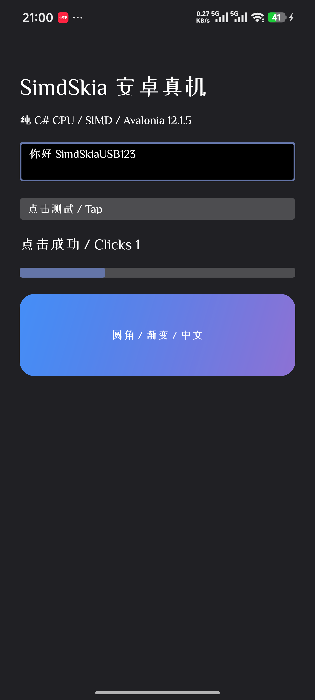

# Android 首个真机接入与 iOS 差距记录

本轮依据 issue #1 的移动端支持和示例需求，完成 Android 源码适配器、可运行示例及 USB 真机验证。issue 原文询问 Android、iOS 支持并希望提供示例。[原始 issue](https://github.com/donet-org-cn/SimdSkia/issues/1)

## 交付范围

新增 `src/SimdSkia.Avalonia.Android` 与 `UseSimdSkiaAndroid()`，使用官方 Android 窗口、输入和软件帧缓冲宿主。绘图、字体与基本排版由现有 C# 引擎执行。Android 适配器固定 Avalonia 12.1.5，作为仓库源码项目消费。公开 NuGet 0.1.3 的发行记录单独保留。

示例包含中文和英文、可编辑输入框、按钮路由、进度条动画、圆角渐变卡片，以及 Activity 暂停/恢复时的动画调度。接入、构建、安装与复验命令见[示例说明](../examples/Mobile.Android/README.md)。

## 真机结果

| 项目 | 结果 |
|---|---|
| 设备 | 24122RKC7C，ARM64，Android 16 / API 36 |
| 实际显示 | 1440×3200，中文、英文和控件可见 |
| Debug 构建 | 0 警告、0 错误，实际安装启动 |
| Release | 裁剪及 95 个程序集的 Mono AOT，实际安装启动 |
| 按钮 | 系统触摸注入触发 Avalonia Click，状态更新 |
| 输入框 | 等待输入法就绪后输入，得到“你好 SimdSkiaUSB123” |
| 动画 | 两张系统截图的进度条区域存在实际像素变化 |
| 前后台 | Activity 暂停后停止动画调度，恢复后呈现帧继续增长 |
| ARM 路径 | `Vector=True`，`AdvSimd=False`，通用向量与标量分支可运行 |
| 应用依赖 | APK 与运行程序集检查通过，SkiaSharp/HarfBuzz 和宿主生成工具未进入运行资产 |
| 桌面回归 | 43 项字体发现、36 项核心测试通过 |

最终 APK 为15,272,895字节，约14.57MiB，包含示例中文字体、AndroidX与.NET Android运行时。最后一次 `am start -W` 的 Activity 启动记录为688ms，画面呈现另由引擎帧计数和系统截图验证。交互记录的暂停/恢复帧计数为133→174，进度条区域有14,798个变化像素。[APK校验值与冻结证据](evidence/android-issue1-2026-11-09/)

这是功能与部署验证，性能对照仍需要独立的同设备、同场景原版进程和稳定采样。Android GPU、其他 API 级别及其他机型待验证。Android API 23 为项目声明的最低版本。

## 修复与依赖处理

首次真机启动暴露了示例遗漏 AppCompat 主题的问题，导致 Activity 退出。补上明确主题、深色启动背景后，Debug 和 Release 均通过实际启动。原始失败堆栈与修复后的记录一并保留。

官方 Android 宿主入口默认注册 Skia/HarfBuzz。新增构建工具先验证官方 12.1.5 DLL 的固定 SHA256，再移除两个默认注册调用及对应引用，保留窗口和输入功能。APK、NuGet 运行依赖图和进程程序集通过独立检查。宿主写入先验证临时文件，再原子发布。官方 Android 软件模式的定义和实现可在固定基线源码核对。[Avalonia AndroidPlatform.cs](https://github.com/AvaloniaUI/Avalonia/blob/12.1.5/src/Android/Avalonia.Android/AndroidPlatform.cs)

Android 系统字体发现新增三个系统字体目录。示例显式带有 OFL 静态中文 TrueType 字体，支持当前解析器的格式范围。部分手机默认中文字体为可变字体/CFF，后续字体兼容工作仍需覆盖这些格式。

依赖用途和许可证列于[依赖说明](DEPENDENCIES.md)。Android/.NET 负责平台运行和系统交互，Mono.Cecil 为构建工具依赖，APK 内保留字体、Avalonia、AndroidX、Clipper2、编解码和项目许可。

## iOS 状态

现有 C# 几何、像素、字体及编解码模块的目标框架可用于移动端集成。Avalonia iOS 窗口接入还需要呈现适配。12.1.5 官方宿主提供 Metal/OpenGL 两种模式，现有 SimdSkia Avalonia 适配器接收软件帧缓冲，二者之间需要补充上传/呈现与资源生命周期实现。[iOS 官方平台入口](https://github.com/AvaloniaUI/Avalonia/blob/12.1.5/src/iOS/Avalonia.iOS/Platform.cs)

iOS 后续验收包括 Mac/Xcode 构建、签名/模拟器、UIKit 输入法、旋转和安全区域、前后台表面恢复，以及真机内存和帧时间。本轮使用 Windows 与 Android USB 设备，iOS 尚无可运行示例及实机通过结果。
