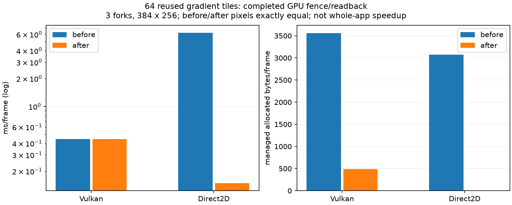
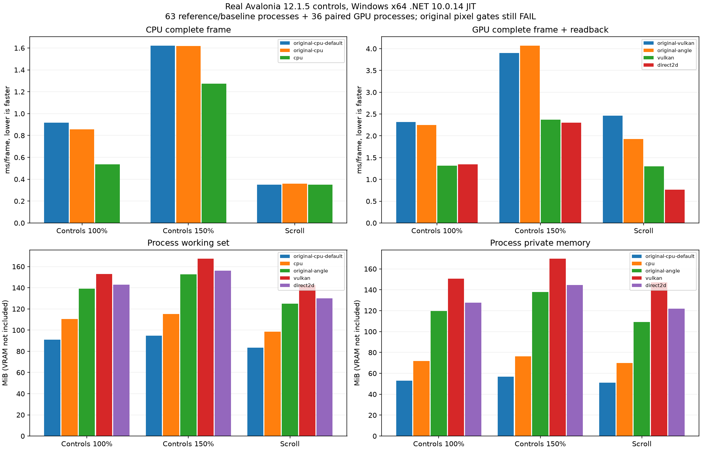

# API继续扩展与GPU实测：默认后端的选择（2026-11-06，未发布）

本轮新增15个SkiaSharp基线签名，精确匹配 **1105→1120/3235**，64类型，仍缺2115项，额外/不同签名0。完成真实代码、独立原版探针、CPU/GPU回归、实际Native AOT及129个计时进程；**没有发布NuGet，也没有把GPU设为默认**。

## 默认是否应当开启GPU

当前受测控件页应保持CPU默认。CPU已经默认启用可用的SIMD。Vulkan/Direct2D虽比本轮原版GPU快，但不等于比本库CPU快；GPU驱动、同步、回读、资源和图集有成本。Windows Direct2D交换链不需要正常帧回读，另行测量后在此控件示例仍略慢于CPU且内存更高。

另外，NativeWindowTarget明确拒绝分层/逐像素透明窗口，必须显式选择FramebufferReadback；allowCpuFallback仅处理支持范围内的绘图命令回退，不保证设备初始化失败或所有窗口类型自动回退。macOS尚无GPU后端。因此不能为所有应用强行开启。

## API与几何实现

- ConicTo/RConicTo四个重载，保留有理二次曲线权重；权重≤0退为端点直线、+Infinity退为两条线、权重1使用二次曲线，行为经原版核对。NaN权重明确拒绝。
- AddOval、AddArc、矩形ArcTo及两种切线ArcTo。支持方向、相对命令、负半径切线归一化、零/整圈扫角、点/动词计数、紧边界及仿射变换。SVG端点/旋转椭圆ArcTo仍未实现。
- DrawOval三个重载、DrawArc、DrawColor（默认Src）和DrawPaint。DrawPaint依原版忽略描边样式，保留裁剪及shader局部坐标；默认矩阵复用已优化的矩形路径，变换shader仍按真实坐标采样。
- AddCircle从三次曲线近似改成原版9点/6动词的圆锥表示。权重使用PathSegment原先闲置的C载荷，不扩大每个字形/路径片段；Marshal.SizeOf仍为28字节。
- 核心新增正权重曲线细分与解析极值；Transform/Append正确保留权重，非仿射路径转换明确拒绝。Vulkan共享核心细分，Direct2D按变换精度生成并缓存有界折线几何。
- 椭圆和弧几何各有64项画布缓存，路径修改会失效，画布Dispose释放；没有静默返回空实现。

**几何一致不等于像素全部一致。** 370组、6810个路径数据/边界值通过；新增28个绘图场景仅16个通过既有max≤32/RMSE≤2门槛，12个仍失败，主要为硬边、部分椭圆AA/描边及变换边缘。原有圆的表示差异消除，但RoundRect仍使用既有cubic路径，不能推断所有路径查询已经等同。Direct2D新圆锥跨后端精细门槛max≤8/RMSE≤.75为0/6，最大差29、RMSE .808；Vulkan6/6逐字节一致。所有失败JSON和退出码保留。

推断：几何点、权重语义和极值已对齐，剩余差异主要集中于覆盖率、硬边扫描转换与描边；本库16×16采样与原版不同。尚未完成原版扫描转换语义，不能把此定位当作已修复。

## GPU优化代码与局部收益

1. 对已经验证有序且有限的不可变色标，构造时记住是否位于[0,1]；Vulkan、窗口GPU与Direct2D验证不再每次ToArray/Any复制。保留32/256色标限制和明确报错。
2. Direct2D按不可变shader与paint透明度缓存COM渐变画刷，每上下文最多64项。透明度是键的一部分，淘汰与Dispose均Release；上下文/线程不共享。重复创建停止点集合的开销显著下降。
3. 两格式、低/高透明度、重复引用、超过容量的淘汰、Dispose及线程约束等148060条断言通过，其中多数为物理PMA字节逐项检查，不代表这么多独立API。

384×256、64个复用的三色渐变块、每帧等待GPU完成并回读；两端各3进程，预热1秒/采样2秒。前后分组运行，采用中位数，原版不参与此局部微基准。

| 后端 | 修改前 ms/帧 | 修改后 | 前/后分配 B/帧 | 前/后WS MiB | 前/后Private MiB |
| --- | ---: | ---: | ---: | ---: | ---: |
| vulkan | 0.443010 | 0.445181 | 3560.52/488.24 | 78.52/72.35 | 86.23/80.14 |
| direct2d | 6.245299 | 0.148614 | 3074.34/0.07 | 60.84/60.88 | 73.60/55.71 |

Direct2D局部约42倍提速，CPU时间6.523→0.293 ms/帧；**不是整应用42倍，也不是比原版42倍**。Vulkan耗时基本不变，分配减少约86%，本轮未见确定速度收益。两后端各自前后像素哈希完全一致；Direct2D与Vulkan彼此不要求逐字节相同。摊销分配0.07B/帧不等于绝对0分配。



## 同一真实Avalonia控件树：CPU与原版

Windows x64、i7-8700K、GTX1050Ti、SDK10.0.403/.NET10.0.14 JIT，Avalonia12.1.5/SkiaSharp3.119.4，同一OFL字体和1000×720逻辑尺寸。首轮7种配置×3场景×3进程=63进程，分别包含原版CPU默认/灰度配置、本库CPU、原版Vulkan/ANGLE、本库Vulkan/Direct2D。原版CPU按各场景两配置中较快者比较。

| 场景 | 较快原版CPU ms/帧 | 本库CPU | 耗时比 | 原版/本库CPU ms/帧 | 原版/本库WS MiB | 原版/本库Private MiB |
| --- | ---: | ---: | ---: | ---: | ---: | ---: |
| 控件100% | 0.8561 | 0.5347 | 0.625 | 0.854/0.537 | 90.96/110.55 | 53.11/71.70 |
| 控件150% | 1.6195 | 1.2752 | 0.787 | 1.615/1.279 | 94.58/115.09 | 56.73/76.20 |
| 滚动100% | 0.3490 | 0.3518 | 1.008 | 0.350/0.354 | 83.55/98.56 | 51.01/70.00 |

CPU耗时综合比0.791，最差场景约落后0.8%，仅速度指标满足整体不落后10%；本库CPU内存依然更高。此CPU轮在GPU缓存优化前采集；缓存补丁只改GPU色标验证/画刷与描述标志，不把CPU数字当成一次新的同画质验收。

## GPU完整帧与原版：提交、完成和回读全部计入

首轮63进程的原版数据保留；随后用冻结的修改前/后本库GPU二进制交替跑36进程，均预热3秒/采样5秒。每个GPU帧包括记录命令、fence/event完成与BGRA回读；CPU直接写BGRA。不能把记录时间当作GPU完成时间，不能换算成显示器FPS。GPU相对原版表中，原版来自首轮，优化后来自配对轮；不是一轮中同时采样，不把微小差异当成确定收益。

| 场景 | 原版Vulkan | 原版ANGLE | 本库Vulkan前→后 | 本库Direct2D前→后 |
| --- | ---: | ---: | ---: | ---: |
| 控件100% | 2.3191 | 2.2517 | 1.3150→1.3128 | 1.4936→1.3468 |
| 控件150% | 3.8989 | 4.0700 | 2.3661→2.3715 | 2.5663→2.3017 |
| 滚动100% | 2.4596 | 1.9303 | 1.2978→1.2972 | 0.7620→0.7644 |

单位ms/完成帧。Direct2D控件页约快9.8%/10.3%，滚动场景基本不变；Vulkan基本不变。六个配对场景前后图像全部逐字节相同。原版整页门槛仍 **0/18**（含两种CPU对照及两个GPU原版），首轮脚本退出2、releaseEligible=false。优化后图像相同，不能改判画质通过。

| 场景/后端 | 优化后CPU ms/帧 | 忙循环整机CPU% | WS MiB 前→后 | Private MiB 前→后 | 分配 B/帧 前→后 |
| --- | ---: | ---: | ---: | ---: | ---: |
| 控件100%/vulkan | 0.574 | 3.65 | 153.00→153.12 | 150.11→150.78 | 7945.7→7849.7 |
| 控件100%/direct2d | 1.840 | 11.38 | 145.57→142.95 | 129.80→127.61 | 5705.6→5609.4 |
| 控件150%/vulkan | 0.984 | 3.46 | 167.18→167.40 | 169.73→169.74 | 8121.9→8025.9 |
| 控件150%/direct2d | 2.792 | 10.13 | 155.82→156.10 | 143.84→144.62 | 5705.4→5609.4 |
| 滚动100%/vulkan | 0.333 | 2.14 | 142.45→142.44 | 148.20→147.05 | 4816.7→4816.7 |
| 滚动100%/direct2d | 1.128 | 12.03 | 130.08→129.94 | 122.04→122.07 | 2488.4→2488.4 |

忙循环CPU占用反映无限制吞吐，不是60FPS应用占用；进程CPU时间/帧更适合比较工作量。内存为进程WS和Private，不包括显存。**未测GPU显存，不宣称总设备内存下降。** 本库GPU不是此控件场景的省内存方案。



## 真实窗口：Direct2D交换链与CPU

examples/CrossPlatform的真实控件窗口，每种后端3进程，预热3秒/采样5秒。Direct2D正常帧不回读，Present等待完成事件；Vulkan当前经完成回读后呈现。窗口放在屏幕外，计的是绘制/呈现服务时间，不是可见显示器FPS。与上方离屏指标分开。

| 后端 | P50 ms | P95 ms | 整机CPU% | 峰值WS MiB | 峰值Private MiB |
| --- | ---: | ---: | ---: | ---: | ---: |
| cpu | 1.3364 | 1.7802 | 0.67 | 102.49 | 48.34 |
| direct2d | 1.4027 | 1.8058 | 1.25 | 133.68 | 105.30 |
| vulkan | 2.4069 | 3.1855 | 0.83 | 147.75 | 132.08 |

三者采样量足够、计时中关闭额外截图/串行化GPU诊断，绘图命令回退计数均为0；GPU默认文字图集仍由C#预生成并缓存，不称为纯GPU文字光栅化。此示例CPU最快、最省内存，因此保留CPU默认。

## 其余验证、剩余工作和复现

核心冻结标量对照472085项，正常硬件与DOTNET_EnableHWIntrinsic=0各通过；基础36、Features、编解码1417、PDF18、控件9750、Shader50场景/30擦除、原几何4612值及Vulkan采样590/优化540回归通过。实际Native AOT新增10项通过，片段布局28字节已断言。Release完整构建0警告/错误。

另测9个CPU几何进程：受测圆形0.051403→0.052097ms，约慢1.35%；混合0.067788→0.067626ms，未明显退化。由于改为真实圆锥表示，圆/混合输出有意变化，与原版最大误差由9变13、RMSE增加但仍在原32/2门槛内，不能宣称像素更接近原版。其余精确优化检查保持不变。

剩余：12个新曲线画质项、Direct2D圆锥精细门槛、整页CPU/GPU画质、历史JPEG严格差异；SVG椭圆端点ArcTo、RoundRect表示、path ops/iterator、其他描边/混合、复杂排版与大量其他API。当前不满足全面兼容/同画质整体持平验收。新代码本轮只在Windows实测，远程CI未运行，未新增运行时依赖。

```powershell
dotnet build SimdSkia.sln -c Release
python tools/check-conic-compatibility.py --output artifacts/conic-check-new # 当前退出2，保留12个画质失败
dotnet run --project tests/ConicCompatibility/Gpu -c Release -- artifacts/conic-gpu-new # 当前退出2
dotnet publish tests/ConicCompatibility/NativeAot -c Release -r win-x64 -o artifacts/conic-aot-new
.\artifacts\conic-aot-new\NativeAot.exe
dotnet run --project examples/Conics -c Release
dotnet build benchmarks/AvaloniaGpuParity/Original -c Release
dotnet build benchmarks/AvaloniaGpuParity/Managed -c Release
python tools/run-ui-backend-parity.py --output artifacts/ui-backend-new --forks 3 --warmup 3 --seconds 5 # 原版画质仍失败
```


可选Windows GPU需引用SimdSkia.Avalonia.Gpu并using SimdSkia.Avalonia；显式配置示例：

```csharp
.UseSimdSkiaDesktop(options => options.UseGpu(
    SimdSkiaGpuBackend.Direct2D, allowCpuFallback: true))
// 逐像素透明/分层窗口要显式指定：
// presentation: SimdSkiaGpuPresentation.FramebufferReadback
```

完整原始进程、源码/二进制哈希、缓存补丁、退出日志和图表在[evidence/conic-gpu-2026-11-06](evidence/conic-gpu-2026-11-06/status.json)。默认后端未改，不会让现有用户额外依赖GPU。公开0.1.1不包含本批新增代码，需源码构建；没有推送或发布新版。
