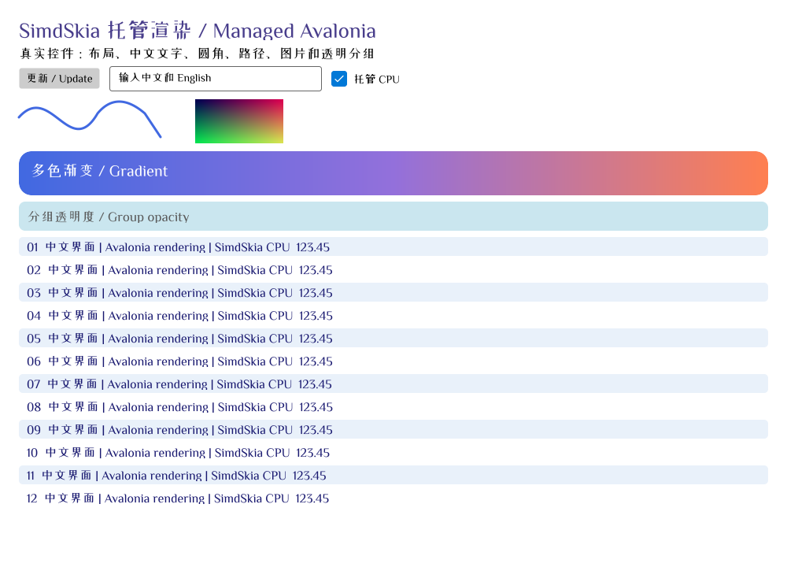

# 真实 Avalonia 控件 CPU 对比：2026-10-21

现在可以用 `UseSimdSkia` 运行基础 Avalonia 控件和真实 Win32 软件窗口。完整控件场景约 1.47 ms/帧；原版默认约 0.86 ms，原版开启完整透明分组约 3.18 ms。原版默认采用逐 draw 的 opacity，透明内容重叠时与完整分组的结果不同，因此两种配置全部列出。托管工作集仍更高、首绘仍更慢，像素 gate 仍失败，不能视为全面超过原版或完整替换成功。

这份测量使用实际 Avalonia 12.1.4 控件、Fluent 主题、布局/模板和 `RenderTargetBitmap.Render`，由 Avalonia 的 ImmediateRenderer 遍历视觉树。不是此前的 SKCanvas 调用回放，也不包含 GPU 或桌面窗口呈现耗时。真实窗口呈现与输入由另外的功能测试验证。

## 最终数据

i7-8700K，12 逻辑核，Windows 10.0.26300，.NET 8.0.32。固定 ZCOOLXiaoWei-Regular.ttf，SHA-256 `A42B620140F493DB42F741351DFBF343C0936D58588EE8004B8B2A218D997FF1`。原版为 Avalonia.Skia 12.1.4 / SkiaSharp 3.119.4，排版为原版 Avalonia.HarfBuzz 12.1.4。两进程使用相同字体文件集合、控件源码、尺寸、缩放、抗锯齿和无 hint 灰度文本选项。

每个配置每实现 3 个独立进程，交替执行；每进程连续渲染预热 2.5 秒、强制 GC 后测量 600 次完整重绘。最终 27 个进程同时测量托管、原版完整分组、原版默认三个配置，下面取三个进程的中位数。完整组在透明 Border 设置 `RenderOptions.RequiresFullOpacityHandling=true`；原版默认列将其设为 false。托管后端始终保证透明内容按组合成。列表没有半透明组，两种原版配置在该场景绘制语义相同。

滚动为每帧改变根控件的整数 Y 平移，仍完整重绘，不是合成器的局部更新或虚拟化 ListBox 结果。首绘另列，不能用暖缓存数字代表首次打开界面。

表内时间均为 ms，单元格为“帧时间 / 进程 CPU 时间”。

| 场景 | 尺寸 | SimdSkia 完整组 | 原版完整组 | 原版默认 |
|---|---|---:|---:|---:|
| 按钮、输入框、复选框、12 行中文、路径、圆角渐变、图片、透明组 | 1000×720 | 1.469 / 1.484 | 3.182 / 3.177 | 0.858 / 0.859 |
| 相同控件，150% DPI | 1500×1080 | 2.672 / 2.656 | 6.725 / 6.693 | 1.589 / 1.589 |
| 24 行中英文列表滚动 | 1000×720 | 0.707 / 0.807 | 0.365 / 0.365 | 0.370 / 0.365 |

| 场景 | SimdSkia P95 / P99 ms | 原版完整组 P95 / P99 ms | 原版默认 P95 / P99 ms |
|---|---:|---:|---:|
| 控件 100% | 1.567 / 1.952 | 3.326 / 3.903 | 0.937 / 1.200 |
| 控件 150% | 2.845 / 3.379 | 7.137 / 8.276 | 1.716 / 2.208 |
| 滚动 100% | 0.771 / 0.983 | 0.398 / 0.488 | 0.424 / 0.498 |

分位数先在各进程内统计，再取三个进程中位数；不将三个进程的帧混合成一个样本。100% 控件离屏吞吐约为托管 681、原版完整组 314、原版默认 1165 完成帧/秒，不是桌面窗口 FPS。600 帧测量期间，托管完整控件两个 DPI 的 Gen0 中位数为 2，原版为 0；其余场景及 Gen1/Gen2 中位数为 0。

| 场景 | 配置 | 分配 KiB/帧 | 工作集 / Private MiB | GC 后托管保留 MiB |
|---|---|---:|---:|---:|
| 控件 100% | SimdSkia | 20.89 | 118.9 / 79.3 | 20.9 |
| 控件 100% | 原版完整组 | 7.94 | 95.9 / 51.1 | 2.3 |
| 控件 100% | 原版默认 | 7.77 | 96.0 / 50.8 | 2.3 |
| 控件 150% | SimdSkia | 22.75 | 129.1 / 90.2 | 31.4 |
| 控件 150% | 原版完整组 | 7.94 | 98.2 / 53.4 | 2.3 |
| 控件 150% | 原版默认 | 7.77 | 99.7 / 54.6 | 2.3 |
| 滚动 100% | SimdSkia | 10.09 | 106.6 / 73.6 | 16.5 |
| 滚动 100% | 原版完整组 | 8.03 | 86.4 / 47.7 | 1.4 |
| 滚动 100% | 原版默认 | 8.03 | 86.5 / 47.9 | 1.4 |

CPU 时间取整个进程 `TotalProcessorTime` 差值，包括后台 JIT/GC 线程；原始结果另给相对于单核的 CPU%。Private 与工作集是不同统计，GC 后托管保留也不是进程总占用。内存表使用结束时快照，原始 JSON 另外保留测量前及进程峰值工作集；这些数字不能相互替换。

首次 `Render` 每进程仅取一次，包含首次覆盖率生成/JIT，**不含**此前框架启动、字体加载、模板应用和布局。按“托管 / 原版完整组 / 原版默认”顺序：100% 控件 89.4 / 8.5 / 6.0 ms，150% 为 116.3 / 23.5 / 17.4 ms。具体进程范围、全部 27 份结果与失败 gate 在 [原始汇总](avalonia-controls-results.json)，不是完整应用启动时间。首绘仍显著慢于原版，不能用上面的暖帧时间掩盖。

## 本轮优化与排版修复

初版接通后，100% 控件约 32.309 ms/帧、894.41 KiB/帧分配；150% 约 70.633 ms/帧、1960.58 KiB/帧。修复了这些实际热点：

- 透明分组记录绘制范围，合成实际改动区域；不再为小透明组扫描整张目标图，但保留正确的重叠/分组语义。
- 为格式相同、预乘 Alpha 的行加入 AVX2 SrcOver，保留逐项整数舍入和标量回退；没有降低 AA 或更换 blend。
- 几何 AA 裁剪使用跨画布、有明确预算的覆盖率缓存；水平多色渐变按行采样并合成。
- 轴对齐 bilinear 图片复用 X 采样和源行，避免反复生成矩形 mask；镜像、分数裁切、三 Alpha/格式/stride 对通用路径逐字节验证。
- 相同字体内容的注册与流加载共享不可变字体，避免重复保存数 MB 字体数据。

第一轮 27 个进程保存了优化前/后/原版三方结果：优化后的 100%/150% 约 1.473/2.740 ms，三个配置优化前后最终帧逐字节一致。数据位于 `artifacts/avalonia-controls/final-2026-10-21`，冻结程序集及 SHA 清单保留在工作区，首版适配器不是已发布版本。

随后修复 GPOS kern pair/class 及旧 kern 表、Tab/换行、字形偏移、可变 pen/路径缓存失效。15 份原版中英文排版夹具现在字形、cluster、advance、offset 一致（允许浮点差 0.000001），但修正字距会改变像素。再复测分位数与 GC，并核查原版透明度处理：默认 `UseOpacitySaveLayer=false` 与完整组语义不同，最终加入了上面三配置的 27 进程测试。此前目录均保留，未把字距变化或原版默认 opacity 数字冒充同语义逐像素通过。

## 画质门槛仍失败

全文 UI 的既定门槛为最大通道误差 ≤32、RMSE ≤2；没有因本轮结果提高阈值。

| 场景 | 最大通道误差 | RMSE | 结果 |
|---|---:|---:|---|
| 控件 100% | 99 | 5.079 | FAIL |
| 控件 150% | 216 | 4.681 | FAIL |
| 滚动 100% | 110 | 6.419 | FAIL |

字距修复前对应 RMSE 15.886、18.144、21.253，说明位置错误已实质改善；灰度栅格、曲线边缘及 DPI 的差异仍需继续定位。排版指标一致不等于像素结果一致。没有把不同字体混在这份对比里，也没有以缺字空白提升成绩。



同一场景的 [原版完整组图片](images/avalonia-controls-reference.png) 与 `artifacts/avalonia-controls/final-verified-2026-10-21/diff-*.png` 可用于检查差异。

## 复现与取舍

```powershell
powershell -NoProfile -File tools/fetch-avalonia-font.ps1
powershell -NoProfile -File tools/run-avalonia-controls.ps1 -Output artifacts/avalonia-controls/my-run
# 保存数据和差异图后，画质未达标时返回 2；不应把它当作验收通过
```

构建、功能验收、Win32 窗口、精确依赖和剩余 API 见 [接入文档](AVALONIA-INTEGRATION.md)。当前透明组场景得到较好热帧结果，默认原版和滚动文字仍更快；内存和首次绘制也还有明显差距。若目标是完整 Avalonia 应用、默认字体效果和 GPU 性能等价，当前版本仍未达到这一要求。接下来优先解决画质、首绘和内存，再补 ImageBrush/VisualBrush、滤镜和 Vulkan 窗口集成。
