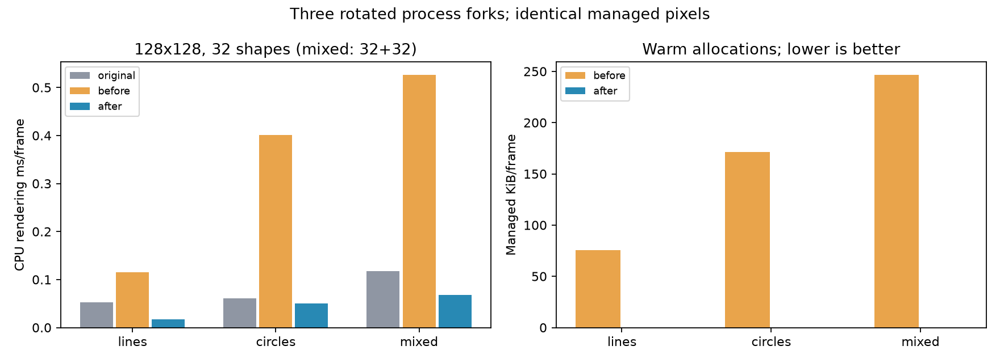
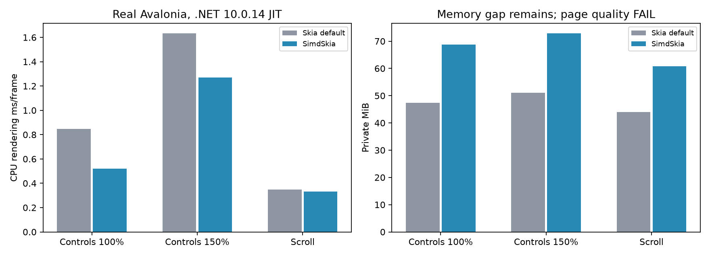

# SimdSkia 兼容性扩展与性能复测（2026-11-06，未发布源码）

公共元数据匹配 **892/3235 → 1090/3235**，新增 **198 条**：134 个命名颜色字段、2 个解析方法及62条路径/矩阵/画布/画笔元数据。64个公开类型，仍缺 **2145 条**，额外或不同签名为 **0**。不是198个完整绘图功能，也不代表全部行为或二进制兼容。

本轮尚未发布 NuGet，公开0.1.1包不包含这些改动；新功能需使用当前源码。[新增清单](evidence/compat-optimization-2026-11-06/added-api.json)及[数据证据](evidence/compat-optimization-2026-11-06/status.json)。

## 实际改动

- SKPath：点/动词、普通/紧边界、偏移、原地/目标路径仿射变换、相对命令、多边形、Append/Extend/自身追加、矩形起点；修复隐式原点、空 Close、Close 后继续绘制。边界与点数缓存随修改失效。
- SKMatrix：Values、可逆查询、枢轴变换、Skew、Concat/PreConcat/PostConcat、点/向量数组与Span映射、MapRect/MapRadius。Path/Canvas透视绘制仍拒绝。
- SKPaint.Clone/Reset/IsStroke；字体Typeface真正支持切换、null默认字体和释放来源typeface后的保留视图。克隆画笔保留已赋予后又释放的shader数据。IsStroke支持StrokeAndFill状态查询，不代表StrokeAndFill绘制已实现。
- SKColors补齐原版141个命名颜色；SKColor.Parse/TryParse支持有/无#的RGB/ARGB/RRGGBB/AARRGGBB，使用Span解析，并对照失败返回、异常类型和参数名。
- Canvas增加枢轴变换和Skew；重复直线/圆形使用按需分配、各至多64项的几何缓存；描边仍受4 MiB/64项预算限制。
- 核心压缩掩码不再同时保留密集字节和可直接绘制的游程，不降低采样或颜色处理。12条带样本的有效载荷 **114 KiB→24 KiB**，像素重建完全相同；不是整程序内存减少79%。

## 验证与保留的差异

- 299组对照、**4612项值检查**通过，包含200个随机矩阵、全部命名颜色、异常参数名和字体/shader生命周期；几何浮点容差绝对1e-4、相对2e-6个逻辑单位。
- 四个新增像素场景均非空，原max≤32/RMSE≤2不变，最大通道误差1。
- 原版AddCircle是conic表示（9点），当前仍用cubic近似（13点），因此报告明确保留 **fullBehavioralCompatibility=false**。新查询只对受测Move/Line/Quad/Cubic路径宣称一致。
- 椭圆试验max=47、RMSE≈2.020未过门槛，因此**没有把DrawOval并入本轮已实现API**。[失败记录](evidence/compat-optimization-2026-11-06/rejected-oval.json)保留，未改阈值。
- Release零警告/错误；基础36、精确像素471569、兼容扩展37、编解码1417、PDF18、控件9750、字形批次60、真实Native AOT14通过。Vulkan GTX1050Ti实际设备回归通过（12完成批次、线程/中文/纹理生命周期）；没有新增GPU跑分。
- 新Windows CI和verify.ps1 -Reference已接入对照；本轮未推送，也未声称远程三平台CI已执行。

## 受测CPU热点

Windows x64 / i7-8700K / .NET10.0.14 JIT、默认CPU SIMD，128×128预乘BGRA。每帧32条线或32个圆，混合为各32个；原版3.119.4、冻结的修改前和最终候选三轮独立进程轮换顺序，取中位数。不是通用x64 AOT、GPU或窗口呈现成绩。

| 场景 | 原版 ms/帧 | 修改前 | 修改后 | 比修改前快 |
| --- | ---: | ---: | ---: | ---: |
| bounds | 0.000138 | 0.281229 | 0.000079 | 3572.01× |
| lines | 0.052910 | 0.115747 | 0.016761 | 6.91× |
| circles | 0.061198 | 0.401246 | 0.050211 | 7.99× |
| mixed | 0.118014 | 0.526740 | 0.067429 | 7.81× |

Bounds是固定513点路径的32次热查询，不含构建，不能混入整页综合成绩。绘图三场景修改前后逐字节一致，对原版max=1/9/9、RMSE=0.455/1.092/0.827，均过原32/2门槛。

| 场景 | 修改前KiB分配/帧 | 修改后B分配/帧 | 原版/前/后CPU ms/帧 | 原版/前/后工作集MiB |
| --- | ---: | ---: | --- | --- |
| lines | 75.51 | 0.0139 | 0.05235 / 0.13563 / 0.01666 | 35.59 / 45.71 / 34.94 |
| circles | 171.28 | 0.0415 | 0.06117 / 0.39531 / 0.04969 | 35.72 / 42.07 / 34.98 |
| mixed | 246.79 | 0.0557 | 0.11676 / 0.51389 / 0.06754 | 35.79 / 42.98 / 35.05 |

忙循环均接近一个核心，CPU时间/帧更有比较意义；工作集/Private包含运行时和缓存，不是库体积。小于1B/帧的摊销分配不等于绝对零。



## 真实Avalonia：内存仍未追平

Avalonia12.1.5、同许可字体、软件CPU RenderTargetBitmap，600帧、三轮；共36个进程，比较掩码补丁前/后、原版默认与受控原版。下表用较快的原版默认配置，不拿较慢配置美化成绩。补丁前后三个整页场景逐字节一致；SK* facade热点优化不会自动作用于独立Avalonia后端。

| 场景 | 原版默认ms/帧 | 补丁前/后ms/帧 | 原版/当前工作集MiB | 原版/当前Private MiB |
| --- | ---: | --- | --- | --- |
| controls 100% | 0.849 | 0.518 / 0.520 | 89.85 / 106.66 | 47.32 / 68.71 |
| controls 150% | 1.634 | 1.248 / 1.269 | 93.63 / 110.90 | 51.13 / 72.91 |
| scroll 100% | 0.347 | 0.329 / 0.331 | 81.20 / 92.71 | 44.06 / 60.77 |

**整页内存没有得到实质改善**：本页面GC后保留量几乎不变；150%场景Private波动较大，不能把局部载荷下降直接当作进程内存下降。当前工作集仍高约14%–19%，Private高约38%–45%。

原版整页画质仍 **0/3**（max=96/117/75，RMSE=2.408/2.321/2.595），脚本保留退出码2，阈值未变。即使这些CPU计时较快，也不满足整体同画质/同内存持平。



## 剩余差距

| 公共元数据缺口分类 | 数量 |
| --- | ---: |
| GPU/native interop | 227 |
| Drawing/surfaces/recording | 227 |
| Other | 316 |
| Images/pixels/codecs/IO | 541 |
| Fonts/text | 250 |
| Geometry/paths | 241 |
| Paint/effects | 343 |

分组包含类型、枚举及重载，不是独立功能数量。下一批重点仍是混合/滤镜、Conic/Arc/路径布尔运算、复杂字体/排版、更多像素与Codec接口、原版整页覆盖率。GR/native handle及强名称替代不能伪造。

## 复现

```powershell
dotnet build SimdSkia.sln -c Release
python tools/check-geometry-compatibility.py --output artifacts/geometry-new-run
dotnet publish tests/GeometryCompatibility/NativeAot -c Release -r win-x64 -o artifacts/geometry-aot
artifacts/geometry-aot/NativeAot.exe
```

使用.NET SDK10.0.403+、下载两份固定许可字体；每次用新输出目录。微基准原版和源码分别构建benchmarks/GeometryCompatibility/Original、Managed；修改前可用Managed的`-p:UsePackedSimdSkia=true`引用已发0.1.1，然后用`tools/run-geometry-benchmarks.py --before ... --after ... --original ... --output ...`。本轮修改前实际为编辑前冻结的干净源码构建。整页命令见tools/run-avalonia-controls.ps1，数据目录保留manifest及每次metrics。图仅需隔离开发依赖Matplotlib，不进入产品。
