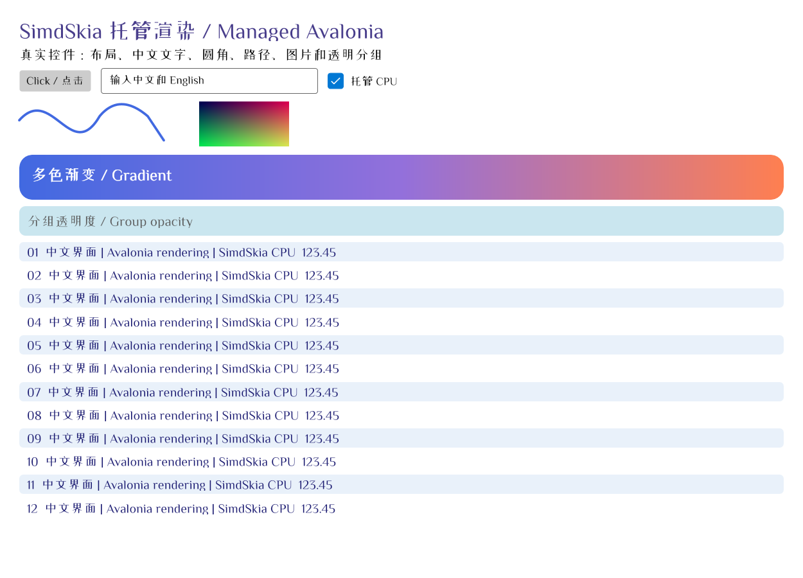

# 跨平台桌面与 GPU：2026-10-22

本轮实现 Avalonia 12.1.4 的 Windows/Linux X11/macOS 统一宿主、纯 C# 已安装字体发现，并将 GPU 实际接入窗口。Windows Direct2D 使用 D3D11 硬件设备与 DXGI 原生交换链，正常帧不强制回读。Windows/Linux Vulkan 使用完成 fence 后回读到系统 framebuffer。macOS 目前使用 CPU，Metal 未实现。

## 使用

preview.3 修复文字图集在半透明覆盖裁剪下提前合成重叠字形的问题：覆盖率在 C# 字形栅格化时逐字形应用，缓存同时区分遮罩和设备原点，并保守计入保留的遮罩字节。新增回归先在旧实现复现失败，再在 Vulkan/Direct2D、RGBA/BGRA、两种文字透明度、两种裁剪覆盖率及整数/小数滚动下通过；硬件集成断言增至 12172 项。preview.2 标签和已上传包保留原内容，使用修复后的 preview.3。三平台的 GPU 初版 CI 和最终修复版 CI 分别记录。

桌面包 `SimdSkia.Avalonia.Desktop`，可选 GPU 包 `SimdSkia.Avalonia.Gpu`，版本均为 `0.1.0-preview.3`；发布结果见 [NuGet 记录](NUGET-PREVIEW.md)。无需重新编译 Avalonia。

```csharp
using SimdSkia.Avalonia;
// 三平台 CPU
AppBuilder.Configure<App>().UseSimdSkiaDesktop();
// Windows GPU；Vulkan 需显式改枚举值，不做静默后端回退
AppBuilder.Configure<App>().UseSimdSkiaDesktop(o => o.UseGpu(SimdSkiaGpuBackend.Direct2D));
```

完整双文件程序、字体和 AOT 命令在 [首页](../README.md)。macOS 经用户确认允许官方 MIT `libAvaloniaNative.dylib` 作为窗口宿主；应用绘图、字体解析、文字覆盖率和编解码继续使用 C#，不调用 Skia/HarfBuzz/FreeType。Direct2D 是自写的 C# Windows SDK ABI，无 Vortice/SharpGen 运行依赖，无动态 COM 激活。原型因 SharpGen 反射裁剪警告被替换，未屏蔽该警告用于交付。

## 平台与测试

最终 preview.3 的三平台真实窗口、各自 Native AOT 编译/实际运行、真实 nupkg 完整控件窗口均通过 [CI 39647833834](https://github.com/hnlyf168/SimdSkia/actions/runs/39647833834)，受测源码提交 `b8227eef11c8b8f654fa6b9e6b37215f14597b09`。GPU 初版另见 [CI 39645744951](https://github.com/hnlyf168/SimdSkia/actions/runs/39645744951)，首次宿主验证见 [CI 39635321989](https://github.com/hnlyf168/SimdSkia/actions/runs/39635321989)。

下载 CI 产物后提取的[修复版九条运行记录](evidence/desktop-preview3-ci-2026-10-22.json)包含 OS、架构、实际帧数、自动字体及 `NativeAot` 标志；原始日志和呈现截图由对应 CI 保留。初版记录另存于 [GPU 初版 CI 数据](evidence/desktop-ci-2026-10-22.json)。

| 平台 | 实际运行 | 字体发现 | GPU |
| --- | --- | --- | --- |
| Windows x64 | 本机及 CI Win32 | 系统消息字体；CI 固定 CJK 字体 | 本机 GTX 1050 Ti 验证 Direct2D/Vulkan |
| Ubuntu 24.04 x64 | CI X11/Xvfb | DejaVu Sans + 已安装 CJK 测试字体 | 代码具备 Vulkan 接入，未在 Linux 物理 GPU 验收 |
| macOS 26 ARM64 | CI 官方 Cocoa 宿主 | Arial + 已安装 CJK 测试字体 | CPU；Metal 未实现 |

Linux 原生 Wayland 不包含在本轮，Wayland 会话需要 XWayland；macOS x64、Windows ARM64 尚未实机验收。CI JIT、Native AOT、实际物理 GPU 是不同检查，不能互相代替。三平台 CI 的 AOT 均记录 `NativeAot=True`，实际呈现、首次呈现后的 resize 和控件事件路由通过；GPU 硬件测试在本机单独执行。

本机 Release 全解决方案构建 0 警告、0 错误。行为 36、图片 484、CPU/编解码 7845、文字 595、控件 8109、Windows 字体及新字体发现/失败帧清理检查通过；原有 Vulkan、Vulkan 优化、采样回归通过。新增 Direct2D 54 项硬件检查，GPU 集成 12124 项断言，含 RGBA/BGRA/stride、C# 文字纹理、回退前后顺序、跨帧保留、部分纹理上传、小数源矩形、三种采样、多色渐变、重复/镜像和画刷变换；变换后的 Direct2D 渐变按显式 CPU 回退验证。60 个字形合批对照逐字节一致，480 次独立描画合为 200 次且保留重叠顺序。

原始日志 `artifacts/desktop-final-*.log`、`artifacts/avalonia-gpu-tests.log`、`artifacts/desktop-final-tests.json`。旧 Skia 整页画质门槛和 SK* API 差距未因新增后端变成通过；不承诺完整 Skia/Avalonia 行为兼容或二进制替换。

最终 preview.3 源码在本机 Windows x64 已以 `PublishAot=true` 发布成功，无裁剪/AOT 警告。相同原生 GUI 可执行文件分别以 CPU、Direct2D、Vulkan 运行完整控件、创建窗口并在首帧后缩放，三者通过；`NativeAot=True`，未加载 coreclr/clrjit/Skia/HarfBuzz。Direct2D 在 GTX 1050 Ti 上完成 132 条 GPU 命令、2 次原生交换链呈现、0 条不支持命令的 CPU 回退，另记录 6 条托管图层命令。日志和实际呈现截图在 `artifacts/cross-platform-aot-preview3/results-*`。这验证功能，不作为下表 JIT 性能测量。

下面是 AOT Direct2D 的实际 GPU 呈现缓冲区截图；共享控件夹具中的“托管 CPU”等文字是固定标签，实际后端由上面的设备名和 GPU 完成/呈现计数验证。



## 性能：同一真实控件窗口

Windows x64、i7-8700K/12 逻辑处理器、GTX 1050 Ti、.NET 10 JIT。窗口逻辑 1000×720、DPI 125%，设备像素 1250×900。三种后端使用相同 `ControlScene`、固定 ZCOOL 中文字体与动态按钮文本，每配置 3 个独立进程，轮换运行顺序；预热 2 秒，测量至少 3 秒。下表取每进程 P50/P95 等指标的中位数。Direct2D 包含 GPU event 完成，Vulkan 包含 fence、回读和 framebuffer 拷贝；截图捕获关闭。

| 指标 | SimdSkia CPU | Direct2D 原生交换链 | Vulkan 回读呈现 |
| --- | ---: | ---: | ---: |
| 帧绘制 P50 | 3.539 ms | 2.049 ms | 21.437 ms |
| 帧绘制 P95 | 4.905 ms | 2.910 ms | 22.914 ms |
| 进程 CPU / 全机 | 5.53% | 4.51% | 7.16% |
| 进程 CPU / 单逻辑核 | 66.38% | 54.14% | 85.88% |
| 采样工作集峰值 | 114.5 MiB | 176.1 MiB | 216.6 MiB |
| 采样 private bytes 峰值 | 61.8 MiB | 195.2 MiB | 247.6 MiB |
| 托管分配 / 实测帧 | 30.1 KiB | 225.4 KiB | 434.7 KiB |
| 三进程计时帧数 | 328 | 313 | 334 |
| 未支持绘制命令的 CPU 回退 | 0 | 0 | 0 |

该场景 Direct2D 的帧服务时间约为 CPU 的 58%（约 1.73 倍），同时内存和分配更高；Vulkan 仍约慢 6.1 倍，不作为性能优势宣传。CPU 百分比受实际调度帧数影响，保留每进程原始计数；进程峰值包括 CLR/驱动开销，不等同于独立显存占用。文字纹理首次生成与透明图层/滤镜有 CPU 工作，回退计数 0 不代表整条管线没有 CPU 计算。

窗口在 Windows 测量时放到屏幕外，以上是渲染/提交/完成服务成本，**不是显示器 FPS、端到端输入延迟或原版 SkiaSharp 性能对比**。这是一组 JIT 数据；Native AOT 的功能验证不作为此性能结论。不同后端的曲线 AA 仍有差异，表格不能宣称同原版逐像素等价胜出。此前原版对比保持在各自报告中，不混用时间范围。

优化过程原始数据保留：Direct2D 从首轮约 11.7 ms 降至约 1.95 ms。文字默认使用有界 C# 图集，内容哈希有完整轮廓/位置校验防碰撞，不按布局对象地址强行缓存。GPU 上传只裁切实际图像采样范围，保留小数源坐标及采样边界；Vulkan 纹理 LRU 从 32 项改为 256 项，64 MiB 数据预算不变；显式不可变纹理避免重复扫描。所有变化先通过相应像素测试再测量。

复现：

```powershell
dotnet build examples/CrossPlatform -c Release
python tools/run-desktop-benchmarks.py --output artifacts/desktop-gpu-performance/my-run --runs 3
dotnet run --project tests/Direct2D -c Release
dotnet run --project tests/AvaloniaGpu -c Release
dotnet run --project tests/GlyphBatches -c Release
```

表格已针对 preview.3 修复版重新完成九次独立进程测量，完整逐帧数据、运行时程序集/字体哈希、分配与峰值见[修复版原始记录](evidence/desktop-gpu-preview3-jit-2026-10-22.json)，本机原件在 `artifacts/desktop-gpu-performance/preview3-jit`。每个运行时文件在测后再次核对 SHA，防止测量途中重建。早期结果另见[初版原始记录](evidence/desktop-gpu-jit-2026-10-22.json)；当时只记录 apphost 和字体 SHA，不冒称与发布包的每个 DLL 均逐字节核对。机器没有空跑基准替代实际 GPU 完成，也未将云 CI 当性能测试。

## 剩余限制

- macOS GPU/Metal、Vulkan 直接 swapchain、Linux 物理 GPU 与其他 ISA 的实测尚缺。
- Direct2D 原生交换链需要普通 HWND；分层透明窗口需显式选择回读呈现。Resize 当前重建后端和缓存，尚未优化为保留设备的 ResizeBuffers。
- 默认文字纹理维持现有 C# 字体覆盖率，`GpuOutlines` 的原生 AA 与之不同且更慢；CFF、可变、彩色字体、hinting、RTL/复杂脚本等旧缺口保留。
- Direct2D 独立画刷变换会触发原生过滤差异，精确语义需显式 CPU 回退；Source/Clear 配合覆盖率剪裁、Mitchell/特定边界采样等也有明确回退条件。未启用回退则报错。
- 本轮是可运行预览功能，不是全部 Avalonia 应用、GPU 画质或性能验收完成。

系统接口依据：[Direct2D](https://learn.microsoft.com/en-us/windows/win32/direct2d/direct2d-portal)、[DXGI 交换链](https://learn.microsoft.com/en-us/windows/win32/api/dxgi1_2/nf-dxgi1_2-idxgifactory2-createswapchainforhwnd)、[D3D11 GPU 完成查询](https://learn.microsoft.com/en-us/windows/win32/api/d3d11/nf-d3d11-id3d11devicecontext-getdata)。
