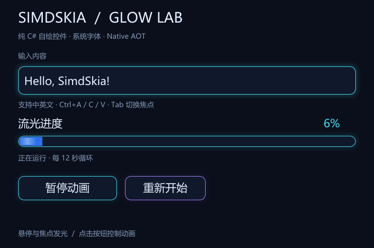

# 发光控件 Native AOT 交付：2026-10-23

新增 [NativeControls 示例](../examples/NativeControls/README.md)：真实可编辑文本框、焦点发光、流光进度条、悬停/按下反馈按钮。支持暂停、继续和从零重新开始。窗口内容由 SimdSkia CPU 绘制，发光使用多层透明圆角形状叠加，进度使用渐变和移动亮条；不依赖 Avalonia 或原版 Skia 绘制。



## 实际 AOT 体积

Windows x64，.NET 10 Native AOT，系统微软雅黑，不附带字体。完整部署包含许可证、不包含 PDB；ZIP 为这些部署文件的压缩包。

| 项目 | 字节 | MiB |
|---|---:|---:|
| EXE | 1,408,512 | 1.343 |
| 完整部署 | 1,422,263 | 1.356 |
| ZIP | 709,605 | 0.677 |

比此前仅有图形和中英文的最小 EXE（1,374,720 字节）增加 **33,792 字节，约 33 KiB**。生成普通 EXE，没有压壳。采用精简全球化/诊断配置，取舍与[最小发布报告](NATIVE-WINDOW-MINIMUM-2026-10-23.md)相同。本次没有进行持续吞吐、CPU 或内存基准；30 ms 是请求重绘间隔，不是实测帧率。

## 验证

22 项编辑模型检查通过，覆盖选区替换、中文、Unicode 边界、删除、长度限制、无效字符与单行粘贴规范化。实际 AOT 窗口验证通过：

- 进度和流光随时间变化；暂停后进度区域像素保持不变，继续后恢复，重置后回到起点。
- 英文输入、光标左移和退格的结果与直接输入目标文字的像素相同；提交中文字符消息后实际画面更新。
- 按钮悬停和按下画面不同，窗口可以调整大小并正常关闭。
- GUI PE 无 CLR header；实际模块没有 CoreCLR/JIT、Avalonia、SkiaSharp 或 HarfBuzz。
- 从不带 PDB 的部署目录运行验证，保存部署文件 SHA-256、模块与截图。[原始结果](evidence/native-controls-2026-10-23.json)

剪贴板及系统 IME 候选定位已接入；自动化测试没有修改用户剪贴板，也不代表所有输入法预编辑/选词流程都经过验证。此例面向基本中英文单行输入，没有完整的编辑器、无障碍、多行或复杂脚本排版功能。

## 运行

本机成品：`artifacts/native-controls-aot/portable/NativeControls.exe`；可分发 ZIP：`artifacts/native-controls-aot/native-controls-aot.zip`。

```powershell
dotnet publish examples/NativeControls/NativeControls.csproj -c Release -o artifacts/native-controls-aot/final
dotnet run --project tests/NativeControls -c Release
python tools/test-native-controls.py
```

源码、快捷键和工具链要求见[示例说明](../examples/NativeControls/README.md)。
