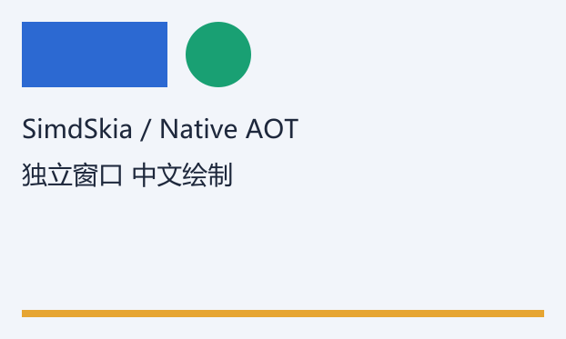

# 独立 SimdSkia 窗口的 Native AOT 体积：2026-10-23

这是首次测量的历史快照。后续已实现[更小的发布配置](NATIVE-WINDOW-MINIMUM-2026-10-23.md)：纯图形 EXE 1.172 MiB、中英文 1.311 MiB。下文保留首次产物的原始数据。

**不依赖 Avalonia 的简单自绘窗口，实际部署约 1.87 MiB；加入系统中文字体绘制后约 1.94 MiB。** 两个发布程序都已在真实 Windows 桌面运行并完成像素、窗口调整大小及点击检查，数字来自发布文件，未从 NuGet 包大小估算。

[示例与构建命令](../examples/NativeWindow/README.md) · [验证脚本](../tools/test-native-window-aot.py) · [原始证据和 SHA-256](evidence/native-window-aot-2026-10-23.json)

## 环境和功能范围

Windows 11 10.0.26300、x64、.NET SDK 10.0.402 / Native AOT runtime 10.0.13。渲染库来自 `cef51cf2de2891b589a20f5352cf602868c99d91`，本次没有修改引擎实现；新增示例和脚本的哈希单独记录。

Win32 系统 API 创建可移动、可缩放和可关闭的窗口，处理鼠标点击。窗口内容由 SimdSkia 的 C# CPU 实现绘制：浅色背景、矩形、抗锯齿圆、底部色条，以及文字版的英文和中文。GDI `StretchDIBits` 只复制完成的 BGRA 帧，不调用 GDI 绘制图形或客户端文字。原生调用限于 Windows 自带的窗口、呈现和运行时系统服务，不携带第三方原生绘图库。

文字版读取系统 `%WINDIR%\Fonts\msyh.ttc`，没有复制或内嵌字体。发布设置为 Release / win-x64 / self-contained / Native AOT，不强制 AVX2。首次配置曾写 `IlcOptimizationPreference=Size`，后续核对本机 .NET 10 的 targets 和实际 `.ilc.rsp` 发现它未生效，当时使用编译器默认的平衡优化；当前已改为有效的 `OptimizationPreference=Size`。首次产物没有 UPX、二进制补丁或关闭全球化；两版都保留验证代码。

## 实测大小

MiB = 1,048,576 字节。完整部署包含 EXE 和随项目复制的许可证；调试符号 PDB 单列，不计入运行所需文件。ZIP 为这些部署文件的 DEFLATE level 9 压缩包，不能当作解压后磁盘大小。

| 示例 | EXE 字节 | EXE MiB | 完整部署 MiB | ZIP MiB |
|---|---:|---:|---:|---:|
| 纯图形窗口 | 1,944,576 | 1.85 | 1.87 | 0.86 |
| 图形 + 中英文文字 | 2,021,888 | 1.93 | 1.94 | 0.89 |

加入中英文绘制后，EXE 增加 **77,312 字节（约 75.5 KiB）**；系统已有的微软雅黑文件不计为应用分发文件。两种部署目录均没有额外 DLL、.NET 运行时目录或字体文件。PDB 合计分别为 9,980,940 和 10,267,660 字节，仍保留在原始 publish 输出供调试。

此前带 Fluent 控件的 Avalonia AOT 示例是 SimdSkia **26.99 MiB**、原版 **38.33 MiB**，见[此前报告](STARTUP-ROUND7-2026-10-22.md#实际-native-aot-启动)。它们包含的控件、宿主、主题和依赖与本示例不同，不能把大小下降理解为同功能替换后的节省。本示例没有 Avalonia 的控件、布局、绑定、无障碍、输入法编辑控件，也没有启用 GPU。

## 实际运行验证

脚本从不含调试符号的部署目录运行两个 EXE，均正常退出，检查全部通过：

- GUI PE 子系统为 Windows，EXE 没有 CLR/IL header；运行时不支持动态代码，进程模块中没有 CoreCLR/JIT、SkiaSharp、HarfBuzz 或 Avalonia。
- 每版实际呈现并验证 3 帧：初始客户区 **622×373**，调整大小后 **762×453**，随后发送鼠标点击消息使矩形由蓝变绿。每帧同时核对 SimdSkia 缓冲和窗口 DC 的背景、矩形与圆心像素。
- 独立读取 BMP 检查像素及调整大小后的结果。圆边缘包含 **35 种颜色**，确认抗锯齿覆盖参与了绘制；文字版检查中文字符字形存在且中文区域有 **2,817 个非背景像素**，纯图形版同一区域为零。
- 验证 ZIP 完整性及每个部署文件的 SHA-256。构建日志没有编译、裁剪或 AOT 警告。

下图是文字版初次绘制的客户端缓冲快照，不包含系统标题栏：



本次只测发布体积和功能运行；没有测持续吞吐、CPU、内存或启动白屏时长，也不把此示例当成跨平台窗口框架。

## 复现

```powershell
python tools/test-native-window-aot.py
```

直接运行文字版：`artifacts/native-window-aot/portable-text/NativeWindow.exe`。其他输出和分别构建两版的命令见[示例说明](../examples/NativeWindow/README.md)。
