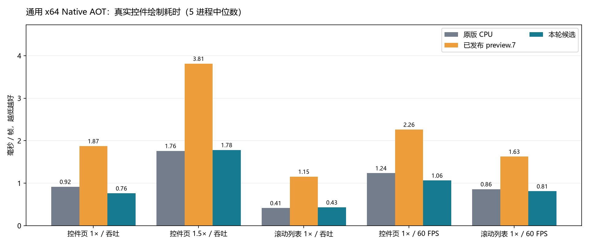
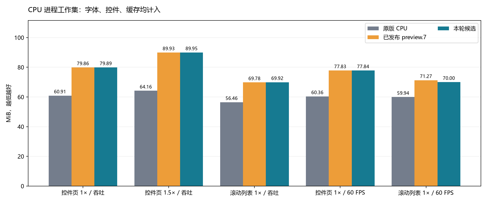
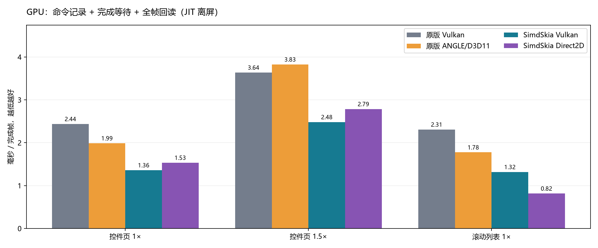
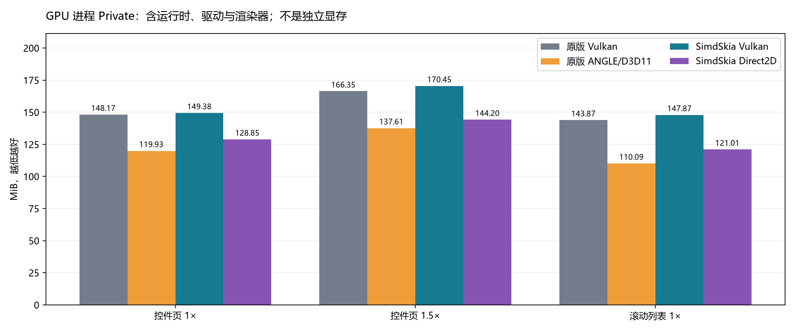

# 通用 x64、Vulkan 与 Direct2D 追平验收：2026-10-27

**完整验收：未满足，画质失败记录保留。** 本报告保留测量时的全部门槛与原始结果。2026-10-27 用户了解当前限制后，授权将这些优化作为 preview.8 发布并重写文章；此发布决定不将失败验收改为通过。公开状态见 [发布记录](NUGET-PREVIEW.md)。

用户要求：每个后端整体至少持平，单个验收场景最多慢 10%。本轮使用各场景耗时比的几何平均数，要求不超过 1.00；每个场景不超过 1.10。CPU 吞吐和包含 60 FPS 的全部场景均检查。画质、功能及资源生命周期必须同时合格，不用更低画质换速度。

## 环境与口径

- Windows 11 10.0.26300，Core i7-8700K（6 核 / 12 线程）、31.93 GiB RAM、GeForce GTX 1050 Ti。
- Avalonia 12.1.4、原版 SkiaSharp 3.119.4、HarfBuzzSharp 8.3.1.3；同一份 Fluent 控件树和 ZCOOLXiaoWei 字体，字体 SHA-256 在逐进程证据中。
- CPU：.NET 10.0.13 Native AOT，通用 x64，SSE2 可用、AVX2 不可用。核实最终 PE 和进程模块，没有把 JIT 或 v3 二进制当成通用 AOT。原版原生库保留其正常指令集分派。
- CPU 75 个串行进程：每例预热 2 秒、采样 5 秒、5 次独立进程。GPU 36 个串行进程：预热 3 秒、采样 5 秒、3 次。逐轮轮换后端顺序；正式采样期间没有并行构建、分析或跑其他测试。
- 原版 CPU 保留默认逐绘制透明度策略，SimdSkia 保留完整组透明度语义；不将两者说成完全相同实现。帧捕获验证其现存视觉差距。
- GPU 为 .NET 10 JIT 的真实 Avalonia 控件**离屏完成帧和回读**，不是 Native AOT、交换链呈现、显示器帧率或显存用量。比较原版 Vulkan 与硬件 ANGLE/D3D11；每例取较快原版作为速度门槛。生产路径中的 C# 字形缓存、软件图层和回退开销照常计入。
- CPU% 为总进程 CPU 时间除以墙钟时间及 12 个逻辑处理器。吞吐测试会尽量占满一个核，不能仅凭 CPU% 判断谁效率更高。另列独立 QueryProcessCycleTime 周期/帧；周期不可直接换算 CPU 时间。Windows 的短时 CPU 时间存在调度记账/采样波动，60 FPS 同时参考周期和逐帧耗时，不将偶发 0 当作零开销。
- WS 为工作集，Private 为私有提交内存；不把托管 GC 保留量与原版的全部原生内存比较。分配为托管分配，不代表原版没有原生分配。GPU 内存采用外部 25 ms 采样中位数，CPU 表采用工作区原始测量结束时数据。

## CPU：耗时、CPU 与内存



| 场景 | 原版 ms | preview.7 ms | 候选 ms | 候选/原版 | 对 preview.7 耗时减少 | 候选进程间范围 ms |
|---|---:|---:|---:|---:|---:|---:|
| 控件页 1× / 吞吐 | 0.9159 | 1.8722 | 0.7611 | 0.831× | 59.3% | 0.7500–0.8224 |
| 控件页 1.5× / 吞吐 | 1.7599 | 3.8125 | 1.7803 | 1.012× | 53.3% | 1.7092–1.8116 |
| 滚动列表 1× / 吞吐 | 0.4142 | 1.1543 | 0.4300 | 1.038× | 62.7% | 0.4263–0.4526 |
| 控件页 1× / 60 FPS | 1.2355 | 2.2607 | 1.0626 | 0.860× | 53.0% | 1.0190–1.1197 |
| 滚动列表 1× / 60 FPS | 0.8591 | 1.6252 | 0.8092 | 0.942× | 50.2% | 0.7632–0.9923 |

吞吐综合耗时比 **0.9557**，全部场景综合 **0.9330**，最慢场景比 **1.0383**。CPU 速度门槛：**通过**。每帧、P95、CPU 与内存不混成一个评分。

| 场景 | 实现 | P95 ms | CPU ms/帧 | 整机 CPU% | 百万周期/帧 | WS MiB | Private MiB | 托管分配 KiB/帧 | GC 后托管 MiB |
|---|---|---:|---:|---:|---:|---:|---:|---:|---:|
| 控件页 1× / 吞吐 | 原版 CPU | 1.048 | 0.916 | 8.31 | 3.378 | 60.91 | 36.40 | 7.09 | 2.60 |
| 控件页 1× / 吞吐 | 已发布 preview.7 | 2.114 | 1.866 | 8.33 | 6.900 | 79.86 | 59.88 | 5.65 | 21.96 |
| 控件页 1× / 吞吐 | 本轮候选 | 0.884 | 0.761 | 8.33 | 2.804 | 79.89 | 59.96 | 5.37 | 21.96 |
| 控件页 1.5× / 吞吐 | 原版 CPU | 2.225 | 1.760 | 8.31 | 6.480 | 64.16 | 39.93 | 7.09 | 2.60 |
| 控件页 1.5× / 吞吐 | 已发布 preview.7 | 4.256 | 3.775 | 8.25 | 14.048 | 89.93 | 69.96 | 5.66 | 32.08 |
| 控件页 1.5× / 吞吐 | 本轮候选 | 2.289 | 1.775 | 8.31 | 6.541 | 89.95 | 69.99 | 5.37 | 32.08 |
| 滚动列表 1× / 吞吐 | 原版 CPU | 0.521 | 0.413 | 8.31 | 1.527 | 56.46 | 34.82 | 6.60 | 1.73 |
| 滚动列表 1× / 吞吐 | 已发布 preview.7 | 1.282 | 1.151 | 8.31 | 4.249 | 69.78 | 52.64 | 2.48 | 15.73 |
| 滚动列表 1× / 吞吐 | 本轮候选 | 0.503 | 0.429 | 8.31 | 1.582 | 69.92 | 52.71 | 2.48 | 15.73 |
| 控件页 1× / 60 FPS | 原版 CPU | 1.686 | 1.198 | 0.60 | 4.958 | 60.36 | 35.91 | 7.71 | 2.60 |
| 控件页 1× / 60 FPS | 已发布 preview.7 | 2.417 | 2.969 | 1.48 | 8.708 | 77.83 | 57.83 | 6.28 | 21.96 |
| 控件页 1× / 60 FPS | 本轮候选 | 1.348 | 0.625 | 0.31 | 4.341 | 77.84 | 57.85 | 6.04 | 21.96 |
| 滚动列表 1× / 60 FPS | 原版 CPU | 1.282 | 4.948 | 2.47 | 14.438 | 59.94 | 38.48 | 12.87 | 1.73 |
| 滚动列表 1× / 60 FPS | 已发布 preview.7 | 2.213 | 5.104 | 2.55 | 17.040 | 71.27 | 54.01 | 155.14 | 16.28 |
| 滚动列表 1× / 60 FPS | 本轮候选 | 1.246 | 3.594 | 1.79 | 8.993 | 70.00 | 52.79 | 28.05 | 16.73 |



## GPU：两个原版后端均对照



| 场景 | 后端 | 完成帧 ms | 记录 ms | 完成/回读 ms | P95 ms | CPU ms/帧 | CPU% | WS MiB | Private MiB | 分配 KiB/帧 |
|---|---|---:|---:|---:|---:|---:|---:|---:|---:|---:|
| 控件页 1× | 原版 Vulkan | 2.4374 | 0.2466 | 2.1908 | 2.890 | 1.774 | 6.15 | 148.56 | 148.17 | 5.13 |
| 控件页 1× | 原版 ANGLE/D3D11 | 1.9878 | 0.2431 | 1.7461 | 2.315 | 2.249 | 9.42 | 139.56 | 119.93 | 5.13 |
| 控件页 1× | SimdSkia Vulkan | 1.3587 | 0.2465 | 1.1102 | 1.548 | 0.616 | 3.83 | 153.80 | 149.38 | 7.76 |
| 控件页 1× | SimdSkia Direct2D | 1.5340 | 0.4032 | 1.1308 | 1.817 | 2.041 | 11.01 | 145.71 | 128.85 | 5.57 |
| 控件页 1.5× | 原版 Vulkan | 3.6374 | 0.3028 | 3.3361 | 4.043 | 2.923 | 6.69 | 160.72 | 166.35 | 5.13 |
| 控件页 1.5× | 原版 ANGLE/D3D11 | 3.8261 | 0.3621 | 3.4641 | 4.484 | 4.085 | 8.88 | 151.48 | 137.61 | 5.13 |
| 控件页 1.5× | SimdSkia Vulkan | 2.4821 | 0.4083 | 2.0724 | 2.789 | 1.109 | 3.72 | 167.79 | 170.45 | 7.93 |
| 控件页 1.5× | SimdSkia Direct2D | 2.7861 | 0.5936 | 2.2047 | 3.473 | 3.432 | 9.97 | 155.66 | 144.20 | 5.57 |
| 滚动列表 1× | 原版 Vulkan | 2.3085 | 0.1795 | 2.1289 | 2.769 | 1.691 | 5.96 | 138.72 | 143.87 | 4.17 |
| 滚动列表 1× | 原版 ANGLE/D3D11 | 1.7753 | 0.1820 | 1.5933 | 2.265 | 1.996 | 9.34 | 124.59 | 110.09 | 4.17 |
| 滚动列表 1× | SimdSkia Vulkan | 1.3173 | 0.1124 | 1.2049 | 1.445 | 0.479 | 3.02 | 142.26 | 147.87 | 4.70 |
| 滚动列表 1× | SimdSkia Direct2D | 0.8151 | 0.1396 | 0.6772 | 1.004 | 1.185 | 12.11 | 129.89 | 121.01 | 2.43 |

逐进程的记录阶段加完成/回读阶段构成完成帧；表中各列分别取中位数，因此中位数之和可能有小幅差异。记录阶段可能包含生产后端的同步工作，不能把完成/回读列单独解读为整个 GPU 执行时间。

| 后端 | 相对每例较快原版的综合比 | 最慢场景比 | 速度门槛 |
|---|---:|---:|---|
| SimdSkia Vulkan | 0.7021 | 0.7420 | 通过 |
| SimdSkia Direct2D | 0.6474 | 0.7717 | 通过 |



## 画质与兼容性：没有随速度放宽

CPU 0/5、GPU 0/12 通过原版整页画质门槛。既定门槛仍是最大通道误差 ≤32 且 RMSE ≤2。CPU 优化前后捕获 全部相同；这只证明优化没有改变既有结果，不能证明既有结果已与原版兼容。

| CPU 场景 | 最大差 | RMSE | 结论 |
|---|---:|---:|---|
| 控件页 1× / 吞吐 | 96 | 2.4338 | 失败 |
| 控件页 1.5× / 吞吐 | 109 | 2.3196 | 失败 |
| 滚动列表 1× / 吞吐 | 92 | 3.0873 | 失败 |
| 控件页 1× / 60 FPS | 96 | 2.4338 | 失败 |
| 滚动列表 1× / 60 FPS | 92 | 3.0873 | 失败 |

GPU 各对照的误差和回退计数均保留在 [完整证据](evidence/parity-2026-10-27/results.json)，没有只选差距最小的后端。

字体调查：同一原始 TrueType 字体的 56 组原版/托管轮廓栅格只有 31 组精确一致；在**隔离诊断副本**移除字体指令后 56/56 一致。四组“保留/移除指令 × 保留/重算边界”的控制实验给出一致结论。原版和托管传入绘制的 float 字形位置完全一致，但亚像素映射/覆盖规则仍需核对。纯 C# 指令解释器原型在设计单位尺寸下达到 50/56 精确、最大误差 5，已确保解释异常显式抛出；这不是生产集成，也不能保证所有字体行为。无字体指令的合成矩形字形仍出现边缘差异，说明还存在独立的覆盖率问题；原版轮廓回放、改采样网格、移除字体指令均仅是诊断，未混入产品或正式性能测试。可用 `tools/diagnose-font-outlines.py` 复现四组控制实验，[控制实验数据](evidence/parity-2026-10-27/font-instruction-controls.json)保留全部 224 组结果。

SK* API 仍为 425/3235 个公共条目匹配，37 个实现类型；不承诺二进制替换或全部 SkiaSharp API。Avalonia 适配器绕过完整 SK* 公共面，实际支持范围由控件、字体、画刷、图层与平台测试共同限定。此前记录的复杂排版、更多字体格式、滤镜、阴影等缺口没有因本轮提速自动消失。

## 本轮落地的优化与回归

1. 为通用 x64 AOT 增加 SSE2 字形/图像合成及双线性采样，保留 AVX2 和标量回退；按独立原版夹具维持精确舍入、预乘 Alpha、尾部和 stride。
2. 连续白色/透明缓冲和整宽矩形使用连续填充；16–256 KiB 的通用 x64 不同色通道色块使用初始化后逐倍复制，大缓冲保持原填充。白底黑字检查实际像素后使用精确简化公式，短尾直接合成，掩码裁剪与模式判断移出行循环。
3. opacity=1 未产生实际图层时减少脏区计算；真实嵌套图层、裁剪、清屏、透明度和 Dispose 校验保留。
4. 字形串缓存按不可变身份先查最近变换，命中避免大键复制、链表重排与 GC 引用写屏障；有界第二次机会淘汰。串缓存预算从 2 MiB 调为 4 MiB、字形预算仍 8 MiB，512 串/4096 字形上限保留，以降低多视图交替绘制反复分配；具体内存代价以上表为准。
5. 纯平移字形跳过未使用的矩阵求逆；紧密排列 framebuffer 用整块复制，带 padding 仍逐行复制。每帧光栅画布的路径、矩形和渐变缓存容器按需初始化，Dispose 释放引用，纯色矩形/文字帧不再创建未使用的字典。

完整 `tools/verify.ps1 -Reference -Gpu` 实际执行，之后另跑 Direct2D / AvaloniaGpu 集成。正常硬件 471,569 项精确检查（含字体），SSE2/完全标量各 471,557 项（未传可选字体），9,741 项真实 Avalonia 检查通过；Direct2D 344、Vulkan 内核 540、GPU 集成 12,174、GPU 文字链路 599 等通过。新增 336 组填充阈值前后、非整块尾部、格式/Alpha、padding 与哨兵行对照。最终通用 x64 的真实 Native AOT 另执行 460,050 项采样检查，AVX2/SSE4.1 均为 false，并从外部核对 PE 与已加载模块。原版画质仍失败，完整验证退出码 2；不是全绿验收。日志在本轮 artifacts 下。没有新增生产字体解释器或原生字体依赖。

## 复现与原始证据

```powershell
# 使用全新的输出目录；不要与任何其他性能测试并行
powershell -NoProfile -ExecutionPolicy Bypass -File tools/verify.ps1 -Reference -Gpu
python tools/publish-parity-candidate.py --output artifacts/parity-replay/candidate
python tools/run-cpu-parity.py --candidate artifacts/parity-replay/candidate --output artifacts/parity-replay/cpu --forks 5 --seconds 5 --warmup 2
dotnet build benchmarks/AvaloniaGpuParity/Original -c Release
dotnet build benchmarks/AvaloniaGpuParity/Managed -c Release
python tools/run-gpu-parity.py --output artifacts/parity-replay/gpu --forks 3 --seconds 5 --warmup 3
# 采样全部完成后才生成图表，不与测量并行
python tools/report-parity.py --cpu artifacts/parity-replay/cpu --gpu artifacts/parity-replay/gpu
```

本次 CPU：`artifacts/parity-2026-10-27/cpu-round13-measured`；GPU：`artifacts/parity-2026-10-27/gpu-round13-measured`。原始二进制/源文件哈希、逐进程数据、帧图、父进程采样和未通过门槛均保留。`run-cpu-parity.py` 默认还需要本机冻结的 preview.7/原版产物（见 `--baseline`），不能凭当前源码重建后假装成旧版本。图表生成器额外需要 matplotlib/numpy，不进入生产依赖。

[可携带的完整 JSON 证据](evidence/parity-2026-10-27/results.json) · [功能验证原始日志](evidence/parity-2026-10-27/validation.log.txt) · [SSE2/标量原始日志](evidence/parity-2026-10-27/scalar-sse2.log.txt) · [真实 AOT 采样与进程模块](evidence/parity-2026-10-27/sampling-aot.json)。短测和较早正式轮次保留在 `artifacts/parity-2026-10-27`，不以短测偶然过线替代最终复测，不覆盖失败数据。

本机固定场景的 CPU/Vulkan/Direct2D **速度部分已通过**。完整替换仍需修复原版文字/路径画质，继续处理高于原版的常驻内存，并在后续修复后保持速度门槛；真实窗口呈现性能也需单独比较。当前 GPU 结果不能代替真实窗口呈现验收。preview.8 按用户最新授权作为披露这些限制的实验性预览版发布；跨平台/包消费检查另见发布记录，不与完整画质验收混淆。原始 JSON 的 releaseEligible=false 描述原定完整验收门槛，保持原样。
