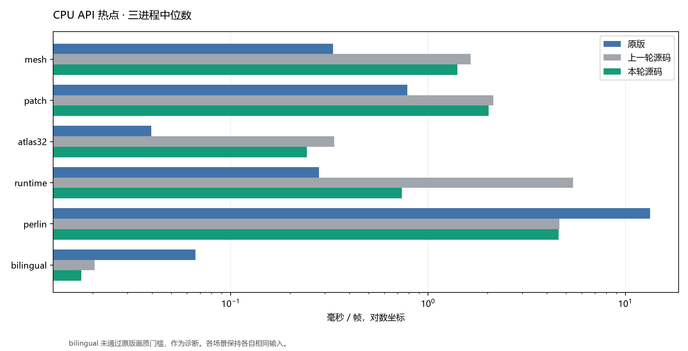
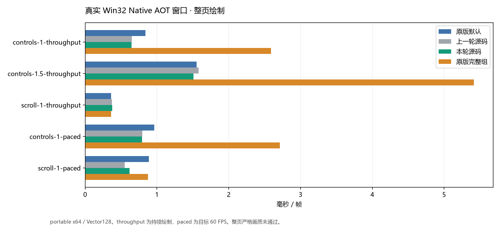
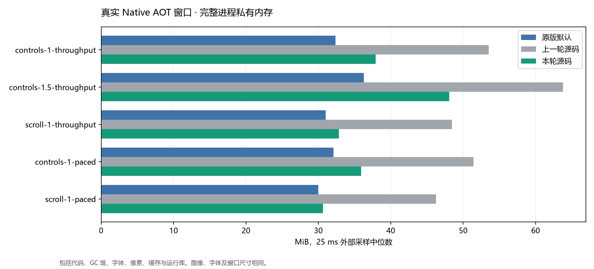
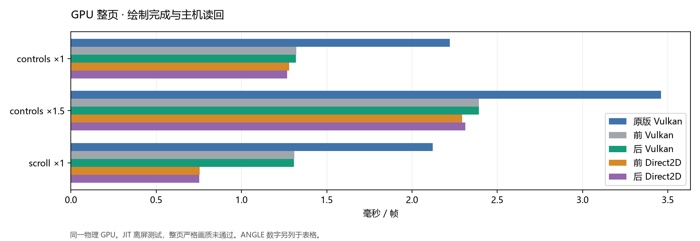

# SimdSkia 第二轮优化与原版对比（2026-11-10）

本轮继续优化上一轮未发布的工作区源码。基线为 SkiaSharp 3.119.4、Avalonia 12.1.5，构建版本基于 0.1.4。Windows x64、i7-8700K、12 逻辑处理器、GTX 1050 Ti、SDK 10.0.403、.NET 10.0.14。修改前完整 DLL 已冻结，AOT 修改前使用上一轮本机 dotnet publish 产物。各实现串行、轮换顺序运行。

本轮完成318个性能工作进程，另执行85个最终验收命令及Native AOT专项测试。完整逐进程结果、压缩原始像素和源码/二进制哈希已归档。[本轮证据](evidence/performance-2026-11-10-round2/)

## 实施内容

- 运行时效果共享有界数值执行计划，在绑定时快照 uniform，移除逐像素 AST 遍历和大 Value 结构复制。可向量化的数值指令按像素批量执行，其余现有语言特性继续使用类型化解释器。更新 uniform 复用计划，保留绑定独立性及并发安全。

- 网格预计算颜色和纹理坐标差分，批量传播坐标及材质采样。最近邻图像着色器在一批样本内复用行访问，并在精确整数区间采用等价边界计算，保留大坐标回退。

- Avalonia 的普通不透明作用域使用不含托管引用的轻量记录，真实图层另存状态。保留错误配对、嵌套、透明度、裁剪及资源回收检查。

- 已注册字体重新以可寻址流打开时，先流式校验再复用字体，减少启动时完整 MemoryStream 大对象缓冲。外部新字体仍保留独立字节快照，非寻址流另行验证。

- 字形/路径覆盖率的黑色文本和全不透明 AVX2 通道减少重复计算。标量、SSE2、AVX2 路径分别回归。

坐标向量收集和仿射分支候选初测出现性能回退，已撤回。PNG 单次解压候选需要访问底包内部行接口，编译验证失败后撤回，严格验证和颜色处理保留在最终管线中。

## CPU 公共 API

256×192，相同 CJK 字体及场景，每实现三个独立进程，每场景 0.5 s 预热、0.8 s 测量。CPU ms/帧便于比较完成同等工作需要的处理器时间。持续单线程满负荷时，机器 CPU 百分比接近 8.3%。



| 场景 | 原版 ms | 前 ms | 后 ms | 变化 | 后/原版 | CPU ms 前→后 | 原版画质 |
| --- | --- | --- | --- | --- | --- | --- | --- |
| mesh | 0.330 | 1.645 | 1.409 | -14.3% | 4.26× | 1.650→1.428 | 通过 |
| patch | 0.784 | 2.145 | 2.029 | -5.4% | 2.59× | 2.131→2.017 | 通过 |
| atlas32 | 0.040 | 0.335 | 0.243 | -27.5% | 6.13× | 0.334→0.242 | 通过 |
| runtime | 0.280 | 5.435 | 0.736 | -86.5% | 2.63× | 5.595→0.733 | 通过 |
| perlin | 13.362 | 4.621 | 4.585 | -0.8% | 0.34× | 4.670→4.554 | 通过 |
| bilingual | 0.066 | 0.020 | 0.018 | -14.1% | 0.26× | 0.020→0.017 | 失败，诊断 |

| 场景 | WS MiB 原版 / 前 / 后 | Private MiB 原版 / 前 / 后 | 分配 B/帧 前→后 |
| --- | --- | --- | --- |
| mesh | 27.9 / 29.5 / 29.5 | 9.0 / 10.2 / 10.2 | 2.0→1.7 |
| patch | 27.4 / 31.2 / 31.2 | 7.6 / 10.8 / 10.8 | 2.5→2.4 |
| atlas32 | 30.6 / 33.1 / 33.0 | 10.0 / 12.0 / 12.0 | 312.4→312.3 |
| runtime | 32.2 / 34.9 / 35.0 | 10.7 / 13.0 / 13.0 | 4.1→0.6 |
| perlin | 29.7 / 35.0 / 35.1 | 8.0 / 13.0 / 13.0 | 3.4→3.4 |
| bilingual | 39.1 / 38.4 / 38.5 | 16.4 / 14.7 / 14.7 | 0.0→0.0 |

## 真实 Native AOT 窗口

每例四种实现各三个真实窗口进程，5 s 测量、2 s 预热。普通 x64 / Vector128，不提高 CPU 最低指令集。原版默认和强制完整透明度组分别列出。所有修改前后固定帧逐字节比较，原版使用 max=32、RMSE=2 的既有整页门槛。



| 页面 / 模式 | 原版默认 ms | 原版完整组 ms | 前 ms | 后 ms | 变化 | 后/原版默认 |
| --- | --- | --- | --- | --- | --- | --- |
| controls-1-throughput | 0.839 | 2.590 | 0.650 | 0.647 | -0.4% | 0.77× |
| controls-1.5-throughput | 1.552 | 5.413 | 1.580 | 1.509 | -4.5% | 0.97× |
| scroll-1-throughput | 0.361 | 0.361 | 0.372 | 0.376 | +1.0% | 1.04× |
| controls-1-paced | 0.963 | 2.711 | 0.797 | 0.794 | -0.4% | 0.82× |
| scroll-1-paced | 0.886 | 0.875 | 0.552 | 0.619 | +12.0% | 0.70× |



| 页面 / 模式 | CPU% 原版默认 / 前 / 后 | WS MiB 原版 / 前 / 后 | Private MiB 原版 / 前 / 后 | 分配 B/帧 前→后 |
| --- | --- | --- | --- | --- |
| controls-1-throughput | 8.31 / 8.33 / 8.33 | 57.9 / 75.6 / 61.5 | 32.4 / 53.5 / 37.9 | 5629→5629 |
| controls-1.5-throughput | 8.33 / 8.33 / 8.31 | 61.7 / 85.5 / 71.4 | 36.3 / 63.8 / 48.1 | 5630→5629 |
| scroll-1-throughput | 8.33 / 8.31 / 8.33 | 54.3 / 68.1 / 54.1 | 31.0 / 48.5 / 32.8 | 2558→2558 |
| controls-1-paced | 0.47 / 0.47 / 0.49 | 57.6 / 73.5 / 59.4 | 32.1 / 51.4 / 35.9 | 6348→6345 |
| scroll-1-paced | 1.40 / 0.81 / 0.73 | 53.2 / 64.0 / 49.9 | 30.0 / 46.3 / 30.6 | 6485→6356 |

内存为完整进程外部采样。托管分配量不包含原生 malloc。持续绘制和目标 60 FPS 两种负荷分别比较。

### 60 FPS 滚动页加长复测

主矩阵三轮中，本轮滚动页 paced 耗时相对修改前上升。追加每实现六个独立进程，3 s 预热、7.5 s 测量，保留两组完整记录。以下为加长复测，初轮回退原因尚未定位。

| 实现 | 绘制 ms/帧 | 完整 CPU ms/帧 | 机器 CPU% | Private MiB |
| --- | --- | --- | --- | --- |
| simd | 0.634 | 1.684 | 0.84 | 31.0 |
| original-default | 0.831 | 3.056 | 1.53 | 30.2 |
| original-full | 0.850 | 3.073 | 1.53 | 30.2 |
| before | 0.636 | 1.701 | 0.85 | 46.5 |

### 系统字体补测

上面的显著内存下降来自相同字体同时经 FontFiles 注册、再经 EmbeddedFontCollection 打开的路径。另用系统 Microsoft YaHei UI 运行 JIT CPU 离屏控件页，1000×720，2.5 s 预热、6000 帧测量、每实现三个进程。五个实际字体表的哈希在原版及修改前后逐项核对，固定帧在修改前后精确比较。此处的进程内存为测量结束快照。

| 实现 | 绘制 ms/帧 | CPU ms/帧 | 机器 CPU% | WS MiB | Private MiB | GC 后托管 MiB |
| --- | --- | --- | --- | --- | --- | --- |
| original-default | 0.861 | 0.859 | 8.32 | 84.6 | 41.4 | 2.6 |
| original-full | 3.345 | 3.346 | 8.32 | 73.6 | 31.0 | 2.6 |
| before | 0.571 | 0.576 | 8.36 | 94.5 | 49.8 | 14.8 |
| current | 0.551 | 0.557 | 8.36 | 94.5 | 49.8 | 14.7 |

固定字体复用与系统字体的结果分别列出，具体应用的内存收益取决于其字体加载路径。

## Vulkan 与 Direct2D

三进程，每例 3 s 预热、5 s 测量。GPU 完成时间包括绘制、同步等待和 BGRA8888 主机读回。此处为 JIT 离屏场景，与上面的 AOT 软件呈现分别列出。



| 页面 | 后端 | 原版 Vulkan ms | 原版 ANGLE ms | 前 ms | 后 ms | 变化 | CPU ms 前→后 | Private MiB 前→后 |
| --- | --- | --- | --- | --- | --- | --- | --- | --- |
| controls ×1 | vulkan | 2.221 | 2.136 | 1.321 | 1.320 | -0.1% | 0.572→0.573 | 152.0→140.3 |
| controls ×1 | direct2d | 2.221 | 2.136 | 1.280 | 1.267 | -1.0% | 1.712→1.746 | 128.2→117.4 |
| controls ×1.5 | vulkan | 3.460 | 4.091 | 2.392 | 2.392 | -0.0% | 1.008→1.016 | 169.3→165.4 |
| controls ×1.5 | direct2d | 3.460 | 4.091 | 2.295 | 2.313 | +0.8% | 2.825→2.899 | 144.2→140.5 |
| scroll ×1 | vulkan | 2.121 | 1.815 | 1.309 | 1.308 | -0.1% | 0.438→0.425 | 146.9→130.6 |
| scroll ×1 | direct2d | 2.121 | 1.815 | 0.756 | 0.752 | -0.5% | 1.078→1.099 | 123.3→107.1 |

| 页面 | 后端 | 机器 CPU% 前→后 | WS MiB 前→后 | Private MiB 原版 VK / ANGLE / 后 | 分配 B/帧 后 |
| --- | --- | --- | --- | --- | --- |
| controls ×1 | vulkan | 3.62→3.62 | 155.5→141.4 | 149.6 / 120.4 / 140.3 | 5850 |
| controls ×1 | direct2d | 11.12→11.25 | 145.1→131.6 | 149.6 / 120.4 / 117.4 | 5849 |
| controls ×1.5 | vulkan | 3.51→3.54 | 167.0→160.4 | 165.6 / 138.1 / 165.4 | 5849 |
| controls ×1.5 | direct2d | 10.26→10.34 | 155.9→148.6 | 165.6 / 138.1 / 140.5 | 5850 |
| scroll ×1 | vulkan | 2.79→2.71 | 141.9→127.9 | 144.0 / 109.6 / 130.6 | 2505 |
| scroll ×1 | direct2d | 11.95→12.16 | 130.9→117.0 | 144.0 / 109.6 / 107.1 | 2504 |

GPU 整页严格画质结果在测试报告中列出，失败场景的速度作为诊断。实际原生 GPU 窗口、资源失效、软件回退和线程约束由硬件集成测试覆盖。

### Vulkan 基础工作负荷

| 场景 / 尺寸 | 原版 ms | 前 ms | 后 ms | 变化 | 原版画质 |
| --- | --- | --- | --- | --- | --- |
| blend / 256×256 | 0.219 | 0.256 | 0.260 | +1.7% | 通过 |
| blend / 1024×768 | 2.400 | 1.423 | 1.425 | +0.1% | 通过 |
| curve-changing / 256×256 | 0.203 | 0.215 | 0.217 | +1.3% | 失败，max 45 / 32 |
| curve-changing / 1024×768 | 2.145 | 1.365 | 1.365 | +0.0% | 失败，max 44 / 32 |
| chinese-changing / 256×256 | 0.274 | 0.142 | 0.144 | +1.9% | 失败，max 188 / 32 |
| chinese-changing / 1024×768 | 2.087 | 0.747 | 0.750 | +0.4% | 失败，max 185 / 32 |

## CPU 基础绘制与编解码

CPU 基础绘制每实现三个独立进程、每场景 0.5 s 预热、五批各目标 0.1 s，TieredCompilation 与 ReadyToRun 关闭。当前标量与 SIMD 另行检查。编解码为同一 1920×1080 输入，统一显式 RGBA8888/Unpremul 输出。

| 场景 / 尺寸 | 原版 ms | 前 ms | 后 ms | 变化 | 后/原版 | 原版画质 |
| --- | --- | --- | --- | --- | --- | --- |
| gradient / 256×256 | 0.176 | 0.012 | 0.011 | -2.4% | 0.06× | 通过 |
| png-encode / 1024×768 | 27.743 | 27.106 | 27.253 | +0.5% | 0.98× | 通过 |
| curve-aa / 1024×768 | 0.201 | 0.186 | 0.179 | -3.7% | 0.89× | 失败，max 63 / 32 |
| png-encode / 256×256 | 2.590 | 2.624 | 2.665 | +1.6% | 1.03× | 通过 |
| image / 256×256 | 0.232 | 0.139 | 0.140 | +0.2% | 0.60× | 失败，max 253 / 0 |
| blend / 1024×768 | 9.475 | 1.622 | 1.636 | +0.9% | 0.17× | 失败，max 2 / 1 |
| clear / 256×256 | 0.005 | 0.005 | 0.005 | -0.7% | 0.98× | 通过 |
| chinese / 256×256 | 0.064 | 0.029 | 0.025 | -13.7% | 0.38× | 失败，max 188 / 32 |
| stroke / 1024×768 | 0.076 | 0.105 | 0.107 | +1.2% | 1.41× | 通过 |
| image / 1024×768 | 2.964 | 0.767 | 0.762 | -0.7% | 0.26× | 失败，max 249 / 0 |
| evenodd / 1024×768 | 0.142 | 0.141 | 0.141 | -0.3% | 0.99× | 通过 |
| rectangles / 1024×768 | 0.208 | 0.243 | 0.243 | +0.0% | 1.17× | 通过 |
| chinese / 1024×768 | 0.210 | 0.123 | 0.112 | -8.7% | 0.53× | 失败，max 185 / 32 |
| blend / 256×256 | 0.874 | 0.240 | 0.241 | +0.3% | 0.28× | 失败，max 2 / 1 |
| rect-aa / 1024×768 | 0.197 | 0.169 | 0.175 | +3.2% | 0.89× | 通过 |
| gradient / 1024×768 | 2.096 | 0.148 | 0.146 | -1.6% | 0.07× | 通过 |
| curve-aa / 256×256 | 0.039 | 0.033 | 0.032 | -3.6% | 0.81× | 失败，max 57 / 32 |
| rectangles / 256×256 | 0.036 | 0.053 | 0.053 | -0.1% | 1.47× | 通过 |
| evenodd / 256×256 | 0.013 | 0.016 | 0.016 | -1.7% | 1.18× | 通过 |
| stroke / 256×256 | 0.007 | 0.017 | 0.017 | -0.5% | 2.37× | 通过 |
| clear / 1024×768 | 0.072 | 0.065 | 0.067 | +2.7% | 0.93× | 通过 |
| rect-aa / 256×256 | 0.022 | 0.024 | 0.023 | -2.0% | 1.07× | 通过 |
| png-decode / 1024×768 | 3.425 | 3.521 | 3.517 | -0.1% | 1.03× | 通过 |
| png-decode / 256×256 | 0.279 | 0.385 | 0.392 | +1.8% | 1.41× | 通过 |

| 内容 / 操作 | 原版 ms | 前 ms | 后 ms | 变化 | 后/原版 | 分配 KiB 后 |
| --- | --- | --- | --- | --- | --- | --- |
| ui / decode-jpeg444 | 11.497 | 4.238 | 4.266 | +0.7% | 0.37× | 2.17 |
| ui / decode-jpeg420 | 9.698 | 3.694 | 3.739 | +1.2% | 0.39× | 2.17 |
| ui / decode-png | 2.815 | 2.164 | 2.153 | -0.5% | 0.76× | 8.90 |
| ui / encode-jpeg444 | 30.197 | 7.383 | 7.250 | -1.8% | 0.24× | 386.33 |
| ui / encode-png | 59.890 | 10.669 | 10.296 | -3.5% | 0.17× | 44.04 |
| texture / decode-jpeg444 | 19.600 | 9.129 | 9.104 | -0.3% | 0.46× | 2.17 |
| texture / decode-jpeg420 | 17.721 | 8.070 | 8.210 | +1.7% | 0.46× | 2.17 |
| texture / decode-png | 20.328 | 42.055 | 41.390 | -1.6% | 2.04× | 9.09 |
| texture / encode-jpeg444 | 57.275 | 9.443 | 9.883 | +4.7% | 0.17× | 1465.28 |
| texture / encode-png | 439.214 | 158.431 | 156.477 | -1.2% | 0.36× | 13399.05 |

PNG/JPEG 编码策略与输出大小详见原始记录。JPEG 严格编码误差和纹理 PNG 解码属于剩余差距。

## 16 张同时存活图片

| 尺寸 | 原版 Private MiB | 前 MiB | 后 MiB | 后托管存活 MiB |
| --- | --- | --- | --- | --- |
| 256×256 | 11.8 | 14.9 | 14.9 | 4.3 |
| 1024×768 | 56.2 | 60.0 | 59.9 | 48.4 |
| 1025×1025 | 72.6 | 76.4 | 76.4 | 64.5 |
| 1920×1080 | 135.0 | 139.4 | 139.5 | 127.0 |
| 1024×768，先暖大图 | 56.5 | 64.1 | 64.2 | 52.4 |

## 构建与复测

```powershell
dotnet build SimdSkia.sln -c Release -m:1
dotnet run --project tests/RuntimeNumeric -c Release -- artifacts/runtime-numeric
python tools/run-performance-validation.py --output artifacts/validation-new
python tools/run-final-api-benchmarks.py --before <冻结目录>/Api99/Managed/Managed.dll --output artifacts/api-new
python tools/run-gpu-parity.py --before-managed <冻结目录>/AvaloniaGpuParity/Managed/Managed.exe --output artifacts/gpu-new
```

完整命令、输入和二进制哈希、逐进程 CPU/内存、原始像素及差异结果见本轮证据目录。该报告覆盖 Windows x64 实机，其他平台需要各自硬件复测。

## 同一示例的 AOT 发布体积

| 实现 | EXE MiB | 原生 DLL MiB | 字体 MiB | 运行所需 MiB | ZIP MiB |
| --- | --- | --- | --- | --- | --- |
| original | 18.70 | 12.82 | 6.02 | 41.16 | 16.35 |
| before | 24.47 | 0.00 | 6.02 | 30.66 | 13.03 |
| simd | 24.47 | 0.00 | 6.02 | 30.66 | 13.03 |

运行所需文件按 runtimeBytes 统计，调试符号单独记录于原始 sizes.json。使用相同字体及示例。

## 尚未达到的目标

CPU网格、图集、运行时效果耗时仍约为原版4.26×、6.13×、2.63×。系统字体补测的私有内存约49.8MiB，原版默认约41.4MiB、完整组约31.0MiB。固定字体AOT示例的显著内存下降有明确适用路径，整页画质和部分JPEG、图像采样差异仍待解决。整体持平且最多落后10%的目标尚未达成。
