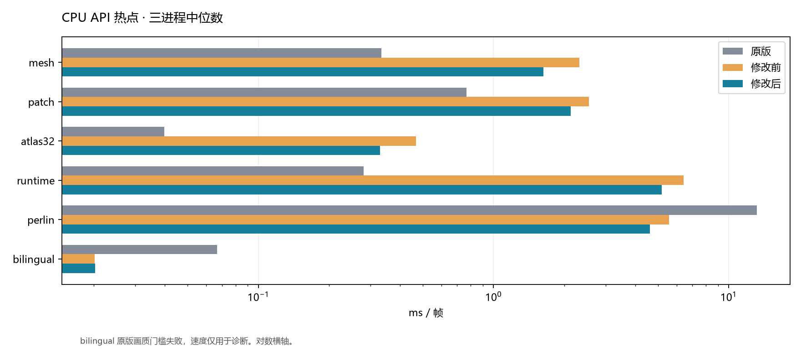
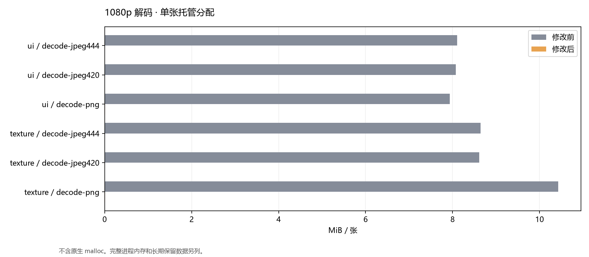
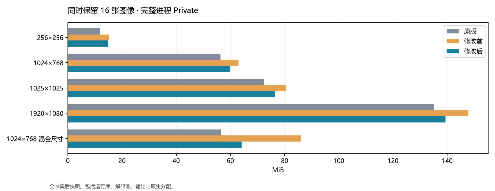
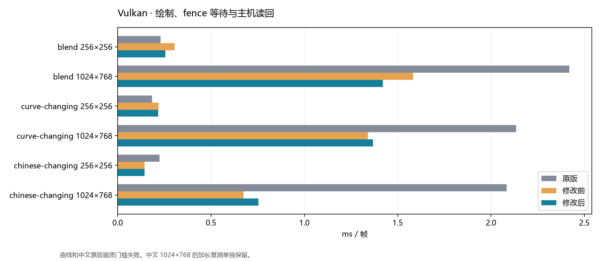
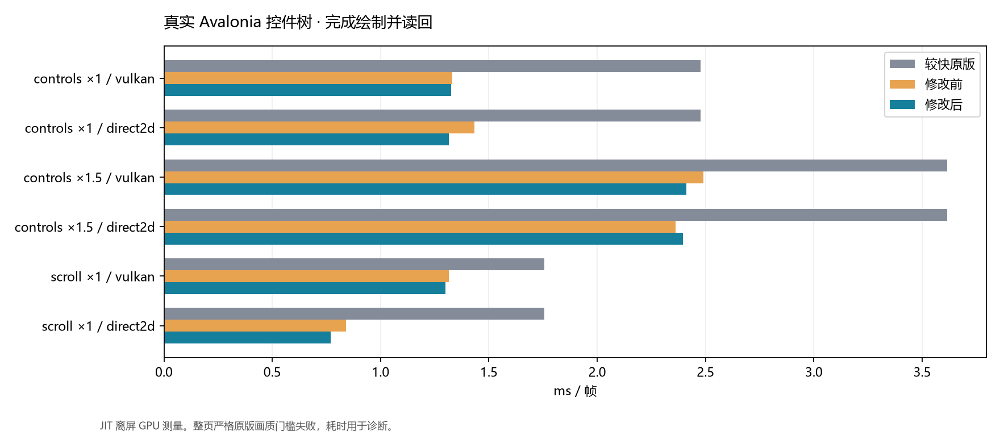
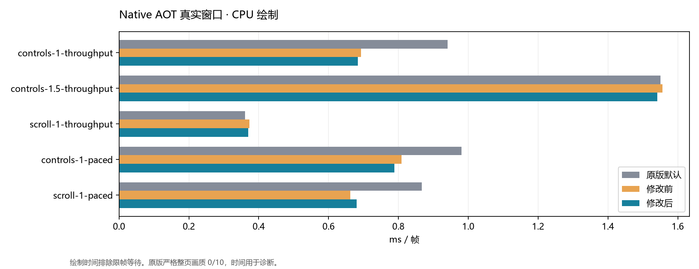
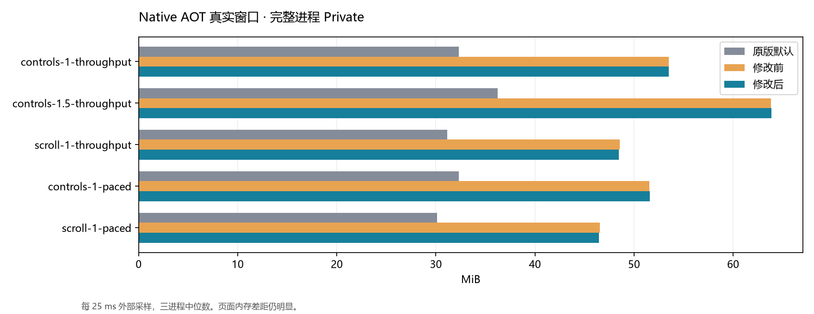

# SimdSkia 性能优化与全面复测（2026-11-10）

本批为工作区源码优化，NuGet 正式版为 0.1.4。修改前引擎冻结于 `1eceed6`，原版为 SkiaSharp 3.119.4，控件使用 Avalonia 12.1.5。Windows x64、i7-8700K / 12 逻辑处理器、GTX 1050 Ti、SDK 10.0.403、.NET 10.0.14。构建、回归与性能采集串行执行。CPU/GPU、JIT/Native AOT 分别列出。

## 实施内容

- 常量混合增加 SSE2/AVX2 通道内解包、整数除法与饱和打包路径，保留标量和其他架构回退。
- 浮点着色器按最多 128 个像素采样并批量混合，使用固定栈空间，覆盖矩形和完整覆盖率路径段。部分覆盖、其他混合模式及滤镜继续走相应管线。
- 默认位图解码的透明度扫描、预乘和 RGBA/BGRA 转换向量化。指定 RGBA/Unpremul 的临时解码可转移真实像素所有权，持续使用的 SKCodec 保持独立输出。解码池余量超过 6.25% 时生成精确尺寸的完整像素副本，限制长期保留的浪费。
- Vulkan 有序矩形提前合并矩形裁剪、预乘颜色，参数步长 48→32 字节，64 项 uniform 范围 3104→2080 字节。实际绘制仍在 GPU，预编译 SPIR-V 随库提供。Direct2D 通过真实控件页和硬件回归复测。

基准修正了两个旧的像素格式假设，双方解码均显式指定 RGBA8888/Unpremul。编解码对照程序使用相同源码，分别引用完整冻结旧模块与当前模块。初轮不完整模块回放、缺少 SKP 交叉输入的回放以及容量保护前的中间测量均排除在本报告最终数字之外。

## CPU 基础场景

每种实现 3 个独立进程，每场景 500 ms 预热、5 批×目标 100 ms。原版、修改前、当前标量、当前 SIMD 轮换串行。TieredCompilation/ReadyToRun 关闭，Server GC 关闭。帧完成同步，矩形和混合各包含 64 次绘制。下表使用当前 SIMD，24 组修改前后固定帧完全相同。

| 场景 | 尺寸 | 原版 ms | 前 ms | 后 ms | 变化 | 后/原版 | 原版像素门槛 |
| --- | --- | --- | --- | --- | --- | --- | --- |
| blend | 256×256 | 0.887 | 0.487 | 0.242 | -50.3% | 0.27× | 失败，诊断 max=2 / 1 |
| chinese | 256×256 | 0.063 | 0.028 | 0.029 | +2.6% | 0.46× | 失败，诊断 max=188 / 32 |
| clear | 256×256 | 0.005 | 0.005 | 0.005 | +1.6% | 0.99× | 通过 max=0 / 0 |
| curve-aa | 256×256 | 0.038 | 0.030 | 0.033 | +9.1% | 0.85× | 失败，诊断 max=57 / 32 |
| evenodd | 256×256 | 0.014 | 0.016 | 0.016 | -0.3% | 1.17× | 通过 max=0 / 0 |
| gradient | 256×256 | 0.175 | 0.011 | 0.011 | -0.5% | 0.06× | 通过 max=0 / 1 |
| image | 256×256 | 0.232 | 0.142 | 0.140 | -1.6% | 0.60× | 失败，诊断 max=253 / 0 |
| png-decode | 256×256 | 0.279 | 0.450 | 0.388 | -13.7% | 1.39× | 通过 max=0 / 0 |
| png-encode | 256×256 | 2.586 | 2.680 | 2.621 | -2.2% | 1.01× | 通过 max=0 / 0 |
| rect-aa | 256×256 | 0.021 | 0.022 | 0.024 | +8.2% | 1.12× | 通过 max=1 / 2 |
| rectangles | 256×256 | 0.037 | 0.059 | 0.052 | -11.1% | 1.42× | 通过 max=0 / 0 |
| stroke | 256×256 | 0.007 | 0.017 | 0.017 | +3.6% | 2.39× | 通过 max=0 / 0 |
| blend | 1024×768 | 10.264 | 2.827 | 1.649 | -41.7% | 0.16× | 失败，诊断 max=2 / 1 |
| chinese | 1024×768 | 0.216 | 0.126 | 0.122 | -3.5% | 0.56× | 失败，诊断 max=185 / 32 |
| clear | 1024×768 | 0.070 | 0.065 | 0.066 | +1.7% | 0.96× | 通过 max=0 / 0 |
| curve-aa | 1024×768 | 0.206 | 0.170 | 0.184 | +8.4% | 0.90× | 失败，诊断 max=63 / 32 |
| evenodd | 1024×768 | 0.139 | 0.136 | 0.140 | +2.5% | 1.01× | 通过 max=0 / 0 |
| gradient | 1024×768 | 2.068 | 0.144 | 0.145 | +0.5% | 0.07× | 通过 max=0 / 1 |
| image | 1024×768 | 3.024 | 0.794 | 0.745 | -6.2% | 0.25× | 失败，诊断 max=249 / 0 |
| png-decode | 1024×768 | 3.425 | 4.263 | 3.548 | -16.8% | 1.04× | 通过 max=0 / 0 |
| png-encode | 1024×768 | 27.618 | 28.825 | 26.702 | -7.4% | 0.97× | 通过 max=0 / 0 |
| rect-aa | 1024×768 | 0.199 | 0.171 | 0.170 | -0.5% | 0.86× | 通过 max=1 / 2 |
| rectangles | 1024×768 | 0.205 | 0.250 | 0.243 | -2.8% | 1.18× | 通过 max=0 / 0 |
| stroke | 1024×768 | 0.074 | 0.107 | 0.106 | -1.8% | 1.42× | 通过 max=0 / 0 |

PNG 编码同时记录输出大小及压缩策略，按各自输出与压缩策略解读耗时。画质失败行作为诊断数据。

| PNG 编码尺寸 | 原版输出 B | 前输出 B | 后输出 B | 压缩策略可比 |
| --- | --- | --- | --- | --- |
| 1024×768 | 41791 | 32341 | 32341 | False |
| 256×256 | 4764 | 3910 | 3910 | False |

| 场景 / 尺寸 | CPU ms 原/前/后 | 整机 CPU% 原/后 | 托管 B/op 原/前/后 | WS MiB 原/前/后 | Private MiB 原/前/后 |
| --- | --- | --- | --- | --- | --- |
| blend 256×256 | 0.921/0.487/0.240 | 8.53/8.09 | 0.0/0.6/0.3 | 37.4/49.5/49.9 | 14.1/26.4/26.9 |
| chinese 256×256 | 0.064/0.029/0.029 | 8.30/8.33 | 640.0/0.0/0.0 | 38.4/50.8/51.2 | 14.6/26.8/27.2 |
| clear 256×256 | 0.005/0.005/0.005 | 8.53/8.27 | 0.0/0.0/0.0 | 33.6/47.5/47.5 | 10.1/24.1/23.0 |
| curve-aa 256×256 | 0.038/0.029/0.034 | 8.21/8.48 | 0.0/0.0/0.0 | 38.0/47.7/48.0 | 14.3/23.8/23.8 |
| evenodd 256×256 | 0.014/0.017/0.016 | 8.43/8.26 | 0.0/0.0/0.0 | 37.7/49.5/50.9 | 14.1/25.6/27.4 |
| gradient 256×256 | 0.177/0.011/0.011 | 8.42/8.36 | 0.0/0.0/0.0 | 36.6/45.5/50.9 | 14.3/21.8/27.4 |
| image 256×256 | 0.232/0.144/0.142 | 8.30/8.50 | 104.0/0.2/0.2 | 33.8/49.5/50.9 | 10.3/25.6/27.4 |
| png-decode 256×256 | 0.271/0.441/0.391 | 8.20/8.34 | 296.0/270017.1/2552.4 | 38.1/47.8/48.0 | 14.2/23.9/24.3 |
| png-encode 256×256 | 2.618/2.644/2.632 | 8.32/8.33 | 320.0/22001.3/22001.3 | 37.9/52.0/52.3 | 14.9/28.4/28.9 |
| rect-aa 256×256 | 0.021/0.022/0.024 | 8.23/8.22 | 0.0/0.0/0.0 | 37.8/47.4/47.5 | 14.1/22.9/23.2 |
| rectangles 256×256 | 0.037/0.057/0.053 | 8.34/8.44 | 0.0/0.1/0.1 | 36.6/47.9/48.0 | 14.1/23.5/23.8 |
| stroke 256×256 | 0.007/0.017/0.018 | 8.31/8.50 | 0.0/0.0/0.0 | 37.8/47.4/47.5 | 14.2/22.9/23.2 |
| blend 1024×768 | 10.511/2.865/1.639 | 8.28/8.33 | 0.0/3.3/2.0 | 34.7/49.5/49.9 | 11.5/26.4/26.9 |
| chinese 1024×768 | 0.218/0.127/0.119 | 8.26/8.12 | 640.0/0.2/0.2 | 40.7/47.7/47.7 | 16.8/24.2/23.3 |
| clear 1024×768 | 0.070/0.067/0.067 | 8.29/8.35 | 0.0/0.1/0.1 | 40.4/47.4/47.5 | 16.6/22.9/23.2 |
| curve-aa 1024×768 | 0.198/0.176/0.188 | 7.99/8.46 | 0.0/0.2/0.2 | 40.5/49.7/49.8 | 17.3/26.5/26.2 |
| evenodd 1024×768 | 0.138/0.136/0.142 | 8.22/8.37 | 0.0/0.2/0.2 | 40.2/49.0/49.2 | 17.3/24.4/25.6 |
| gradient 1024×768 | 2.168/0.144/0.145 | 8.42/8.30 | 0.0/0.2/0.2 | 40.6/47.4/48.0 | 16.6/23.5/23.8 |
| image 1024×768 | 3.027/0.800/0.745 | 8.05/8.23 | 104.0/1.0/0.9 | 41.6/51.3/51.7 | 18.0/27.0/27.8 |
| png-decode 1024×768 | 3.438/4.297/3.664 | 8.34/8.46 | 296.0/3195709.7/5875.4 | 40.6/50.5/50.4 | 20.1/26.9/26.2 |
| png-encode 1024×768 | 28.125/28.906/26.562 | 8.37/8.29 | 320.0/96516.4/96516.4 | 40.0/40.2/40.3 | 20.5/20.9/21.2 |
| rect-aa 1024×768 | 0.202/0.171/0.171 | 8.47/8.29 | 0.0/0.2/0.2 | 40.3/47.9/48.0 | 16.7/23.6/23.8 |
| rectangles 1024×768 | 0.202/0.245/0.241 | 8.28/8.21 | 0.0/0.3/0.3 | 40.3/47.1/47.5 | 16.5/22.6/23.2 |
| stroke 1024×768 | 0.074/0.108/0.107 | 8.23/8.47 | 0.0/0.2/0.2 | 40.6/49.1/49.2 | 17.1/25.1/24.8 |

## CPU 公共 API 热点

三进程轮换，逐场景 0.5 s 预热、0.8 s 测量，256×192，默认 JIT 设置。原版门槛 max≤3、RMSE≤0.75。进程内存为逐场景结束快照，包含此前场景。

| API 场景 | 原版 ms | 前 ms | 后 ms | 变化 | 后/原版 | 原版画质 |
| --- | --- | --- | --- | --- | --- | --- |
| mesh | 0.333 | 2.316 | 1.629 | -29.7% | 4.89× | 通过 |
| patch | 0.769 | 2.541 | 2.124 | -16.4% | 2.76× | 通过 |
| atlas32 | 0.040 | 0.467 | 0.329 | -29.5% | 8.28× | 通过 |
| runtime | 0.281 | 6.427 | 5.189 | -19.3% | 18.49× | 通过 |
| perlin | 13.178 | 5.562 | 4.615 | -17.0% | 0.35× | 通过 |
| bilingual | 0.067 | 0.020 | 0.020 | +0.5% | 0.30× | 失败，诊断 |



| API 场景 | CPU ms 前→后 | 托管 B/帧 前→后 | WS MiB 前→后 | Private MiB 前→后 |
| --- | --- | --- | --- | --- |
| mesh | 2.303→1.630 | 2.8→1.9 | 32.4→29.6 | 12.4→10.3 |
| patch | 2.546→2.149 | 3.0→2.5 | 34.0→31.2 | 13.7→10.9 |
| atlas32 | 0.474→0.323 | 312.6→312.4 | 34.8→33.1 | 13.9→12.0 |
| runtime | 6.500→5.242 | 4.8→3.9 | 36.9→35.0 | 14.9→13.1 |
| perlin | 5.534→4.580 | 4.2→3.4 | 37.0→35.1 | 15.0→13.1 |
| bilingual | 0.020→0.020 | 0.0→0.0 | 38.5→38.5 | 14.9→14.8 |

运行时效果、图集、网格与补丁的实测耗时高于原版，后续继续处理这些热点。

## 编解码与图像内存

1920×1080 的 UI 和纹理输入，3 进程轮换，1 s 预热、2 s 测量。解码交付拥有独立生命周期的 RGBA8888/Unpremul，编码交付 byte[]。PNG 无损像素核验，JPEG 固定 4:4:4、质量 90；JPEG 原有 1-LSB 编码门槛独立报告。

| 输入 / 操作 | 原版 ms | 前 ms | 后 ms | 变化 | 后/原版 | 前→后托管 MiB/张 | 输出 B 原/后 |
| --- | --- | --- | --- | --- | --- | --- | --- |
| ui / decode-jpeg444 | 11.428 | 6.776 | 4.276 | -36.9% | 0.37× | 8.106→0.002 | 8294400/8294400 |
| ui / decode-jpeg420 | 9.493 | 5.917 | 3.799 | -35.8% | 0.40× | 8.073→0.002 | 8294400/8294400 |
| ui / decode-png | 2.838 | 4.738 | 2.196 | -53.6% | 0.77× | 7.933→0.009 | 8294400/8294400 |
| ui / encode-jpeg444 | 31.378 | 7.389 | 7.485 | +1.3% | 0.24× | 0.377→0.377 | 129451/196847 |
| ui / encode-png | 60.396 | 10.400 | 10.523 | +1.2% | 0.17× | 0.043→0.043 | 12569/8099 |
| texture / decode-jpeg444 | 19.770 | 11.371 | 9.091 | -20.1% | 0.46× | 8.642→0.002 | 8294400/8294400 |
| texture / decode-jpeg420 | 17.801 | 10.310 | 8.183 | -20.6% | 0.46× | 8.611→0.002 | 8294400/8294400 |
| texture / decode-png | 20.329 | 45.965 | 42.222 | -8.1% | 2.08× | 10.430→0.009 | 8294400/8294400 |
| texture / encode-jpeg444 | 57.341 | 9.704 | 9.488 | -2.2% | 0.17× | 1.431→1.431 | 719929/749217 |
| texture / encode-png | 444.275 | 156.022 | 162.692 | +4.3% | 0.37× | 13.085→13.085 | 2921668/2637917 |



| 输入 / 操作 | CPU ms 原/前/后 | 整机 CPU% 原/后 | WS MiB 原/前/后 | Private MiB 原/前/后 |
| --- | --- | --- | --- | --- |
| ui / decode-jpeg444 | 11.364/7.340/4.274 | 8.31/8.33 | 34.0/53.1/44.3 | 10.4/30.0/20.9 |
| ui / decode-jpeg420 | 9.508/6.361/3.765 | 8.26/8.26 | 33.8/52.8/44.2 | 10.3/29.1/21.0 |
| ui / decode-png | 2.815/5.208/2.178 | 8.27/8.26 | 33.8/73.7/53.5 | 10.3/50.8/30.0 |
| ui / encode-jpeg444 | 31.738/7.322/7.463 | 8.34/8.31 | 57.7/103.6/105.8 | 34.8/83.1/85.2 |
| ui / encode-png | 60.662/10.606/10.717 | 8.37/8.49 | 48.3/60.7/60.5 | 25.0/37.6/37.6 |
| texture / decode-jpeg444 | 20.067/12.340/9.091 | 8.46/8.32 | 34.4/54.4/44.6 | 11.0/30.7/21.2 |
| texture / decode-jpeg420 | 18.114/10.873/8.163 | 8.43/8.31 | 34.4/53.6/44.6 | 11.0/30.5/21.3 |
| texture / decode-png | 20.833/47.585/44.271 | 8.49/8.62 | 36.2/63.9/50.8 | 12.7/40.2/26.5 |
| texture / encode-jpeg444 | 57.589/9.662/9.553 | 8.38/8.33 | 69.5/77.1/78.0 | 46.6/55.9/57.5 |
| texture / encode-png | 446.875/157.452/163.462 | 8.36/8.37 | 62.2/91.2/91.2 | 39.7/72.4/72.4 |

另用 3 进程、16 张同时存活的图片测试长期占用，增加大图解码后再持有小图的混合尺寸场景。所有图片输出哈希一致，全收集后采集存活状态，再逐张 Dispose 并重新采集。

| 尺寸 / 场景 | 原版 Private | 前 Private | 后 Private | 前→后托管存活 MiB | 释放后 Private 前→后 |
| --- | --- | --- | --- | --- | --- |
| 256×256 | 12.0 | 15.2 | 14.9 | 4.6→4.3 | 11.6→14.9 |
| 1024×768 | 56.3 | 63.0 | 59.9 | 51.4→48.4 | 39.1→33.0 |
| 1025×1025 | 72.4 | 80.5 | 76.5 | 68.5→64.5 | 60.6→52.5 |
| 1920×1080 | 135.1 | 147.8 | 139.4 | 134.9→127.0 | 139.8→115.7 |
| 1024×768 混合尺寸 | 56.4 | 86.1 | 64.1 | 52.4→52.4 | 66.1→40.2 |



托管分配计数只统计托管内存。Private/WS 覆盖完整进程、原生分配、解码池和运行库。Dispose 后的保留池及分配器缓存也计入进程内存。

## Vulkan 与 Direct2D

Vulkan 微场景包含实际绘制、提交、fence 完成等待与主机读回，同一 GTX 1050 Ti。3 进程，每场景 500 ms 预热、5×目标 150 ms；TieredCompilation/ReadyToRun 关闭。

| 场景 | 尺寸 | 原版 ms | 前 ms | 后 ms | 变化 | CPU ms 前→后 | 原版画质 |
| --- | --- | --- | --- | --- | --- | --- | --- |
| blend | 256×256 | 0.230 | 0.304 | 0.255 | -16.2% | 0.090→0.110 | 通过 |
| blend | 1024×768 | 2.419 | 1.582 | 1.421 | -10.2% | 0.432→0.354 | 通过 |
| curve-changing | 256×256 | 0.184 | 0.219 | 0.217 | -0.8% | 0.067→0.064 | 失败，诊断 |
| curve-changing | 1024×768 | 2.134 | 1.340 | 1.368 | +2.0% | 0.558→0.614 | 失败，诊断 |
| chinese-changing | 256×256 | 0.225 | 0.143 | 0.144 | +0.3% | 0.095→0.078 | 失败，诊断 |
| chinese-changing | 1024×768 | 2.083 | 0.673 | 0.755 | +12.1% | 0.248→0.204 | 失败，诊断 |



| 场景 / 尺寸 | 托管 B/帧 前→后 | WS MiB 前→后 | Private MiB 前→后 |
| --- | --- | --- | --- |
| blend 256×256 | 0.3→0.3 | 89.4→88.3 | 95.1→90.9 |
| blend 1024×768 | 1.8→1.6 | 94.4→92.7 | 98.2→97.6 |
| curve-changing 256×256 | 232.2→232.2 | 82.5→82.4 | 87.3→87.0 |
| curve-changing 1024×768 | 192865.0→192862.6 | 114.9→113.5 | 120.2→118.4 |
| chinese-changing 256×256 | 168.2→168.2 | 94.9→92.2 | 96.6→94.9 |
| chinese-changing 1024×768 | 169.0→169.1 | 93.8→94.1 | 99.9→98.5 |

中文 1024×768 的三进程首轮出现回退，额外使用 6 进程、1.5 s 预热、7×目标 500 ms 交替复测。原始首轮保留，补测前 0.669 ms，后 0.676 ms，变化 +1.1%。该场景原版画质门槛仍失败。

真实 Avalonia 控件树另测 3 进程、3 s 预热、5 s 测量。原版 Vulkan/ANGLE 与本库 Vulkan/Direct2D 均完成 BGRA8888 GPU 读回。这组是 JIT 离屏测量，窗口呈现另见 AOT。

| 页面 / 后端 | 原版 Vulkan ms | 原版 ANGLE ms | 前 ms | 后 ms | 变化 | CPU ms 前→后 | WS MiB 前→后 | Private MiB 前→后 |
| --- | --- | --- | --- | --- | --- | --- | --- | --- |
| controls ×1 / vulkan | 2.791 | 2.476 | 1.330 | 1.327 | -0.3% | 0.603→0.549 | 155.6→155.7 | 152.2→152.6 |
| controls ×1 / direct2d | 2.791 | 2.476 | 1.433 | 1.316 | -8.2% | 1.937→1.798 | 145.5→145.4 | 128.0→127.6 |
| controls ×1.5 / vulkan | 3.616 | 4.236 | 2.490 | 2.412 | -3.1% | 1.129→1.086 | 162.0→166.9 | 166.3→169.1 |
| controls ×1.5 / direct2d | 3.616 | 4.236 | 2.362 | 2.397 | +1.5% | 2.893→2.981 | 156.2→155.4 | 143.3→142.9 |
| scroll ×1 / vulkan | 2.257 | 1.757 | 1.315 | 1.299 | -1.2% | 0.448→0.378 | 142.0→142.0 | 146.5→147.1 |
| scroll ×1 / direct2d | 2.257 | 1.757 | 0.839 | 0.771 | -8.2% | 1.186→1.127 | 130.8→130.8 | 122.7→123.3 |



整页原版画质门槛为 max≤32、RMSE≤2，结果见 quality.json。通过相应门槛的行用于同画质比较，其余行标记诊断。

## Native AOT 真实窗口





Windows 通用 x64 AOT，Vector128，CPU 光栅与 Win32 软件呈现。每项 3 独立进程、2 s 预热、5 s 测量。1000×720，控件 ×1.5 为 1500×1080。外部每 25 ms 采样，验证 PE 无 CLR 目录、进程未加载 CLR/JIT。下表同时列出原版默认设置与 full-opacity 对照，后者与本库的透明度合同对应。

### controls-1-throughput

| 实现 | 绘制 ms | P95 ms | CPU ms/帧 | 整机 CPU% | WS MiB | Private MiB | 托管 KiB/帧 |
| --- | --- | --- | --- | --- | --- | --- | --- |
| 原版默认 | 0.941 | 1.240 | 0.929 | 8.33 | 56.6 | 32.3 | 7.09 |
| 原版 full | 2.901 | 3.667 | 2.873 | 8.30 | 58.4 | 35.2 | 7.27 |
| 修改前 | 0.692 | 0.832 | 0.693 | 8.33 | 75.6 | 53.5 | 5.50 |
| 修改后 | 0.684 | 0.788 | 0.684 | 8.31 | 75.5 | 53.5 | 5.50 |

### controls-1.5-throughput

| 实现 | 绘制 ms | P95 ms | CPU ms/帧 | 整机 CPU% | WS MiB | Private MiB | 托管 KiB/帧 |
| --- | --- | --- | --- | --- | --- | --- | --- |
| 原版默认 | 1.550 | 1.792 | 1.546 | 8.31 | 61.7 | 36.2 | 7.09 |
| 原版 full | 5.415 | 6.001 | 5.400 | 8.30 | 64.1 | 41.0 | 7.27 |
| 修改前 | 1.556 | 1.777 | 1.551 | 8.26 | 85.5 | 63.8 | 5.50 |
| 修改后 | 1.542 | 1.716 | 1.537 | 8.31 | 85.6 | 63.9 | 5.50 |

### scroll-1-throughput

| 实现 | 绘制 ms | P95 ms | CPU ms/帧 | 整机 CPU% | WS MiB | Private MiB | 托管 KiB/帧 |
| --- | --- | --- | --- | --- | --- | --- | --- |
| 原版默认 | 0.361 | 0.392 | 0.361 | 8.33 | 54.4 | 31.2 | 6.60 |
| 原版 full | 0.363 | 0.405 | 0.364 | 8.33 | 54.3 | 31.0 | 6.60 |
| 修改前 | 0.374 | 0.417 | 0.373 | 8.31 | 68.2 | 48.6 | 2.50 |
| 修改后 | 0.370 | 0.395 | 0.370 | 8.33 | 68.1 | 48.5 | 2.50 |

### controls-1-paced

| 实现 | 绘制 ms | P95 ms | CPU ms/帧 | 整机 CPU% | WS MiB | Private MiB | 托管 KiB/帧 |
| --- | --- | --- | --- | --- | --- | --- | --- |
| 原版默认 | 0.981 | 1.304 | 0.938 | 0.47 | 57.8 | 32.3 | 7.74 |
| 原版 full | 2.779 | 3.480 | 2.959 | 1.48 | 57.0 | 31.8 | 7.90 |
| 修改前 | 0.809 | 1.093 | 1.038 | 0.52 | 73.6 | 51.6 | 6.20 |
| 修改后 | 0.788 | 1.077 | 0.986 | 0.49 | 73.6 | 51.6 | 6.20 |

### scroll-1-paced

| 实现 | 绘制 ms | P95 ms | CPU ms/帧 | 整机 CPU% | WS MiB | Private MiB | 托管 KiB/帧 |
| --- | --- | --- | --- | --- | --- | --- | --- |
| 原版默认 | 0.867 | 1.133 | 2.656 | 1.33 | 53.3 | 30.1 | 14.56 |
| 原版 full | 0.880 | 1.141 | 2.656 | 1.32 | 53.2 | 30.1 | 14.53 |
| 修改前 | 0.662 | 0.877 | 1.458 | 0.73 | 66.2 | 46.5 | 6.35 |
| 修改后 | 0.680 | 0.945 | 1.562 | 0.78 | 66.1 | 46.5 | 6.35 |

绘制耗时排除限帧等待。CPU/分配包括 UI 让出线程后的呈现与调度。吞吐测试中整机 CPU% 接近一个逻辑核上限是正常统计口径，同时使用 CPU ms/帧评估工作量。内存为完整进程，WS 衡量驻留内存，Private 衡量私有提交，两个维度分别列出。

## 验证与剩余差距

最终广泛回归实际执行 82 个命令，状态统计为 `{"passed": 56, "reference-gate-failed": 26}`。聚合入口含重复子套件。原版差异及预期 API 缺口保持非零退出码。

通用扫描曾误调用一次需要专用参数的冻结回放工具，usage 日志单独保留。扫描器已分离该入口，后续使用完整参数执行冻结回放。本表统计有效测试命令，工具调用错误另列于原始记录。

冻结旧引擎回放 17 个相关套件，561 个输出文件逐字节或 JSON 值相同。API 仍匹配 3230/3235，5 项原生句柄/版本合同按约定保留，0 额外签名。Native AOT 的采样、runtime/mesh/PDF 综合场景及编解码另有实际执行记录。

- JPEG 严格编码门槛、部分字体/曲线/图像采样、滤镜、序列化及整页原版差异仍存在，逐项记录在验证证据。
- 运行时效果、图集、网格和纹理 PNG 解码仍是下一批热点。表中同时列出收益较小及回退的项目。
- 本轮硬件实测为 Windows x64。Linux、macOS、ARM64、Android GPU、iOS 和 Metal 实机复测待补。关闭 AVX2/全部硬件指令的正确性测试通过。
- 测试使用本机当前电源计划和 GPU 时钟策略，各功能门槛在表中列出。三进程样本含 OS/驱动波动，原始批次、单帧延迟和资源采样保留。

## 复现

使用 SDK 10.0.403，先构建 Release 并冻结修改前工作程序及全部 SimdSkia 模块。编码器与 AOT 示例通过 `FrozenEngineDirectory` 引用冻结模块，正常源码构建保持该属性为空。

```powershell
dotnet build SimdSkia.sln -c Release -p:UsePackedSimdSkia=false
python tools/run-performance-validation.py --output artifacts/validation-new
python tools/run-cpu-optimization.py --output artifacts/cpu-new --before <冻结的CPU工作程序.dll>
python tools/run-final-api-benchmarks.py --output artifacts/api-new --before <冻结的API工作程序.dll>
python tools/run-codec-skia-comparison.py --output artifacts/codec-new --before <统一工作负载的旧引擎Managed.exe>
python tools/run-gpu-slow-cases.py --output artifacts/gpu-new --before <冻结的GPU工作程序.dll>
python tools/run-gpu-parity.py --output artifacts/pages-new --before-managed <冻结的控件页Managed.exe>
python tools/run-avalonia-aot.py --output artifacts/aot-new --publish artifacts/aot-publish-new --before-simd <冻结的AOT程序.exe>
```

完整命令、源码/二进制 SHA256、每进程结果、原版差异与压缩原始帧见 [本轮证据](evidence/performance-2026-11-10/)。文档生成命令 `python tools/report-comprehensive-performance.py --input artifacts/performance-2026-11-10/final --report docs/PERFORMANCE-2026-11-10.md --assets docs/assets/performance-2026-11-10`。
