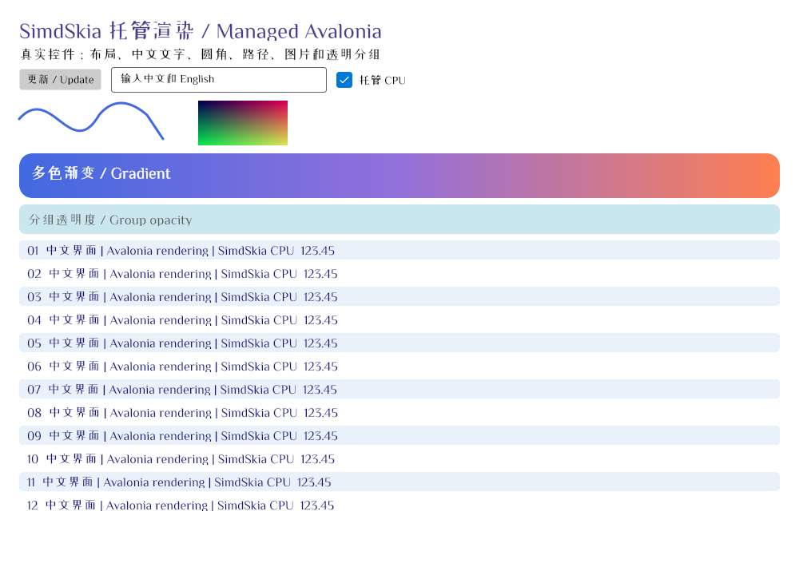

# 最终性能与内存报告：2026-10-21

**现在不建议替换生产 Avalonia。** 功能范围已经扩大，Gaussian SIMD 有明显收益；完整控件相对原版默认仍较慢、内存较高，且 CPU/GPU 画质验收未通过。耗时更短的失败场景不能判为同画质胜出。

硬件：i7-8700K（12 逻辑 CPU）、GTX 1050 Ti、Windows 10.0.26300、.NET 8.0.32 x64。固定 Avalonia 12.1.4 / SkiaSharp 3.119.4。全部进程串行运行，CPU、Gaussian 与 GPU 没有并发争用；没有修改 OS 电源计划或锁定 Turbo。完整测试见 [测试报告](TEST-REPORT-2026-10-21.md)，算法与未完成项见 [实现说明](IMPLEMENTATION-DETAILS-2026-10-21.md)。

## 实际 Avalonia 控件：CPU 软件光栅

36 个独立进程：优化前/最终/原版默认/原版完整组 × 3 配置 × 3 fork，旋转执行顺序。每进程预热 2.5 秒、测量 600 帧；以下是三进程中位数。字体、控件场景、尺寸固定，格式 BGRA8888/PMA。源码与当时 DLL SHA 在 [配置清单](cpu-performance-manifest.json)，含每个进程数据的 [完整 JSON](cpu-performance-results.json)。before 是本轮开始时 c4e1481 的完整构建输出，不是混用同一组后来被覆盖的 DLL。

计时范围是实际控件经 `RenderTargetBitmap + ImmediateRenderer` 的软件绘制；字体注册、布局准备、PNG 保存与窗口呈现不在循环计时内。首绘也仅指第一次 Render，不含进程/字体/布局启动。这不是屏幕刷新率或整个应用延迟。

| 场景 | 实现 | ms/帧 | CPU ms/帧 | KiB/帧 | 工作集 MiB | Private MiB | 保留托管堆 MiB |
|---|---|---:|---:|---:|---:|---:|---:|
| 控件 100% | 本轮前 c4e1481 | 1.106 | 1.120 | 16.43 | 118.3 | 78.5 | 20.0 |
| 控件 100% | SimdSkia 最终 | 1.096 | 1.094 | 16.75 | 118.7 | 78.4 | 20.0 |
| 控件 100% | 原版默认 opacity | 0.857 | 0.859 | 7.77 | 96.0 | 50.8 | 2.3 |
| 控件 100% | 原版完整 opacity 组 | 3.239 | 3.229 | 7.94 | 95.8 | 50.9 | 2.3 |
| 控件 150% | 本轮前 c4e1481 | 2.364 | 2.344 | 18.29 | 129.2 | 89.5 | 30.6 |
| 控件 150% | SimdSkia 最终 | 2.280 | 2.292 | 18.61 | 129.4 | 89.3 | 30.6 |
| 控件 150% | 原版默认 opacity | 1.611 | 1.589 | 7.77 | 99.7 | 54.6 | 2.3 |
| 控件 150% | 原版完整 opacity 组 | 6.929 | 6.927 | 7.94 | 98.2 | 53.3 | 2.3 |
| 列表滚动 100% | 本轮前 c4e1481 | 0.419 | 0.469 | 4.46 | 102.4 | 69.4 | 15.9 |
| 列表滚动 100% | SimdSkia 最终 | 0.420 | 0.495 | 4.62 | 102.7 | 69.4 | 15.9 |
| 列表滚动 100% | 原版默认 opacity | 0.365 | 0.365 | 8.03 | 86.4 | 47.6 | 1.4 |
| 列表滚动 100% | 原版完整 opacity 组 | 0.367 | 0.391 | 8.03 | 86.5 | 48.0 | 1.4 |

与原版默认比较：

- controls 100%：耗时 1.28 倍；工作集多 22.7 MiB，Private 多 27.6 MiB。本轮帧时间变化 -0.9%。
- controls 150%：耗时 1.42 倍；工作集多 29.7 MiB，Private 多 34.7 MiB。本轮帧时间变化 -3.5%。
- scroll 100%：耗时 1.15 倍；工作集多 16.4 MiB，Private 多 21.7 MiB。本轮帧时间变化 +0.2%。

本轮对既有控件循环的收益很小，列表变化属于噪声量级；没有因为新增很多功能就宣称完整 UI 大幅提速。高 DPI 仍有较明显差距。原版默认是逐 draw opacity，原版完整组使用离屏透明组；场景中的半透明区域行为不同，必须同时列出，不能只挑较慢的完整组。所有完整页面画质都未达标，所以即使比完整组更快也不宣布同画质胜出。

CPU 时间是整个进程累计 TotalProcessorTime，含后台线程，不能当作硬件 GPU 利用率；Windows 的 CPU 计时粒度会影响约 0.25 秒的列表样本，小差异不作严格排名。B/帧仅为托管分配，不含 native malloc；工作集/Private 包括运行时和 native/driver，保留堆不是总内存。不能将工作集、Private 与托管堆相加。

### 尾延迟、吞吐与首绘

| 场景 | 实现 | P95 ms | P99 ms | 绘制吞吐 帧/s | 首绘 ms | GC0/600帧 |
|---|---|---:|---:|---:|---:|---:|
| controls 100% | 本轮前 c4e1481 | 1.190 | 1.381 | 904 | 18.91 | 1 |
| controls 100% | SimdSkia 最终 | 1.185 | 1.365 | 912 | 19.09 | 1 |
| controls 100% | 原版默认 opacity | 0.922 | 1.121 | 1167 | 6.13 | 0 |
| controls 100% | 原版完整 opacity 组 | 3.423 | 3.985 | 309 | 8.67 | 0 |
| controls 150% | 本轮前 c4e1481 | 2.543 | 3.130 | 423 | 66.40 | 1 |
| controls 150% | SimdSkia 最终 | 2.459 | 2.832 | 439 | 67.81 | 1 |
| controls 150% | 原版默认 opacity | 1.757 | 2.125 | 621 | 16.90 | 0 |
| controls 150% | 原版完整 opacity 组 | 7.421 | 8.411 | 144 | 23.46 | 0 |
| scroll 100% | 本轮前 c4e1481 | 0.478 | 0.561 | 2387 | 9.14 | 0 |
| scroll 100% | SimdSkia 最终 | 0.475 | 0.585 | 2382 | 9.63 | 0 |
| scroll 100% | 原版默认 opacity | 0.414 | 0.604 | 2743 | 5.72 | 0 |
| scroll 100% | 原版完整 opacity 组 | 0.386 | 0.475 | 2726 | 5.52 | 0 |

列表使用 17 个整数滚动位置循环，允许正常命中缓存；不是不断出现新文本/新路径的成本。CPU 循环没有新增的大面积 Blur，滤镜成本单独列在下节。

### 画质：0/3，仍然失败

| 场景 | 最大通道误差 | RMSE | before/after 逐字节一致 |
|---|---:|---:|---|
| controls 100% | 96 | 2.408 | True |
| controls 150% | 117 | 2.321 | True |
| scroll 100% | 75 | 2.595 | True |

门槛保持 max ≤32、RMSE ≤2。未降低 AA 16×16、曲线容差或颜色处理来提速。


[原版页面](images/completion-controls-reference.png) · [差异图](images/completion-controls-diff.png)

## Gaussian 内核：标量与 SIMD 的相同算法

3 个独立进程/实现，交替顺序；每配置预热 750 ms，采样至少 1500 ms。比较同一个 16384 权重、两次分离卷积的实现，硬件测试另验证逐字节相同。这里不是与原版 Skia 的模糊耗时比较。[全部原始进程数据](filter-performance-results.json) / [参数](filter-performance-manifest.json)。

| 尺寸 | σ | 实现 | ms/次 | CPU ms/次 | B/次 | 工作集 MiB | Private MiB |
|---|---:|---|---:|---:|---:|---:|---:|
| 640×360 | 2 | scalar | 28.384 | 28.892 | 339 | 31.8 | 13.5 |
| 640×360 | 2 | simd | 6.151 | 6.225 | 330 | 32.8 | 14.5 |
| 640×360 | 8 | scalar | 104.094 | 103.125 | 367 | 31.6 | 13.3 |
| 640×360 | 8 | simd | 13.733 | 13.778 | 333 | 32.7 | 14.3 |
| 1024×768 | 2 | scalar | 93.004 | 92.831 | 363 | 37.1 | 18.8 |
| 1024×768 | 2 | simd | 10.567 | 10.563 | 332 | 37.2 | 19.0 |
| 1024×768 | 8 | scalar | 363.916 | 362.500 | 446 | 40.1 | 21.8 |
| 1024×768 | 8 | simd | 42.451 | 42.535 | 344 | 40.2 | 22.0 |

最终 SIMD 相对当前标量约 **4.6–8.8 倍**；多累加器展开和行访问复用同时改善标量/AVX2。1024×768、σ=8 仍需约 42 ms，不能视为所有滤镜均满足实时帧预算。已有 Blur 8 个原版画质对照只有 7 个通过，没有用不同近似核换成绩。

## Vulkan：单独的 GPU round-trip

[完整 GPU 报告](PERFORMANCE-GPU-FINAL-2026-10-21.md) 比较同一 GTX 1050 Ti、同样 RGBA8888/PMA；3 fork、5 批/配置、每批目标 70 ms，预热 150 ms 且至少 3 帧。包含录制、提交、等待 fence、完整主机回读。没有把纯提交时间当成完成时间；窗口 swapchain 仍未实现。

以下同时列出较快、较慢和画质失败的代表场景。GPU 内存列为整个进程，不是显存；托管分配不包含原版/驱动的 native 分配。

| 1024×768 场景 | 实现 | 完成 ms | CPU ms | B/帧 | 工作集 MiB | Private MiB | 画质 |
|---|---|---:|---:|---:|---:|---:|---|
| clear | original | 2.360 | 1.263 | 0 | 93.3 | 106.4 | 原版基准 |
| clear | simd | 0.740 | 0.296 | 706 | 97.5 | 98.7 | PASS |
| blend | original | 2.029 | 1.435 | 0 | 93.9 | 105.1 | 原版基准 |
| blend | simd | 3.699 | 0.377 | 712 | 95.6 | 102.9 | PASS |
| image | original | 2.409 | 1.596 | 104 | 93.4 | 106.5 | 原版基准 |
| image | simd | 1.188 | 0.230 | 1090 | 95.4 | 100.9 | FAIL max=253 |
| chinese | original | 2.097 | 1.740 | 640 | 94.2 | 107.1 | 原版基准 |
| chinese | simd | 4.055 | 0.590 | 715 | 108.0 | 111.0 | FAIL max=173 |

GPU 只通过 12/24 个原版像素 gate。图像、AA 和文字失败行仅为诊断，不能据此给性能胜负结论。包含回读的领先也不能推出不回读的屏幕渲染更快；没有硬件 GPU timestamp 或显存分配量统计。新增 GPU 采样/裁剪与 CPU 数值对照通过，不会消除所有原版行为差异。

## 复现

```powershell
powershell -NoProfile -File tools/run-avalonia-controls.ps1 -Output artifacts/my-cpu
powershell -NoProfile -File tools/run-filter-benchmarks.ps1 -Output artifacts/my-filters
powershell -NoProfile -File tools/run-gpu-benchmarks.ps1 -Output artifacts/my-gpu -Forks 3 -Samples 5 -SampleMilliseconds 70 -WarmupMilliseconds 150 -Report artifacts/my-gpu/report.md
```

CPU/GPU 原版画质失败时脚本返回 2，数据仍完整保留；这是验收失败，不是要求重试或忽略它。若要复现 before 比较，先从 c4e1481 构建并保留完整测试输出目录，再传 `-BeforeDirectory`，不要覆盖快照。本地 `artifacts/completion` 保存全部运行、逐帧 ticks、PNG/RGBA 和日志；随 Git 保存的 JSON/CSV/manifest 足够核查统计和软件/字体指纹。

当前取舍：如果目标是立即替换整个生产 Avalonia 后端，继续使用原版更合适。SimdSkia 已有真实功能与可复测数据，但剩余画质、API 和 GPU 窗口工作仍然实质性存在。
