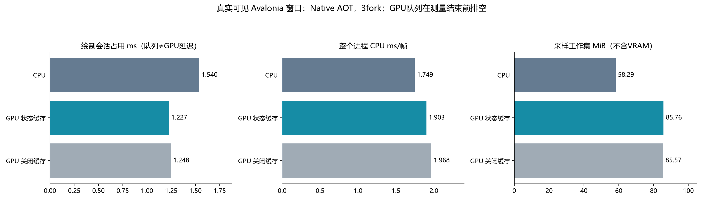
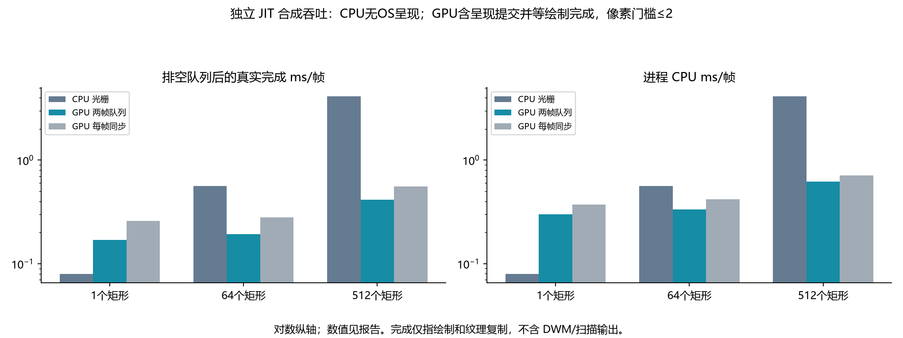

# GPU 为什么还吃 CPU：完成等待、两帧队列与性能边界实测

**未发布源码，NuGet0.1.2不包含本批优化。** 本报告比较本引擎 CPU/Direct2D/Vulkan 及自身改动前后；不是新一轮原版 Google Skia 同画质验收。

最终三轮 AOT 中，GPU/CPU 绘制会话耗时比为 **0.797**；进程 CPU 毫秒/帧比为 **1.088**，工作集仍多 **27.47 MiB**。绘制会话在 GPU 队列模式下包含录制、提交和背压等待，**不等于 GPU 执行延迟**；不能据此宣称整应用/GPU 执行全面更快。连续绘制的真实完成吞吐另表给出。

## 找到并修复的成本

1. 原生 Direct2D 每帧在 `GetData` 查询中 `Thread.Yield()`，试测可出现数十万次查询。现代 Windows 改用 `ID3D11DeviceContext3.Flush1` 完成事件；最终所有原生窗口测量轮询为0。缺少该接口时使用低频查询，显式旧模式只供复现。
2. 每帧立即等待 GPU 结束，使 CPU 与 GPU 串行。原生窗口现在最多两帧在途，完成事件确认后才释放相应瞬态资源；读取像素、同步 Present、CPU 回退及正常释放会等待实际完成。没有无限堆积提交来制造帧率。
3. 双缓冲 flip-discard 交换链配合常驻 GPU 渲染纹理保留上一帧，避免丢掉局部更新；正常帧不 CPU 读回，staging 纹理延迟分配。旧 blt 与无保留纹理实验均保留原始结果，未仅凭预期选择实现。
4. 原生窗口调用/释放继续受创建线程检查。单线程 D3D11 标志候选未获得稳定收益，已经撤回，最终设备保留线程安全创建策略；实验及其对照全部保留。测试读取原生创建标志核验最终策略，并检查跨线程调用报错。
5. 修复 `Present` 清空待提交标记后，下一帧第一条 CPU 回退读到旧 CPU 副本的问题；现在独立追踪 CPU 副本是否陈旧，格式/stride/预乘 Alpha 保持原有语义。

6. 缓存相同矩阵、原生混合和抗锯齿状态，相同设备裁剪在连续命令间复用；结束绘制前关闭裁剪，覆盖层切换时保守失效相关状态。关闭缓存的路径保留用于同设备精确像素和性能对照。

7. 另测了 `ID3D11DeviceContext4.Signal` / `ID3D11Fence.SetEventOnCompletion`，每个测量区间的本库主动 Flush 从约270次降到1次，但GPU进程CPU毫秒/帧中位数2.298，对照Flush1为2.095，未获得稳定CPU收益，已撤回。最终代码与上面的状态缓存版本逐文件SHA256一致；失败候选的源码、二进制哈希和全部结果独立保留。显式Flush数不等于驱动内部物理提交数。

参考：[Microsoft Flush1 完成通知](https://learn.microsoft.com/en-us/windows/win32/api/d3d11_3/nf-d3d11_3-id3d11devicecontext3-flush1)、[DXGI flip model](https://learn.microsoft.com/en-us/windows/win32/direct3ddxgi/for-best-performance--use-dxgi-flip-model)、[D3D11 创建标志和单线程限制](https://learn.microsoft.com/en-us/windows/win32/api/d3d11/ne-d3d11-d3d11_create_device_flag)。

## 最终 AOT 真实可见控件窗口

Windows11、i7-8700K/12逻辑线程、GTX1050Ti、.NET10.0.14/SDK10.0.403、Avalonia12.1.5。1000×720、固定中文字体、相同 Fluent 页面，定时更新按钮并请求重绘；8秒预热、8秒测量、3独立进程中位数，串行且无并行构建/基准。计时不开截图/额外 GPU 查询。结束前增加一个同步帧排空队列，尾部等待包含在墙钟、CPU和逐帧样本内。可见原生窗口另保留 DXGI 遮挡计数。

| 配置 | 绘制会话 ms | p95 ms | CPU ms/帧 | 整机 CPU %（范围） | WS MiB | Private MiB | 托管 KiB/帧 |
|---|---:|---:|---:|---:|---:|---:|---:|
| C# CPU/SIMD | 1.5395 | 2.0488 | 1.749 | 0.488 (0.422–0.601) | 58.29 | 32.95 | 18.27 |
| Direct2D 默认队列 / 状态缓存 | 1.2273 | 1.5630 | 1.903 | 0.536 (0.470–0.679) | 85.76 | 81.17 | 17.82 |
| Direct2D 两帧队列 / 关闭状态缓存 | 1.2479 | 1.5838 | 1.968 | 0.550 (0.437–0.681) | 85.57 | 80.91 | 17.82 |

同一两帧队列策略下，矩阵/混合/AA/轴对齐裁剪原生调用从 **425.6 → 138.8 次/帧**；缓存开/关的绘制会话耗时比 **0.983**、进程CPU毫秒/帧比 **0.967**。此处两条GPU路径的提交/等待语义相同，队列均最终排空。



这套窗口由定时器和渲染循环驱动，观察到的帧数/秒不等于显示器 FPS 或峰值吞吐；各配置帧数不完全相同，因此同时列进程 CPU 毫秒/帧。CPU%为整个进程 CPU 时间/墙钟/12，包含 UI、驱动工作线程和诊断采样。内存是定时采样峰值，不能替代精确系统峰值或 VRAM；WS 与 Private 不可相加。三轮范围显示低负载 CPU 测量有波动，不能承诺所有程序和硬件均降低 CPU。

`gpuCompletionMilliseconds`/统计中的 `CompletionMilliseconds` 是 Flush/Present 宿主调用累计时间，不是 GPU 硬件时间戳。新的 NativeSubmittedFrames/NativeCompletedFrames/NativePendingFrames 区分提交和实际退休工作；测量边界可能带入一帧预热工作，因此不能把该完成计数直接当作测量帧率。

## 初始完整矩阵与前后对照（保留中间结果）

以下为初始18进程矩阵，仍为AOT、8秒预热/8秒测量/3fork。可见与屏幕外窗口分组，不能交叉计算收益。改动前来自实际 a54485f AOT，采用每帧完成等待；中间版队列的绘制会话时长含义发生变化，不能把两个绘制会话数值直接宣传成 GPU 执行提速。CPU/内存列与最终排空后的完成数量单独判断。后续保留呈现方式、单线程设备和撤回后的中间检查点各9进程；最终表是状态缓存加入后新测的9进程，没有筛选其中更有利的旧轮次。

| 配置 | 绘制会话 ms | p95 ms | CPU ms/帧 | 整机 CPU %（范围） | WS MiB | Private MiB | 托管 KiB/帧 |
|---|---:|---:|---:|---:|---:|---:|---:|
| C# CPU/SIMD | 1.6028 | 2.2366 | 1.241 | 0.358 (0.341–0.455) | 58.18 | 32.84 | 18.28 |
| 中间版 Direct2D 队列（未加状态缓存） | 1.2360 | 1.5958 | 2.115 | 0.582 (0.403–0.697) | 85.63 | 81.08 | 17.81 |
| Direct2D 每帧同步 | 2.4018 | 3.1438 | 2.128 | 0.616 (0.436–1.164) | 85.80 | 83.42 | 17.83 |
| Vulkan 同步读回 | 5.1405 | 8.3020 | 3.146 | 0.957 (0.927–1.090) | 102.04 | 115.18 | 17.11 |
| 改动前 Direct2D（屏幕外） | 3.0443 | 5.5357 | 2.524 | 0.748 (0.667–0.764) | 85.12 | 84.70 | 17.78 |
| 中间版队列 Direct2D（屏幕外） | 1.2536 | 1.5980 | 2.133 | 0.596 (0.323–0.617) | 85.61 | 82.92 | 17.84 |

Vulkan 窗口依然执行 GPU→主机读回→OS framebuffer，同步完成时间明显高于该 CPU 页面，本批没有修成原生 Vulkan 窗口交换链。它不能借用 Direct2D 的优化成绩。Linux 窗口仍受这一路径限制，macOS 窗口仍用 CPU；Metal 没有 Mac GPU 实机验收。低负载期间还观测到 GTX1050Ti 的 P8/303MHz 状态，记录为影响因素，没有修改用户显卡/电源设置，也未证明它解释了全部差距。

## 连续绘制：GPU 工作确实完成之后的吞吐

另用 JIT 的1000×720纯绘制工作负载，1/64/512个整数边界、抗锯齿、半透明 SourceOver 矩形，每帧清屏；每进程预热至少3秒、计时至少2秒，3fork，共27进程。GPU计时末尾排空绘制/纹理复制队列，CPU为光栅本身，GPU额外含原生呈现提交；不测DWM/扫描输出完成。双方读回/画质核验均在计时外。这是合成吞吐测试，不能替代上面的真实Avalonia页面，也不与AOT结果混算。

| 矩形/帧 | CPU 完成 ms/帧 | GPU 队列完成 ms/帧 | GPU 同步完成 ms/帧 | GPU 队列/CPU 耗时比 | CPU ms/帧：CPU → GPU 队列 |
|---|---:|---:|---:|---:|---:|
| 1 | 0.0794 | 0.1692 | 0.2595 | 2.131 | 0.0793 → 0.3009 |
| 64 | 0.5637 | 0.1920 | 0.2795 | 0.341 | 0.5631 → 0.3355 |
| 512 | 4.1235 | 0.4157 | 0.5598 | 0.101 | 4.1199 → 0.6176 |



图使用对数纵轴，准确数值见表。完成指本引擎GPU绘制和纹理复制完成，原生呈现调用计时；不代表显示器已经扫描输出。

所有结果逐像素对照本引擎 CPU 的固定门槛为最大通道误差≤2；队列最终在途为0，实际完成计数与提交一致。复杂文字、曲线、滤镜、混合回退及整页并未因此变成原版像素一致。轻负载下 GPU 有固定驱动/提交/同步成本，GPU不保证每次绘制都比优化后的CPU更快；负载规模和呈现架构决定收益。

## 验证、剩余差距与复现

- 最终79项策略/原生HWND/部分帧保留/跨帧CPU回退/两种格式和stride/两帧上限/24个独立GPU查询/创建标志与线程约束/缓存开关精确像素通过；后来80项硬件fence候选通过正确性，但未因功能通过就保留性能无收益的候选。
- 既有 Avalonia GPU 12174项和 Vulkan 566项（556精确字节比较，含真实中文轮廓）通过，完整Release构建与Native AOT发布通过。
- 最终Auto/CPU两个实际AOT窗口运行、中文、调整尺寸、呈现成功，无CLR/JIT或Skia/HarfBuzz；同后端呈现PNG与前一设备配置逐字节相同。
- 原版严格整页画质、JPEG历史差异、Vulkan原生窗口呈现、Metal窗口与跨GPU硬件性能仍有差距；本批不宣称全面兼容、整体速度或内存全面胜出。
- 全部中间试验保留。sampled-thread-time包含睡眠/等待，未被当成CPU时间热点；Windows与单块旧GPU结果不代表Linux/macOS性能。NuGet0.1.2仍默认CPU，本批未发布新包。

```powershell
dotnet build SimdSkia.sln -c Release
dotnet run --project tests/GpuPreferred -c Release -- --hardware
dotnet publish examples/CrossPlatform -c Release -r win-x64 -p:PublishAot=true -p:IlcInstructionSet=x86-64 -o artifacts/current-aot
python tools/run-gpu-completion-cost.py --after artifacts/current-aot/CrossPlatform.exe --output artifacts/current-cost --state-probe --forks 3 --warmup 8 --seconds 8
python tools/run-native-gpu-throughput.py --output artifacts/current-throughput --forks 3
python tools/verify-final-evidence.py --directory docs/evidence/gpu-completion-2026-11-07
```

[冻结证据](evidence/gpu-completion-2026-11-07/)、[最终AOT逐帧与各fork](evidence/gpu-completion-2026-11-07/state-window/runs.json)、[初始矩阵](evidence/gpu-completion-2026-11-07/comparison/runs.json)、[真实完成吞吐](evidence/gpu-completion-2026-11-07/state-throughput/runs.json)、[构建/测试状态](evidence/gpu-completion-2026-11-07/validation-state.json)、[撤回后检查](evidence/gpu-completion-2026-11-07/validation-selected.json)、[SHA256清单](evidence/gpu-completion-2026-11-07/sha256.json)。
