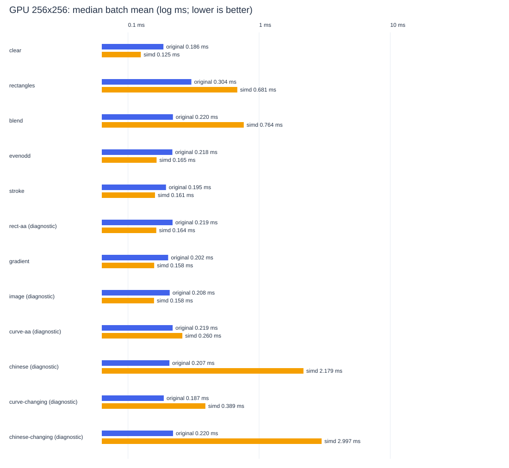
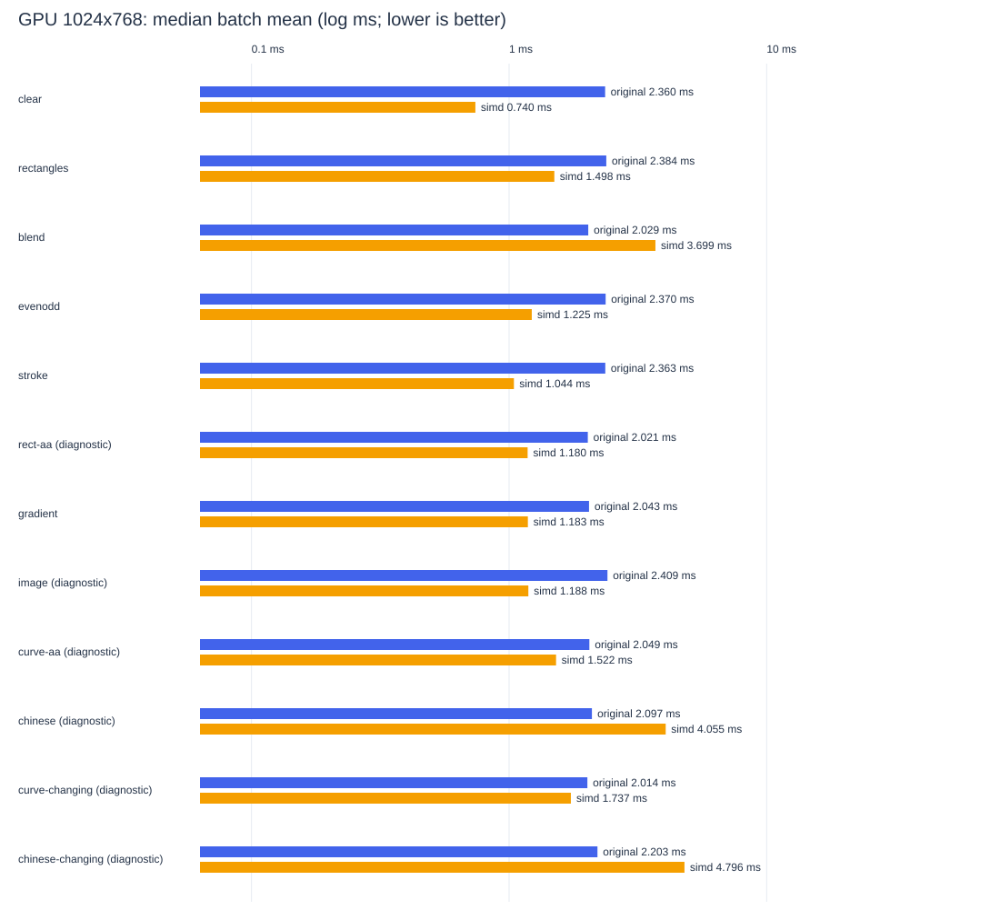

# 原版与 SimdSkia GPU(Vulkan)性能对比：2026-10-21

实际执行：Intel(R) Core(TM) i7-8700K CPU @ 3.70GHz；Microsoft Windows 10.0.26300；.NET 8.0.32 / X64，逻辑 CPU 12。原版包 SkiaSharp 3.119.4。
原版路径：Native Skia GPU dispatch (Vulkan, NVIDIA GeForce GTX 1050 Ti)；SimdSkia 路径：SimdSkia Vulkan compute (NVIDIA GeForce GTX 1050 Ti)。
每种实现 3 个独立进程；每项每进程 5 批，目标每批 70 ms，预热至少 150 ms 且 3 帧，再校准。进程顺序/场景顺序打乱，串行执行。TieredCompilation=0。
主要结论：以 1024×768 为例，以下只列通过画质门槛的场景。

- clear：原版 2.360 ms，SimdSkia 0.740 ms，为原版耗时的 0.31 倍。
- rectangles：原版 2.384 ms，SimdSkia 1.498 ms，为原版耗时的 0.63 倍。
- blend：原版 2.029 ms，SimdSkia 3.699 ms，为原版耗时的 1.82 倍。
- evenodd：原版 2.370 ms，SimdSkia 1.225 ms，为原版耗时的 0.52 倍。
- stroke：原版 2.363 ms，SimdSkia 1.044 ms，为原版耗时的 0.44 倍。
- gradient：原版 2.043 ms，SimdSkia 1.183 ms，为原版耗时的 0.58 倍。

这次只比较同机 Vulkan GPU round-trip（绘制全部命令 + 提交 + 等待 fence + 回读主机）。未与 CPU 光栅结果混用；CPU/滤镜/内存结果见 [本轮汇总](PERFORMANCE-FINAL-2026-10-21.md)。

原始数据：[JSON](gpu-performance-results.json)、[CSV](gpu-performance-results.csv)、[配置](gpu-performance-manifest.json)。工作进程数据、逐帧 ticks、像素和日志保留在同目录。

## 256×256：时间与质量

表内 ms 为多进程所有批均值的中位数；‘慢倍数’=SimdSkia / 原版，低于 1 表示更快。质量未过不给性能胜负结论。

| 场景 | 原版 ms | SimdSkia ms | 慢倍数 | SimdSkia P95 ms | 质量 |
| --- | ---: | ---: | ---: | ---: | --- |
| clear | 0.186 | 0.125 | 0.67× | 0.136 | 通过 max=0 |
| rectangles | 0.304 | 0.681 | 2.24× | 0.733 | 通过 max=0 |
| blend | 0.220 | 0.764 | 3.47× | 0.804 | 通过 max=0 |
| evenodd | 0.218 | 0.165 | 0.76× | 0.187 | 通过 max=0 |
| stroke | 0.195 | 0.161 | 0.82× | 0.186 | 通过 max=0 |
| rect-aa | 0.219 | 0.164 | — | 0.174 | 诊断：max 41>2 |
| gradient | 0.202 | 0.158 | 0.78× | 0.168 | 通过 max=1 |
| image | 0.208 | 0.158 | — | 0.168 | 诊断：max 249>0 |
| curve-aa | 0.219 | 0.260 | — | 0.307 | 诊断：max 45>32 |
| chinese | 0.207 | 2.179 | — | 2.233 | 诊断：max 173>32 |
| curve-changing | 0.187 | 0.389 | — | 0.428 | 诊断：max 45>32 |
| chinese-changing | 0.220 | 2.997 | — | 3.465 | 诊断：max 173>32 |

### 托管分配、进程内存、CPU 使用率

下表内存绝对值含 runtime、Vulkan 驱动映射与先前场景，不等于显存/渲染缓冲用量。CPU ms/帧为各批进程总处理器时间累计/总帧数；CPU% 按累计 CPU 时间/累计墙钟加权，单逻辑核归一（100% = 一核满载）。JSON/CSV 同时提供除以逻辑核数的机器占用。满速占用不等于固定帧率应用占用，Windows 处理器时间有计数粒度，短批内 0 不代表不消耗 CPU。

| 场景 | 原 B/op | Simd B/op | 原 CPU ms/帧 | Simd CPU ms/帧 | 原 CPU% 单核 | Simd CPU% 单核 | 原 private MiB | Simd private MiB | 原 working set MiB | Simd working set MiB |
| --- | ---: | ---: | ---: | ---: | ---: | ---: | ---: | ---: | ---: | ---: |
| clear | 0 | 704 | 0.124 | 0.075 | 65.6 | 59.8 | 104.0 | 96.3 | 91.2 | 93.6 |
| rectangles | 0 | 705 | 0.171 | 0.130 | 63.4 | 19.1 | 103.3 | 92.2 | 90.3 | 91.0 |
| blend | 0 | 706 | 0.163 | 0.175 | 67.1 | 23.0 | 101.8 | 97.9 | 90.1 | 94.5 |
| evenodd | 0 | 704 | 0.127 | 0.073 | 62.1 | 44.0 | 103.6 | 92.7 | 91.0 | 91.5 |
| stroke | 0 | 704 | 0.135 | 0.073 | 67.3 | 44.2 | 103.6 | 92.8 | 90.3 | 91.8 |
| rect-aa | 0 | 704 | 0.145 | 0.058 | 67.5 | 35.4 | 103.8 | 92.7 | 91.0 | 91.6 |
| gradient | 0 | 704 | 0.144 | 0.081 | 64.0 | 50.7 | 103.1 | 92.0 | 90.3 | 90.8 |
| image | 104 | 1088 | 0.135 | 0.076 | 64.8 | 48.0 | 103.4 | 96.0 | 91.0 | 95.0 |
| curve-aa | 0 | 705 | 0.123 | 0.072 | 56.6 | 27.6 | 104.0 | 95.3 | 91.2 | 94.2 |
| chinese | 640 | 710 | 0.161 | 0.126 | 70.6 | 5.8 | 104.3 | 108.2 | 91.4 | 102.1 |
| curve-changing | 0 | 40948 | 0.132 | 0.109 | 67.1 | 28.6 | 104.2 | 98.1 | 91.1 | 92.7 |
| chinese-changing | 640 | 373629 | 0.173 | 0.748 | 73.7 | 24.8 | 104.1 | 112.2 | 90.9 | 109.0 |

完整 op/s、GC 次数、托管 retained、进程历史峰值、IQR 和 CV 在 CSV/JSON。

## 1024×768：时间与质量

表内 ms 为多进程所有批均值的中位数；‘慢倍数’=SimdSkia / 原版，低于 1 表示更快。质量未过不给性能胜负结论。

| 场景 | 原版 ms | SimdSkia ms | 慢倍数 | SimdSkia P95 ms | 质量 |
| --- | ---: | ---: | ---: | ---: | --- |
| clear | 2.360 | 0.740 | 0.31× | 0.797 | 通过 max=0 |
| rectangles | 2.384 | 1.498 | 0.63× | 1.558 | 通过 max=0 |
| blend | 2.029 | 3.699 | 1.82× | 3.747 | 通过 max=0 |
| evenodd | 2.370 | 1.225 | 0.52× | 1.284 | 通过 max=0 |
| stroke | 2.363 | 1.044 | 0.44× | 1.115 | 通过 max=0 |
| rect-aa | 2.021 | 1.180 | — | 1.231 | 诊断：max 41>2 |
| gradient | 2.043 | 1.183 | 0.58× | 1.245 | 通过 max=1 |
| image | 2.409 | 1.188 | — | 1.250 | 诊断：max 253>0 |
| curve-aa | 2.049 | 1.522 | — | 1.596 | 诊断：max 44>32 |
| chinese | 2.097 | 4.055 | — | 4.141 | 诊断：max 173>32 |
| curve-changing | 2.014 | 1.737 | — | 1.844 | 诊断：max 44>32 |
| chinese-changing | 2.203 | 4.796 | — | 5.291 | 诊断：max 173>32 |

### 托管分配、进程内存、CPU 使用率

下表内存绝对值含 runtime、Vulkan 驱动映射与先前场景，不等于显存/渲染缓冲用量。CPU ms/帧为各批进程总处理器时间累计/总帧数；CPU% 按累计 CPU 时间/累计墙钟加权，单逻辑核归一（100% = 一核满载）。JSON/CSV 同时提供除以逻辑核数的机器占用。满速占用不等于固定帧率应用占用，Windows 处理器时间有计数粒度，短批内 0 不代表不消耗 CPU。

| 场景 | 原 B/op | Simd B/op | 原 CPU ms/帧 | Simd CPU ms/帧 | 原 CPU% 单核 | Simd CPU% 单核 | 原 private MiB | Simd private MiB | 原 working set MiB | Simd working set MiB |
| --- | ---: | ---: | ---: | ---: | ---: | ---: | ---: | ---: | ---: | ---: |
| clear | 0 | 706 | 1.263 | 0.296 | 56.5 | 40.0 | 106.4 | 98.7 | 93.3 | 97.5 |
| rectangles | 0 | 707 | 1.453 | 0.352 | 64.2 | 23.5 | 106.8 | 99.0 | 93.5 | 96.3 |
| blend | 0 | 712 | 1.435 | 0.377 | 66.8 | 10.2 | 105.1 | 102.9 | 93.9 | 95.6 |
| evenodd | 0 | 706 | 1.382 | 0.353 | 61.5 | 28.9 | 106.8 | 100.5 | 93.5 | 95.4 |
| stroke | 0 | 707 | 1.427 | 0.314 | 63.1 | 30.0 | 106.8 | 97.5 | 93.8 | 95.4 |
| rect-aa | 0 | 706 | 1.578 | 0.281 | 74.5 | 23.8 | 106.1 | 98.7 | 93.3 | 97.3 |
| gradient | 0 | 706 | 1.546 | 0.240 | 71.7 | 20.3 | 106.4 | 98.2 | 93.6 | 97.2 |
| image | 104 | 1090 | 1.596 | 0.230 | 69.4 | 19.3 | 106.5 | 100.9 | 93.4 | 95.4 |
| curve-aa | 0 | 707 | 1.497 | 0.355 | 69.3 | 23.2 | 106.0 | 108.2 | 93.2 | 102.7 |
| chinese | 640 | 715 | 1.740 | 0.590 | 79.0 | 14.5 | 107.1 | 111.0 | 94.2 | 108.0 |
| curve-changing | 0 | 273552 | 1.592 | 0.461 | 79.0 | 26.6 | 100.7 | 116.0 | 92.5 | 109.4 |
| chinese-changing | 640 | 545088 | 1.389 | 1.890 | 62.1 | 39.1 | 106.8 | 121.6 | 93.9 | 120.3 |

完整 op/s、GC 次数、托管 retained、进程历史峰值、IQR 和 CV 在 CSV/JSON。

## 解读边界

- 每个‘op’是一整帧 GPU round-trip：绘制全部命令 + flush 提交 + fence 等待 + 主机回读拷贝。rectangles/blend 每帧 65 条命令（1 clear+64 draw），chinese 含 4 行文字，其余 1 项。几何/字体/纹理准备不在计时内；每帧的命令录制、提交、等待与回读在计时内。
- 双方目标像素格式 RGBA8888/Premul，同一 GPU 上各自独立初始化 Vulkan（原版用 graphics queue + GRContext 光栅后端；SimdSkia 用 compute queue + 自研 compute shader 管线）。
- 固定场景允许正常复用纹理/缓存（SimdSkia 纹理缓存 ≤32 个/64MiB LRU）；curve-changing/chinese-changing 场景每帧移动 1/16 像素、97 个位置循环，强制覆盖率/文字缓存持续未命中。变化场景像素 gate 检查 frame=0。
- 质量门槛以原版 GPU 输出为基准逐通道比较；AA/字体必须检查本轮相同尺寸的像素 gate；失败的时间保留为诊断数据。未提高容差，也未降低画质。
- B/op 是线程托管分配，不含 native malloc 与显存。private/working set 是整个进程，包含 runtime、Vulkan 驱动映射、native/字体缓存和先前场景，不能当显存或纯渲染缓冲内存公平排名；peak working set 是进程历史峰值。
- P95 是实际单帧延迟，包含 GC/调度/驱动抖动；耗时列是批均值中位数，两者定义不同。
- 帧时间由 CPU 计时（Stopwatch）测得，包含每帧回读同步；驱动内部排队可能引入噪声。样本不控制 OS power plan/Turbo/其他用户进程，不给所有硬件的优势承诺。

GPU pixel acceptance: 12/24. Failed rows remain diagnostic; no threshold was relaxed.
