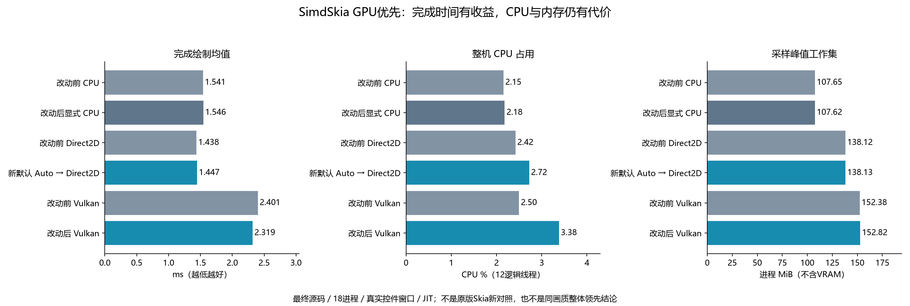

# GPU 优先批次：真实控件窗口的完成时间、CPU 与内存

**未发布源码，NuGet0.1.2仍默认CPU。** 本报告比较SimdSkia改动前后，不是新一轮原版Skia对照，不能替代此前严格画质失败的报告。

新默认Auto实际选择Direct2D原生交换链。相对本轮显式CPU，完成绘制耗时比 **0.936**，但整机CPU占用比 **1.249**、峰值工作集增加 **30.51MiB**。相对改动前已有Direct2D，耗时比 **1.006**；Vulkan改动后/前耗时比 **0.966**。不能把默认GPU包装成速度、CPU、内存全面改善。

## 方法

Windows11 x64，i7-8700K（6核12线程）、GTX1050Ti，SDK10.0.403/runtime10.0.14，Avalonia12.1.5，JIT。同一1000×720真实Fluent控件窗口、固定中文字体；定时更新按钮文本并请求重绘。窗口移到屏幕外，仍调用实际OS/交换链与GPU完成事件，不等同显示器呈现FPS。每项2秒预热、5秒测量、3独立进程中位数；6变体共18进程串行。计时期间没有并行构建/AOT/其他本机基准。

这不是强制整页峰值吞吐，也不是固定60FPS同工作量测试：完成帧数可能不同。CPU%为进程CPU时间/墙钟/12，另给CPU毫秒/实际完成帧；包含UI、定时器、驱动等进程工作。峰值内存来自UI定时采样，不是系统精确历史峰值或VRAM；WS/private不可相加；托管分配不含原生堆/显存。

| 配置 | 完成绘制均值 ms | p95 ms | CPU ms/帧 | 整机 CPU % | 峰值 WS MiB | 峰值 private MiB | 托管 KiB/帧 |
|---|---:|---:|---:|---:|---:|---:|---:|
| 改动前 CPU | 1.5409 | 2.1408 | 7.719 | 2.15 | 107.65 | 50.48 | 21.91 |
| 改动后显式 CPU | 1.5460 | 2.1293 | 7.907 | 2.18 | 107.62 | 50.38 | 21.95 |
| 改动前 Direct2D | 1.4377 | 1.9327 | 8.650 | 2.42 | 138.12 | 104.36 | 18.64 |
| 新默认 Auto → Direct2D | 1.4465 | 1.9415 | 9.429 | 2.72 | 138.13 | 104.62 | 18.16 |
| 改动前 Vulkan | 2.4007 | 3.1397 | 8.571 | 2.50 | 152.38 | 132.81 | 17.32 |
| 改动后 Vulkan | 2.3188 | 3.1294 | 11.541 | 3.38 | 152.82 | 133.25 | 17.29 |



原生Direct2D正常帧不强制回读；Vulkan等待完成后读回OS framebuffer。双方同后端前后比较才用于判断对应改动；跨后端选择用于评价默认策略。新Auto三个进程初始化失败0、命令级CPU回退0，但文字覆盖率/部分图层仍有CPU准备和处理。每个指标分别取中位数；全部fork、极值、逐帧时间和实际完成帧数保留在证据中。

本轮Auto比已有Direct2D没有显著提速；Vulkan完成时间略低，CPU占用反而更高，不能只报道较好的时间。少量进程、单一页面与单块旧GPU的结果有局限，CPU差距的具体调用栈原因尚未定位。没有为获得更好成绩继续重复筛选；此前中间源码的18进程也保留在timing-1，最终表只用timing-final。

## 实现与行为验证

- 最终Release全解决方案、Native AOT发布零警告/错误。
- 新增40项策略/故障注入/缓存生命周期/提前管线检查通过；既有12174项Vulkan/Direct2D集成、566项GPU检查（556精确字节比较）通过。
- Auto/显式CPU/Vulkan等7个真实窗口通过；改动前后CPU、Direct2D、Vulkan三组呈现PNG逐字节相同。
- 最终Auto与显式CPU两个真正Native AOT窗口通过；GUI PE无CLR头，未加载CLR/JIT或Google Skia/HarfBuzz。
- Avalonia最低12.1.0和当前12.1.5真实默认GPU窗口均通过；新平台GPU实机性能没有测试，Metal无Mac GPU验证。
- 透明提示没有触发实际分层HWND，只记录不崩溃；不当成已通过逐像素透明。
- 同后端相同与新单项检查不改变原版严格整页画质0/18、此前AOT0/10或JPEG21/24。

## 从Impeller吸收的范围

本轮实现GPU优先与可诊断回退、Vulkan离线SPIR-V共享、七条管线在设备初始化准备、按估算载荷/条目有界的字形LRU和在途资源完成后回收。参考[官方架构目标](https://docs.flutter.dev/perf/impeller)，没有引入其原生引擎。初始化前移没有消除驱动编译，也不是启动白屏的新验收；原生Vulkan窗口交换链、通用帧图/退休队列及Metal窗口仍未完成。详见[实现与API合同](GPU-PREFERRED-2026-11-07.md)。

## 复现与证据

```powershell
python tools/run-gpu-preferred-comparison.py --before <f7f0185独立构建的CrossPlatform.exe> --after examples/CrossPlatform/bin/Release/net10.0/CrossPlatform.exe --output artifacts/new-gpu-preferred-run --forks 3 --warmup 2 --seconds 5
python tools/verify-final-evidence.py --directory docs/evidence/gpu-preferred-2026-11-07
```

[冻结证据](evidence/gpu-preferred-2026-11-07/)、[最终原始结果](evidence/gpu-preferred-2026-11-07/timing-final/runs.json)、[对照程序集与源码SHA](evidence/gpu-preferred-2026-11-07/timing-final/manifest.json)、[校验清单](evidence/gpu-preferred-2026-11-07/sha256.json)。本地候选nupkg仅检查Desktop→GPU传递依赖，未上传；不代表发布了0.1.3-preview.1。
