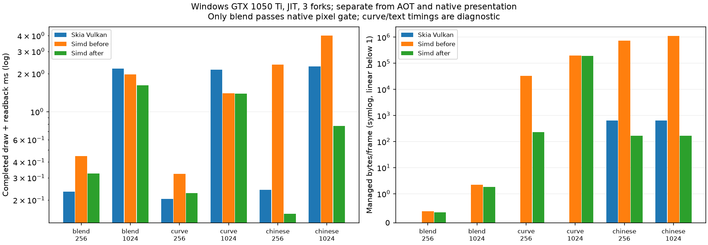

# 性能热点复查：滚动异常、动态中文与 GPU 混合（2026-11-07）

本批为未发布源码，正式 NuGet 仍为0.1.2。Windows11 / i7-8700K 6核12线程 / GTX1050Ti / .NET10.0.14、SDK10.0.403；Avalonia12.1.5、原版SkiaSharp3.119.4、固定ZCOOL中文字体。构建、测试与测量串行；没有修改显卡/电源设置。CPU与GPU、JIT与Native AOT分别报告。

## 已实施

- 文字内容哈希只在不可变文字对象构造时计算；相同内容的新包装对象复用覆盖率，并在哈希命中后检查完整内容，身份索引不会保留所有临时对象。
- 子像素相位共享同一文字轮廓，按引用计数计费；字形/文字默认字节预算保持不变。设备文字覆盖率改为逐项LRU、最多512项/4MiB估算预算，整数平移共享不可变数组，避免64项后整批清空。预算含保留源遮罩及继承裁剪，不等于进程内存上限。
- Vulkan小面积、轴对齐、无AA纯色矩形可在同一像素内顺序混合：一次全局读写、最多64条命令、区域≤128K像素；其他命令保留原路径。没有把AA命令改成无AA。通用着色器候选变慢已撤回；8条管线初始化时创建，运行时无着色器编译。
- Vulkan小覆盖率边数据允许128项，较大条目仍64项，16MiB预算不变；移除每次未命中都排序并分配整个缓存数组的操作。曾测出大条目扩容增加内存，最终限制大条目数量。
- Direct2D离屏事件等待降低CPU但增加延迟，默认保留原有Map路径。可在创建设备前显式设置 `AppContext.SetSwitch("SimdSkia.Direct2D.BlockingReadback", true)` 选择该取舍；原生窗口继续使用上一批两帧完成队列。

## 60 FPS滚动：旧7.528倍记录的复核

同一未修改的0.1.2二进制在本轮未重现旧5.5232ms/约3.21MiB分配。旧证据保留，根因仍未定位，不能把这段差值归因于本批修复。正式复测强制还原来源，另构建冻结源码修改前/当前源码两个真正AOT；保留ILC输入和不同EXE哈希，排除了最初一次误用NuGet还原缓存的试验。2秒预热、5秒测量、3独立进程中位数；相同1000×720、portable x64/Vector128。

| AOT滚动/60 FPS | 绘制ms | p95 ms | 进程CPU ms/帧 | 整机CPU% | 采样WS MiB | Private MiB | 分配KiB/次 |
|---|---:|---:|---:|---:|---:|---:|---:|
| 原版 | 0.9370 | 1.2731 | 1.198 | 0.597 | 55.62 | 30.01 | 14.56 |
| 未修改0.1.2 | 0.7188 | 1.0559 | 0.885 | 0.442 | 68.09 | 46.50 | 6.30 |
| 源码修改前 | 0.7430 | 1.0382 | 0.990 | 0.493 | 68.16 | 46.56 | 6.27 |
| 源码修改后 | 0.7289 | 1.0485 | 0.938 | 0.469 | 68.20 | 46.49 | 6.28 |

绘制计时排除Task.Delay；总进程CPU/分配包含让出UI线程后的窗口呈现和调度。截止时间延迟不等于显示器丢帧，离屏Render不等于扫描输出FPS。源码修改前后固定帧逐字节相同，原版严格画质失败仍保留。

## Vulkan历史慢项：真正完成绘制与读回

3fork，每进程每项5批×目标150ms，预热≥500ms并校准；TieredCompilation/ReadyToRun关闭。双方同GPU、RGBA/Premul，每帧绘制+提交+fence等待+主机读回，采集固定frame=0像素在计时外。原版与本库使用各自正常缓存，修改前/后及关闭新批处理全部保留。

| 场景 | 原版ms | 修改前ms | 修改后ms | 后/前 | 后/原版 | 原版画质 |
|---|---:|---:|---:|---:|---:|---|
| blend 256×256 | 0.2328 | 0.4462 | 0.3237 | 0.726 | 1.391 | 通过 max=0 |
| blend 1024×768 | 2.1910 | 1.9787 | 1.6242 | 0.821 | 0.741 | 通过 max=0 |
| curve-changing 256×256 | 0.2043 | 0.3223 | 0.2276 | 0.706 | 1.114 | 失败/仅诊断 max=45 |
| curve-changing 1024×768 | 2.1504 | 1.4022 | 1.3941 | 0.994 | 0.648 | 失败/仅诊断 max=44 |
| chinese-changing 256×256 | 0.2406 | 2.3583 | 0.1554 | 0.066 | 0.646 | 失败/仅诊断 max=188 |
| chinese-changing 1024×768 | 2.2841 | 3.9985 | 0.7707 | 0.193 | 0.337 | 失败/仅诊断 max=185 |



图使用对数/对称对数轴；曲线和中文原版像素门槛仍失败，速度数字只能用于排查成本。所有修改前后固定帧完全相同；独立标量/未优化GPU回归另覆盖多个相位和混合顺序。

| GPU微场景 | CPU ms/帧 前→后 | 分配B/帧 前→后 | WS MiB 前→后 | Private MiB 前→后 |
|---|---:|---:|---:|---:|
| blend 256 | 0.140→0.107 | 0.4→0.4 | 94.25→90.68 | 97.16→90.87 |
| blend 1024 | 0.430→0.399 | 2.3→1.9 | 101.12→94.84 | 100.19→94.96 |
| curve-changing 256 | 0.122→0.079 | 32658.2→232.3 | 92.44→85.90 | 94.04→87.46 |
| curve-changing 1024 | 0.602→0.591 | 201147.1→192821.8 | 118.21→115.01 | 121.44→116.52 |
| chinese-changing 256 | 2.268→0.088 | 743850.6→168.2 | 97.22→95.04 | 98.39→95.32 |
| chinese-changing 1024 | 3.906→0.304 | 1099815.2→169.1 | 105.07→96.91 | 109.82→99.52 |

内存为该微场景采样结束、全收集后但目标仍存活时的整个进程值，含JIT、驱动映射、此前场景缓存；顺序按相同fork打乱。不是纯渲染缓冲或显存测量，WS和Private不可相加。短批CPU计数有粒度，不能把接近0解释为无成本。

## 真实Avalonia页面GPU对照

独立JIT程序，3秒预热/5秒测量/3fork，共36进程。原版Vulkan与ANGLE(D3D11)、本库Vulkan与Direct2D均完成同尺寸BGRA GPU读回；不把CPU对手当作GPU原版，不代表原生交换链或AOT性能。

| 页面 | 原版Vulkan ms | 原版ANGLE ms | Simd Vulkan ms | Simd Direct2D ms |
|---|---:|---:|---:|---:|
| controls ×1 | 2.3886 | 2.0164 | 1.3802 | 1.3640 |
| controls ×1.5 | 3.6759 | 3.7906 | 2.4776 | 2.4391 |
| scroll ×1 | 2.3671 | 1.7392 | 1.3420 | 0.8046 |

| 页面/实现 | CPU ms/帧 | 整机CPU% | 采样WS MiB | Private MiB | 分配KiB/帧 |
|---|---:|---:|---:|---:|---:|
| controls ×1 / original-vulkan | 1.732 | 6.04 | 151.55 | 149.06 | 5.13 |
| controls ×1 / original-angle | 2.332 | 9.63 | 143.34 | 121.83 | 5.13 |
| controls ×1 / vulkan | 0.621 | 3.75 | 150.49 | 144.24 | 5.71 |
| controls ×1 / direct2d | 1.858 | 11.43 | 145.84 | 125.27 | 5.71 |
| controls ×1.5 / original-vulkan | 2.872 | 6.51 | 163.55 | 166.54 | 5.13 |
| controls ×1.5 / original-angle | 4.063 | 8.93 | 156.24 | 137.42 | 5.13 |
| controls ×1.5 / vulkan | 1.045 | 3.49 | 165.40 | 167.15 | 5.71 |
| controls ×1.5 / direct2d | 2.942 | 10.05 | 153.74 | 142.21 | 5.71 |
| scroll ×1 / original-vulkan | 1.711 | 6.01 | 142.16 | 144.14 | 4.17 |
| scroll ×1 / original-angle | 2.046 | 9.69 | 128.62 | 110.78 | 4.17 |
| scroll ×1 / vulkan | 0.404 | 2.55 | 145.05 | 146.78 | 2.45 |
| scroll ×1 / direct2d | 1.186 | 12.16 | 133.76 | 123.16 | 2.45 |

严格原版整页画质通过 **0/12**（max≤32、RMSE≤2，未改阈值）。本库新旧同后端捕获相同；原版门槛失败时不宣称同画质胜出。Vulkan窗口同步读回、Metal未实机、原生窗口总CPU和内存差距仍需继续解决。

## CPU文字包装对象压力测试

单独JIT合成场景，2秒预热/3秒/3fork，2048个内容重复的不可变文字对象，每次仍清屏并绘制32个轮廓；不是整应用或原版对照。耗时 0.01934→0.00607ms，分配 6648.64→0.001B/次；三轮像素哈希相同。

## 验证与复现

最终Release全解构建、核心36项、474413项标量/SIMD优化检查、13853项Avalonia检查、599项GPU检查（588精确字节）、12174项GPU集成及131项偏好/原生窗口/离屏独立完成事件检查通过。CPU与GPU测试包含缓存淘汰、并发、颜色/透明度、97个文字相位、stride、跨帧回退、资源释放。Native AOT两种源码来源及原版都实际运行，无CoreCLR/JIT；本库未加载Google Skia/HarfBuzz。一次基准驱动DLL路径拼错已修正，记录保留。

```powershell
dotnet build SimdSkia.sln -c Release
dotnet run --project tests/AvaloniaControls -c Release -- --frames 5
dotnet run --project tests/GpuOptimization -c Release -- baseline/fonts/ZCOOLXiaoWei-Regular.ttf
dotnet run --project tests/GpuPreferred -c Release -- --hardware
dotnet build benchmarks/GpuManaged -c Release
dotnet build benchmarks/GpuReference -c Release
python tools/run-gpu-slow-cases.py --output artifacts/new-slow-cases
python tools/run-gpu-parity.py --output artifacts/new-pages
python tools/verify-final-evidence.py --directory docs/evidence/hotspots-2026-11-07
```

AOT复测必须显式还原来源：`dotnet publish examples/AvaloniaAot/SimdSkia -c Release -p:UsePackedSimdSkia=false -p:RestoreForce=true -o <新目录>`；检查ILC输入指向src而非旧NuGet缓存，完整冻结/修改后/原版命令在证据final-run.py与validation-final.json中。图形着色器由[Khronos glslang](https://github.com/KhronosGroup/glslang/releases/tag/16.6.0)离线生成，发布不携带编译器；源码/字节码/编译器哈希保留。

[冻结证据与原始各轮](evidence/hotspots-2026-11-07/) · [汇总](evidence/hotspots-2026-11-07/overview.json) · [旧7.528倍记录](PERFORMANCE-STABLE-0.1.2-AOT-2026-11-07.md)。本批未发布NuGet，不宣称全面兼容、画质通过或所有负载持平。
