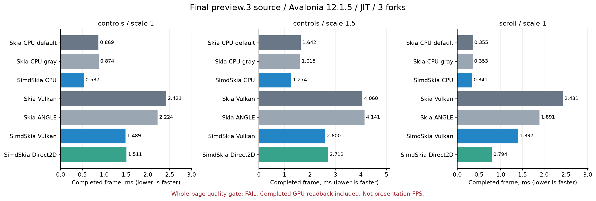
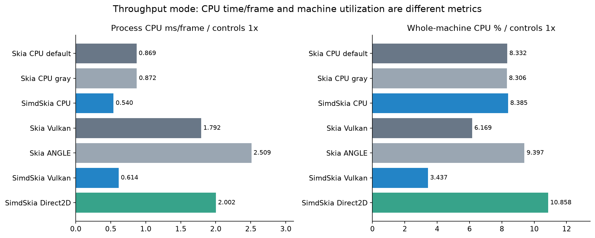
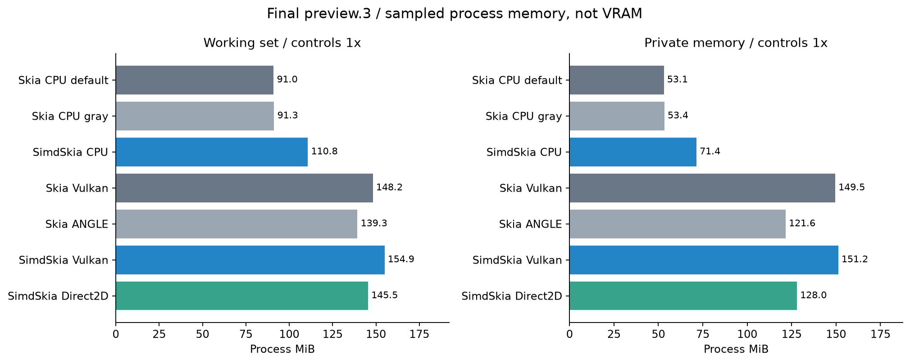

# SimdSkia 0.1.2-preview.3：最终源码的CPU/GPU与内存复测

完成连续MoveTo与特殊混合SaveLayer修复后，全量重新构建两个对照进程，再采集63个独立进程。源码提交固定为`82e9575971aff578762e879aea8afdbbdf9c811d`；旧结果不覆盖，以下是最终源码的新测量。

CPU综合耗时比为较快原版的 **0.778**，最差场景 **0.967**；Vulkan/Direct2D相对两条原版GPU中较快者的综合耗时比 **0.682/0.575**。**整页严格画质仍0/18，内存仍有差距；这些耗时不能宣传为同画质整体领先。**

Windows x64，i7-8700K（6核12线程）、GTX1050Ti；SDK10.0.403、.NET10.0.14、Avalonia12.1.5、原版SkiaSharp3.119.4。相同控件、固定字体、尺寸和DPI；3秒预热/5秒测量，3进程中位数，25ms采样。全部进程串行执行，期间没有并行构建/AOT或其他本机基准；只读CI状态轮询仍在进行。

CPU直接绘制BGRA缓冲；GPU每帧等待完成并读回同样缓冲。Vulkan与原版Vulkan是同API；Direct2D与原版ANGLE是同GPU不同API，不称为同后端。计时GPU进程的回退命令均为0，每帧完成批次已检查；路径/字形覆盖仍可能由C#在CPU生成，再由GPU合成。不是窗口交换链FPS、AOT速度或GPU纯着色器耗时。

| 场景 | 实现 | ms/帧 | P95 ms | CPU ms/帧 | 整机CPU% | WS MiB | 私有MiB | WS/物理RAM% | 托管B/帧 |
|---|---|---:|---:|---:|---:|---:|---:|---:|---:|
| controls ×1 | 原版CPU默认 | 0.8687 | 1.0031 | 0.8688 | 8.33 | 91.00 | 53.08 | 0.278 | 5256.0 |
| controls ×1 | 原版CPU灰度 | 0.8740 | 1.0188 | 0.8725 | 8.31 | 91.25 | 53.38 | 0.279 | 5256.0 |
| controls ×1 | SimdSkia CPU | 0.5369 | 0.6208 | 0.5405 | 8.38 | 110.75 | 71.41 | 0.339 | 5561.2 |
| controls ×1 | 原版Vulkan | 2.4206 | 2.7612 | 1.7924 | 6.17 | 148.23 | 149.53 | 0.453 | 5256.0 |
| controls ×1 | 原版ANGLE | 2.2244 | 2.8533 | 2.5092 | 9.40 | 139.34 | 121.62 | 0.426 | 5256.0 |
| controls ×1 | SimdSkia Vulkan | 1.4886 | 1.5884 | 0.6142 | 3.44 | 154.93 | 151.25 | 0.474 | 5849.7 |
| controls ×1 | SimdSkia Direct2D | 1.5110 | 1.9353 | 2.0021 | 10.86 | 145.46 | 127.99 | 0.445 | 5849.7 |
| controls ×1.5 | 原版CPU默认 | 1.6419 | 2.0261 | 1.6420 | 8.33 | 94.68 | 56.83 | 0.290 | 5256.0 |
| controls ×1.5 | 原版CPU灰度 | 1.6152 | 1.9231 | 1.6155 | 8.33 | 94.76 | 56.93 | 0.290 | 5256.0 |
| controls ×1.5 | SimdSkia CPU | 1.2745 | 1.4897 | 1.2719 | 8.33 | 112.57 | 73.37 | 0.344 | 5561.4 |
| controls ×1.5 | 原版Vulkan | 4.0604 | 5.1137 | 2.7738 | 5.67 | 158.62 | 163.84 | 0.485 | 5256.0 |
| controls ×1.5 | 原版ANGLE | 4.1408 | 5.4451 | 4.4532 | 8.80 | 152.52 | 138.06 | 0.466 | 5256.0 |
| controls ×1.5 | SimdSkia Vulkan | 2.6002 | 2.8302 | 1.0356 | 3.33 | 166.83 | 169.31 | 0.510 | 5849.5 |
| controls ×1.5 | SimdSkia Direct2D | 2.7124 | 3.1504 | 3.1580 | 9.69 | 150.41 | 141.63 | 0.460 | 5849.9 |
| scroll ×1 | 原版CPU默认 | 0.3553 | 0.4255 | 0.3556 | 8.33 | 83.59 | 51.00 | 0.256 | 4272.0 |
| scroll ×1 | 原版CPU灰度 | 0.3527 | 0.4102 | 0.3542 | 8.33 | 83.59 | 51.04 | 0.256 | 4272.0 |
| scroll ×1 | SimdSkia CPU | 0.3410 | 0.3756 | 0.3436 | 8.36 | 98.88 | 69.93 | 0.302 | 2504.3 |
| scroll ×1 | 原版Vulkan | 2.4310 | 2.9853 | 1.6956 | 5.81 | 138.91 | 143.21 | 0.425 | 4272.0 |
| scroll ×1 | 原版ANGLE | 1.8912 | 2.5421 | 2.1941 | 9.50 | 124.67 | 110.35 | 0.381 | 4272.0 |
| scroll ×1 | SimdSkia Vulkan | 1.3972 | 1.4753 | 0.4371 | 2.60 | 141.27 | 146.14 | 0.432 | 2504.6 |
| scroll ×1 | SimdSkia Direct2D | 0.7943 | 0.8945 | 1.1581 | 11.98 | 130.53 | 120.43 | 0.399 | 2504.4 |

物理RAM为31.93GiB。CPU%按全部12逻辑线程归一化；吞吐模式下更快实现会处理更多帧，不能只看CPU%。托管分配不含原生堆或驱动分配；WS是物理工作集、私有内存含已提交页面，均不是显存；未测VRAM。峰值和逐次采样见原始JSON，不用缓存预算代替进程内存。







画质门槛仍为最大通道32、RMSE2。质量失败的计时只作工程诊断；不能从这三页推导所有功能/设备性能达标。先前同GL/Vulkan/D3D12微场景、固定60FPS、CPU API/WebP和所有API/文字/JPEG质量差距，继续见[完整报告](PUBLIC-API-FINAL-2026-11-07.md)。Metal没有Mac GPU，仍未实机验证。

完整数据包含63次运行、每次父进程采样、原始像素gzip对象、二进制/源文件/字体SHA256、门槛与GPU诊断。[冻结证据](evidence/ui-preview3-2026-11-07/)；[结果摘要](evidence/ui-preview3-2026-11-07/summary.json)、[质量](evidence/ui-preview3-2026-11-07/quality.json)、[门槛](evidence/ui-preview3-2026-11-07/gate.json)。

```powershell
dotnet build benchmarks/AvaloniaGpuParity/Original -c Release
dotnet build benchmarks/AvaloniaGpuParity/Managed -c Release
python tools/run-ui-backend-parity.py --output artifacts/reproduce/preview3-ui --forks 3 --seconds 5 --warmup 3
```

运行前将DOTNET_ROOT/PATH指向同一SDK/runtime并取得固定许可字体；需要实际GPU驱动。新输出目录必须不存在；当前画质失败会返回2，不能把正常采集完成改写成画质通过。
