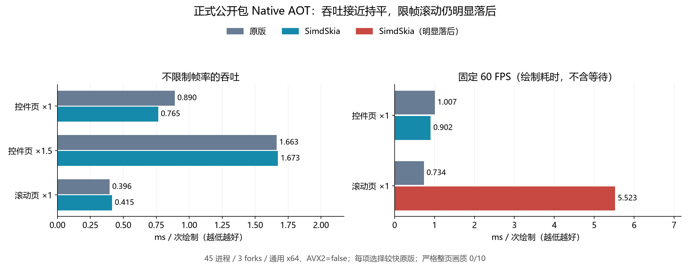
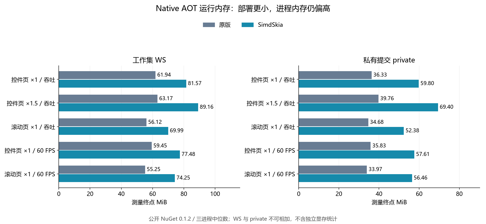
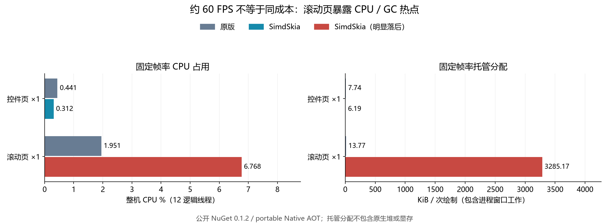

# SimdSkia 0.1.2 正式公开包：通用 x64 Native AOT、CPU/内存与默认窗口体积复测

测量日期2026-11-07。使用NuGet.org已发布0.1.2；不修改产品绘图代码。对应[preview.8→0.1.2新文章](blog/2026-11-07-simdskia-preview8-to-012-cnblogs.md)，此前测量保留。

**三个吞吐场景综合耗时比0.968，最差1.049；纳入两个固定60FPS场景后综合1.437。限帧滚动耗时7.528倍、托管分配约3.21MiB/次，严格画质0/10。整体持平且最差落后不超过10%的目标未达到。**

## 环境与方法

Windows11 x64 / i7-8700K 6核12线程 / 31.93GiB / GTX1050Ti。SDK10.0.403、runtime10.0.14、Avalonia12.1.5、原版SkiaSharp3.119.4/HarfBuzzSharp8.3.1.3。真正Native AOT，通用x64，AVX2=false、Vector128；固定同一字体、页面/尺寸/DPI。每项2秒预热5秒测量、3独立进程中位数；5场景×3变体×3fork=45进程，串行运行。

保留原版default和full-group两套透明度合同；每项选择耗时较低的原版作性能分母，不等于两者行为已相同。吞吐为连续离屏RenderTargetBitmap.Render，paced通过Task.Delay让出UI线程，CPU/分配含窗口呈现/定时器工作；绘制计时不含显式等待。它不是显示器呈现FPS或光栅内核孤立计时。

## 绘制耗时

| 场景 | 原版 ms | SimdSkia ms | 耗时比 | 选择的原版配置 |
|---|---|---|---|---|
| 控件页 ×1 / 吞吐 | 0.8898 | 0.7646 | 0.859 | original-default |
| 控件页 ×1.5 / 吞吐 | 1.6629 | 1.6733 | 1.006 | original-default |
| 滚动页 ×1 / 吞吐 | 0.3957 | 0.4151 | 1.049 | original-full |
| 控件页 ×1 / 60 FPS | 1.0073 | 0.9025 | 0.896 | original-default |
| 滚动页 ×1 / 60 FPS | 0.7337 | 5.5232 | 7.528 | original-full |



## CPU、内存和分配

| 场景 | 实现 | CPU ms/帧 | 整机 CPU % | WS MiB | private MiB | 托管 KiB/帧 |
|---|---|---|---|---|---|---|
| 控件页 ×1 / 吞吐 | 原版 | 0.890 | 8.33 | 61.94 | 36.33 | 7.09 |
| 控件页 ×1 / 吞吐 | SimdSkia | 0.762 | 8.33 | 81.57 | 59.80 | 5.50 |
| 控件页 ×1.5 / 吞吐 | 原版 | 1.658 | 8.30 | 63.17 | 39.76 | 7.09 |
| 控件页 ×1.5 / 吞吐 | SimdSkia | 1.673 | 8.33 | 89.16 | 69.40 | 5.50 |
| 滚动页 ×1 / 吞吐 | 原版 | 0.396 | 8.33 | 56.12 | 34.68 | 6.60 |
| 滚动页 ×1 / 吞吐 | SimdSkia | 0.415 | 8.33 | 69.99 | 52.38 | 2.50 |
| 控件页 ×1 / 60 FPS | 原版 | 0.882 | 0.44 | 59.45 | 35.83 | 7.74 |
| 控件页 ×1 / 60 FPS | SimdSkia | 0.625 | 0.31 | 77.48 | 57.61 | 6.19 |
| 滚动页 ×1 / 60 FPS | 原版 | 3.906 | 1.95 | 55.25 | 33.97 | 13.77 |
| 滚动页 ×1 / 60 FPS | SimdSkia | 13.542 | 6.77 | 74.25 | 56.46 | 3285.17 |

CPU%为整机12逻辑线程口径。WS/private是测量终点值（完整25ms外部采样和峰值在证据中）；二者不可相加。托管分配不计原生堆/显存。限帧滚动本库p95=13.9555ms，原版1.0076ms，3fork本库49–51次调度截止延迟、原版0–3；不能等同实际丢帧。根因尚未通过调用栈分析确认。





## 默认窗口AOT体积（另一程序，只测大小）

两个默认模板窗口保留同一Fluent/Inter、App/XAML/manifest/AOT属性，无源码项目引用；原版默认桌面配置、本库CPU，实际启动窗口与PE/CLR/JIT模块检查通过。没有删DLL或UPX，PDB单列；不含可选GPU/PDF。

| 文件类别 | 原版 | SimdSkia 0.1.2 |
|---|---|---|
| EXE | 18.58 MiB | 24.02 MiB |
| 运行 DLL | 17.97 MiB | 0.00 MiB |
| 运行文件合计（不含 PDB） | 36.55 MiB | 24.02 MiB |
| PDB（单独统计） | 164.80 MiB | 82.93 MiB |
| 全部发布文件（含 PDB） | 201.35 MiB | 106.96 MiB |

| 文件 | 字节 | MiB |
|---|---|---|
| `av_libglesv2.dll` | 5,394,096 | 5.14 |
| `libHarfBuzzSharp.dll` | 1,816,088 | 1.73 |
| `libSkiaSharp.dll` | 11,628,896 | 11.09 |

运行文件减少13,133,352字节（12.52MiB、34.27%）；EXE本身更大。旧文19.51MiB是preview.7历史结果，本次24.02MiB不能宣传为继续减小。SDK/Avalonia/依赖/功能不同，差值未做模块归因。

## 画质与复现

10幅比较全部保留FAIL，最大通道误差92–109、RMSE约2.31–3.09；门槛最大32/RMSE2。相同group合同也失败。脚本退出码2表示质量未过，不是把运行成功算作画质通过。本报告没有重新运行GPU/JIT；既有同绘图代码63进程报告单独列于文章，不能与此处AOT数混合。

在有.NET10 AOT工具链的Windows桌面，从仓库根目录执行（输出须为新目录）：

```powershell
python tools/compare-default-avalonia-aot.py --output artifacts/default-012-new --avalonia-version 12.1.5 --simdskia-version 0.1.2
python tools/run-avalonia-aot.py --output artifacts/aot-012-new --publish artifacts/aot-012-new-publish --package-version 0.1.2 --isa portable --forks 3 --warmup 2 --seconds 5
python tools/verify-final-evidence.py --directory docs/evidence/blog-preview8-to-012-2026-11-07
```

冻结证据：[目录](evidence/blog-preview8-to-012-2026-11-07/)、[机器可读汇总](evidence/blog-preview8-to-012-2026-11-07/overview.json)、[逐文件哈希](evidence/blog-preview8-to-012-2026-11-07/sha256.json)。保留45进程metrics/外部采样、原始像素内容寻址对象、构建和执行记录、默认窗口逐文件SHA与截图、实际preview.8公共API对照。

## 新旧口径

旧文章preview.8：Avalonia12.1.4/SDK10.0.402/runtime10.0.13；本次12.1.5/10.0.403/10.0.14。新旧吞吐和paced均列出，但不能把差值全部归因于引擎版本。API增量在同一3.119.4基线/工具下从实际包提取，425→3230、37→201公开类型，剩余5个真实native合同缺口；这不等于完整行为或二进制兼容。
