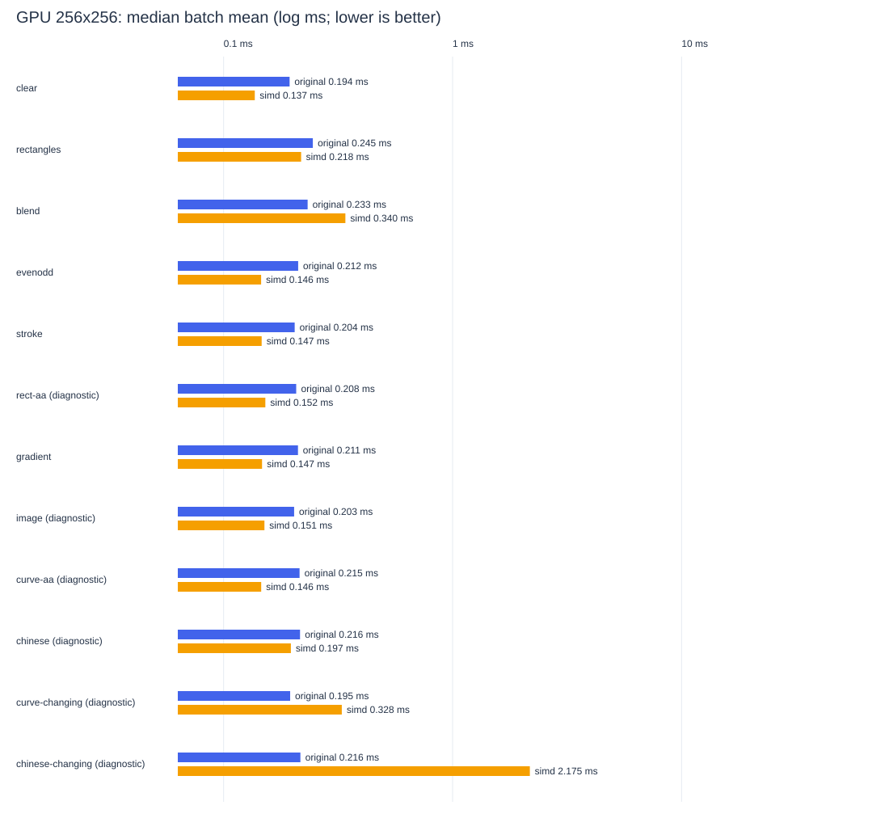
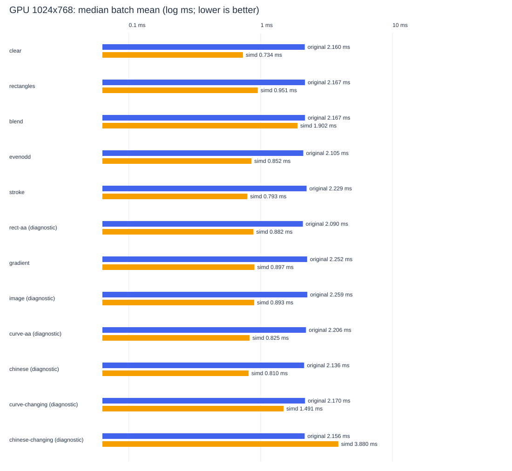

# 原版与 SimdSkia GPU(Vulkan)性能对比：2026-10-22

[窗口与冻结前后比较](VULKAN-OPTIMIZATION-2026-10-22.md)；下面保留所有原版 GPU 质量失败项及 CPU/内存数据。

实际执行：Intel(R) Core(TM) i7-8700K CPU @ 3.70GHz；Microsoft Windows 10.0.26300；.NET 8.0.32 / X64，逻辑 CPU 12。原版包 SkiaSharp 3.119.4。
原版路径：Native Skia GPU dispatch (Vulkan, NVIDIA GeForce GTX 1050 Ti)；SimdSkia 路径：SimdSkia Vulkan compute (NVIDIA GeForce GTX 1050 Ti)。
每种实现 3 个独立进程；每项每进程 7 批，目标每批 60 ms，预热至少 100 ms 且 3 帧，再校准。进程顺序/场景顺序打乱，串行执行。TieredCompilation=0。
主要结论：以 1024×768 为例，以下只列通过画质门槛的场景。

- clear：原版 2.160 ms，SimdSkia 0.734 ms，为原版耗时的 0.34 倍。
- rectangles：原版 2.167 ms，SimdSkia 0.951 ms，为原版耗时的 0.44 倍。
- blend：原版 2.167 ms，SimdSkia 1.902 ms，为原版耗时的 0.88 倍。
- evenodd：原版 2.105 ms，SimdSkia 0.852 ms，为原版耗时的 0.40 倍。
- stroke：原版 2.229 ms，SimdSkia 0.793 ms，为原版耗时的 0.36 倍。
- gradient：原版 2.252 ms，SimdSkia 0.897 ms，为原版耗时的 0.40 倍。

这次只比较同机 Vulkan GPU round-trip（绘制全部命令 + 提交 + 等待 fence + 回读主机）。未与 CPU 光栅结果混用；CPU 结果见 PERFORMANCE.md。

原始数据：[完整证据 JSON](evidence/vulkan-round3-2026-10-22.json)、[CSV](evidence/vulkan-round3-after-2026-10-22.csv)、[配置和哈希](evidence/vulkan-round3-2026-10-22.json)。工作进程数据、逐帧 ticks、像素和日志保留在同目录。

## 256×256：时间与质量

表内 ms 为多进程所有批均值的中位数；‘慢倍数’=SimdSkia / 原版，低于 1 表示更快。质量未过不给性能胜负结论。

| 场景 | 原版 ms | SimdSkia ms | 慢倍数 | SimdSkia P95 ms | 质量 |
| --- | ---: | ---: | ---: | ---: | --- |
| clear | 0.194 | 0.137 | 0.70× | 0.165 | 通过 max=0 |
| rectangles | 0.245 | 0.218 | 0.89× | 0.280 | 通过 max=0 |
| blend | 0.233 | 0.340 | 1.46× | 0.456 | 通过 max=0 |
| evenodd | 0.212 | 0.146 | 0.69× | 0.173 | 通过 max=0 |
| stroke | 0.204 | 0.147 | 0.72× | 0.169 | 通过 max=0 |
| rect-aa | 0.208 | 0.152 | — | 0.180 | 诊断：max 41>2 |
| gradient | 0.211 | 0.147 | 0.70× | 0.190 | 通过 max=1 |
| image | 0.203 | 0.151 | — | 0.184 | 诊断：max 249>0 |
| curve-aa | 0.215 | 0.146 | — | 0.174 | 诊断：max 45>32 |
| chinese | 0.216 | 0.197 | — | 0.265 | 诊断：max 173>32 |
| curve-changing | 0.195 | 0.328 | — | 0.402 | 诊断：max 45>32 |
| chinese-changing | 0.216 | 2.175 | — | 2.620 | 诊断：max 173>32 |

### 托管分配、进程内存、CPU 使用率

下表内存绝对值含 runtime、Vulkan 驱动映射与先前场景，不等于显存/渲染缓冲用量。CPU ms/帧为各批进程总处理器时间累计/总帧数；CPU% 按累计 CPU 时间/累计墙钟加权，单逻辑核归一（100% = 一核满载）。JSON/CSV 同时提供除以逻辑核数的机器占用。满速占用不等于固定帧率应用占用，Windows 处理器时间有计数粒度，短批内 0 不代表不消耗 CPU。

| 场景 | 原 B/op | Simd B/op | 原 CPU ms/帧 | Simd CPU ms/帧 | 原 CPU% 单核 | Simd CPU% 单核 | 原 private MiB | Simd private MiB | 原 working set MiB | Simd working set MiB |
| --- | ---: | ---: | ---: | ---: | ---: | ---: | ---: | ---: | ---: | ---: |
| clear | 0 | 704 | 0.121 | 0.060 | 61.8 | 43.9 | 103.5 | 98.7 | 91.2 | 95.2 |
| rectangles | 0 | 704 | 0.177 | 0.133 | 71.4 | 59.7 | 103.8 | 94.3 | 90.8 | 91.0 |
| blend | 0 | 705 | 0.162 | 0.193 | 69.3 | 53.3 | 102.8 | 98.3 | 90.8 | 92.2 |
| evenodd | 0 | 704 | 0.150 | 0.088 | 69.0 | 59.4 | 103.5 | 97.7 | 90.9 | 94.8 |
| stroke | 0 | 704 | 0.143 | 0.051 | 71.6 | 35.5 | 103.5 | 98.1 | 90.8 | 96.7 |
| rect-aa | 0 | 704 | 0.128 | 0.073 | 61.9 | 48.2 | 103.9 | 96.9 | 91.2 | 95.6 |
| gradient | 0 | 704 | 0.143 | 0.076 | 63.3 | 49.3 | 103.2 | 94.4 | 90.8 | 91.0 |
| image | 104 | 1088 | 0.136 | 0.063 | 62.9 | 41.1 | 103.0 | 96.8 | 91.5 | 94.7 |
| curve-aa | 0 | 704 | 0.143 | 0.062 | 64.6 | 42.6 | 104.2 | 97.6 | 91.2 | 95.5 |
| chinese | 640 | 704 | 0.151 | 0.099 | 66.8 | 49.6 | 104.2 | 107.4 | 91.6 | 102.3 |
| curve-changing | 0 | 33137 | 0.131 | 0.173 | 63.3 | 53.4 | 101.8 | 98.0 | 90.5 | 93.0 |
| chinese-changing | 640 | 350548 | 0.159 | 1.333 | 72.2 | 61.5 | 104.6 | 113.7 | 91.3 | 110.7 |

完整 op/s、GC 次数、托管 retained、进程历史峰值、IQR 和 CV 在 CSV/JSON。

## 1024×768：时间与质量

表内 ms 为多进程所有批均值的中位数；‘慢倍数’=SimdSkia / 原版，低于 1 表示更快。质量未过不给性能胜负结论。

| 场景 | 原版 ms | SimdSkia ms | 慢倍数 | SimdSkia P95 ms | 质量 |
| --- | ---: | ---: | ---: | ---: | --- |
| clear | 2.160 | 0.734 | 0.34× | 0.782 | 通过 max=0 |
| rectangles | 2.167 | 0.951 | 0.44× | 1.054 | 通过 max=0 |
| blend | 2.167 | 1.902 | 0.88× | 1.994 | 通过 max=0 |
| evenodd | 2.105 | 0.852 | 0.40× | 0.904 | 通过 max=0 |
| stroke | 2.229 | 0.793 | 0.36× | 0.860 | 通过 max=0 |
| rect-aa | 2.090 | 0.882 | — | 0.955 | 诊断：max 41>2 |
| gradient | 2.252 | 0.897 | 0.40× | 0.986 | 通过 max=1 |
| image | 2.259 | 0.893 | — | 0.962 | 诊断：max 253>0 |
| curve-aa | 2.206 | 0.825 | — | 0.888 | 诊断：max 44>32 |
| chinese | 2.136 | 0.810 | — | 0.874 | 诊断：max 173>32 |
| curve-changing | 2.170 | 1.491 | — | 1.655 | 诊断：max 44>32 |
| chinese-changing | 2.156 | 3.880 | — | 4.540 | 诊断：max 173>32 |

### 托管分配、进程内存、CPU 使用率

下表内存绝对值含 runtime、Vulkan 驱动映射与先前场景，不等于显存/渲染缓冲用量。CPU ms/帧为各批进程总处理器时间累计/总帧数；CPU% 按累计 CPU 时间/累计墙钟加权，单逻辑核归一（100% = 一核满载）。JSON/CSV 同时提供除以逻辑核数的机器占用。满速占用不等于固定帧率应用占用，Windows 处理器时间有计数粒度，短批内 0 不代表不消耗 CPU。

| 场景 | 原 B/op | Simd B/op | 原 CPU ms/帧 | Simd CPU ms/帧 | 原 CPU% 单核 | Simd CPU% 单核 | 原 private MiB | Simd private MiB | 原 working set MiB | Simd working set MiB |
| --- | ---: | ---: | ---: | ---: | ---: | ---: | ---: | ---: | ---: | ---: |
| clear | 0 | 705 | 1.523 | 0.375 | 69.1 | 51.5 | 106.1 | 104.4 | 93.6 | 98.1 |
| rectangles | 0 | 706 | 1.614 | 0.366 | 71.3 | 38.4 | 106.2 | 101.1 | 93.7 | 99.5 |
| blend | 0 | 707 | 1.562 | 0.273 | 68.1 | 14.4 | 105.8 | 101.4 | 93.9 | 96.1 |
| evenodd | 0 | 705 | 1.395 | 0.298 | 63.4 | 35.3 | 106.1 | 106.8 | 93.6 | 98.0 |
| stroke | 0 | 706 | 1.517 | 0.274 | 67.1 | 35.1 | 106.3 | 103.7 | 93.6 | 97.4 |
| rect-aa | 0 | 706 | 1.411 | 0.276 | 67.6 | 31.3 | 105.3 | 99.9 | 92.9 | 98.3 |
| gradient | 0 | 706 | 1.416 | 0.258 | 63.8 | 28.6 | 106.5 | 100.0 | 93.6 | 97.9 |
| image | 104 | 1089 | 1.497 | 0.335 | 65.9 | 37.7 | 106.1 | 101.6 | 93.6 | 96.1 |
| curve-aa | 0 | 705 | 1.674 | 0.273 | 74.9 | 33.1 | 106.1 | 110.2 | 93.7 | 107.7 |
| chinese | 640 | 706 | 1.392 | 0.326 | 65.2 | 40.4 | 107.4 | 112.6 | 94.2 | 109.0 |
| curve-changing | 0 | 201634 | 1.594 | 0.676 | 73.6 | 45.3 | 100.6 | 108.3 | 93.0 | 100.0 |
| chinese-changing | 640 | 485988 | 1.626 | 2.042 | 75.0 | 52.2 | 107.3 | 122.6 | 93.9 | 120.1 |

完整 op/s、GC 次数、托管 retained、进程历史峰值、IQR 和 CV 在 CSV/JSON。

## 解读边界

- 每个‘op’是一整帧 GPU round-trip：绘制全部命令 + flush 提交 + fence 等待 + 主机回读拷贝。rectangles/blend 每帧 65 条命令（1 clear+64 draw），chinese 含 4 行文字，其余 1 项。几何/字体/纹理准备不在计时内；每帧的命令录制、提交、等待与回读在计时内。
- 双方目标像素格式 RGBA8888/Premul，同一 GPU 上各自独立初始化 Vulkan（原版用 graphics queue + GRContext 光栅后端；SimdSkia 用 compute queue + 自研 compute shader 管线）。
- 固定场景允许正常复用纹理/缓存（SimdSkia 纹理缓存 ≤32 个/64MiB LRU）；curve-changing/chinese-changing 场景每帧移动 1/16 像素、97 个位置循环，强制覆盖率/文字缓存持续未命中。变化场景像素 gate 检查 frame=0。
- 质量门槛以原版 GPU 输出为基准逐通道比较；AA/字体必须检查本轮相同尺寸的像素 gate；失败的时间保留为诊断数据。未提高容差，也未降低画质。
- B/op 是线程托管分配，不含 native malloc 与显存。private/working set 是整个进程，包含 runtime、Vulkan 驱动映射、native/字体缓存和先前场景，不能当显存或纯渲染缓冲内存公平排名；peak working set 是进程历史峰值。
- P95 是实际单帧延迟，包含 GC/调度/驱动抖动；耗时列是批均值中位数，两者定义不同。
- 帧时间由 CPU 计时（Stopwatch）测得，包含每帧回读同步；驱动内部排队可能引入噪声。样本不控制 OS power plan/Turbo/其他用户进程，不给所有硬件的优势承诺。

GPU pixel acceptance: 12/24. Failed rows remain diagnostic; no threshold was relaxed.
