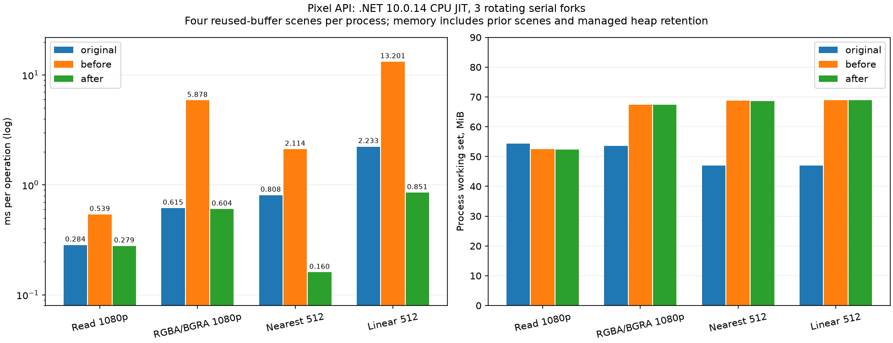

# 像素公共API扩展与CPU性能（2026-11-06，未发布）

公共元数据匹配 **1146→1279/3235**，公开类型65→70，缺口2089→1956，额外/不同签名0。本批新增133条匹配项，包含类型、属性、枚举字段及重载，不是133个独立算法。相对最初892项，五批累计增加387项，含134个命名颜色字段。公开NuGet仍为0.1.1，本批未推送或发布。

## 新增的可运行能力

| 领域 | 新匹配项 | 实际功能 |
| --- | ---: | --- |
| SKPixmap | 47 | 托管像素保留视图、外部非拥有指针描述、stride/格式/Alpha信息、字节/泛型Span、指针/像素读取、实际透明度扫描、重置、别名子集、元数据重解释、读取/格式转换、擦除、缩放和通用编码 |
| SKBitmap | 24 | PeekPixels、Pixels数组、GetAddress、Reset、immutable标记、状态查询、Copy/CopyTo颜色类型转换、Resize/ScalePixels及旧重载、Stream编码、SKData解码 |
| SKImage | 15 | Info/IsAlphaOnly、PeekPixels、指针/像素图ReadPixels和ScalePixels、缓存提示及旧重载 |
| SKColorF | 26 | 浮点RGBA、分量替换/钳制、HSL/HSV、颜色转换、相等性/Hash/字符串 |
| SKAutoCanvasRestore | 5 | 保存状态并在离开作用域或显式Restore时恢复，仅恢复一次，允许null或先释放画布 |
| 枚举及图像信息 | 13 | SKFilterQuality、SKImageCachingHint、SKImageInfo.Size/Rect/WithSize(SKSizeI) |
| SKSurface | 3 | PeekPixels两重载、指针ReadPixels |

以上接口用同一份调用源码分别编译到原版SkiaSharp3.119.4与本库，未链接原版进行产品绘图。外部指针是调用方拥有的像素内存，不是Google Skia句柄；InstallPixels/SetPixels及GR/native handle接入仍未实现。

实现保留RGBA/BGRA、Premul/Unpremul/Opaque、行填充、负源坐标裁切及目标未覆盖区域。Opaque是元数据，不强行抹掉物理Alpha，擦除后透明度按实际字节扫描；与原版分开核对。WithColorType/WithAlphaType只重解释元数据；需要转换应调用ReadPixels。缩放支持最近邻、双线性和有限B/C的三次重采样，包括Mitchell/CatmullRom；mipmap、各向异性及旧Medium质量要求明确报错，不能把它们静默映射为Linear。

Copy/CopyTo按原版分配独立紧凑行，而不是复制源行填充。旧基础测试的“保留stride”预期已按原版修正，仍检查源修改不影响副本；原失败日志也保留。SetImmutable是与原版一致的调用者承诺，不是内存写保护，已取得的Span/指针不能撤销。

## 生命周期、输入验证与未兼容行为

托管PeekPixels、ExtractSubset和With*视图保留存储租约，源位图Reset/重分配/Dispose后仍可在视图有效期内读取；视图Reset/Dispose归还租约、释放懒固定的指针。外部构造器不复制或释放调用方内存，调用方须保证其有效且同步访问；元数据无法验证一个外部指针真实拥有多大内存。空地址的ReadPixels返回false，非法坐标、已释放对象和未支持格式明确报错。重叠传输先保存源像素，避免别名写入破坏未读区域。

本批 **Span行为有意保留7组差异、19个字段**：原版3.119.4的GetPixelSpan按Info的紧凑字节数计算，对byte位置使用紧凑偏移，对泛型位置使用y×Height+x；本库按实际stride返回到最后可见像素，并使用物理行偏移。非方形泛型位置即使没有padding也可能不同。原版方法源码已固定存档；不会为了让检查变绿而改成错误行定位。指针GetPixels(x,y)、ReadPixels、子集及padding保护分别验证，兼容报告仍记metadataPassed=false，默认检查退出2。

其他边界：像素格式仍仅RGBA/BGRA8888，不能因新增SKColorF而宣称支持F16/HDR或完整色彩空间；PNG/JPEG等沿用既有编解码能力与限制，编码选项类型及SKWStream重载仍有缺口。SKImage的像素视图应按原版不可变图像的约定使用，不承诺修改不可变图像后的缓存行为。完整异常、native ABI及二进制替代未成立。

## 性能实现

- 连续、同格式/Alpha读取合并为一次Span.CopyTo；有padding时按可见行复制，不读取/改写填充区。
- RGBA/BGRA通道交换采用Vector<uint>批量位运算，保留标量尾部与硬件禁用路径，不依赖单一x64指令集。
- 最近邻预计算横向坐标，直接搬运32位像素；双线性复用现有AVX2八像素内核，提供运算次序和舍入一致的标量路径。直通路径只对适合的Alpha/格式启用，透明直通及三次采样保持完整算法。
- 横向采样表用有界stackalloc，大宽度租借ArrayPool并finally归还，没有整图结果缓存。指针读取重载通过有界Span直接处理，去除临时SKPixmap对象。

## 原版、初始实现与优化后的同机CPU对照

Windows x64、i7-8700K（12逻辑处理器）、.NET10.0.14 JIT、SDK10.0.403。固定原版SkiaSharp3.119.4；三组冻结二进制，三轮旋转顺序、9个串行进程，每个场景预热0.4秒、采样0.8秒，期间不构建。修改前是本批新像素API的初始实现，不是公开0.1.1（旧包没有这些完整接口）。另一次9进程试测留在artifacts，不与最终成绩混用。

每进程依次测4个场景，复用源/目标缓冲区，完整读取1920×1080或由1920×1080缩放至512×512。未缓存输出图像，也不包含编码、窗口呈现或GPU。下表为三轮中位数。

| 场景 | 原版 ms/次 | 修改前 | 优化后 | 前/后提速 |
| --- | ---: | ---: | ---: | ---: |
| 1080p同格式读取 | 0.2842 | 0.5386 | 0.2789 | 1.93倍 |
| 1080p RGBA/BGRA转换 | 0.6155 | 5.8783 | 0.6037 | 9.74倍 |
| 最近邻缩放512×512 | 0.8076 | 2.1144 | 0.1604 | 13.19倍 |
| 双线性缩放512×512 | 2.2329 | 13.2014 | 0.8506 | 15.52倍 |

读取和通道交换已接近原版，约2%差异不作为确定超越结论；两个受测缩放场景更快。四个基准修改前后字节完全一致，与原版最大通道差分别0/0/0/1。另246组共同的像素用例修改前后也逐字节相同。不能推广为所有尺寸、透明度、三次采样或整应用都达到这一速度。

| 场景 | 原版/本库CPU ms/次 | 原版/本库WS MiB | 原版/本库Private MiB | 本库托管分配 B/次 |
| --- | ---: | ---: | ---: | ---: |
| 同格式读取 | 0.2830 / 0.2886 | 54.34 / 52.42 | 34.09 / 34.22 | 0.00 |
| 通道交换 | 0.6130 / 0.6010 | 53.57 / 67.36 | 32.65 / 48.56 | 0.00 |
| 最近邻 | 0.8107 / 0.1597 | 46.97 / 68.69 | 25.80 / 49.94 | 0.05 |
| 双线性 | 2.2507 / 0.8468 | 46.98 / 68.88 | 25.87 / 50.04 | 0.26 |

满速循环中各组CPU总占用约8.3%（12线程中约一个核心），较快实现会完成更多操作，不能据此认为单位工作CPU相同。应看每次CPU耗时；TotalProcessorTime存在计时粒度误差。分配计数含固定测量开销，另用六条实际操作预热30次/循环100次验证稳态0托管字节，正常与禁用全部intrinsics均通过；原版托管0不代表原生0分配。

**内存没有全面追平**：通道交换/缩放的WS和Private仍明显高于原版，也没有随本次提速明显下降。每进程先后运行4场景，采样前强制GC，内存包含运行时、托管像素、此前场景和输出数组的堆驻留，不是单个内核缓存大小。不能把零分配说成低工作集，更不能当成整页Avalonia的内存结果。



## 测试结果和保留的失败

- 431组元数据/行为、10875个值；除上述Span的19个字段外，检查全部通过。八项null/数组长度/泛型参数异常及默认Copy行布局另与原版对照。
- 462组原版像素转换/指针读取/裁切/擦除/采样全部达到预设门槛：读取/最近邻/擦除最大差1，双线性/三次最大差3，未按结果放宽。包含前后哨兵与行填充字节。默认检查因Span差异仍退出2。
- 1358项本地检查通过，含360组双线性标量/SIMD、360组交换标量/SIMD精确比较，涵盖尾部、大宽度池、Alpha钳制及stride；六种零分配操作、视图多层保留/释放、重叠读写和拒绝前不写入。关闭全部硬件intrinsics再跑同样1358项通过。
- 新Native AOT实际执行10项通过，确认DynamicCodeSupported=false；Windows x64实机，未冒称新API在其他架构已实测。
- 完整Release构建0警告/错误；基础36、精确优化472085（正常/禁用intrinsics）、编解码1417、PDF18、Features、控件9750、原几何4612值、shader50场景/30擦除、Vulkan实际设备与Direct2D148060断言回归通过。
- 原描边53组605值及606项本地检查仍通过，原版画质仍27/48，工具退出2。独立Imaging先通过369项，再在既有Opaque/alpha32/erase JPEG严格门槛失败，与上一批记录相同；未改判全绿。整页画质失败与其他未实现API继续保留。

本批没有新的整页Avalonia或GPU性能成绩；CPU仍默认，Vulkan/Direct2D既有回归不等于新GPU跑分。前批窗口及GPU记录见[历史API/GPU报告](API-GPU-2026-11-06.md)。

后续诊断补记：[JPEG与整页失败归因](JPEG-QUALITY-ATTRIBUTION-2026-11-06.md)。24组交叉回读确认三组JPEG严格差异在编码侧，两个解码器对相同文件逐字节一致；本库默认4:4:4与原版4:2:0还存在参数兼容差距，统一采样后仍有三例差2。本补记不改变本批测试/性能快照，也没有修复或改判旧失败。

## 剩余1956项的处理顺序

不能把这些数都解释为“1956个可独立画图函数”。它们包括字段、枚举、类型、重载、旧接口及原生句柄契约。完整逐条缺口见[API差异](api/comparison.json)，按类型统计见[机器清单](evidence/pixel-api-2026-11-06/remaining-by-type.json)。

| 优先领域 | 当前主要缺口 | 兼顾性能的实施方向 |
| --- | --- | --- |
| 路径与几何 | SKPath42项、PathMeasure、迭代器、SVG弧/读写、路径布尔运算 | 可复用几何快照，避免每次全量展开；保留曲线精度和填充规则 |
| 图片和像素 | SKImage80、SKBitmap36、SKPixmap剩余编码选项，外部存储生命周期 | 先补调用链和实际格式，再复用连续缓冲；不伪造InstallPixels所有权/回调 |
| 字体与文字 | SKFont88、SKTypeface34、FontManager、度量/布局扩展 | 字体视图生命周期、批量Span字形度量与有界缓存；复杂shaping仍需实算法 |
| 画笔/着色/滤镜 | SKPaint122、SKCanvas83、SKImageFilter85、SKShader48 | 共用后端命令和颜色流程，先正确再测SIMD/纹理缓存；未实现继续报错 |
| 流、颜色与其他 | SKStream29等托管桥接、完整色彩空间、Region/Matrix44等 | 支持真实流定位/所有权，减少中间数组；颜色处理不能省略 |
| Skia原生GPU/句柄 | GR上下文、纹理、原生回调及ABI | 与自有Vulkan/Direct2D分别评估，不能通过同名空对象声称兼容Google Skia句柄 |

## 运行与复现

```powershell
dotnet build SimdSkia.sln -c Release
dotnet run --project examples/Pixels -c Release
python tools/check-pixel-compatibility.py --output artifacts/pixel-check-new # 当前因Span差异退出2
dotnet run --project tests/PixelCompatibility/Managed -c Release -- artifacts/pixel-managed-new
dotnet publish tests/PixelCompatibility/NativeAot -c Release -r win-x64 -o artifacts/pixel-aot-new
.\artifacts\pixel-aot-new\NativeAot.exe
```


性能复现先冻结修改前/后及原版benchmarks/PixelCompatibility二进制，再运行tools/run-pixel-benchmarks.py；原目录、命令和逐进程数据在[冻结清单](evidence/pixel-api-2026-11-06/performance-manifest.json)和[运行记录](evidence/pixel-api-2026-11-06/performance-runs.json)。API新增[133项](evidence/pixel-api-2026-11-06/new-api.json)、[原版逐组对照](evidence/pixel-api-2026-11-06/comparison.json)、[全部像素输入输出](evidence/pixel-api-2026-11-06/pixel-oracle.zip)、[前后精确比较](evidence/pixel-api-2026-11-06/pixel-before-after.json)、[回归日志清单](evidence/pixel-api-2026-11-06/regression.json)、[源哈希](evidence/pixel-api-2026-11-06/source-hashes.json)、[总状态](evidence/pixel-api-2026-11-06/status.json)和[证据校验](evidence/pixel-api-2026-11-06/sha256.json)均保留。CI增加本地检查/AOT，但本轮没有推送执行。

固定版本原版源码依据：[SKPixmap](https://github.com/mono/SkiaSharp/blob/v3.119.4/binding/SkiaSharp/SKPixmap.cs)、[SKBitmap](https://github.com/mono/SkiaSharp/blob/v3.119.4/binding/SkiaSharp/SKBitmap.cs)、[SKColorF](https://github.com/mono/SkiaSharp/blob/v3.119.4/binding/SkiaSharp/SKColorF.cs)。HSL/HSV算法沿用MIT代码并保留归属，转换与像素内核由本仓库C#实现；没有新增生产依赖或原生分发库。报告图表只用既有开发Python环境。
