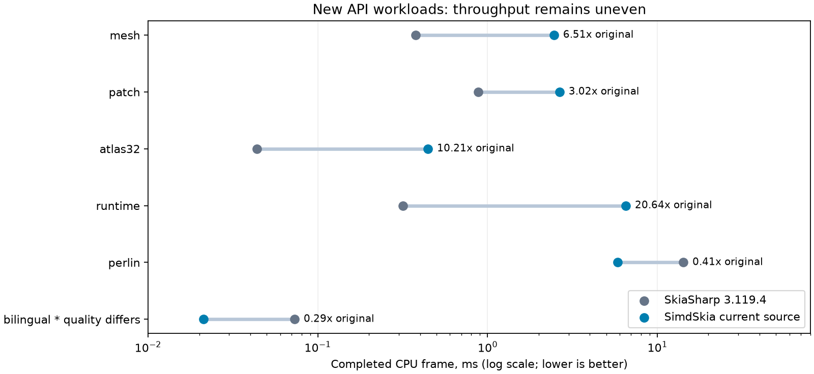
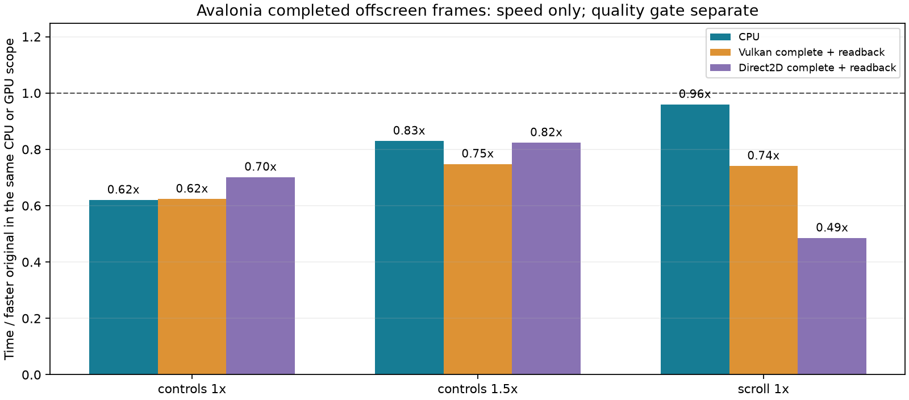
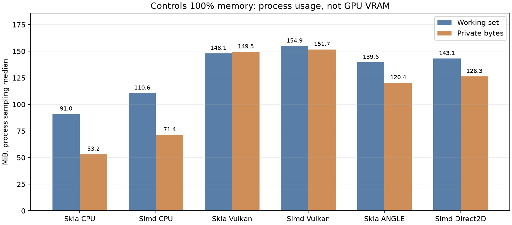

# 公共 API 缺口降至 99 项：功能、画质、CPU/GPU 与内存实测

2026-11-07，Windows x64，源码开发快照，**尚未发布**。固定 SkiaSharp **3.119.4 / 3235 项**，现 **3136 匹配、99 缺口、200 公开类型、0 额外签名**（96.94% 元数据匹配）。从上一冻结快照 2726 增加 410 项，缺口由 509 降至 99；更早 1146 快照的缺口为 2089。没有缩小基线、用空绘图或只补抛异常签名凑数。NuGet **0.1.1 不变，不含本轮源码新增能力**。

## 兼容范围

这是源码兼容清单：含类型、方法/重载、属性、枚举、接口、可见性、默认参数和工具检查的属性。元数据匹配不证明所有参数、绘图结果或生命周期已兼容；protected API、工具未提取的属性、nullable 等另需审查。SkiaSharp 强名称程序集与本程序集名称/公钥不同，**不承诺二进制直接替换**。原生 Skia Handle 不伪造，调用方像素指针与系统 Vulkan/GL 互操作另有实际实现。

- RuntimeEffect：C# 类型化 AST 解释执行，uniform/数组/矩阵/完整 32 位整数、child shader/filter/blender、builder 与资源租约。无动态代码生成，AOT 可运行；完整 SkSL 的 helper/loop/switch/unsigned/derivative 等未实现语法返回编译错误。
- Lattice/nine-patch、Picture/Recorder/Drawable、NoDraw/NWay/Overdraw、NullSurface、float 渐变/两圆锥、RawShader/ApplyImageFilter、Perlin、Vertices/Atlas/Coons Patch 和 PDF 注释都参与真实绘图或其定义的非绘图合同。Picture shader 当前为有界光栅 tile，不是随 CTM 自适应的矢量重绘；SKP 序列化仍缺。
- GRContext/SKSurface 新增真实的借用 Vulkan 设备和离屏绘制链路，含完成同步、资源统计、缓存清理与弃用；只拥有本库新建资源，不销毁调用方 VkDevice。单采样 compute 路径；mips/MSAA/保护上下文及外部纹理导入仍有缺口或明确拒绝。GL 接口只验证真实函数表/能力，不表示实现了 GRContext.CreateGl 绘图。
- PDF 生成仍为光栅页，文字不可搜索；新增 URL、跨页命名目标、录制注释回放、SKWStream 输出。读取支持明确无外观且无边框的导航链接；可见注释、表单、其他未实现 PDF 特性仍报错。PDF 不是 SkiaSharp 的原生 PDF 读取 API。
- GPU 不会静默遗漏新增 CPU 功能。当前 GPU 对固定网格/Atlas/Patch、部分 shader/filter/lattice/save-layer 命令明确拒绝；Avalonia 既有配置的回退另有统计。

## 正确性与生命周期

完整 Release **零警告/零错误**。独立回归 basic/pixels/codecs/pdf/features/platform-fonts/optimization/Avalonia/controls/Direct2D/Vulkan/GPU-sampling 全通过；精确优化 **474413** 项，PDF **22** 项。Imaging 在 **12410** 项独立检查后仍失败于既有 JPEG 原版编码画质门槛，未改绿。

| 功能族 | 原版像素通过/总数 | 元数据差异 |
|---|---:|---:|
| canvas-views | 17/17 | 0/4 |
| drawing-additions | 58/58 | 0/0 |
| float-shaders | 144/144 | 0/72 |
| gpu-context | 10/10 | 0/3 |
| image-operations | 22/28 | 0/12 |
| lattice-resources | 56/56 | 0/8 |
| mesh-atlas | 85/85 | 0/0 |
| path-boolean | 40/160 | 1/184 |
| perlin | 144/144 | 0/5 |
| pictures | 44/64 | 0/14 |
| runtime-effects | 37/37 | 0/48 |

常规新绘图门槛 max channel ≤3、RMSE ≤0.75（以各 comparison.json 的 gate 为准）；未放宽门槛隐藏曲线/文字差异。

Lattice 的 56/56 是明确的 packed-lattice 语义 oracle：基线 C# 包装层把 int 枚举数组交给 byte 布局，原始包装层失败另留历史记录，不能称未修改包装层逐字节一致。Path Boolean 使用 Clipper2 托管运算，曲线按 1/1024 单位展平、六位小数裁剪，结果不保留原曲线 verbs；OpBuilder 的一个拓扑差异与原版全 Union 对 even-odd 输入的优化有关。ApplyImageFilter 只对比定义的 outSubset/offset，未把 native backing 的 padding 当作有效内容。

Runtime uniform 值合同 34/34、48 个 runtime-effect 元数据核对通过；Mesh/Atlas 各 215 个局部断言，新增绘图各 109 个；字体/资源缓存原版和本实现各 30 个并发/禁用/清理检查。真实 ANGLE/Vulkan/COM 各 7 个检查及能力元数据一致；独立 PdfPig 对两种 DPI 的链接、坐标、跨页目标解析一致，各 12 个检查。

实际 Native AOT 新增集成 **24 项**分别在 Vector128 与显式关闭本库 SIMD 的 Scalar 清屏模式通过（不是 JIT 的 PublishAot 属性）。JIT Perlin 144 幅图在所有硬件 intrinsics 禁用时与正常输出逐字节相同，Vector.IsHardwareAccelerated=false。AOT 解释器 child 的外部像素 release callback 在最后一个 Picture/paint 所有者释放后恰好触发一次。原版存在的崩溃、早期失败、回归期间发现并修复的普通路径一字节差异均保留。

## 性能与内存方法

同机 i7-8700K 6 核/12 线程、GTX 1050 Ti、Windows 26300、.NET SDK10.0.403/runtime10.0.14。CPU JIT 三轮、轮换、独立串行进程；新 API 每场景预热0.5s/测量0.8s，旧通用绘图预热0.4s/测量0.8s。最终轮采集期间不构建或并行跑测试。首轮发现 run 缓存仅256KiB导致抖动，已中断并标INVALID：控件100%约6.1ms、150%约12.4ms、每帧约1.58MB分配。保持总预算2MiB，重新分配给packed run后才复验和采集最终轮；没有用增大总预算掩盖问题。下表为三轮中位数，CPU% 分母为12逻辑处理器，满速吞吐的一核饱和约8.3%，不是固定FPS下的CPU/能耗。分配为托管计数，WS/Private为进程测量点，包含JIT/GC/此前场景/缓存，不能当单个对象的净占用。

### 新 API：优化前/当前/原版



优化前为同一 worker 的本轮开发二进制，**不是公开0.1.1，也不是上一冻结2726快照**。优化移除每三角形临时 SKShader/SKPaint，记录时仍由原始 paint 的独立租约保活；固定三角覆盖缓存懒分配、最多4096项/约2MiB，避免曲面轮流挤出64项普通路径 LRU；普通路径边的计算顺序保留旧行为。

| 场景 | 原版 ms | 优化前 ms | 当前 ms | 当前/原版 | 分配 前→后 B/帧 |
|---|---:|---:|---:|---:|---:|
| mesh | 0.3779 | 2.4597 | 2.4620 | 6.51× | 331.7→2.9 |
| patch | 0.8811 | 3.1839 | 2.6570 | 3.02× | 991734.5→3.2 |
| atlas32 | 0.0436 | 0.4593 | 0.4455 | 10.21× | 6177.4→272.5 |
| runtime | 0.3163 | 6.7666 | 6.5272 | 20.64× | 5.0→4.9 |
| perlin | 14.2453 | 5.8262 | 5.8434 | 0.41× | 4.3→4.4 |
| bilingual | 0.0730 | 0.0211 | 0.0212 | 0.29× | 0.0→0.0 |

| 场景 | 原版/当前 CPU ms/帧 | 原版/当前 CPU% | 原版/当前 WS MiB | 原版/当前 Private MiB |
|---|---:|---:|---:|---:|
| mesh | 0.376/2.452 | 8.30/8.30 | 27.95/32.41 | 8.91/12.54 |
| patch | 0.878/2.639 | 8.30/8.28 | 27.52/34.04 | 7.65/13.80 |
| atlas32 | 0.043/0.444 | 8.30/8.30 | 30.78/34.83 | 10.13/14.02 |
| runtime | 0.315/6.625 | 8.30/8.59 | 32.34/36.17 | 10.74/14.56 |
| perlin | 14.254/5.888 | 8.34/8.30 | 29.81/35.47 | 8.09/13.64 |
| bilingual | 0.074/0.021 | 8.46/8.30 | 40.82/38.14 | 18.50/14.78 |

完整原版像素误差见 api99-timing-2/quality.json，不能把低分配等同于原版吞吐持平。Runtime AST、CPU 网格/Atlas 仍有显著性能差距；Perlin 在本场景快于原版。中英文热路径虽更快，但该基准文字图像与原版 max207/RMSE23.54，未过严格画质门槛，不能作为同画质性能优势。缓存的全局字体默认预算现与原版实测2MiB对齐：outline128KiB、glyph128KiB、run1536KiB、text256KiB；缓存 byte 是估算载荷，Count 是本引擎 owner 数，不是 native strike 数，也不包括存活字体源文件和所有 canvas/GPU 缓存。

### 已有 CPU 绘图复测

| 场景 | 原版 µs | 当前 µs | 当前/原版 | 当前 B/帧 |
|---|---:|---:|---:|---:|
| clear-1024x512 | 51.14 | 54.24 | 1.061× | 0.04 |
| opaque-rectangle | 50.72 | 54.36 | 1.072× | 0.04 |
| alpha-rectangle | 945.49 | 165.86 | 0.175× | 0.12 |
| linear-gradient | 1491.25 | 55.87 | 0.037× | 0.09 |
| nearest-image | 423.35 | 57.93 | 0.137× | 0.13 |
| linear-image | 1122.72 | 456.95 | 0.407× | 1.11 |
| multiply-rectangle | 1157.87 | 169.29 | 0.146× | 0.49 |
| repeat-image-shader | 1258.12 | 27.13 | 0.022× | 0.07 |
| lighting-color-filter | 51.43 | 54.65 | 1.063× | 0.13 |

### 真实 Avalonia 控件：CPU、Vulkan、Direct2D



使用同一共享控件 harness，三轮，每次3s预热/5s采集，controls(1×/1.5×)和scroll(1×)。GPU 等待实际完成并回读完整 BGRA8888；区分 recording 与 completion，不能拿仅提交时间比较 CPU 完成帧。不是窗口 swapchain 呈现、启动白屏或 AOT 性能。原版 Vulkan 与 ANGLE，以及本实现 Vulkan/Direct2D 是独立 GPU 结果，CPU 单列。

| 场景/缩放 | 原版 CPU 默认/参考 ms | 当前 CPU ms | 原版 Vulkan/ANGLE ms | 当前 Vulkan/Direct2D ms |
|---|---:|---:|---:|---:|
| controls/1 | 0.961/0.973 | 0.596 | 2.553/2.612 | 1.592/1.790 |
| controls/1.5 | 1.901/1.900 | 1.576 | 3.808/4.875 | 2.848/3.136 |
| scroll/1 | 0.378/0.376 | 0.361 | 2.362/1.867 | 1.383/0.906 |

| 场景/缩放/后端 | CPU% | CPU ms/帧 | 分配 B/帧 | WS MiB | Private MiB |
|---|---:|---:|---:|---:|---:|
| controls/1/original-cpu-default | 8.31 | 0.959 | 5256 | 91.01 | 53.16 |
| controls/1/cpu | 8.33 | 0.598 | 5513 | 110.63 | 71.39 |
| controls/1/original-vulkan | 6.51 | 1.995 | 5256 | 148.06 | 149.45 |
| controls/1/vulkan | 3.93 | 0.763 | 8042 | 154.89 | 151.73 |
| controls/1/original-angle | 9.29 | 2.889 | 5256 | 139.61 | 120.37 |
| controls/1/direct2d | 10.83 | 2.327 | 5762 | 143.11 | 126.35 |
| controls/1.5/original-cpu-default | 8.33 | 1.895 | 5256 | 94.59 | 56.74 |
| controls/1.5/cpu | 8.33 | 1.582 | 5513 | 114.26 | 75.18 |
| controls/1.5/original-vulkan | 6.87 | 3.127 | 5256 | 160.11 | 165.74 |
| controls/1.5/vulkan | 3.41 | 1.180 | 8218 | 166.46 | 168.58 |
| controls/1.5/original-angle | 8.98 | 5.224 | 5256 | 152.68 | 137.38 |
| controls/1.5/direct2d | 9.66 | 3.666 | 5762 | 154.84 | 142.22 |
| scroll/1/original-cpu-default | 8.33 | 0.379 | 4272 | 83.42 | 50.88 |
| scroll/1/cpu | 8.33 | 0.361 | 2496 | 98.94 | 70.18 |
| scroll/1/original-vulkan | 6.22 | 1.758 | 4272 | 138.77 | 143.37 |
| scroll/1/vulkan | 2.92 | 0.485 | 4825 | 142.71 | 147.00 |
| scroll/1/original-angle | 9.40 | 2.142 | 4272 | 124.87 | 109.55 |
| scroll/1/direct2d | 11.59 | 1.262 | 2497 | 130.65 | 121.79 |

整页画质 **0/18** 通过。正式性能/质量门槛完整结果见 [gate](evidence/public-api-99-2026-11-07/ui-final-timing-2/gate.json)，releaseEligible=False；本次没有发布。签名数达标不意味着整页、GPU 或全部功能已经达到原版。



## 剩余99项与行为差距

完整逐签名列表见 [comparison.json](evidence/public-api-99-2026-11-07/comparison.json)。这些条目之外，已匹配签名的未支持参数、颜色空间/像素格式、字体/曲线画质、完整SkSL、GPU能力和 PDF 内容也属于行为差距，不能只数99个就宣称全面兼容。此前记录的 Span 7组19字段、路径效果/MaskFilter/描边等原版差异也未在本批证明全面消除，历史原始门槛与结果见 [效果与编解码报告](QUERY-EFFECTS-CODEC-API-2026-11-06.md) 和 [像素报告](PIXEL-API-2026-11-06.md)。

| 类型 | 缺失/不同条目 |
|---|---:|
| SkiaSharp.SKSurface | 28 |
| SkiaSharp.SKImage | 27 |
| SkiaSharp.GRContext | 8 |
| SkiaSharp.SKPicture | 8 |
| SkiaSharp.SKDocument | 6 |
| SkiaSharp.SKPaint | 6 |
| SkiaSharp.SKBitmap | 4 |
| SkiaSharp.SkiaSharpVersion | 4 |
| SkiaSharp.SKPixmap | 3 |
| SkiaSharp.SKSvgCanvas | 3 |
| SkiaSharp.SKFont | 1 |
| SkiaSharp.SKObject | 1 |

主要剩余：外部 GPU texture/render-target 创建和导入、GL/Metal/D3D GRContext、SKP 序列化、XPS/SVG 输出、ExtractAlpha，以及 Blender/ColorF/dither/LCD/embedded bitmap text 和原生版本/句柄合同。没有通过伪造版本、句柄或借用描述创建成功来计入绘图能力。

## 复现

```powershell
dotnet build SimdSkia.sln -c Release
dotnet run --project examples/Compatibility99 -c Release -- artifacts/examples/compatibility99
python tools/check-api99-batch.py --output artifacts/api99-local
python tools/run-api-completion-regressions.py --output artifacts/api99-regressions
dotnet publish tests/CompletionAot -c Release -r win-x64 -o artifacts/api99-aot
artifacts/api99-aot/CompletionAot.exe artifacts/api99-aot-normal
artifacts/api99-aot/CompletionAot.exe artifacts/api99-aot-scalar --scalar
dotnet run --project tools/ApiAudit -c Release -- extract src/SimdSkia.Compatibility/bin/Release/net10.0/SimdSkia.Compatibility.dll artifacts/api99-implemented.json
dotnet run --project tools/ApiAudit -c Release -- compare docs/api/baseline-3.119.4.json artifacts/api99-implemented.json artifacts/api99-comparison.json
```

含已知差异的 oracle/regression/API compare 返回非零，这是保留失败，不是测试工具损坏。性能 worker 需先按本次 manifest 的文件/版本独立 publish；运行 run-api99-benchmarks.py、run-raster-benchmarks.py 与 run-ui-backend-parity.py（GPU 需真实驱动）。每次选择新的输出目录。

本批 Core 直接引用既已用于 Avalonia 层的 **Clipper2 [2.0.0]**（BSL-1.0、托管路径布尔运算），随包分发许可；未增加 Google Skia 或其他 native 绘图库。字体/编解码仍为 C#，保留此前获准的 .NET 压缩与 macOS 官方窗口宿主例外。Perlin/Coons/固定三角边算法依据固定基线 BSD 源码移植；完整许可见 [DEPENDENCIES](DEPENDENCIES.md)。本次运行验证仅 Windows x64，不把它当 Linux/macOS/ARM 的实机结果。

[示例源码](../examples/Compatibility99/Program.cs) · [验证摘要](evidence/public-api-99-2026-11-07/status.json) · [文件哈希](evidence/public-api-99-2026-11-07/sha256.json)。帧数据按 SHA256 去重保存为 gzip，原路径/字节数见 frame-objects.json。
