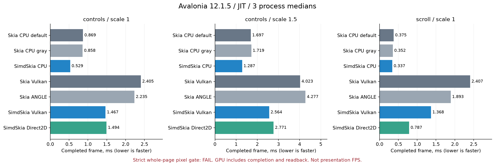
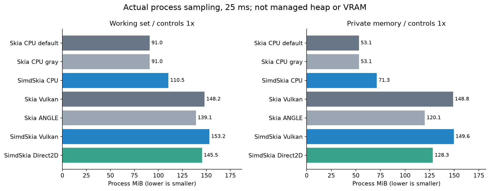
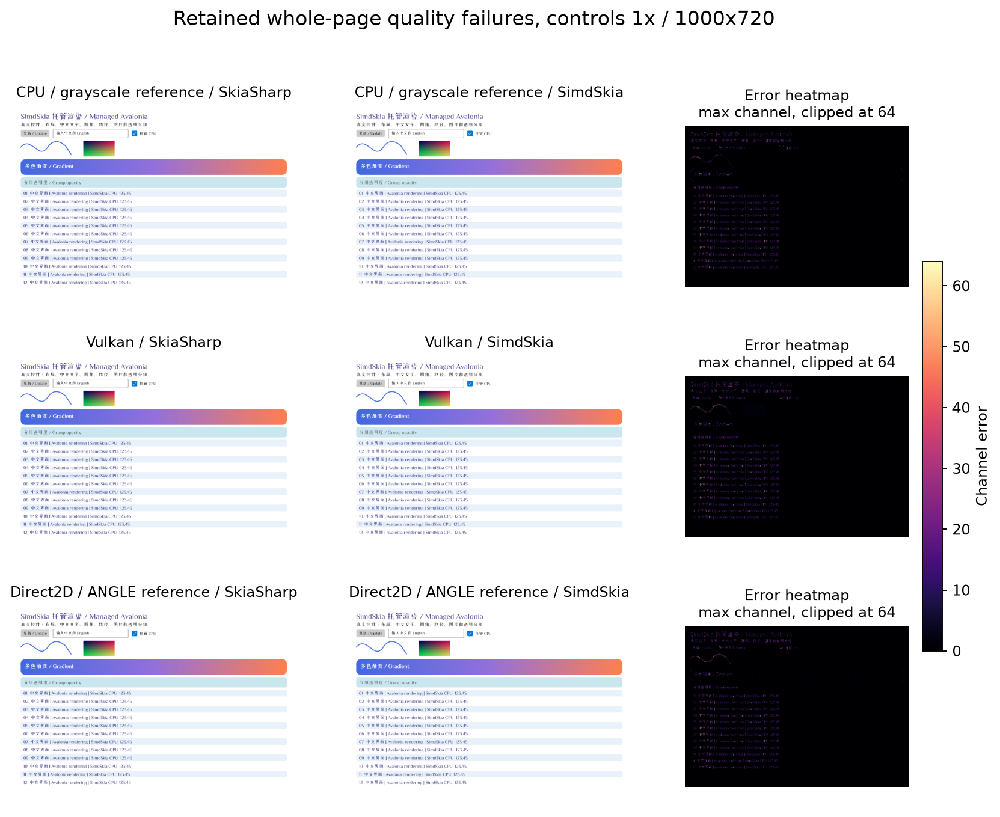
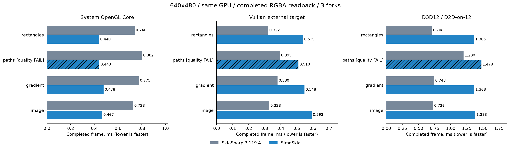
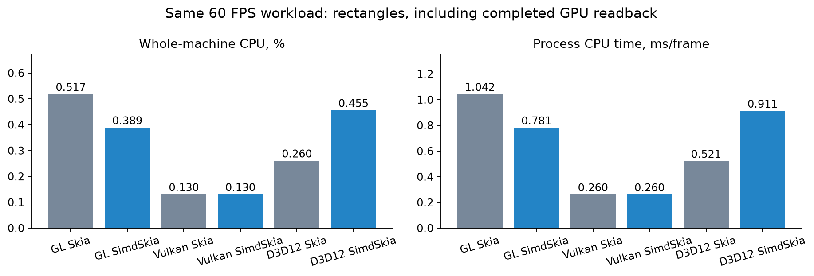

# SimdSkia 0.1.2-preview.1：公共 API、测试与性能报告

实际NuGet包消费也已验证：独立缓存下1417项编解码断言、22项PDF检查、真实Avalonia桌面窗口与真实Native AOT窗口通过。最终本地重打包只更新使用说明，十二包全部runtime资产与已消费包逐字节相同。[包消费证据](evidence/api-final-package-consumption-2026-11-07/)保留两份manifest与比对；最终tag仍由CI重新构建、测试和公开下载验证，状态见[发布记录](NUGET-PREVIEW.md)。

固定源码基线 **SkiaSharp 3.119.4 / 3235 项**。最终匹配 **3230 项、201 公开类型、5 缺口、0 额外签名**；从99项冻结快照补入94项。基线SHA256仍为 `03A164AC1097F84793632DF806DA91E2829F0FCA65D8F2B922E45554AB083296`。这五项按用户要求保留，不提供替代句柄或虚构原生版本。

本预览还汇入此前未发布的路径/滤镜/RuntimeEffect/Picture/网格等实现。**公共签名覆盖不等于全面行为兼容，更不等于二进制替换。JPEG、部分文字/曲线、整页画质及性能仍有失败，Metal没有Mac GPU实机验证。** 新包的公开下载状态以[发布记录](NUGET-PREVIEW.md)为准。

## 兼容范围与真实实现

| 新增项 | 本轮条目数 | 实际能力与限制 |
|---|---:|---|
| SKImage.FromPicture | 4 | 真正延迟生成，持有录制资源；PeekPixels不隐式生成，ToRasterImage(true)实际生成 |
| SKPixmap WebP选项编码 | 3 | 真正lossless/lossy；依赖Sdcb.SimdCodecs1.4.0，质量/压缩率不等于libwebp刻度 |
| SKBitmap.ExtractAlpha | 4 | 真正1字节Alpha8、stride、偏移与遮罩；不再保留RGBA工作面 |
| SKPaint ColorF/SetColor/Blender/IsDither | 4 | 浮点精度、颜色转换、实际算术混合和有序抖动；新阶段GPU明确拒绝，需显式CPU回退 |
| LCD与嵌入点阵 | 3 | BGRA水平LCD三通道；真实EBLC/EBDT中文点阵；RGBA/垂直几何回退灰度，不是完整hinting/复杂排版 |
| SKSvgCanvas及Create | 3 | 实际向量路径、裁剪、渐变、图层和图片；不是全页PNG包装 |
| SKDocument.CreateXps | 6 | 实际多页OPC/XPS向量包、图片及流生命周期，独立WPF阅读器验证 |
| SKPicture Serialize/Deserialize | 8 | 实际原生v103 SKP向量子集，双方交叉读取；其余flattenable/操作码明确报错 |
| GRContext GL/D3D12/Metal | 8 | 系统GL/GLES程序、D3D11On12/Direct2D、Metal计算管线；Metal仅编译，未硬件验收 |
| SKImage外部纹理/上传 | 23 | 实际GL/VkImage/ID3D12Resource/MTLTexture，借用/接管/回调/方向/完成读回；限制按后端明确拒绝 |
| SKSurface外部texture/target | 28 | 真实外部GPU资源内容、生命周期与GPU快照；D3D12/Metal导入表面仍有CPU桥接，Vulkan为设备内复制 |

上述合计94；完整类型/重载/属性/枚举/默认值/签名见[最终清单](api/implemented.json)、[逐项比较](api/comparison.json)及[本轮新增94条](evidence/api-final-2026-11-07/implemented-additions.json)。审计工具不覆盖全部protected API、nullable注解或所有自定义属性，不能将3230解释为整个SkiaSharp全部可用。

保留缺口：`SKObject.Handle`，`SkiaSharpVersion`类型及其`Native`、`NativeMinimum`、`CheckNativeLibraryCompatible`。实际像素指针/系统GPU资源不是native Skia对象句柄。程序集名称/强名称公钥不同，不能让既有SkiaSharp二进制依赖直接装载替换。

GL→GL纹理绘制直接绑定GPU纹理。Vulkan外部表面通过VkImage↔计算buffer设备复制；显式读回直接进入调用方缓冲，普通Flush仍维护CPU shadow。其他GPU图片来源/快照及D3D12/Metal导入表面仍可能发生CPU读回/再上传，不能称全部零拷贝。

所有GPU仍限制MSAA、非sRGB目标、部分像素格式、mips/各向异性/部分采样、复杂着色器/滤镜/混合、LCD及SaveLayer等；不支持时抛明确异常。`IsTextureBacked`表示存在实际设备资源，不代表每个操作都无CPU步骤。预算统计是已知资源负载/分配，不能当作完整驱动VRAM计量。GPU对象必须按创建线程显式Dispose，GC终结回收尚未与原版等同；不能依赖遗忘Dispose后的自动清理时机。

## 测试与保留失败

Release全解决方案构建零错误/警告；生产依赖图检查通过。CPU/几何/光栅/文字为C#；编解码固定托管Sdcb1.4.0，PNG/TIFF允许.NET系统压缩；可选PdfPig0.1.16。GPU仅调用系统图形API/驱动；macOS官方窗口宿主是已允许的原生例外，Metal绘图没有调用Google Skia。

| 测试集合 | 原版像素门槛结果 | 行为/独立检查 |
|---|---:|---|
| 延迟Picture/WebP | 28/28 | 14元数据、0差异 |
| Alpha8/遮罩/采样 | 270/324 | 90元数据、0差异 |
| 浮点颜色/混合/抖动 | 25/29 | 19元数据、0差异 |
| 原生SKP交叉读取 | 14/35 | 25元数据、0差异 |
| 中文嵌入点阵 | 0/20 | 23元数据、0差异；独立FontTools9/9点阵逐字节正确，整串文字与原版不同 |
| GL/GLES绘制 | 10/10 | 3元数据、0差异 |
| 系统WGL兼容/Core | 8/8 | 2元数据、0差异 |
| GL外部纹理/目标 | 362/366 | 115元数据、0差异；双方各595检查，本实现另10生命周期/上下文检查 |
| Vulkan互操作 | 242/242 | 178元数据、32差异；48额外画面（原版接管工厂返回null） |
| 独立Edge SVG | 4/8 | 14元数据一致；原版导出渐变/图层/Difference裁剪存在丢失，不能全算成我们渲染失败 |
| LCD/灰度文字 | 20/60 | 65元数据一致；双方各120读回/生命周期检查，字形覆盖仍不同 |
| Direct3D12 | 10/10基础、346/346互操作 | 双方设备检查各68、互操作各516、释放回调各8次；完整Adapter/device/queue下同后端验证，元数据一致 |
| XPS | 不把双方差异合并为通过 | 本实现5页、独立WPF14项检查通过；原版同阅读器仍有语义失败 |
| Metal | 未验证 | Windows编译通过；无Mac GPU，原版/本实现硬件测试均unverified |

正常回归basic/pixels/codecs/pdf/features/platform-fonts/optimization/avalonia/controls/direct2d/vulkan/gpu-sampling均通过；JPEG仍非零失败。另12个早期API原版对照中Picture、ImageOperations、PathBoolean仍有差异，完整status/comparison都保留。SVG首次新宿主运行超时，改为每幅独立配置目录后完成，原超时日志仍保留。早期D3D12夹具遗漏Adapter，原版返回null是夹具错误，不能作为原版不支持的证据；完整描述符下已更正并重新对照，旧结果仅保留审计历史。

Vulkan精确优化：**566检查、556次逐字节对照、48次实际矩形合批dispatch**，包含AA、渐变、覆盖剪裁、重叠顺序、中文、stride及初始化。浮点绘制在AVX2与禁用AVX2后的SSE2各**5568**缓冲与标量逐字节一致。没有用低质量替代标量算法。

Native AOT：win-x64实际exe运行，新增CPU链路SIMD/显式标量各**41项**通过，Perlin像素SHA均为`24E3170F259F4B25249C6F150A395BD47D273E3A11DCD4096CBABF81BDAC2BD4`；实际系统OpenGL AOT另**18项**通过、8幅输出。AOT不是只编译或在dotnet下运行IL；本次性能表是JIT，不能当作AOT速度/应用体积成绩。

新增GPU共享资源租约修复：SKImage释放后，shader/Picture仍持有实际纹理，回调直到最后消费者释放才执行，双方时机一致；ToRasterImage产生独立CPU副本。追加pending-draw对照发现并修正GL提前回调，双方在draw后/图像释放后均为0，实际Flush完成后为1，读取像素逐字节一致。丢失上下文时先作废真实纹理，再释放待完成租约，避免无当前上下文仍调用GL。GL创建线程/当前上下文/PBO/pixel-store/丢失与上下文先释放均有检查。底部原点、借用与接管、实际外部资源内容均有读回，不以描述符非零当作绘图通过。

门槛保持：独立API绘图/GPU微场景最大通道3、RMSE0.75；Avalonia整页沿用最大通道32、RMSE2（包含文字）；WebP有损最大48、RMSE8。文字/LCD严格像素结果用于揭示差异，不等于已证明字形兼容；未为获得绿灯调整阈值。

## 性能方法

Windows x64、i7-8700K（6核12线程）、GTX1050Ti，.NET10.0.14 / SDK10.0.403，同硬件/尺寸/场景/完成要求，三个独立进程取中位数，测试串行执行。GPU每帧等待实际完成并读回。整机CPU%=进程CPU时间/墙钟时间/12；满速吞吐和固定60FPS分别报告，CPU时间/帧另列。分配是当前托管线程，不含原生堆、驱动或完整跨线程分配。

UI使用真实Avalonia12.1.5控件与同一固定字体：3秒预热、5秒测量、25ms进程采样，离屏/JIT，不是窗口呈现FPS。GPU微场景640×480：1秒预热、2秒测量、10ms采样；Vulkan双方使用同一外部设备测试宿主，进程内存含宿主，不能等同默认原版应用内存。CPU局部场景为端点WS/private，不能冒充采样峰值。驱动显存没有可靠采集，不提供伪造数字。

CPU/UI/Vulkan测量快照早于最后GL回调及D3D12 Adapter修正，相关光栅/控件/Vulkan计时代码未变；保留原始二进制及源哈希，不冒充相同编译产物。差异文件和适用路径记录在post-timing-source-delta.json；发生变化的GL/D3D12路径已重新测试并采集性能。AOT也在这些修正后重新编译运行。

## 完整Avalonia控件页：耗时、CPU与内存

下表原版CPU给出默认/强制灰度两条真实结果。GPU分别列原版Vulkan/ANGLE，与本实现Vulkan/Direct2D；Direct2D对ANGLE是同硬件不同API，不冒充同后端。

| 场景 | 实现/后端 | 完成ms/帧 | CPU ms/帧 | 整机CPU% | WS MiB | 私有MiB | 托管B/帧 |
|---|---|---:|---:|---:|---:|---:|---:|
| controls ×1 | 原版CPU默认 | 0.8687 | 0.8662 | 8.33 | 90.97 | 53.10 | 5256.0 |
| controls ×1 | 原版CPU灰度 | 0.8582 | 0.8575 | 8.31 | 91.01 | 53.14 | 5256.0 |
| controls ×1 | SimdSkia CPU | 0.5292 | 0.5314 | 8.36 | 110.50 | 71.31 | 5513.2 |
| controls ×1 | 原版Vulkan | 2.4053 | 1.6910 | 5.86 | 148.16 | 148.85 | 5256.0 |
| controls ×1 | 原版ANGLE | 2.2355 | 2.5226 | 9.40 | 139.13 | 120.15 | 5256.0 |
| controls ×1 | SimdSkia Vulkan | 1.4669 | 0.5823 | 3.31 | 153.23 | 149.57 | 8042.1 |
| controls ×1 | SimdSkia Direct2D | 1.4939 | 1.9520 | 10.88 | 145.46 | 128.33 | 5761.5 |
| controls ×1.5 | 原版CPU默认 | 1.6969 | 1.6813 | 8.28 | 94.63 | 56.84 | 5256.0 |
| controls ×1.5 | 原版CPU灰度 | 1.7192 | 1.7033 | 8.25 | 94.68 | 56.88 | 5256.0 |
| controls ×1.5 | SimdSkia CPU | 1.2875 | 1.2880 | 8.36 | 114.18 | 75.09 | 5513.4 |
| controls ×1.5 | 原版Vulkan | 4.0231 | 2.9337 | 6.12 | 160.25 | 166.49 | 5256.0 |
| controls ×1.5 | 原版ANGLE | 4.2766 | 4.5445 | 8.85 | 152.89 | 138.38 | 5256.0 |
| controls ×1.5 | SimdSkia Vulkan | 2.5635 | 1.0256 | 3.33 | 166.92 | 169.25 | 8218.2 |
| controls ×1.5 | SimdSkia Direct2D | 2.7713 | 3.3086 | 9.81 | 154.73 | 144.98 | 5761.6 |
| scroll ×1 | 原版CPU默认 | 0.3748 | 0.3765 | 8.33 | 83.51 | 51.00 | 4272.0 |
| scroll ×1 | 原版CPU灰度 | 0.3517 | 0.3532 | 8.33 | 83.54 | 51.04 | 4272.0 |
| scroll ×1 | SimdSkia CPU | 0.3370 | 0.3376 | 8.33 | 99.04 | 70.23 | 2496.3 |
| scroll ×1 | 原版Vulkan | 2.4068 | 1.5951 | 5.49 | 138.84 | 143.14 | 4272.0 |
| scroll ×1 | 原版ANGLE | 1.8927 | 2.1011 | 9.40 | 124.74 | 110.01 | 4272.0 |
| scroll ×1 | SimdSkia Vulkan | 1.3682 | 0.4297 | 2.66 | 142.75 | 147.66 | 4824.8 |
| scroll ×1 | SimdSkia Direct2D | 0.7872 | 1.1212 | 11.85 | 130.47 | 122.43 | 2496.4 |

整页严格画质 **0/18**；性能门槛原始结果：`{"vulkan": {"geometricMeanToFasterOriginal": 0.6711172891467001, "worstRatio": 0.7229138173231878, "performancePassed": true}, "direct2d": {"geometricMeanToFasterOriginal": 0.5763646992646727, "worstRatio": 0.6888515127822794, "performancePassed": true}, "cpu": {"geometricMeanToFasterOriginal": 0.7653477003548962, "worstRatio": 0.9581898470647614}, "qualityPassed": false, "formalCollection": true, "releaseEligible": false}`。未通过画质的耗时只作工程诊断，不能宣传同画质整体领先。即使局部吞吐更快，内存和全部功能仍需单独评估。







## 同后端GPU微场景

| 后端/场景 | 原版ms | SimdSkia ms | 耗时比 | 原版/本实现CPU ms/帧 | 原版/本实现WS MiB | 画质 |
|---|---:|---:|---:|---:|---:|---|
| OpenGL/rectangles | 0.7401 | 0.4398 | 0.594 | 1.0486/0.8312 | 72.91/82.70 | 通过 |
| OpenGL/paths | 0.8022 | 0.4427 | 0.552 | 0.7957/0.8404 | 75.13/92.07 | 失败 |
| OpenGL/gradient | 0.7753 | 0.4780 | 0.617 | 1.0841/0.9006 | 74.20/92.23 | 通过 |
| OpenGL/image | 0.7277 | 0.4666 | 0.641 | 1.0391/0.8808 | 73.72/79.55 | 通过 |
| Vulkan/rectangles | 0.3217 | 0.5389 | 1.675 | 0.1680/0.1217 | 89.86/74.48 | 通过 |
| Vulkan/paths | 0.3946 | 0.5098 | 1.292 | 0.2158/0.1725 | 90.61/84.48 | 失败 |
| Vulkan/gradient | 0.3801 | 0.5477 | 1.441 | 0.2190/0.1284 | 90.32/74.44 | 通过 |
| Vulkan/image | 0.3281 | 0.5929 | 1.807 | 0.1861/0.1521 | 90.09/74.24 | 通过 |
| D3D12 / D2D-on-12/rectangles | 0.7077 | 1.3655 | 1.929 | 0.5359/1.1945 | 150.59/106.23 | 通过 |
| D3D12 / D2D-on-12/paths | 1.2000 | 1.4784 | 1.232 | 1.0554/1.2357 | 150.84/112.08 | 失败 |
| D3D12 / D2D-on-12/gradient | 0.7427 | 1.3676 | 1.841 | 0.5229/1.1668 | 152.56/106.80 | 通过 |
| D3D12 / D2D-on-12/image | 0.7263 | 1.3831 | 1.904 | 0.5220/1.1014 | 150.72/106.81 | 通过 |





固定60FPS（每帧同样完成读回），便于比较相同工作量的CPU占用：

| 后端/场景 | 原版/本实现实际FPS | 原版/本实现整机CPU% | 原版/本实现CPU ms/帧 | 原版/本实现WS MiB | 原版/本实现私有MiB |
|---|---:|---:|---:|---:|---:|
| OpenGL/rectangles | 59.66/59.69 | 0.52/0.39 | 1.0417/0.7812 | 71.65/82.66 | 79.68/97.33 |
| OpenGL/paths | 59.96/59.90 | 0.26/0.65 | 0.5208/1.3021 | 74.08/86.17 | 87.35/99.75 |
| OpenGL/gradient | 59.63/59.82 | 0.39/0.45 | 0.7812/0.9115 | 72.64/86.43 | 80.11/100.56 |
| OpenGL/image | 59.78/59.90 | 0.45/0.65 | 0.9115/1.3021 | 72.41/79.56 | 79.52/94.57 |
| Vulkan/rectangles | 59.98/59.97 | 0.13/0.13 | 0.2604/0.2604 | 89.86/74.47 | 101.12/85.66 |
| Vulkan/paths | 59.98/59.98 | 0.26/0.26 | 0.5208/0.5208 | 90.70/78.46 | 103.78/90.31 |
| Vulkan/gradient | 59.98/59.98 | 0.20/0.07 | 0.3906/0.1302 | 90.35/74.62 | 101.46/85.93 |
| Vulkan/image | 59.98/60.00 | 0.13/0.13 | 0.2604/0.2604 | 89.94/74.21 | 101.00/85.60 |
| D3D12 / D2D-on-12/rectangles | 59.70/59.80 | 0.26/0.46 | 0.5208/0.9115 | 149.45/106.15 | 238.31/163.86 |
| D3D12 / D2D-on-12/paths | 59.71/59.86 | 0.91/0.45 | 1.8229/0.9115 | 149.75/109.72 | 205.67/166.92 |
| D3D12 / D2D-on-12/gradient | 59.71/59.60 | 0.52/0.65 | 1.0417/1.3021 | 151.52/106.69 | 237.87/164.53 |
| D3D12 / D2D-on-12/image | 59.63/59.92 | 0.65/0.65 | 1.3021/1.3021 | 149.85/106.61 | 238.29/164.96 |

CPU%在两秒短测/低负载下受系统计时粒度影响，保留所有fork与采样，不以单次小数差异断言节省。

Vulkan新路径与同一二进制强制的CPU桥接参考逐字节相同；这里仅隔离设备复制/直接读回收益，双方都包含矩形合批/清屏/去分配优化：

| 场景 | CPU桥接ms | 设备路径ms | 耗时下降 | 本实现托管B/帧 |
|---|---:|---:|---:|---:|
| rectangles | 0.8680 | 0.5389 | 37.9% | 0.6 |
| paths | 0.6885 | 0.5098 | 26.0% | 4033.0 |
| gradient | 0.7821 | 0.5477 | 30.0% | 0.6 |
| image | 0.9693 | 0.5929 | 38.8% | 0.6 |

矩形合批只接受可证明互不重叠的一组命令，保留覆盖/颜色/顺序；Clear使用真实设备填充。去除每批LINQ排序/枚举链与Stopwatch对象，零预算时不再保留覆盖缓存；没有用降低AA/忽略颜色交换性能。

## CPU功能场景

| 场景 | 原版ms | SimdSkia ms | 耗时比 | 原版/本实现CPU ms/帧 | 原版/本实现WS MiB | 原版/本实现私有MiB | 原版/本实现托管B/帧 | 质量核对 |
|---|---:|---:|---:|---:|---:|---:|---:|---|
| alpha8 | 1.0837 | 0.0919 | 0.085 | 1.0783/0.0922 | 29.55/34.54 | 8.91/14.57 | 0.0/0.1 | 通过 |
| float-color | 0.0744 | 0.0425 | 0.571 | 0.0756/0.0420 | 38.05/35.27 | 16.64/15.98 | 0.0/0.0 | 通过 |
| arithmetic | 0.9278 | 1.1091 | 1.195 | 0.9234/1.0946 | 29.16/30.45 | 8.30/10.74 | 0.0/0.8 | 通过 |
| skp-write | 0.0028 | 0.0078 | 2.778 | 0.0029/0.0078 | 49.25/46.91 | 27.59/27.34 | 104.0/32808.0 | 独立SKP/WebP测试另验，非输入缓冲画质 |
| skp-read | 0.0043 | 0.0062 | 1.435 | 0.0044/0.0062 | 49.39/46.19 | 28.09/25.90 | 104.0/18068.6 | 独立SKP/WebP测试另验，非输入缓冲画质 |
| webp-lossless | 2.0344 | 27.0672 | 13.305 | 2.0225/32.2917 | 34.05/50.60 | 13.22/28.71 | 320.0/2178234.1 | 独立SKP/WebP测试另验，非输入缓冲画质 |
| mesh | 0.3376 | 2.3692 | 7.018 | 0.3394/2.4038 | 27.98/32.44 | 9.04/12.37 | 0.0/2.8 | 通过 |
| patch | 0.8038 | 2.5851 | 3.216 | 0.7844/2.5706 | 27.52/34.03 | 7.67/13.71 | 0.0/3.1 | 通过 |
| atlas32 | 0.0444 | 0.4816 | 10.838 | 0.0443/0.4703 | 30.77/34.92 | 10.10/13.93 | 0.0/312.6 | 通过 |
| runtime | 0.2872 | 6.5186 | 22.695 | 0.2860/6.7327 | 32.30/37.02 | 10.67/14.98 | 0.0/4.9 | 通过 |
| perlin | 13.4682 | 5.6189 | 0.417 | 13.5417/5.6118 | 29.77/37.06 | 7.86/14.99 | 0.0/4.2 | 通过 |
| bilingual | 0.0686 | 0.0206 | 0.300 | 0.0683/0.0208 | 38.89/38.30 | 15.91/14.98 | 960.0/0.0 | 失败 |

A8的标量参考/优化输出在324幅用例及计时帧逐字节相等；空间优势指A8像素存储与省去RGBA工作面，不代表整个进程内存低于原版。RuntimeEffect解释执行、部分网格、WebP lossless等仍有明显差距；库内算法/依赖性能和整页缓存分别列示，不能归为同一个瓶颈。

## 结论、限制与复现

本轮94项已接通真实实现，五项原生合同继续缺失；**全面行为兼容、全部画质过门槛、整体持平且最差落后不超过10%的目标仍未全部达到**。预览发布不会改变这些结论。后续优先项是字形/曲线覆盖、GPU高级状态与离屏层、Vulkan计算/转移同步、解释执行/编码热点及内存，而不是继续增加无行为的公开签名。

原版与本库同名SkiaSharp类型默认不能在同一编译单元无别名混用；独立进程用于隔离对照。SkiaSharp仅存在于Original测试项目，不进入生产包。系统字体依平台发现；中文TrueType与基本中英文布局已有实现，不承诺复杂脚本/全部字体格式。PDF读取/显示是可选SimdSkia.Pdf子集，非完整PDF规范实现。

```powershell
dotnet build SimdSkia.sln -c Release
dotnet run --project examples/Compatibility99 -c Release
python tools/run-api-completion-regressions.py --output artifacts/reproduce/regression
python tools/check-api99-batch.py --output artifacts/reproduce/api99
python tools/run-final-compatibility.py --output artifacts/reproduce/final-api
python tools/run-ui-backend-parity.py --output artifacts/reproduce/ui
python tools/run-gpu-interop-benchmarks.py --output artifacts/reproduce/gl
python tools/run-gpu-interop-benchmarks.py --output artifacts/reproduce/gl60 --paced
python tools/run-vulkan-interop-benchmarks.py --output artifacts/reproduce/vk
python tools/run-vulkan-interop-benchmarks.py --output artifacts/reproduce/vk60 --paced
python tools/run-gpu-interop-benchmarks.py --backend d3d12 --output artifacts/reproduce/d3d12
python tools/run-gpu-interop-benchmarks.py --backend d3d12 --output artifacts/reproduce/d3d12-60 --paced
python tools/run-final-raster-benchmarks.py --output artifacts/reproduce/raster
python tools/run-final-api-benchmarks.py --output artifacts/reproduce/api
```

需要.NET10.0.403+、已固定的测试字体与真实GPU驱动；将DOTNET_ROOT指向相同SDK，避免apphost拾取旧runtime。性能按上面顺序串行运行。检查工具质量失败保留退出2；无GPU/Metal硬件保留退出3，SVG宿主失败为执行错误，不能计作绘图通过。NativeAOT使用tests/CompletionAot与tests/GlSystem/Managed执行dotnet publish -c Release -r win-x64 -p:PublishAot=true，再运行发布exe。

[完整冻结证据](evidence/api-final-2026-11-07/)包括status、comparison、每fork计时/进程采样、输入/二进制哈希、源文件哈希及压缩原始像素。frame-objects.json把原路径映射到SHA256对象，gzip解压后按length/hash验证。此前99项快照及试验失败均保留，未覆盖为新结果。
