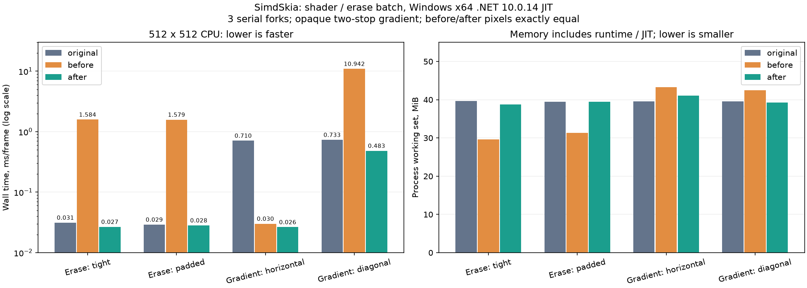
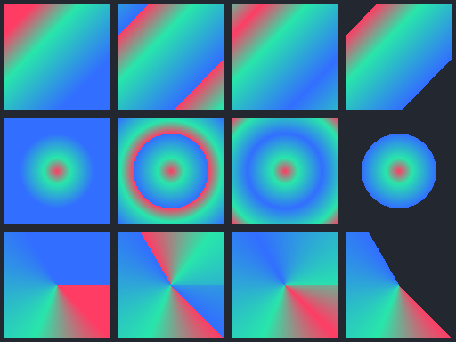

# 渐变与位图 API 补全、CPU 优化实测（2026-11-06，未发布）

本批在上一批1090项API的基础上补充15个精确签名，目前为 **1105/3235**，64个公开类型，仍有2130项缺口、0个额外/不同签名。这里只声明受测源码兼容，不声明完整行为兼容或强名称二进制替换。公开NuGet **0.1.1没有变化**。

## 本批实现

- SKColor线性渐变：任意多色标、等距/显式位置、硬边、位置裁切及单调归一化，Clamp/Repeat/Mirror/Decal。
- 径向和扫描渐变：对应SKColor重载、角度区间、局部矩阵。空色表/不可逆矩阵/非法半径或角度按原版返回null；颜色/位置长度不匹配抛ArgumentException。零长度、零半径和相同扫描角的平均色/末色/透明退化经过对照。
- CreateColor、CreateEmpty、CreateLocalMatrix和WithLocalMatrix；支持矩阵嵌套与普通可逆投影采样。复制调用者数组，paint/clone保留不可变数据，释放来源shader后仍能绘制。投影地平线及非有限多色标明确拒绝。
- SKBitmap.Erase(color, rect)：裁切区域、空/反向/越界区域、空位图无操作；RGBA/BGRA、Premul/Unpremul/Opaque、stride和透明擦除均核验。全图擦除复用批量填充，不再逐像素验证/转换。
- 不透明两色线性渐变的CPU行内核：Vector<T>批量投影/插值/打包，保留原标量的double投影、float插值和ties-to-even舍入；无unsafe、无整图缓存，尾部和不支持硬件时回退。水平渐变继续使用既有的有界行缓存。

## 原版行为、像素与回归

固定oracle为 **SkiaSharp 3.119.4**，隔离Original项目引用原包；生产绘图没有调用原版。两端相同C#测试源、128×128 BGRA premul输入、相同背景和paint透明度。沿用max≤32、RMSE≤2的已有门槛，没有为本批放宽。擦除要求完整可见缓冲区及行间padding逐字节相同。

| 检查 | 本轮结果 |
| --- | --- |
| 边界行为 | 16组全部一致 |
| 渐变/矩阵/生命周期像素 | 50场景全部通过，最大通道误差2, 最大RMSE 0.9924 |
| 原版擦除字节 | 30组全部精确一致 |
| 随机区域擦除标量/SIMD | 480组精确一致 |
| 冻结标量渲染器精确对照 | 472085项通过；另起进程DOTNET_EnableHWIntrinsic=0后472085项也通过，包含516项本批新增内核检查 |
| 真实win-x64 Native AOT | 14项；非JIT，运行期确认DynamicCodeSupported=false |
| 原有几何/颜色对照 | 299组/4612值、4像素场景通过，圆的conic/cubic表示差异仍保留 |
| 其他功能 | 基础36、编解码集成1417、独立兼容37、PDF18、图像独立369、字形批次60、Avalonia控件9750通过 |
| 实际GPU回归 | Direct2D344；Vulkan采样590、优化540；新增3种多色标+局部矩阵4场景CPU/GPU逐字节相同 |

**严格总验收并未全绿。** tools/verify.ps1 -Reference -Gpu在tests/Imaging已披露的Opaque/alpha32/erase JPEG严格误差处退出1；完整失败日志已保留，其余回归单独全部执行。没有改门槛、跳过错误后返回成功，也没有将旧报告21/24改写为本轮完整24组复测。旧Avalonia整页画质失败仍保留，本轮的50个shader场景不能取代整页验收。

## CPU速度、占用与内存

Windows x64 / Intel Core i7-8700K（12逻辑线程）/ .NET 10.0.14 JIT，SDK10.0.403；原版3.119.4。512×512 BGRA premul；每帧1次覆盖式绘制或擦除，stride场景RowBytes=2112。3轮×3变体=9个串行进程，每进程4场景，旋转顺序；每场景预热0.3秒、采样0.7秒，中位数。原版与前后候选输出均冻结并核对全部DLL/JSON哈希，计时期间不构建。

原版、优化前与优化后均为CPU。优化前是本批改动之前、包含前一批1090项API的源码构建，并非重新命名的公开0.1.1包。以下四场景都是不透明两色渐变或固定颜色擦除，**不代表复杂多色标/半透明/径向/扫描渐变已经与原版持平**。

| 场景 | 原版 ms/帧 | 修改前 | 修改后 | 比修改前快 | 修改后/原版 |
| --- | ---: | ---: | ---: | ---: | ---: |
| 整图擦除 | 0.031363 | 1.584226 | 0.026723 | 59.28倍 | 0.852 |
| 带stride擦除 | 0.029095 | 1.579304 | 0.028225 | 55.95倍 | 0.970 |
| 水平两色渐变 | 0.710210 | 0.030068 | 0.026436 | 1.14倍 | 0.037 |
| 斜向两色渐变 | 0.732598 | 10.941756 | 0.483175 | 22.65倍 | 0.660 |

四场景优化前后像素逐字节相同，与原版最大误差分别为0/0/0/1，全部通过原门槛。水平行缓存本批未改，其小幅速度差异不能作为新算法收益；斜向渐变没有借助整图缓存。



| 场景 | CPU ms/帧 原版/前/后 | WS MiB 原版/前/后 | Private MiB 原版/前/后 | 修改后分配 B/帧 |
| --- | ---: | ---: | ---: | ---: |
| 整图擦除 | 0.0312/1.5908/0.0268 | 39.67/29.60/38.73 | 18.06/10.38/18.54 | 0.005 |
| 带stride擦除 | 0.0292/1.5836/0.0283 | 39.47/31.37/39.41 | 17.05/11.69/18.52 | 0.000 |
| 水平两色渐变 | 0.7124/0.0322/0.0283 | 39.58/43.32/41.11 | 17.06/21.94/19.61 | 0.019 |
| 斜向两色渐变 | 0.7347/10.9863/0.4819 | 39.60/42.48/39.27 | 17.13/21.07/17.77 | 0.342 |

CPU占用百分比原始值在runs.json：忙循环通常约占满1个逻辑核，整机约8.3%，部分场景还包含后台JIT/GC。它不能被当作60FPS应用的占用。每帧进程CPU时间更适合比较实际工作量；分配是测量区间摊销值，不据此声称绝对0分配。

**内存没有全面改善。** 前两个擦除场景修改后的WS/Private高于修改前；它们包含CLR/JIT与库初始化，不能只看斜向渐变工作集下降就宣布省内存。本轮没有采集新的整页Avalonia内存或GPU性能，也没有新测AOT发布体积。前批真实整页内存仍高于原版，详见[前批报告](COMPAT-OPTIMIZATION-2026-11-06.md)。

## GPU和剩余缺口

Vulkan实际设备为NVIDIA GTX1050Ti。本批受测线性Clamp/Repeat/Mirror及局部矩阵通过完成等待/回读，新增4场景与CPU精确一致；径向/扫描/Decal明确抛NotSupportedException，不会静默绘制空白。Direct2D已有多色标线性描述能力，独立局部矩阵仍明确拒绝，需要调用方选择已有CPU回退；未新增Direct2D的径向/扫描实现。以上为功能回归，不是原版GPU速度持平证明。

仍缺SKColorF与颜色空间插值、图像/噪声/混合shader、其他大量公共API；路径conic/arc/boolean、部分描边/混合模式、复杂字体、完整Codec/native handle等也未完成。元数据匹配约34.2%不是行为兼容率；Avalonia适配器通过独立服务接口工作，不能用该比例推算Avalonia可用控件比例。

## 运行和复现

使用.NET SDK10.0.403+，已下载的测试字体沿用OFL夹具。fresh目录参数是为避免把旧图像算入新结果。

```powershell
dotnet build SimdSkia.sln -c Release
python tools/check-shader-compatibility.py --output artifacts/shader-check-new
dotnet run --project tests/Optimization -c Release -- baseline/fonts/ZenOldMincho-Regular.ttf
dotnet publish tests/ShaderCompatibility/NativeAot -c Release -r win-x64 -o artifacts/shader-aot-new
.\artifacts\shader-aot-new\NativeAot.exe
dotnet run --project examples/Gradients -c Release -- artifacts/gradients-new.png
```

禁用硬件路径验证可在独立PowerShell进程设置DOTNET_EnableHWIntrinsic=0后运行Optimization；不要将环境变量遗留给之后的性能测试。

```powershell
# 先分别构建并冻结 original / before / after；before必须在修改源代码前保留。
python tools/run-shader-benchmarks.py `
  --before artifacts/shader-2026-11-06/before `
  --after artifacts/shader-2026-11-06/after-final `
  --original artifacts/shader-2026-11-06/original `
  --output artifacts/shader-performance-new
```

示例输出：每行分别为线性/径向/扫描，每列为Clamp/Repeat/Mirror/Decal。



## 证据与许可证

本地测试包核验确认包含BSD归属；仅在artifacts生成临时0.1.2-preview.1测试包，未修改正式版本配置或上传NuGet。另为打包版本条件补充等价括号，消除了原有MSB4130警告。相关记录见[本地包检查](evidence/shader-compatibility-2026-11-06/package-check.json)。

[汇总](evidence/shader-compatibility-2026-11-06/status.json)、[像素/行为](evidence/shader-compatibility-2026-11-06/comparison.json)、[逐进程性能](evidence/shader-compatibility-2026-11-06/performance-runs.json)、[冻结二进制哈希](evidence/shader-compatibility-2026-11-06/performance-manifest.json)、[完整失败日志](evidence/shader-compatibility-2026-11-06/verify.log)、[源哈希](evidence/shader-compatibility-2026-11-06/source-hashes.json)和[文件校验](evidence/shader-compatibility-2026-11-06/sha256.json)均保留。本地artifacts目录保留冻结执行文件和完整像素夹具；不把原版原生库提交为产品。新增Windows CI检查已写入工作流，尚未推送执行，不宣称本批已跨平台实机验收。

扫描角接缝使用[Skia m119的xy_to_unit_angle多项式](https://github.com/google/skia/blob/chrome/m119/src/opts/SkRasterPipeline_opts.h)的标量C#翻译，匹配原版float近似，不是人为偏移单个测试角度；BSD-3-Clause归属和完整条款随Compatibility输出与包分发。没有新增生产NuGet依赖或Google原生组件。详细依赖见[许可证清单](DEPENDENCIES.md)。
