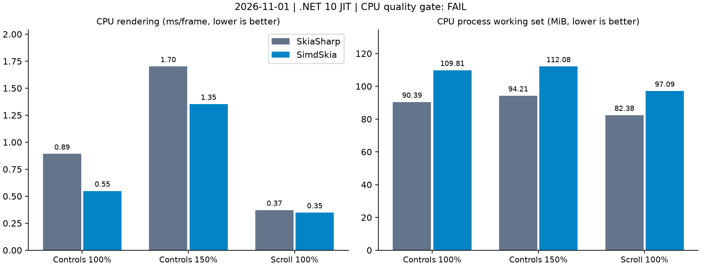
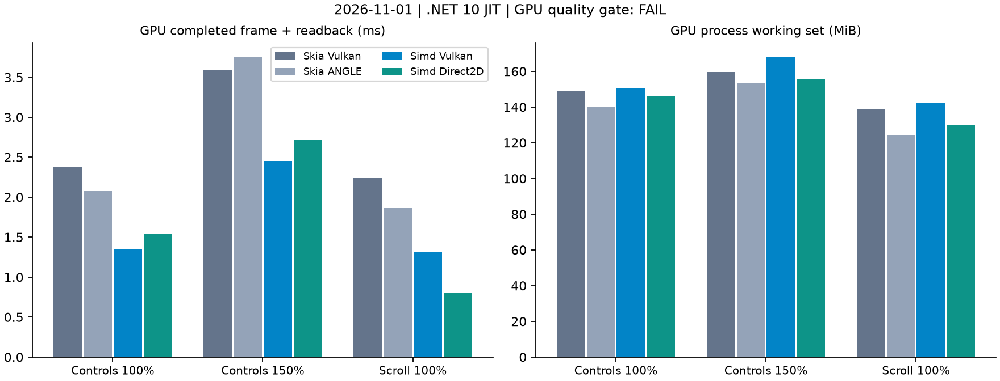
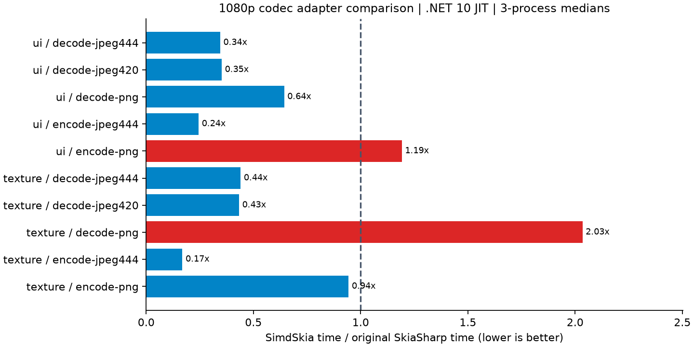

# 当前 SimdSkia 与原版 SkiaSharp：绘制更快，内存和部分 PNG 仍有差距

发行注记：用户随后授权将此绘图/编解码实现及测试记录纳入 `0.1.0-preview.10`；版本改号不改写本报告的计时、哈希、质量失败或“测量当时未发布”的快照。最终公开状态见[发布记录](NUGET-PREVIEW.md)。

日期：2026-11-01。本轮实际重测当前完整接入 `Sdcb.SimdCodecs 1.2.0` 的源码，与固定基线 **SkiaSharp 3.119.4 / Avalonia 12.1.4** 对照。不是拿旧 SimdSkia 当原版，也不是只测 Sdcb 裸解码器。

**已测控件绘制和 GPU 场景的速度优于原版；不能宣布整体替代成功。** CPU 工作集仍高约 18%–22%；纹理 PNG 解码耗时为原版 2.03 倍，UI PNG 编码慢 19.2%；CPU/GPU 整页画质门槛仍失败。JPEG 编解码较快，但编码文件大小不同，不能声称相同码率下的压缩效率也全面领先。

这是 **未发布的 .NET 10 本地试用源码**，不是公开 NuGet preview.9。此次没有发布、没有改画质阈值，也没有用本轮 JIT 结果替换历史 AOT 数据。

## 环境与测量方法

- Windows 10.0.26300 x64；i7-8700K，6 核 / 12 逻辑处理器；约 31.93 GiB 可用物理内存；GTX 1050 Ti，驱动 32.0.15.6094。
- 双方均为 Release / **.NET 10.0.13 JIT**，本机允许 AVX2。不是通用 x64 Native AOT、不是可见窗口启动时间或显示器 FPS，也没有重测发布体积。
- 共 **123 个计时进程**，串行轮换，每例三轮取中位数。编译、其他测试及图表生成没有与性能计时重叠。额外截图、编码和原版交叉解码在计时之后执行。
- CPU：同一真实 Fluent 控件树、列表、中文字体，`RenderTargetBitmap` 离屏绘制。3 场景 × 3 配置 × 3 进程，每进程预热 2.5 秒、计时 3,000 帧。默认尺寸 1000×720，150% DPI 为 1500×1080。
- GPU：同样的实际控件树、字体和尺寸，原版 Vulkan / ANGLE D3D11 与 SimdSkia Vulkan / Direct2D，3 场景 × 4 后端 × 3 进程。每进程预热 3 秒、采样至少 5 秒；**包含命令记录、等待 GPU 完成和完整 BGRA 回读**，记录时间与完成时间分开保存。
- 编解码：两个自制、不透明 1920×1080 UI / 纹理图案，**不是照片语料库**。输入压缩文件完全相同，输出均为新取得所有权的 RGBA8888 / Unpremul 位图或完整编码 byte[]，包含释放、分配、校验与适配成本，不计文件 IO。10 例 × 2 实现 × 3 进程；预热 1 秒、采样至少 2 秒。
- CPU% 为整个进程的 CPU 时间 / 墙钟时间 / **12**，100% 表示整机所有逻辑处理器占满。每帧 CPU ms 更适合比较完成同等工作所耗 CPU；不限帧情况下，CPU% 较高也可能是完成的帧更多。
- CPU/编解码 WS、Private 为计时结束时的进程快照；GPU 为外部每 25 ms 采样的测量区间中位数。WS 包含驻留共享页，Private 是私有提交内存，不是显存。每帧/张分配是 **托管分配**，不包括原版 native malloc，不能单独拿它证明总内存更低。

固定中文字体 SHA-256：`A42B620140F493DB42F741351DFBF343C0936D58588EE8004B8B2A218D997FF1`。Git HEAD 为 `498043e`，测量对象包含未提交的完整编解码接入改动；源文件、实际程序集、输入文件 SHA-256 和逐进程结果保留在[证据](evidence/skia-comparison-2026-11-01/results.json)。

## CPU：真实 Avalonia 控件页

**主要比较原版默认透明度配置**。原版另测强制完整图层配置，附在后面，不拿其较慢成绩充当默认原版。

| 场景 | 原版 ms/帧 | SimdSkia ms/帧 | 原版耗时 / SimdSkia 耗时 |
| --- | ---: | ---: | ---: |
| 控件页 100% DPI | 0.891 | 0.549 | 1.62× |
| 控件页 150% DPI | 1.701 | 1.353 | 1.26× |
| 滚动列表 100% DPI | 0.372 | 0.348 | 1.07× |

三例耗时比的几何平均为 **0.771**，但这不是之前五场景的 Native AOT 验收。控件页 100% 的三进程范围：原版 0.884–0.912 ms、SimdSkia 0.545–0.553 ms。

下表每格顺序均为 **原版 / SimdSkia**：

| 场景 | CPU ms/帧 | 整机 CPU% | WS MiB | Private MiB | 托管 KiB/帧 |
| --- | ---: | ---: | ---: | ---: | ---: |
| 控件 100% | 0.885 / 0.552 | 8.28 / 8.38 | 90.39 / 109.81 | 47.36 / 71.08 | 5.31 / 5.37 |
| 控件 150% | 1.688 / 1.359 | 8.28 / 8.38 | 94.21 / 112.08 | 51.15 / 73.50 | 5.31 / 5.37 |
| 滚动 100% | 0.406 / 0.380 | 9.02 / 9.14 | 82.38 / 97.09 | 44.99 / 64.75 | 5.03 / 3.17 |

**内存没有追平。** 控件 100% 的工作集多约 19.42 MiB、Private 多约 23.72 MiB。GC 后托管存活内存为 19.91 vs 2.26 MiB，但原版的原生缓存不进入 GC 堆，因此仍以完整进程内存评价。这些 JIT 数字不能与此前 `79.89 / 60.91 MiB` 的 AOT 数字直接相减，判断成新的内存回退。



原版强制完整透明图层时，三例为 3.305 / 7.096 / 0.369 ms/帧；对应 WS 为 79.41 / 83.36 / 82.33 MiB。它与默认配置的透明度语义、成本不同，全部保留在证据中。

## GPU：Vulkan、Direct2D 与原版 GPU

单位 ms/完整帧，包含等待和回读，越小越好。

| 场景 | 原版 Vulkan | 原版 ANGLE | SimdSkia Vulkan | SimdSkia Direct2D |
| --- | ---: | ---: | ---: | ---: |
| 控件 100% | 2.377 | 2.079 | 1.350 | 1.542 |
| 控件 150% | 3.586 | 3.747 | 2.450 | 2.715 |
| 滚动 100% | 2.241 | 1.863 | 1.310 | 0.804 |

以各例中更快的原版 GPU 为基线，Vulkan / Direct2D 综合耗时比为 **0.678 / 0.624**，最慢比为 **0.703 / 0.757**；速度门槛通过。不存在不支持命令的 CPU 回退（18 个 SimdSkia 计时进程计数均为 0），但 C# 字形图集和软件图层仍属于生产实现，不能称为所有工作都在 GPU 执行。

| 场景 | 后端 | CPU ms/帧 | 整机 CPU% | WS MiB | Private MiB | 托管 KiB/帧 |
| --- | --- | ---: | ---: | ---: | ---: | ---: |
| 控件 100% | 原版 Vulkan | 1.795 | 6.22 | 148.74 | 149.12 | 5.13 |
| 控件 100% | 原版 ANGLE | 2.431 | 9.69 | 139.85 | 119.34 | 5.13 |
| 控件 100% | Simd Vulkan | 0.595 | 3.67 | 150.52 | 146.54 | 7.76 |
| 控件 100% | Simd Direct2D | 1.967 | 10.70 | 146.13 | 128.03 | 5.57 |
| 控件 150% | 原版 Vulkan | 3.015 | 6.82 | 159.48 | 163.96 | 5.13 |
| 控件 150% | 原版 ANGLE | 4.111 | 9.01 | 153.23 | 138.52 | 5.13 |
| 控件 150% | Simd Vulkan | 1.118 | 3.80 | 167.75 | 169.62 | 7.93 |
| 控件 150% | Simd Direct2D | 3.227 | 9.89 | 155.95 | 144.85 | 5.57 |
| 滚动 100% | 原版 Vulkan | 1.661 | 6.17 | 138.64 | 143.05 | 4.17 |
| 滚动 100% | 原版 ANGLE | 2.106 | 9.42 | 124.44 | 109.79 | 4.17 |
| 滚动 100% | Simd Vulkan | 0.389 | 2.47 | 142.31 | 147.08 | 4.70 |
| 滚动 100% | Simd Direct2D | 1.178 | 12.06 | 129.99 | 123.86 | 2.43 |

Direct2D 的整机 CPU% 仍较高，不应据此宣称更省 CPU；与默认原版的对比须同时看每帧 CPU、实际吞吐及限帧策略。本轮没有做 60 FPS 限帧 GPU 测量。GPU 完成/回读占比较大，例如 Simd Vulkan 控件 100% 为记录约 0.248 ms、完成约 1.102 ms；不能拿 CPU 的离屏绘图时间与 GPU 完整回读时间横向宣称哪个后端更快。



## JPEG / PNG：当前完整适配层

JPEG 编码双方明确为质量 90、4:4:4、baseline，输出 SOF/三分量采样字节实际检查均为 `C0 / 11 11 11`。原版使用显式 `SKJpegEncoderOptions`，不是拿默认下采样配置混测。PNG 原版为 AllFilters / zlib 6，SimdSkia 为公开 Optimal / 单片路径；双方无损像素一致，但过滤策略、压缩输出及 JPEG 熵编码策略不同，文件大小另列。

| 图案 | 操作 | 原版 ms/张 | SimdSkia ms/张 | 原版耗时 / SimdSkia 耗时 | CPU ms/张（原版 / Simd） |
| --- | --- | ---: | ---: | ---: | ---: |
| UI | JPEG 4:4:4 解码 | 12.013 | 4.142 | 2.90× | 12.070 / 4.141 |
| UI | JPEG 4:2:0 解码 | 10.064 | 3.542 | 2.84× | 9.972 / 3.540 |
| UI | PNG 解码 | 2.925 | 1.881 | 1.55× | 2.911 / 1.865 |
| UI | JPEG 4:4:4 编码 | 31.668 | 7.736 | 4.09× | 31.982 / 7.691 |
| UI | PNG 编码 | 62.555 | 74.566 | **0.84×** | 62.988 / 74.653 |
| 纹理 | JPEG 4:4:4 解码 | 20.602 | 9.068 | 2.27× | 20.886 / 9.050 |
| 纹理 | JPEG 4:2:0 解码 | 18.854 | 8.160 | 2.31× | 19.130 / 8.163 |
| 纹理 | PNG 解码 | 21.346 | 43.421 | **0.49×** | 21.711 / 45.545 |
| 纹理 | JPEG 4:4:4 编码 | 60.546 | 10.209 | 5.93× | 60.662 / 10.232 |
| 纹理 | PNG 编码 | 464.193 | 438.022 | 1.06× | 465.625 / 440.625 |

内存和托管分配，每格为 **原版 / SimdSkia**：

| 图案 / 操作 | WS MiB | Private MiB | 托管 KiB/张 |
| --- | ---: | ---: | ---: |
| UI / JPEG444 解码 | 33.75 / 43.21 | 10.34 / 20.01 | 0.29 / 0.95 |
| UI / JPEG420 解码 | 33.75 / 43.39 | 10.35 / 20.27 | 0.29 / 0.95 |
| UI / PNG 解码 | 33.88 / 53.25 | 11.16 / 30.48 | 0.29 / 8.74 |
| UI / JPEG444 编码 | 57.58 / 101.80 | 34.72 / 82.50 | 126.76 / 386.25 |
| UI / PNG 编码 | 48.31 / 48.75 | 25.09 / 27.28 | 12.62 / 68.09 |
| 纹理 / JPEG444 解码 | 34.41 / 43.61 | 11.00 / 20.38 | 0.29 / 0.95 |
| 纹理 / JPEG420 解码 | 34.38 / 43.76 | 11.03 / 20.50 | 0.29 / 0.95 |
| 纹理 / PNG 解码 | 36.16 / 52.71 | 12.81 / 31.13 | 0.29 / 8.81 |
| 纹理 / JPEG444 编码 | 69.94 / 74.38 | 47.12 / 54.38 | 703.42 / 1465.23 |
| 纹理 / PNG 编码 | 62.11 / 104.61 | 39.82 / 83.96 | 2853.54 / 13381.66 |

PNG 校验没有为了提速省掉：CRC、预算、过滤器/调色板索引及精确解压长度仍检查；当前严格适配会额外解压验证一次。这是值得优化的路径，但本轮没有做分项剖析，不能把纹理解码的全部差距都归因于此。编码 API 输出均转换为完整 byte[]；原版在 native 侧的中间存储不进入托管分配数，WS/Private 已同时记录。



### 压缩大小与画质

所有编码输出均用**同一原版 SkiaSharp 解码器**回读，与原始 RGBA 比较，避免把双方解码器差异混进编码质量。

| 图案 / 编码 | 原版字节 | SimdSkia 字节 | 原版 RGB PSNR | SimdSkia RGB PSNR |
| --- | ---: | ---: | ---: | ---: |
| UI / JPEG444 | 129,451 | 196,847 | 47.510 dB | 47.758 dB |
| 纹理 / JPEG444 | 719,929 | 749,217 | 36.296 dB | 36.311 dB |
| UI / PNG | 12,569 | 12,555 | 无损一致 | 无损一致 |
| 纹理 / PNG | 2,921,668 | 2,631,889 | 无损一致 | 无损一致 |

**UI JPEG 文件大约增加 52.1%，纹理 JPEG 增加约 4.1%。** 虽然本例 PSNR 没有下降，编码速度优势不能当作相同码率、相同熵编码工作量下的优势，也不能从两个图案推断照片/所有格式的速度。

同一压缩 JPEG 输入的双方解码结果最大通道差为 UI 2、纹理 3；编码输出交叉回读之间最大差为 UI 9、纹理 13。两种 PNG 输入及编码均逐像素还原本例源图。JPEG 本轮只报告误差，**没有新造宽松门槛改判通过**；此前完整接入的原版联合回读仍有 3/24 组超过 1 LSB 门槛，见[接入报告](SIMDCODECS-INTEGRATION-2026-11-01.md)。

## 仍未满足的条件

- **整页画质**：CPU 对原版默认的 3 组全部失败，最大通道差 96 / 117 / 75，RGBA RMSE 2.418 / 2.333 / 2.591。GPU 12 对全部失败，最大差 75–127、RMSE 2.376–2.588。原门槛仍为最大差 ≤32 且 RMSE ≤2。速度通过不等于同画质替代通过。
- **内存**：CPU 控件进程以及部分编解码进程仍明显高于原版；不存在整体内存持平结论。需要继续剖析有界字形/图层缓存、编码中间缓冲和 SKData/byte[] 输出所有权成本。
- **PNG 性能**：纹理解码约慢一倍、UI 编码慢约 19%，未达到“每例最多落后 10%”。不能将全部格式替换称为全面提速。
- **兼容性**：本次是性能/截图复测，不是完整 API 或真实业务集成验收；中文字体指令/覆盖率、组合字符、CMYK+ICC 原始样本及其余既有边界没有因此解决。
- **范围**：未跑 macOS/Linux、ARM、Native AOT 性能、真实 GPU 交换链呈现、启动白屏或 7×24 长时间资源稳定性。本轮不新增这些承诺。

## 复现

在 .NET 10 Windows x64 环境中先构建全部计时程序，再串行测量。每次使用新的输出目录；GPU/CPU 报告因原版画质未过会以失败退出，不能把它改成全绿。

```powershell
dotnet build tests/AvaloniaControls -c Release
dotnet build tests/AvaloniaControls.Reference -c Release
dotnet build benchmarks/AvaloniaGpuParity/Original -c Release
dotnet build benchmarks/AvaloniaGpuParity/Managed -c Release
dotnet build benchmarks/CodecSkiaComparison/Managed -c Release
dotnet build benchmarks/CodecSkiaComparison/Original -c Release

./tools/run-avalonia-controls.ps1 -NoBuild -Frames 3000 -Forks 3 `
  -Output artifacts/skia-comparison-new/cpu
python tools/run-gpu-parity.py --output artifacts/skia-comparison-new/gpu `
  --forks 3 --seconds 5 --warmup 3
python tools/run-codec-skia-comparison.py --output artifacts/skia-comparison-new/codecs `
  --fixtures artifacts/simdcodecs-evaluation-2026-11-01/fixtures --forks 3 --seconds 2
```

本轮冻结编解码夹具来自此前隔离评估。重新生成可运行 `dotnet run -c Release --project benchmarks/CodecEvaluation -- prepare <新目录>`，但生成器已使用新 JPEG，字节不再与本轮冻结输入相同；必须让比较双方读取同一目录，记录哈希，不混用旧成绩。

离线图表使用临时安装的 Matplotlib，仅为报告工具，不进入 C# 项目、计时进程或 NuGet 包。三个性能图、完整结果与哈希位于 [evidence/skia-comparison-2026-11-01](evidence/skia-comparison-2026-11-01/results.json)；本地逐进程日志、原始 RGBA 和压缩输出保存在 `artifacts/skia-comparison-2026-11-01/`。
