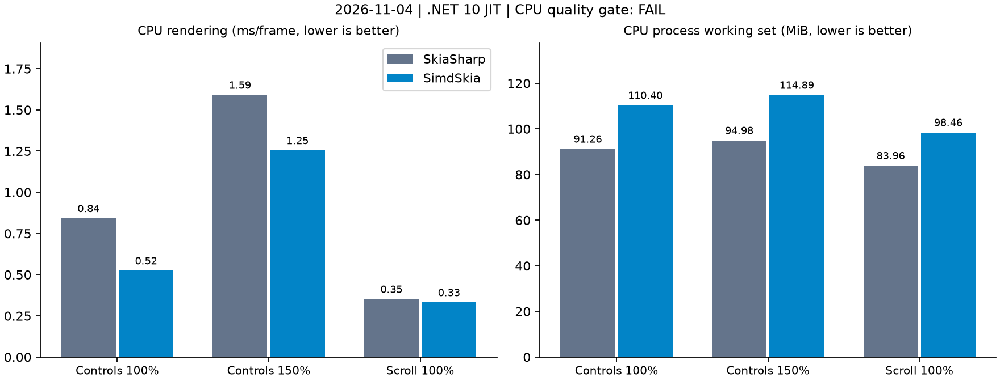
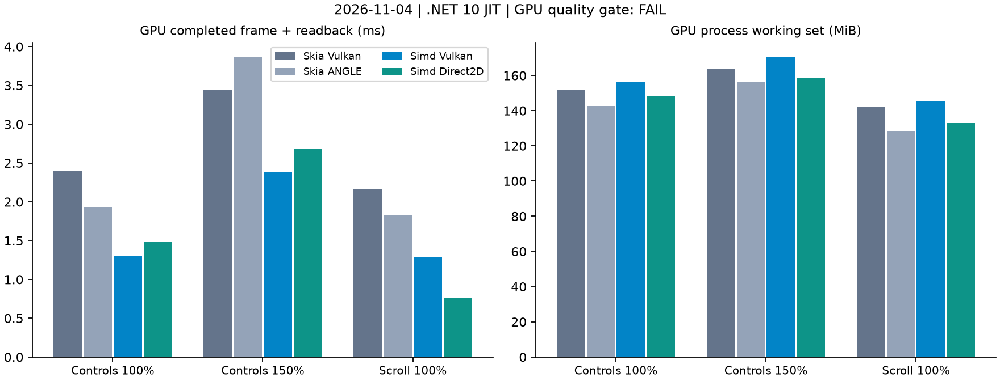
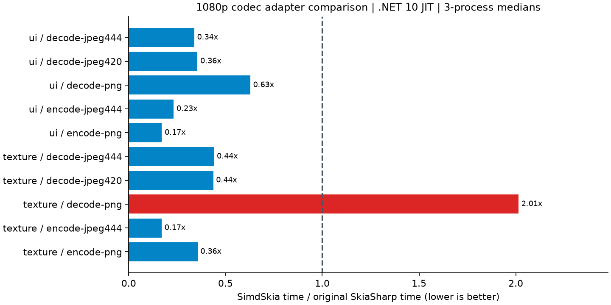

# SimdSkia 0.1.0：依赖升级、PNG 优化与正式版验证

日期：2026-11-04。正式版本支持文档列出的已实现功能子集；SkiaSharp 仍是源码兼容外观，完整 API、强名称二进制与原版逐像素等价不在承诺范围。此处是候选源码的实际测量，发布/公开状态见[发布记录](NUGET-PREVIEW.md)。

## 依赖核验与实现

| 直接依赖 | 之前 | 本次核验采用 |
| --- | --- | --- |
| Avalonia 家族 | 12.1.4 | 12.1.5 |
| Sdcb.SimdCodecs | 1.2.0 | 1.4.0，十五包图 |
| Clipper2 | 2.0.0 | 2.0.0，最新稳定 |
| PdfPig | 0.1.16 | 0.1.16，最新稳定 |

版本来自 NuGet v3 的实际包内容。[Avalonia 12.1.5](https://www.nuget.org/packages/Avalonia/12.1.5) / [Sdcb.SimdCodecs 1.4.0](https://www.nuget.org/packages/Sdcb.SimdCodecs/1.4.0)。Avalonia.Skia 仍实际引用 SkiaSharp 3.119.4 / HarfBuzzSharp 8.3.1.3，故不擅自换成不同契约的最新 SkiaSharp 4/HarfBuzz 14。MicroCom.Runtime 按 Avalonia 上游依赖解析 0.11.6；没有强制提升全部传递包。Avalonia/SDK 仍为 MIT，系统压缩和 macOS 官方窗口宿主的原生例外保留，不调用 Google Skia 绘图。

- PNG 开启 LosslessReduction，无损选择灰度/调色板等表示；颜色和透明隐藏 RGB 继续按真实 RGBA 回读验证。
- PNG 校验直接读取固定生命周期内的 IDAT 分片，移除完整压缩拷贝与该 ArrayPool 桶的保留。仅此同步、私有且有界的流使用 unsafe，不能逃逸 fixed 范围；新增逐字节分片、空块、偏移输入和并发 GC 检查。
- 新库仍接受非法过滤器，不能删除额外严格检查。预算、CRC、过滤器、调色板索引和精确膨胀长度继续执行；因此纹理 PNG 解码依旧有重复解压成本。
- JPEG Huffman 优化试验增加耗时与内存，未纳入默认配置；不把被撤回的试验当作交付。

## 测量方法与验证

同机 Windows x64 / i7-8700K（6 核/12 线程）/ GTX 1050 Ti，.NET 10.0.13 Release JIT。共 **123 个独立计时进程**，每例三轮中位数，串行运行；无并行构建/其他性能测试。CPU 27 进程、预热 2.5 秒/每例 3,000 帧；GPU 36 进程、预热 3 秒/采样 5 秒；编解码 60 进程、预热 1 秒/采样 2 秒。同一中文字体、控件树、尺寸/原始输入，150% DPI 为 1500×1080，其余页面为 1000×720。不是 Native AOT 性能、冷启动、显示器 FPS 或业务应用整体吞吐。

GPU 同时测原版 Vulkan、原版 ANGLE、SimdSkia Vulkan/Direct2D，包含记录命令、等待完成和全帧回读。编解码为两张不透明 1920×1080 自制 UI/纹理图案，不是通用照片集；输出包含所有权/分配/释放，不计 IO。JPEG 质量90/4:4:4 baseline，PNG 双方无损，过滤/缩减/压缩策略不同。CPU% 是整进程 CPU 时间/墙钟时间/12；每帧 CPU 时间更适合比较同等工作成本。WS/Private：CPU与编解码为计时后快照，GPU 为外部25ms采样中位数；不等于显存。托管分配不计原版 native malloc。

本地 Release 0 警告/错误；基础36、图片/损坏输入/压缩369、编解码与标量各1,417、精确优化471,569、兼容37、PDF18、字形批次60、控件9,750项通过。候选三平台托管、桌面 JIT/AOT/实际包/PDF 消费、Windows AOT 专项已通过；最终发行 CI 另记，不用功能检查冒充性能/画质通过。

## CPU 控件

下表主要采用原版默认透明度配置；强制完整图层原版也实测并保留，未用其更慢成绩替代默认原版。每格为 **原版 / SimdSkia**。

| 场景 | ms/帧 | CPU ms/帧 | WS MiB | Private MiB | KiB/帧 |
| --- | ---: | ---: | ---: | ---: | ---: |
| controls / 100% | 0.842 / 0.525 | 0.844 / 0.526 | 91.26 / 110.40 | 47.40 / 71.16 | 5.31 / 5.37 |
| controls / 150% | 1.591 / 1.255 | 1.583 / 1.255 | 94.98 / 114.89 | 51.12 / 75.70 | 5.31 / 5.37 |
| scroll / 100% | 0.352 / 0.332 | 0.375 / 0.365 | 83.96 / 98.46 | 45.12 / 64.84 | 5.03 / 3.17 |

CPU三场景捕获与 preview.10 的 SHA-256 全部相同。原版质量门槛仍 **0/3**，最大通道差96/117/75、RMSE约2.42/2.33/2.59，原 max≤32 且 RMSE≤2 不变。内存未追平，控件100%工作集多约19.14 MiB。



## GPU 完成帧与回读

| 场景 | 原版 Vulkan ms | 原版 ANGLE ms | Simd Vulkan ms | Simd Direct2D ms |
| --- | ---: | ---: | ---: | ---: |
| controls / 100% | 2.396 | 1.936 | 1.308 | 1.479 |
| controls / 150% | 3.442 | 3.860 | 2.380 | 2.678 |
| scroll / 100% | 2.161 | 1.832 | 1.293 | 0.767 |

相对各例较快原版 GPU，Vulkan / Direct2D 综合耗时比 **0.691 / 0.629**。速度门槛通过；画质仍 **0/12**，完整原版追平验收工具保留 `releaseEligible=false`。0.1.0 的已实现功能子集发布不代表该整体验收通过。

| 场景 / 后端 | CPU ms/帧 | 整机 CPU% | WS MiB | Private MiB | KiB/帧 |
| --- | ---: | ---: | ---: | ---: | ---: |
| controls 100% / original-vulkan | 1.804 | 6.27 | 151.50 | 149.62 | 5.13 |
| controls 100% / original-angle | 2.215 | 9.53 | 142.70 | 120.73 | 5.13 |
| controls 100% / vulkan | 0.552 | 3.52 | 156.40 | 150.06 | 7.76 |
| controls 100% / direct2d | 1.979 | 11.14 | 148.05 | 128.14 | 5.57 |
| controls 150% / original-vulkan | 2.721 | 6.59 | 163.45 | 165.72 | 5.13 |
| controls 150% / original-angle | 4.139 | 8.93 | 156.02 | 138.30 | 5.13 |
| controls 150% / vulkan | 1.053 | 3.70 | 170.22 | 169.64 | 7.93 |
| controls 150% / direct2d | 3.150 | 9.79 | 158.70 | 145.55 | 5.57 |
| scroll 100% / original-vulkan | 1.581 | 6.09 | 142.11 | 143.26 | 4.17 |
| scroll 100% / original-angle | 2.076 | 9.48 | 128.43 | 109.98 | 4.17 |
| scroll 100% / vulkan | 0.427 | 2.76 | 145.57 | 147.27 | 4.70 |
| scroll 100% / direct2d | 1.123 | 12.13 | 132.86 | 122.51 | 2.43 |

本次不支持命令的 CPU 回退均为0；CPU字形图集和软件图层仍计入。Direct2D 的不限帧 CPU% 较高，不能只按更短墙钟时间宣称更省CPU；本轮未测60FPS限帧GPU。GPU回读与CPU离屏口径不同，不横向宣称某后端显示更快。



## 图片编解码

| 图案/操作 | 原版 ms/张 | Simd ms/张 | 原版耗时/Simd耗时 | WS MiB（原/Simd） | 分配 KiB（原/Simd） |
| --- | ---: | ---: | ---: | ---: | ---: |
| ui / decode-jpeg444 | 11.374 | 3.853 | 2.95× | 35.38 / 44.60 | 0.29 / 0.95 |
| ui / decode-jpeg420 | 9.551 | 3.393 | 2.81× | 35.41 / 44.62 | 0.29 / 0.95 |
| ui / decode-png | 2.819 | 1.771 | 1.59× | 35.43 / 54.92 | 0.29 / 8.74 |
| ui / encode-jpeg444 | 30.571 | 7.103 | 4.30× | 59.67 / 115.20 | 126.76 / 386.22 |
| ui / encode-png | 59.467 | 10.177 | 5.84× | 49.97 / 61.48 | 12.62 / 43.96 |
| texture / decode-jpeg444 | 19.480 | 8.584 | 2.27× | 36.10 / 45.15 | 0.29 / 0.95 |
| texture / decode-jpeg420 | 17.739 | 7.748 | 2.29× | 35.90 / 45.14 | 0.29 / 0.95 |
| texture / decode-png | 20.383 | 41.053 | 0.50× | 37.84 / 51.69 | 0.29 / 8.80 |
| texture / encode-jpeg444 | 57.467 | 9.791 | 5.87× | 70.87 / 76.59 | 703.42 / 1465.23 |
| texture / encode-png | 439.060 | 156.274 | 2.81× | 63.87 / 92.41 | 2853.54 / 13398.97 |

PNG编码UI/纹理本例比原版快约 **5.84 / 2.81倍**；但纹理PNG解码仍慢约一倍，内存和分配仍有明显高项。零拷贝校验减少一个压缩缓冲，不代表整个编解码进程内存低于原版。每例CPU时间、Private/peakWS与三轮范围均在原始JSON，不删除慢项。



### 压缩大小与像素

所有编码输出由同一个原版解码器回读，两图案PNG均逐像素还原源图；JPEG实际SOF/采样均验证为baseline 4:4:4。不是相同码率或相同熵编码策略对比。

| 图案/编码 | 原版字节 | Simd字节 | 原版RGB PSNR | SimdRGB PSNR |
| --- | ---: | ---: | ---: | ---: |
| ui/encode-png | 12,569 | 8,099 | 无损 | 无损 |
| ui/encode-jpeg444 | 129,451 | 196,847 | 47.510 | 47.758 |
| texture/encode-png | 2,921,668 | 2,637,917 | 无损 | 无损 |
| texture/encode-jpeg444 | 719,929 | 749,217 | 36.296 | 36.311 |

UI JPEG 文件仍比原版大约52%，已保留文件大小代价。JPEG联合严格对照仍 **21/24**，最大差2、门槛1不变；本轮JPEG输入解码与编码输出差异完整记录，未新设宽松阈值。

## 发布范围与剩余差距

正式版0.1.0支持已实现、已验证功能范围；功能/损坏输入、标量、AOT、实际包与生命周期必须通过。对原版的像素级完全替代仍未验收通过，严格JPEG和整页差异保留为失败，只检查已披露差异没有新增回退。完整字体/复杂排版、API缺口、CMYK+ICC/HDR、受限PDF、macOS GPU等边界仍存在并需显式报错。不得据此宣传全面兼容或所有场景/平台性能持平。

## 复现

```powershell
dotnet build SimdSkia.sln -c Release
dotnet build benchmarks/AvaloniaGpuParity/Original -c Release
dotnet build benchmarks/AvaloniaGpuParity/Managed -c Release
dotnet build benchmarks/CodecSkiaComparison/Managed -c Release
dotnet build benchmarks/CodecSkiaComparison/Original -c Release
./tools/run-avalonia-controls.ps1 -NoBuild -Frames 3000 -Forks 3 -Output artifacts/new-run/cpu
python tools/run-gpu-parity.py --output artifacts/new-run/gpu --forks 3 --seconds 5 --warmup 3
python tools/run-codec-skia-comparison.py --output artifacts/new-run/codecs --forks 3 --seconds 2
```

CPU/GPU因原版画质未过保留失败退出，查看结果JSON，不改为质量全绿。字体和同一套编解码输入来自已冻结夹具；首次准备需按旧基准README生成同目录输入并记录SHA。图表工具只用于计时后的离线报告，不进入产品。

[完整结果/逐进程数据/源码与二进制哈希](evidence/stable-2026-11-04/results.json)。原始日志、RGBA、编码输出在本地 `artifacts/stable-2026-11-04/`。旧测量数据不改写。本轮没有重测发布体积、启动白屏、真实交换链FPS、ARM性能或7×24稳定性。
