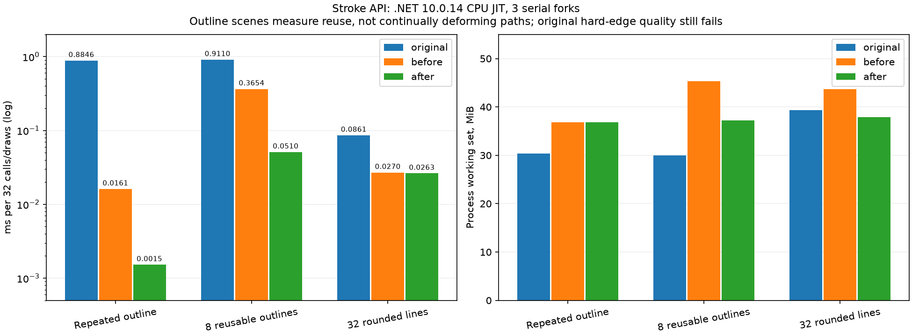

# 公共路径查询、描边轮廓与CPU优化（2026-11-06，未发布）

本批公共API元数据匹配 **1120→1146/3235**，65个公开类型，剩余2089项、额外/不同签名0。新增26项元数据包含1个Flags枚举及其字段、查询属性/方法和GetFillPath重载，不是26个独立绘图算法。没有改默认后端、没有推送或发布NuGet。

## 实现的API与行为

- SKPaint.GetFillPath共12个重载：返回新路径或写入调用方路径，支持cullRect、resScale和matrix。Fill返回独立可修改路径；Stroke返回实际可填充轮廓；hairline写入源几何并返回false，分配路径的重载返回null；允许src与dst相同。
- 矩阵仅影响轮廓细分精度，不变换输出坐标；无PathEffect时cullRect是优化提示，不裁切结果，经原版验证。非有限或投影分辨率矩阵明确拒绝。
- SKPath.IsLine/GetLine、IsRect/GetRect两重载、IsOval/GetOvalBounds、SegmentMasks以及SKPathSegmentMask Flags。矩形识别包括隐式闭合、方向与显式Close状态；椭圆保留构建标记，复制/位移/轴向缩放保留，倾斜/修改清除。AddPath不伪造椭圆标记。
- 开放公共描边的Butt/Round/Square端点、Miter/Round/Bevel接头，StrokeMiter支持0和小于1的合法设置；零长度线的圆/方端点有真实轮廓。DrawLine按原版忽略paint.Style，包括StrokeAndFill；其他形状的StrokeAndFill联合仍明确拒绝。
- 核心以同向的矩形、接头与圆锥圆盘构成一份非零填充轮廓，重叠部分只合成一次，避免半透明接头重复叠色。CPU/Vulkan/Direct2D消费同一几何；原有butt/miter保留原计算语义。

GetFillPath生成的轮廓拓扑与点顺序不承诺和原版相同（本实现可能包含重叠的同向子轮廓）。IsRect无结果时不比较原版未明确保证的out内容。NaN/unsafe/native handle、投影路径改写、其他尚缺API不在兼容承诺内。

## 性能和内存改动

- 原描边不再通过Where/Skip创建临时迭代器；每条边的法线只计算一次。小法线缓冲区在方法内一次性stackalloc，大轮廓从ArrayPool租借并finally归还，避免循环stackalloc累积。600组含重复点、闭合/开放和300点大轮廓与冻结旧实现逐片段一致。
- 每个画笔的GetFillPath轮廓采用最多16项、输入/输出片段载荷约1MiB预算的LRU；字典与对象自身另有开销。几何、宽度、miter、cap、join及精度均参与键，源变化失效，Reset/Dispose清除。不是全局强引用缓存。
- 输出目标已持有同一不可变轮廓时不再重复复制和清空查询缓存；调用者修改目标仍会正常恢复正确轮廓。超过预算的结果不保留。

## 同机原版CPU对照

Windows x64 / i7-8700K / .NET10.0.14 JIT / SDK10.0.403，原版固定SkiaSharp3.119.4。原版、初始新API实现、优化后分别冻结输出目录；9个串行进程、旋转顺序、三轮中位数，每场景预热0.4秒/采样0.8秒。计时期间不构建。

每帧32次调用。单对象轮廓重复用同一128点输入；多对象轮廓轮换8个预建128点输入，**不是每帧变形的冷路径**。圆头直线是128×128 BGRA premul、32条重复AA直线，复用画布/覆盖率缓存。修改前是本批新API的第一版，不是公开0.1.1（旧包没有GetFillPath）。

| 场景 | 原版 ms/帧 | 修改前 | 优化后 | 前/后分配 B/帧 | 前/后WS MiB | 原版WS MiB |
| --- | ---: | ---: | ---: | ---: | ---: | ---: |
| 同一轮廓复用 | 0.884638 | 0.016127 | 0.001520 | 0.01/0.00 | 36.86/36.82 | 30.34 |
| 8个固定轮廓轮换 | 0.910988 | 0.365382 | 0.051038 | 1971845.36/0.03 | 45.34/37.21 | 29.98 |
| 32条圆头直线 | 0.086078 | 0.026990 | 0.026278 | 0.03/0.03 | 43.67/37.85 | 39.35 |

单轮廓复用约10.6倍、多轮廓复用约7.2倍；原版每次重新计算，缓存收益不能宣称为所有算法普遍更快。圆头直线约3%的变化在噪声范围，不认作新的确定提速。多轮廓工作集下降约8MiB，但轮廓查询微程序的工作集仍高于原版。摊销分配接近0不等于绝对0，持续变形/超出预算时仍会重新分配。

| 场景 | 原版CPU ms/帧 | 修改前CPU | 优化后CPU | 原版Private MiB | 前/后Private MiB |
| --- | ---: | ---: | ---: | ---: | ---: |
| 同一轮廓复用 | 0.880525 | 0.016063 | 0.001514 | 9.00 | 15.98/16.74 |
| 8个固定轮廓轮换 | 0.906570 | 0.363870 | 0.050837 | 8.36 | 23.62/16.12 |
| 32条圆头直线 | 0.085741 | 0.026884 | 0.026175 | 16.17 | 21.01/15.48 |



原版为原生计算，托管分配为0不表示原生侧0分配；上述WS/Private包含各自进程、运行时和缓存。圆头直线前后像素精确相同，与原版max=15/RMSE=.961，沿用32/2门槛。没有本批整页Avalonia或GPU性能新跑分；上一轮窗口与原版GPU数据留在[历史报告](API-GPU-2026-11-06.md)，不能当本批新成绩。

## 兼容验证与真实失败

- 原版行为/查询：53组、605值全部通过，含默认参数、hairline、null参数名、cull/matrix提示、方向、标记和零长度。
- 标量冻结/生命周期：606项通过，其中600组逐片段核对，另外验证目标/源修改、缓存键、数量/载荷预算与Reset。
- 直接描边与GetFillPath再Fill的18组托管结果逐字节相同；原版与托管各自的DrawLine三种Style图像相同。
- 原版像素：27/48通过；9种cap/join的AA主场景及轮廓重绘18幅、闭合/零长度9幅通过。18幅硬边和3幅高对比不透明圆头AA仍失败，默认检查工具退出2，门槛未调整。
- 实际GPU完成/回读：Vulkan9组（最高通道差0），Direct2D9组（既定32/2门槛）全部通过。它们验证本批描边，不覆盖历史整页、曲线精细画质和全部设备/平台。
- 新Native AOT程序11项通过，运行期确认DynamicCodeSupported=false；当前Windows x64实测，不称已验证ARM/Linux/macOS。
- 完整Release构建0警告/错误；基础36、精确优化472085（硬件启用/全部intrinsics禁用分别运行）、编解码1417、PDF18、Features、控件9750、原几何4612值与shader50场景/30擦除通过，原Vulkan/Direct2D回归通过。
- 旧基础测试曾预期Round描边抛NotSupported，因功能已实现而失败；已移除这条过时断言，完整保留StrokeAndFill/Multiply等尚不支持的原子拒绝检查。旧失败日志保留，新功能由上述独立像素/GPU/AOT测试覆盖。

历史JPEG严格门槛和CPU/GPU整页画质未通过，未被本批局部通过结果覆盖。完整行为兼容、所有公共API和强名称二进制替代依然未成立；未发布新版。

## 示例、命令与证据

```powershell
dotnet build SimdSkia.sln -c Release
python tools/check-stroke-compatibility.py --output artifacts/stroke-check-new # 当前退出2，画质失败如实保留
dotnet run --project tests/StrokeCompatibility/Gpu -c Release -- artifacts/stroke-gpu-new
dotnet publish tests/StrokeCompatibility/NativeAot -c Release -r win-x64 -o artifacts/stroke-aot-new
.\artifacts\stroke-aot-new\NativeAot.exe
dotnet run --project examples/Strokes -c Release
```


例图列为Butt/Round/Square，行分别为Miter/Round/Bevel。性能复现需先在改动前保存before，分别构建benchmarks/StrokeCompatibility/{Managed,Original}并冻结；然后运行tools/run-stroke-benchmarks.py，具体目录见[冻结哈希](evidence/stroke-api-2026-11-06/performance-manifest.json)。报告图表仅用已有artifacts开发Python环境，不新增生产依赖。

[总状态](evidence/stroke-api-2026-11-06/status.json)、[API新增元数据](evidence/stroke-api-2026-11-06/new-api.json)、[原版对照](evidence/stroke-api-2026-11-06/comparison.json)、[GPU](evidence/stroke-api-2026-11-06/gpu.json)、[逐进程跑分](evidence/stroke-api-2026-11-06/performance-runs.json)、[源哈希](evidence/stroke-api-2026-11-06/source-hashes.json)及[证据校验](evidence/stroke-api-2026-11-06/sha256.json)均保留。CI新增真实AOT检查但尚未推送执行。
