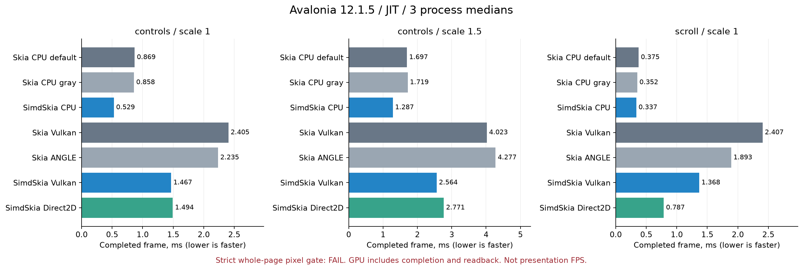
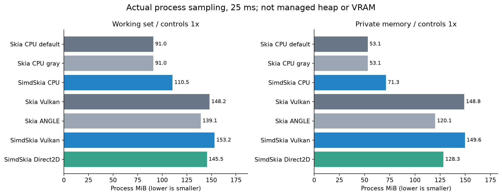
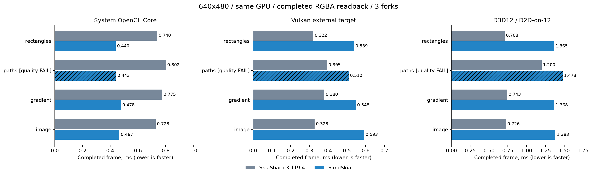
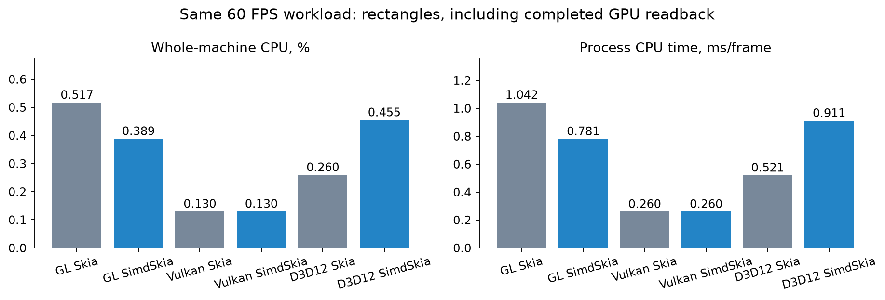
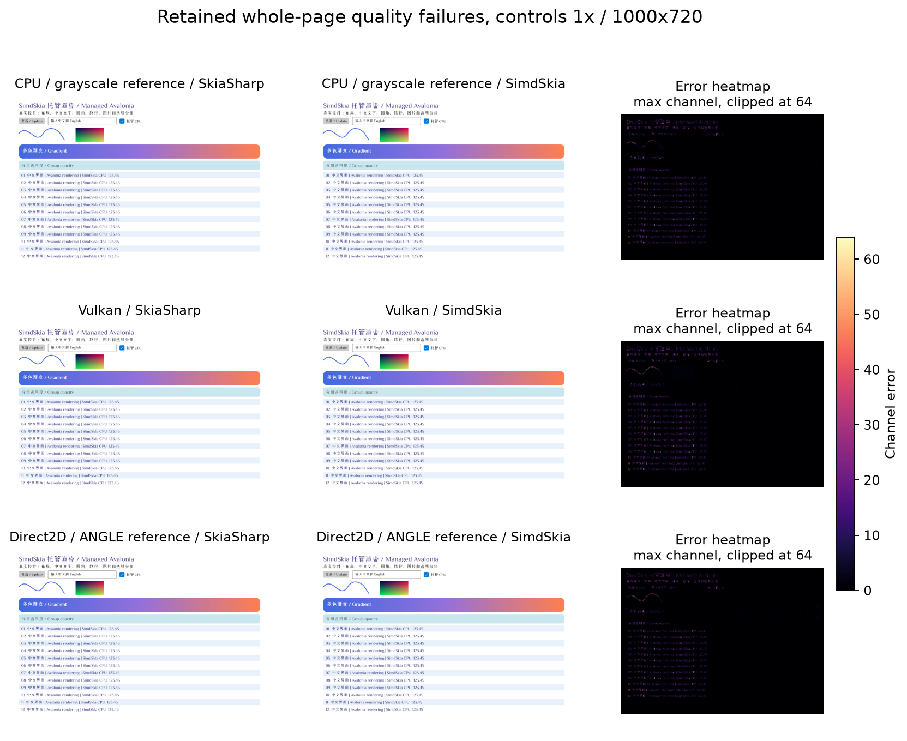

# 补齐94项API之后，纯C#的SimdSkia离替代SkiaSharp还有多远？

SimdSkia是独立的C# 2D渲染引擎，CPU光栅化、字体和基础排版由C#执行，不调用Google Skia原生绘图库；提供SkiaSharp命名空间的源码兼容外观，也提供Avalonia平台渲染适配器。PNG/TIFF允许.NET系统压缩，macOS窗口使用允许的官方宿主；GPU调用操作系统/驱动。这些边界与“任何环节都没有原生代码”有区别。

这次预览版为 **0.1.2-preview.1**。先说结果：固定SkiaSharp3.119.4的3235项公共清单，已匹配**3230项**，从99项缺口补入94项，另5项真实原生句柄/版本合同按约定保留。**签名覆盖不等于全面兼容；整页严格画质仍未过门槛，内存与部分速度也有差距。**

源码：[donet-org-cn/SimdSkia](https://github.com/donet-org-cn/SimdSkia)。[完整测试与性能报告](https://github.com/donet-org-cn/SimdSkia/blob/main/docs/PUBLIC-API-FINAL-2026-11-07.md)、[发布状态](https://github.com/donet-org-cn/SimdSkia/blob/main/docs/NUGET-PREVIEW.md)包含每个fork、CPU/内存采样、原始像素、门槛和失败。

## 补了哪些实际功能

新增真正1字节Alpha8/ExtractAlpha、延迟Picture图片、WebP编码选项、ColorF/Blender/抖动、BGRA水平LCD与中文TrueType嵌入点阵、向量SVG/XPS、原生v103 SKP子集读写，以及GL/GLES、D3D12、Metal核心和外部GPU资源导入。每个后端的格式/采样/滤镜限制仍明确报错。Metal没有Mac GPU，只有编译结果，未计入硬件通过。

Vulkan将外部表面CPU回传后再上传改为设备内复制，非重叠矩形最多16条单dispatch，清屏走设备填充，完成读回直接进入调用方缓冲；移除每批LINQ和临时计时对象。GPU共享图像的回调现在跟随shader/Picture及尚未完成的GL draw，最后消费者和实际GPU完成决定释放时机。

本轮也修正了一项测试错误：早期D3D12描述符漏传Adapter，误判原版工厂不可用。完整描述符下，双方10/10基础画面、346/346互操作画面通过，现在使用真实的同D3D12对照。旧错误记录保留并作废，不能拿它作为原版不支持的依据。

## 真实Avalonia控件页

Windows x64 / i7-8700K / GTX1050Ti，Avalonia12.1.5、SkiaSharp3.119.4、.NET10.0.14 JIT。相同场景、字体、DPI，3秒预热、5秒测量、3个独立进程。GPU等待实际完成并读回；这是离屏完整帧，不是显示器FPS，也不是AOT速度。

| 场景 | 原版CPU较快值ms | SimdSkia CPU ms | 原版/本实现WS MiB |
|---|---:|---:|---:|
| controls ×1 | 0.8582 | 0.5292 | 91.01/110.50 |
| controls ×1.5 | 1.6969 | 1.2875 | 94.63/114.18 |
| scroll ×1 | 0.3517 | 0.3370 | 83.54/99.04 |

CPU综合耗时约为较快原版CPU的76.5%，最慢场景约95.8%；但CPU工作集仍较高。字体缓存预算不是进程总内存，WS还包括运行时、JIT和映射页面。





## GPU不能只报提交时间

下表为640×480微场景，双方同一GPU、同一图形API、每帧真实完成RGBA读回。D3D12路径中本实现使用C# Direct2D驱动和系统D3D11On12。每个独立进程1秒预热/2秒测量、取3个进程中位数；表中的速度不应外推到所有窗口。

| 后端/场景 | 原版ms | SimdSkia ms | 本实现/原版耗时比 | 计时帧画质 |
|---|---:|---:|---:|---|
| OpenGL/rectangles | 0.7401 | 0.4398 | 0.594 | 通过 |
| OpenGL/paths | 0.8022 | 0.4427 | 0.552 | 失败 |
| OpenGL/gradient | 0.7753 | 0.4780 | 0.617 | 通过 |
| OpenGL/image | 0.7277 | 0.4666 | 0.641 | 通过 |
| Vulkan/rectangles | 0.3217 | 0.5389 | 1.675 | 通过 |
| Vulkan/paths | 0.3946 | 0.5098 | 1.292 | 失败 |
| Vulkan/gradient | 0.3801 | 0.5477 | 1.441 | 通过 |
| Vulkan/image | 0.3281 | 0.5929 | 1.807 | 通过 |
| D3D12/rectangles | 0.7077 | 1.3655 | 1.929 | 通过 |
| D3D12/paths | 1.2000 | 1.4784 | 1.232 | 失败 |
| D3D12/gradient | 0.7427 | 1.3676 | 1.841 | 通过 |
| D3D12/image | 0.7263 | 1.3831 | 1.904 | 通过 |



Vulkan相较自身旧CPU桥接已有实际收益，但这些微场景仍落后原版，不能说整体已追平。完整Avalonia页与微场景的成本构成不同；Direct2D窗口直接交换链和这里强制读回的结果也不能混称。原始数据分别给出绘制调用、完成读回、每帧CPU时间与采样内存，不用CPU测试代替GPU结果。

固定60FPS用来比较相同工作量的CPU占用，避免更高吞吐导致的CPU%被误读：



整机CPU百分比按12个逻辑线程计算；短测低占用存在计时粒度，所有fork和进程采样都保留。完整表还有每帧CPU时间、WS、私有内存与托管分配；托管分配不包含原生堆或显存。

## 画质与兼容性没有改判

| 项目 | 本轮结果 |
|---|---|
| 固定公共清单 | 3230/3235，201公开类型，额外签名0；不是二进制替换 |
| Vulkan精确优化 | 566检查、556次逐字节对照通过 |
| 浮点SIMD | AVX2/SSE2各5568缓冲与标量逐字节一致 |
| GL互操作 | 362/366过严格门槛，4幅透明最近邻边界仍失败 |
| D3D12互操作 | 346/346共同图、98元数据一致 |
| 中文点阵 | 独立FontTools9/9正确；整串文字与原版仍不同 |
| JPEG | 21/24，原1-LSB门槛仍失败 |
| Avalonia整页 | 0/18，沿用最大通道32/RMSE2；没有为了性能放宽 |
| Metal | 无Mac GPU，未实机验证 |



Native AOT已实际运行：新增CPU链路正常/标量各41检查通过，系统OpenGL另18检查通过。它证明这些测试路径能AOT运行；本轮没有把JIT速度或旧版本默认应用体积冒充本版AOT数据。GPU对象目前要求创建线程显式Dispose，GC终结回收未与原版等同。复杂排版、部分字体格式、GPU离屏层/高级状态、完整SkSL/SKP/PDF等仍有边界。

## Avalonia怎么安装

桌面应用首先安装 `SimdSkia.Avalonia.Desktop`，它带入 `SimdSkia.Avalonia` 渲染适配器和引擎依赖；GPU为可选包。NuGet界面勾选“包含预发行版”：

```sh
dotnet add package SimdSkia.Avalonia.Desktop --version 0.1.2-preview.1
dotnet add package SimdSkia.Avalonia.Gpu --version 0.1.2-preview.1
```

Avalonia家族包使用同一版本。适配器接受>=12.1.0且<13.0.0，宿主矩阵为12.1.0–12.1.5，未知未来补丁需要补宿主并回归。现有程序保留App/XAML/MVVM，将启动链改为：

```csharp
using Avalonia;
using SimdSkia.Avalonia;

AppBuilder.Configure<App>()
    .UseSimdSkiaDesktop()
    .StartWithClassicDesktopLifetime(args);
```

移除原版 `Avalonia.Desktop`、`Avalonia.Skia`、`Avalonia.Fonts.Inter` 及 `.WithInterFont()`，核对第三方控件是否仍直接依赖原版SK*/GR特性；Windows项目使用OutputType=WinExe避免控制台窗口。系统字体默认自动发现，无需默认内嵌字体文件。完整新项目的Demo.csproj/Program.cs和AOT发布命令见[README](https://github.com/donet-org-cn/SimdSkia#avalonia-快速开始windows--linux--macos)。

Windows可显式启用Direct2D，并允许有诊断记录的CPU回退：

```csharp
.UseSimdSkiaDesktop(options =>
    options.UseGpu(SimdSkiaGpuBackend.Direct2D, allowCpuFallback: true))
```

Windows/Linux可选择Vulkan；macOS窗口仍使用CPU，新增Metal核心未验收且尚未接入Avalonia呈现。独立SDL/图像处理项目选择 `SimdSkia` 或 `SimdSkia.Compatibility`，使用SkiaSharp命名空间重新编译；需要读取显示PDF再添加 `SimdSkia.Pdf`。同名类型默认不能与原版无别名混编，也不能让已编译的强名称SkiaSharp依赖直接装载替换。

源码、公开下载验证、使用说明和当前限制都在仓库。可以用这些结果决定是否针对自己的页面做试用；**“全部画质过门槛、整体持平且最差落后不超过10%”仍不是本版已实现的承诺。**
