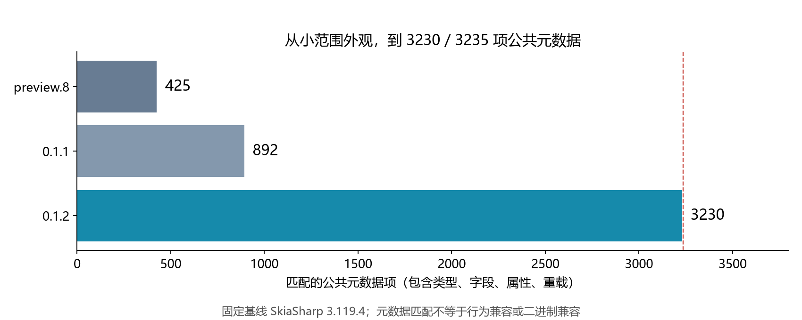
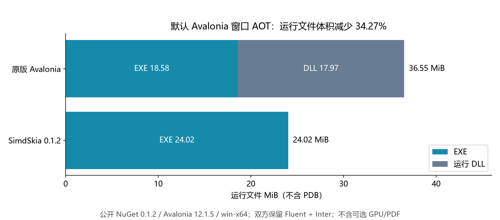
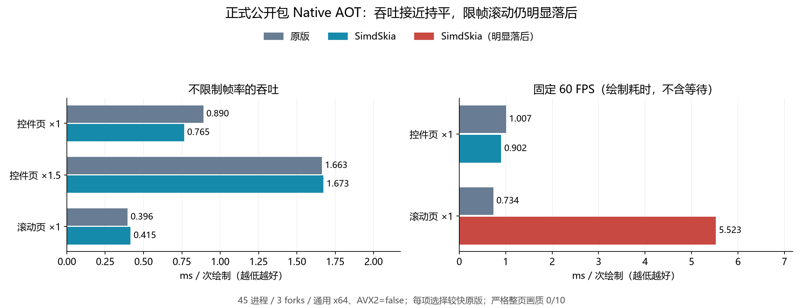
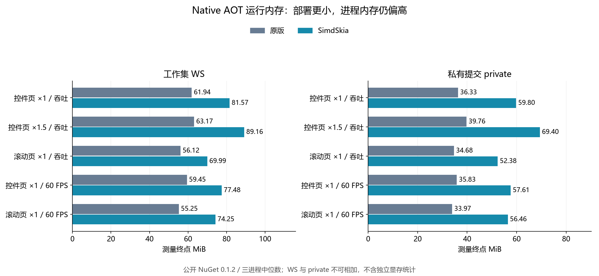
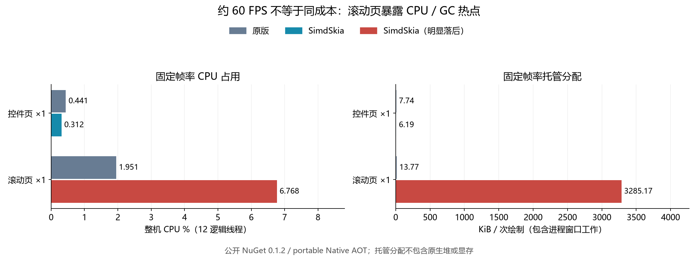
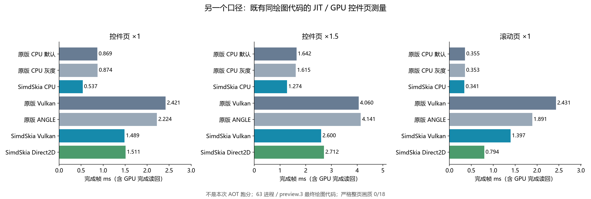
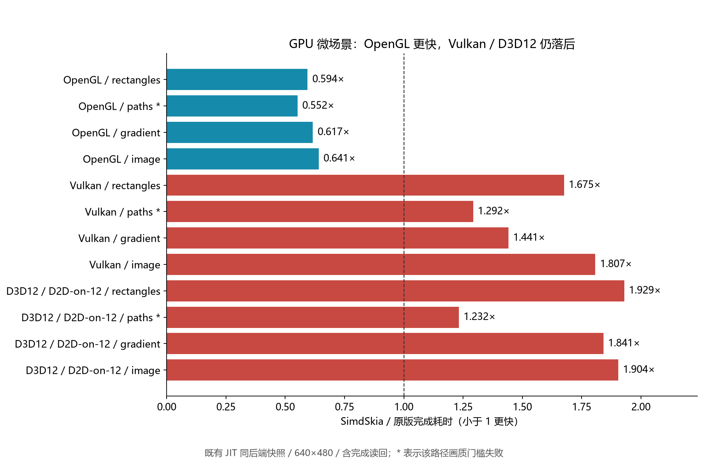
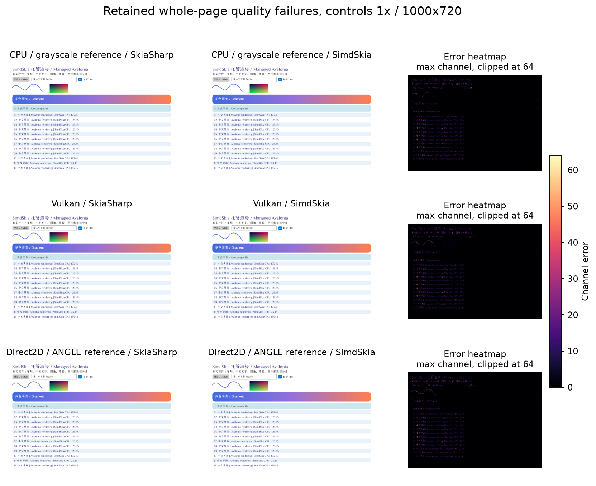

# 纯 C# 替换 SkiaSharp，AOT 少了 3 个 DLL：从 preview.8 到 SimdSkia 0.1.2 的进展与代价

上次在博客园写 SimdSkia，还是 [《纯 C# 追上 Skia？Avalonia 绘制耗时降了 59%，CPU/GPU 与内存实测》](https://www.cnblogs.com/dotnet-org-cn/p/23449873)。当时是 `0.1.0-preview.8`，主要讨论通用 x64 Native AOT 下的几个 Avalonia 页面，以及减少原生依赖后的发布体积。

现在 **0.1.2 正式版和十二个 NuGet 包已经发布**。这篇从上次接着讲：哪些能力真的补上了，部署体积变了多少，CPU/GPU 和内存表现如何，以及为什么目前仍不能把它称为“全面替代 SkiaSharp”。

先给出几个值得关注的结果：

- 固定 SkiaSharp 3.119.4 的公共元数据清单，从 **425/3235** 增至 **3230/3235**；这不等于行为兼容率。
- 同一个默认 Avalonia 窗口，Windows x64 AOT 的运行文件从 **36.55 MiB 降到 24.02 MiB**，少了三个原生 DLL。
- 这次从公开 NuGet 包重新跑的通用 x64 AOT，三个吞吐场景的综合耗时比为 **0.968**；但 **60 FPS 滚动场景的绘制耗时达到原版约 7.53 倍**，分配量也明显偏高。
- 已有同一绘图代码的 JIT/GPU 测量中，一些控件页更快；部分 Vulkan/D3D12 微场景仍慢，进程内存也没有普遍优势。
- **严格整页画质仍未通过，Metal 没有 Mac GPU 实机验证。** 正式版本号没有改变这些事实。

本文所有时间单位为毫秒，`MiB = 1024 × 1024 字节`。性能结果只适用于列出的场景、构建和硬件。

## 1. 先说清它替换的是哪一层

SimdSkia 是独立的 C# 2D 引擎。几何、CPU 光栅化、像素合成、字体解析、基础排版和图片编解码不调用 Google Skia。内部命名空间为 `SimdSkia`，对外兼容层保留 `SkiaSharp` 命名空间和 `SK*` 类型。

有两种接入方式：

1. **Avalonia 应用**：通过 `SimdSkia.Avalonia.Desktop` 注册渲染、字体和平台服务，保留 Avalonia 的控件、XAML 和 MVVM。无需重新编译 Avalonia。
2. **自己使用 SKBitmap/SKCanvas 的应用**：安装 `SimdSkia` 或 `SimdSkia.Compatibility`，保留 `using SkiaSharp;`，对源码重新编译、测试。

第二种是**源码兼容**。原版程序集名、强名称、公钥与本库不同；已经编译并依赖原版 SkiaSharp 的第三方 DLL，不能据此承诺直接装载替换。同名 `SK*` 类型也不能与原版无别名混编。

“纯 C#”还有一个需要讲明的范围：GPU 会调用系统图形 API 和驱动，PNG/TIFF 等允许使用 .NET 自带压缩；macOS 桌面窗口使用 Avalonia 官方原生窗口宿主。这些不是 Google Skia 绘图，但也不能宣传为整个跨平台程序完全没有原生系统组件。

## 2. 从 preview.8 到正式版，具体多了什么

### 公共 API 不再只覆盖很小的一角

这次实际下载 NuGet.org 上的 preview.8 程序集，用同一工具、同一 SkiaSharp 3.119.4 基线重新提取，再与已发布的 0.1.2 对照。

<!-- BEGIN GENERATED:api -->
| 项目 | preview.8 | 0.1.2 |
|---|---|---|
| 公开类型 | 37 | 201 |
| 匹配公共元数据项 | 425 / 3235 | 3230 / 3235 |
| 缺失或签名不一致项 | 2810 | 5 |
| 额外或不同签名项 | 0 | 0 |
<!-- END GENERATED:api -->



计数包含类型、字段、枚举、属性、方法和重载，**新增 2805 项元数据签名不等于新增 2805 个完整功能**。目前工具对比的范围也不包含所有受保护成员、属性标注、可空注解和行为合同。

保留的五项缺口是 `SKObject.Handle`、`SkiaSharpVersion` 类型及其 `Native`、`NativeMinimum`、`CheckNativeLibraryCompatible`。它们描述真实 native Skia 对象或库版本；本库不加载 Google Skia，因此没有制造一套替代句柄/版本来充数。

此外，`SKBitmap.GetPixels()` 返回本库像素缓冲的真实稳定地址，与 `SKObject.Handle` 的原生对象合同是两回事。当前已支持指针、stride、外部像素与释放回调相关链路，仍要遵守相应对象和缓冲的生命周期。

### 几次版本更新的主线

| 阶段 | 主要变化 |
|---|---|
| preview.9 | 补 `GetPixels`、`FromFamilyName`、`SKCodec`/GIF、`SKRoundRect`、`SaveLayer` 等实际应用遇到的缺口；加入 PDF 生成及可选读取；修复窗口后端上下文与字体相关问题 |
| preview.10 | 编解码转向 `Sdcb.SimdCodecs` 托管实现；目标框架调整为 .NET 10 |
| 0.1.0 | 更新 Sdcb.SimdCodecs 1.4.0，改进 PNG 流式 IDAT、CRC 与内存路径；公开正式包 |
| 0.1.1 | Avalonia 12.1.x 匹配宿主、跨补丁版本接入与三平台/AOT 验证 |
| 0.1.2 | 扩展路径、像素、滤镜、文字、序列化和 GPU 公共 API；补真实 Alpha8、浮点颜色、LCD、SVG/XPS/SKP 子集；修复 MoveTo 和特殊混合 SaveLayer；继续优化 SIMD、缓存与 Vulkan 提交/读回 |

0.1.1 到 0.1.2 这一段单独增加 **2338 项元数据签名**；不要与本文从 preview.8 起的 2805 项混用。全部累计内容见 [0.1.2 更新记录](https://github.com/donet-org-cn/SimdSkia/blob/main/docs/RELEASE-0.1.2.md)。

### 功能有了，还要看实现边界

| 范围 | preview.8 时 | 0.1.2 当前能力与边界 |
|---|---|---|
| 几何、路径与绘图状态 | 基础绘图、路径、描边、裁剪 | 扩展圆锥/圆弧、路径测量/布尔运算、描边、图层及绘图重载；部分曲线覆盖与原版仍有差异 |
| 像素访问 | 以托管 Span 为主，指针 API 有缺口 | 补真实像素地址、外部缓冲、视图、复制、缩放、Alpha8 与浮点格式；不是原生 Skia 对象互操作 |
| 字体与排版 | TrueType、基本中英文 | 系统字体发现、更多测量/TextBlob、中文嵌入点阵、LCD；复杂脚本、CFF、可变/彩色字体、完整 hinting 仍有边界 |
| 图片编解码 | PNG/JPEG 为主 | 使用 Sdcb.SimdCodecs 1.4.0 托管编解码及 SKCodec 链路；各格式/选项依已实现子集，JPEG 严格比较仍有失败 |
| 滤镜与高级绘图 | 覆盖有限 | 增加混合、颜色滤镜、图片 shader、RuntimeEffect 子语言、网格/Atlas/Picture；不是完整 SkSL 或全部滤镜组合 |
| PDF | 原文阶段尚未提供当前链路 | 多页**栅格 PDF 导出**；可选 `SimdSkia.Pdf` 读取/绘制已有 PDF 子集，不是完整阅读器，也不是可搜索向量 PDF 导出 |
| SVG/XPS/SKP | 未提供当前向量/互读链路 | SVG、多页 OPC/XPS、原生 v103 SKP 子集；不能概括为任意格式完整往返 |
| Avalonia 桌面 | 三平台 CPU，已有 Windows D2D/Vulkan 等 | 已验证 12.1.0–12.1.5 同一适配器，匹配宿主选择；macOS 窗口仍使用 CPU |
| GPU | 已有 Vulkan/Direct2D，不是本版才加入 | 继续优化二者，增加 GL/GLES、D3D12、Metal 核心/外部资源路径；Metal 无实机验收，部分 API 有 CPU 桥接或不支持状态 |

这里没有用“方法存在”替代功能验证。例如 PDF 栅格导出可以实际生成页面，但不能因此称为完整向量 PDF 引擎；基本中英文能显示，也不等于 HarfBuzz 的复杂文字排版能力已经补齐。

## 3. AOT 体积重新测：少三个 DLL，合计节省 34.27%

本次以公开的 **SimdSkia 0.1.2** 和 **Avalonia 12.1.5** 重新发布。两个程序都是同一默认 Avalonia 窗口，显示 `Welcome to Avalonia!`，保留相同的 Fluent、Inter 字体、XAML、manifest 和 AOT 属性。

使用 SDK 10.0.403、win-x64、self-contained、Native AOT；没有使用 UPX、删除 DLL、关闭堆栈等额外压缩手段。实际启动两个 GUI 窗口，检查真实呈现帧、PE 无 CLR header、进程未加载 CLR/JIT。NuGet 依赖来自 NuGet.org，没有源码项目引用。

<!-- BEGIN GENERATED:size -->
| 文件类别 | 原版 | SimdSkia 0.1.2 |
|---|---|---|
| EXE | 18.58 MiB | 24.02 MiB |
| 运行 DLL | 17.97 MiB | 0.00 MiB |
| 运行文件合计（不含 PDB） | 36.55 MiB | 24.02 MiB |
| PDB（单独统计） | 164.80 MiB | 82.93 MiB |
| 全部发布文件（含 PDB） | 201.35 MiB | 106.96 MiB |
<!-- END GENERATED:size -->



PDB 属于调试符号，单独列出；不是将发布目录里所有文件混在一起后宣称用户必需下载多少。这里也没有包含可选 GPU/PDF 包，不能套用到带大量资源的业务程序。

少掉的三个运行文件如下：

<!-- BEGIN GENERATED:removed -->
| 文件 | 字节 | MiB |
|---|---|---|
| `av_libglesv2.dll` | 5,394,096 | 5.14 |
| `libHarfBuzzSharp.dll` | 1,816,088 | 1.73 |
| `libSkiaSharp.dll` | 11,628,896 | 11.09 |
<!-- END GENERATED:removed -->

需要注意两点：

- **SimdSkia 的 EXE 本身更大**，托管引擎被 AOT 链接进了 EXE；减少的是整个运行目录的体积。
- 上篇引用的 **19.51 MiB 是 10 月 26 日 preview.7 的历史默认窗口结果**。当前为 24.02 MiB，确实更大；期间 Avalonia、SDK、依赖和功能都发生了变化，不能把差值全部归因于某一模块，也不能继续拿旧数字宣传新版更小。

这项测试中，原版保留默认桌面渲染配置，本库使用 CPU。因此这张表只回答**默认应用的部署体积**，不回答不同后端的速度。

## 4. CPU：通用 x64 AOT 接近持平，但滚动场景暴露明显问题

为了接上上篇的“通用 x64”口径，本次重新从公开 0.1.2 包发布真正的 Native AOT 程序。没有为本库加 x86-64-v3 参数，进程报告 `AVX2=false`、向量宽度 128 bit；原版 native Skia 按自己的正常 CPU 检测运行。

测试机：Windows 11 x64、i7-8700K（6 核 12 线程）、31.93 GiB 内存、GTX 1050 Ti。Avalonia 12.1.5、SkiaSharp 3.119.4、HarfBuzzSharp 8.3.1.3、.NET 10.0.14。双方使用相同固定中文字体、控件页、像素尺寸和 DPI。

每个场景 2 秒预热、5 秒测量，三个独立进程取中位数。保留原版默认透明度与 full-group 两种配置，表中逐场景选择**耗时更低的原版**，不只选对本库有利的那条。5 场景 × 3 变体 × 3 进程，共 **45 个进程**；原始两条原版结果和全部 fork 都保留。

<!-- BEGIN GENERATED:aot-time -->
| 场景 | 原版 ms | SimdSkia ms | 耗时比 | 选择的原版配置 |
|---|---|---|---|---|
| 控件页 ×1 / 吞吐 | 0.8898 | 0.7646 | 0.859 | original-default |
| 控件页 ×1.5 / 吞吐 | 1.6629 | 1.6733 | 1.006 | original-default |
| 滚动页 ×1 / 吞吐 | 0.3957 | 0.4151 | 1.049 | original-full |
| 控件页 ×1 / 60 FPS | 1.0073 | 0.9025 | 0.896 | original-default |
| 滚动页 ×1 / 60 FPS | 0.7337 | 5.5232 | 7.528 | original-full |
<!-- END GENERATED:aot-time -->



耗时比为 `SimdSkia / 原版`，越低越好。前三个不限制帧率的吞吐场景，几何平均耗时比 **0.968**，最慢约落后 **4.9%**。但把后两项固定帧率场景也纳入，五项几何平均达到 **1.437**。不能只拿前三项就宣称整体已经追平。

### 为什么 60 FPS 滚动要单独拿出来

该项中本库约 **5.523 ms/次绘制**，原版约 **0.734 ms**。本库的 p95 为 **13.956 ms**，原版约 **1.008 ms**；本库每次进程在约 300 次绘制中记录 **49–51 次计时截止延迟**，原版对照为 0–3 次。这个计数是测试调度截止时间，不等同于显示器实际丢帧。

两边平均都仍接近 60 次/秒，因为这是限帧测试，有剩余时间时会等待。**平均 FPS 相似，不能掩盖 CPU、分配量和尾部延迟的差距。**

吞吐循环连续执行离屏 `RenderTargetBitmap.Render`；固定帧率循环通过 `Task.Delay` 让出 UI 线程，真实窗口的合成、呈现、定时器等也有机会运行。每次 `Render` 单独计时，进程 CPU/分配统计涵盖整个测量区间。两种模式负载不同，因此这里还不能把差距归因于某个已确认的底层函数；需要进一步做分配栈和调度分析。

这是本次写续文时新测出的明确短板，**0.1.2 尚未修复**。它也说明只看离屏峰值吞吐，无法替代真实应用的限帧、输入和动画测试。

### 与上篇数字放在一起看

<!-- BEGIN GENERATED:historical -->
| 场景 | 旧文原版 ms | preview.8 ms | 本次原版 ms | 0.1.2 ms |
|---|---|---|---|---|
| 控件页 ×1 / 吞吐 | 0.9159 | 0.7611 | 0.8898 | 0.7646 |
| 控件页 ×1.5 / 吞吐 | 1.7599 | 1.7803 | 1.6629 | 1.6733 |
| 滚动页 ×1 / 吞吐 | 0.4142 | 0.4300 | 0.3957 | 0.4151 |
| 控件页 ×1 / 60 FPS | 1.2355 | 1.0626 | 1.0073 | 0.9025 |
| 滚动页 ×1 / 60 FPS | 0.8591 | 0.8092 | 0.7337 | 5.5232 |
<!-- END GENERATED:historical -->

这里旧列直接摘自上篇已发表的表，新列来自本次 45 进程测试。旧文用 Avalonia 12.1.4 / SDK 10.0.402 / runtime 10.0.13，本次为 12.1.5 / 10.0.403 / 10.0.14，且新列逐项选择较快的原版透明度配置。**这是带环境标签的历史并列，不是控制全部变量后的引擎版本 A/B。**

可以看到，增加了大量 API 之后，基础吞吐没有数量级变化；限帧滚动却显著变差。不能因为新增功能多就跳过这项结果。上篇标题里的“降低 59%”指当时 preview.7→preview.8 的特定控件场景，也不是这次相对原版的整体加速幅度。

## 5. CPU 占用和内存：部署小，不代表运行时省

<!-- BEGIN GENERATED:aot-resources -->
| 场景 | 实现 | CPU ms/帧 | 整机 CPU % | WS MiB | private MiB | 托管 KiB/帧 |
|---|---|---|---|---|---|---|
| 控件页 ×1 / 吞吐 | 原版 | 0.890 | 8.33 | 61.94 | 36.33 | 7.09 |
| 控件页 ×1 / 吞吐 | SimdSkia | 0.762 | 8.33 | 81.57 | 59.80 | 5.50 |
| 控件页 ×1.5 / 吞吐 | 原版 | 1.658 | 8.30 | 63.17 | 39.76 | 7.09 |
| 控件页 ×1.5 / 吞吐 | SimdSkia | 1.673 | 8.33 | 89.16 | 69.40 | 5.50 |
| 滚动页 ×1 / 吞吐 | 原版 | 0.396 | 8.33 | 56.12 | 34.68 | 6.60 |
| 滚动页 ×1 / 吞吐 | SimdSkia | 0.415 | 8.33 | 69.99 | 52.38 | 2.50 |
| 控件页 ×1 / 60 FPS | 原版 | 0.882 | 0.44 | 59.45 | 35.83 | 7.74 |
| 控件页 ×1 / 60 FPS | SimdSkia | 0.625 | 0.31 | 77.48 | 57.61 | 6.19 |
| 滚动页 ×1 / 60 FPS | 原版 | 3.906 | 1.95 | 55.25 | 33.97 | 13.77 |
| 滚动页 ×1 / 60 FPS | SimdSkia | 13.542 | 6.77 | 74.25 | 56.46 | 3285.17 |
<!-- END GENERATED:aot-resources -->





表中的 CPU 百分比是**整机口径**：`进程 CPU 时间 / 墙钟时间 / 12 个逻辑处理器`。吞吐模式下，两边基本都用满一个核心，显示约 8.33%，所以还要看 CPU 毫秒/帧；更快的一方会在相同时间绘制更多帧。

固定帧率滚动的本库托管分配中位数约 **3.21 MiB/次绘制**，原版约 **13.77 KiB**；本库 5 秒中有约 163 次 Gen0、71 次 Gen1。这包含该进程的窗口工作，不能直接说成光栅内核单次分配，但足以证明该用法有明显 GC 压力。

上表 WS/private 使用测量终点值，完整证据还保留 25 ms 的外部采样、峰值和测量前后值。WS 是驻留物理内存，private 是进程私有提交，二者不能相加；托管分配量也不包含原版 native heap 或 GPU 显存。

因此目前可以说**发布体积下降**，不能说**运行内存全面降低**。长驻客户端、低内存设备尤其需要先测自己的完整页面。

## 6. JIT 与 GPU：有更快的页面，也有更慢的微场景

下面另一组是已冻结的 **63 进程 JIT 测量**：3 秒预热、5 秒测量、3 个独立进程、25 ms 内存采样。它来自 0.1.2-preview.3 的最终绘图代码，正式 0.1.2 没有更换这些渲染算法；这是**同一绘图代码的既有测量**，不是本次重新跑的正式包 GPU/AOT 分数。

不要把这里的 JIT 数字与上面的 portable AOT 直接拼接成版本提速比例，也不要将它与旧文的 AOT 数字相减。JIT 在该机器可以使用更高指令集，构建、运行时与测试夹具也不同。

### Avalonia 控件页的完成耗时

<!-- BEGIN GENERATED:jit-time -->
| 实现 | 控件 ×1 ms | 控件 ×1.5 ms | 滚动 ×1 ms |
|---|---|---|---|
| 原版 CPU 默认 | 0.8687 | 1.6419 | 0.3553 |
| 原版 CPU 灰度 | 0.8740 | 1.6152 | 0.3527 |
| SimdSkia CPU | 0.5369 | 1.2745 | 0.3410 |
| 原版 Vulkan | 2.4206 | 4.0604 | 2.4310 |
| 原版 ANGLE | 2.2244 | 4.1408 | 1.8912 |
| SimdSkia Vulkan | 1.4886 | 2.6002 | 1.3972 |
| SimdSkia Direct2D | 1.5110 | 2.7124 | 0.7943 |
<!-- END GENERATED:jit-time -->



CPU 相对较快原版的三个页面综合耗时比为 **0.778**；本库 Vulkan/Direct2D 相对两条原版 GPU 中较快者为 **0.682/0.575**。但这组严格整页画质仍是 **0/18**，不能把这些时间宣传成“同画质全面领先”。

GPU 每帧都等待实际完成并读回相同缓冲，不只计命令提交。该过程会放大同步与 PCIe/内存传输成本；CPU 原本直接持有目标像素，因此本例中 GPU 比 CPU 慢并不矛盾。这些是**完成离屏帧的耗时**，不是窗口呈现 FPS，也不是纯 shader 速度。

本库 Direct2D 对原版 ANGLE，是同一块 GPU 上的**不同 API**；Vulkan 对 Vulkan 才是同 API。Direct2D 真实窗口的 DXGI 交换链正常帧不强制读回，不能把该窗口路径与这里的离屏读回数混为一谈。

### 相同控件页 ×1 的 CPU 和进程内存

<!-- BEGIN GENERATED:jit-resources -->
| 实现 | CPU ms/帧 | 整机 CPU % | 采样 WS MiB | 采样 private MiB | 托管 B/帧 |
|---|---|---|---|---|---|
| 原版 CPU 默认 | 0.869 | 8.33 | 91.00 | 53.08 | 5256.0 |
| 原版 CPU 灰度 | 0.872 | 8.31 | 91.25 | 53.38 | 5256.0 |
| SimdSkia CPU | 0.540 | 8.38 | 110.75 | 71.41 | 5561.2 |
| 原版 Vulkan | 1.792 | 6.17 | 148.23 | 149.53 | 5256.0 |
| 原版 ANGLE | 2.509 | 9.40 | 139.34 | 121.62 | 5256.0 |
| SimdSkia Vulkan | 0.614 | 3.44 | 154.93 | 151.25 | 5849.7 |
| SimdSkia Direct2D | 2.002 | 10.86 | 145.46 | 127.99 | 5849.7 |
<!-- END GENERATED:jit-resources -->

这组 GPU 命令级 CPU fallback 计数为零，但文字/路径覆盖率等准备工作仍可能在 C# CPU 上完成，再由 GPU 合成。因此“没有回退命令”也不等于所有处理都在 GPU 执行。

### 把测试缩小，结果可能反过来

下面来自已冻结的同后端 GPU 微场景：640×480、1 秒预热、2 秒计时、3 进程，双方完成同样的 RGBA 读回。保留全部四种场景，没有隐藏曲线路径的画质失败。

<!-- BEGIN GENERATED:gpu-micro -->
| 后端 / 场景 | 原版 ms | SimdSkia ms | 耗时比 | 画质门槛 |
|---|---|---|---|---|
| OpenGL / rectangles | 0.7401 | 0.4398 | 0.594 | 通过 |
| OpenGL / paths | 0.8022 | 0.4427 | 0.552 | **失败** |
| OpenGL / gradient | 0.7753 | 0.4780 | 0.617 | 通过 |
| OpenGL / image | 0.7277 | 0.4666 | 0.641 | 通过 |
| Vulkan / rectangles | 0.3217 | 0.5389 | 1.675 | 通过 |
| Vulkan / paths | 0.3946 | 0.5098 | 1.292 | **失败** |
| Vulkan / gradient | 0.3801 | 0.5477 | 1.441 | 通过 |
| Vulkan / image | 0.3281 | 0.5929 | 1.807 | 通过 |
| D3D12 / D2D-on-12 / rectangles | 0.7077 | 1.3655 | 1.929 | 通过 |
| D3D12 / D2D-on-12 / paths | 1.2000 | 1.4784 | 1.232 | **失败** |
| D3D12 / D2D-on-12 / gradient | 0.7427 | 1.3676 | 1.841 | 通过 |
| D3D12 / D2D-on-12 / image | 0.7263 | 1.3831 | 1.904 | 通过 |
<!-- END GENERATED:gpu-micro -->



这组 Vulkan 仍约为原版 **1.29–1.81 倍**，D3D12/D2D-on-12 约 **1.23–1.93 倍**。后者是本库通过系统 D3D11On12/Direct2D 实现的 D3D12 互操作路径，不代表前面 Avalonia 的 D3D11 Direct2D 窗口路径。

CPU 单项里也有差距：同一批 API 测量中的网格约为原版 **7.02 倍耗时**，WebP lossless 编码约 **13.31 倍**，RuntimeEffect 解释执行也有明显热点。完整 CPU/内存与各格式门槛见 [公共 API 最终报告](https://github.com/donet-org-cn/SimdSkia/blob/main/docs/PUBLIC-API-FINAL-2026-11-07.md)。

GPU 已做的改进包括 Vulkan 外部表面设备内复制、最多 16 条非重叠矩形合批 dispatch、设备填充清屏、直接完成读回，以及提交中的临时分配削减；CPU 侧也增加 SIMD 行内核、采样表、字形覆盖与有界缓存复用。这些优化是真实代码与测试覆盖的改动，但**不意味着所有场景都已经达到持平且最差落后不超过 10%**。

## 7. 哪些测试通过了，哪些还没过

| 项目 | 当前结果与含义 |
|---|---|
| 实际 NuGet 发布 | 十二个 0.1.2 正式包；CI/本机重新下载，比对 DLL、依赖、宿主资产、README/CHANGELOG/LICENSE |
| 三平台 Avalonia | Windows x64、Linux X11 x64、macOS ARM64；12.1.0–12.1.5 共 18 组真实窗口、最低/最高版本 6 组 Native AOT 通过 |
| 几何、图层修复 | 几何 300 组/4636 值通过；特殊 SaveLayer 464 组、2,375,680 字节与原版精确一致 |
| 标量/SIMD | 浮点 AVX2、禁用 AVX2 后 SSE2 各 5568 缓冲与标量逐字节一致 |
| Vulkan 优化 | 566 检查、556 次逐字节对照通过；不代表全部 GPU API 都已验收 |
| GL / D3D12 互操作 | GL 严格像素 362/366，仍有 4 幅透明最近邻边界失败；D3D12 共同比较 346/346 |
| JPEG | 原定严格门槛仍 21/24，三个蓝色通道 +2 的用例不改判为通过 |
| 中文/LCD | 独立 FontTools 中文点阵 9/9 正确，但整串文字和部分 LCD 像素与原版仍不同 |
| 本次 AOT 整页 | **0/10**；最大通道误差 92–109、RMSE 约 2.31–3.09，门槛仍为最大 32 / RMSE 2 |
| 既有 JIT 整页 | **0/18**；沿用原门槛，未为成绩放宽 |
| Metal | 无 Mac GPU，**未实机验证**；尚未接入 Avalonia 窗口 GPU 呈现 |



上图来自前述 JIT 快照；本次 AOT 每个进程的原图/原始像素也在证据目录中。整页差异包含文字覆盖、曲线边缘等；只看缩略图觉得相似，不能替代像素门槛。原版默认与 full-group 透明度合同分别比较，本次即使选择相同 group 合同也没有通过。

资源生命周期也仍有边界：GPU 对象要求在创建线程显式 `Dispose`，GC 终结回收行为没有与原版等同；复杂采样、滤镜、混合、LCD/SaveLayer 等后端状态按已实现子集处理。不支持的功能应明确报错或经显式允许回退，不能返回空白假装成功。

## 8. Avalonia 怎么用：包名和启动代码

当前要求 **.NET 10**。Avalonia 支持声明为 `>=12.1.0 且 <13.0.0`，**实际验收版本为 12.1.0–12.1.5**；未知未来 12.x 需要匹配宿主与回归，不能理解成未来所有版本已验证。以下固定使用 12.1.5。

新建桌面应用首先安装：

```sh
dotnet add package SimdSkia.Avalonia.Desktop --version 0.1.2
```

现有项目将全部直接引用的 `SimdSkia.*` 包统一到 0.1.2，Avalonia 家族统一到相同版本。替换默认后端时移除直接的 `Avalonia.Desktop`、`Avalonia.Skia`；若希望使用系统字体，也移除 `Avalonia.Fonts.Inter` 和 `.WithInterFont()`。第三方控件可能仍间接引用原版，必须检查依赖树。

最小项目引用示例：

```xml
<Project Sdk="Microsoft.NET.Sdk">
  <PropertyGroup>
    <OutputType>WinExe</OutputType>
    <TargetFramework>net10.0</TargetFramework>
    <ImplicitUsings>enable</ImplicitUsings>
    <Nullable>enable</Nullable>
  </PropertyGroup>
  <ItemGroup>
    <PackageReference Include="SimdSkia.Avalonia.Desktop" Version="0.1.2" />
    <PackageReference Include="Avalonia" Version="[12.1.5]" />
    <PackageReference Include="Avalonia.Themes.Fluent" Version="[12.1.5]" />
  </ItemGroup>
</Project>
```

保留自己的 `App`、XAML、窗口与 MVVM，将入口配置改为：

```csharp
using Avalonia;
using SimdSkia.Avalonia;

internal static class Program
{
    [STAThread]
    public static void Main(string[] args)
        => AppBuilder.Configure<App>()
            .UseSimdSkiaDesktop()
            .StartWithClassicDesktopLifetime(args);
}
```

`OutputType=WinExe` 避免 Windows 启动时弹出控制台。此配置默认 CPU/SIMD，不要再保留一条与之冲突的原版平台/渲染初始化链。完整两文件可运行示例见 [README 快速开始](https://github.com/donet-org-cn/SimdSkia#avalonia-快速开始windows--linux--macos)。

字体默认发现系统字体：本机正式包 AOT 验证使用 `Microsoft YaHei UI`；Linux/macOS 需安装本库支持的静态 TrueType 字体。选择系统字体减少资源携带，但不同系统、字体版本的排版与像素不会天然一致。需要固定效果时仍可显式带字体。前面的体积对照特意两边都保留 Inter，没有通过删掉单边字体制造优势。

### 可选 GPU，不是默认越开越快

```sh
dotnet add package SimdSkia.Avalonia.Gpu --version 0.1.2
```

Windows 可以改为：

```csharp
.UseSimdSkiaDesktop(options =>
    options.UseGpu(SimdSkiaGpuBackend.Direct2D, allowCpuFallback: true))
```

Windows/Linux 可以选择 `SimdSkiaGpuBackend.Vulkan`。Direct2D 使用系统 DXGI 交换链；当前 Vulkan 窗口路径等待完成、读回后交给 framebuffer 呈现。macOS 的 Avalonia 路径目前使用 CPU，启用 GPU 配置会明确报错。

`allowCpuFallback` 允许有诊断记录的**命令级**回退，不保证设备初始化、所有窗口类型都自动回退。逐像素透明/分层窗口需按文档选择 `FramebufferReadback`。用 `SimdSkiaGpuDiagnostics` 核对回退、缓存和同步，而不是仅凭“启用 GPU”判断实际执行。详见 [跨平台与后端说明](https://github.com/donet-org-cn/SimdSkia/blob/main/docs/CROSS-PLATFORM.md)。

### 不使用 Avalonia，也可以单独试

| NuGet 包 | 用途 |
|---|---|
| `SimdSkia` / `SimdSkia.Compatibility` | SKBitmap/SKCanvas 等源码兼容层；现有源码保留 `using SkiaSharp;`，重新编译 |
| `SimdSkia.Core` / `SimdSkia.Cpu` | 直接使用本库几何与 CPU 引擎 |
| `SimdSkia.Text` / `SimdSkia.Imaging` | 字体/基本排版、图片编解码模块 |
| `SimdSkia.Gpu` / `SimdSkia.Gpu.Direct2D` | 独立 GPU 后端和系统图形 API 互操作 |
| `SimdSkia.Pdf` | 可选已有 PDF 读取/页面绘制；依赖 PdfPig 0.1.16；生成栅格 PDF 不需要额外安装它 |

例如 SDL、OCR 前处理或视频像素拷贝项目，应检查自己实际使用的 SK* 调用，而不是安装 Avalonia 包。像素访问能力已补上，不代表端到端 OCR/视频吞吐就已经有本文的性能结论。

## 9. 怎么判断值不值得用

**当前比较明确的优势**是：减少 Google Skia/HarfBuzz/ANGLE 的随包原生文件；C# 引擎方便调试、裁剪和 AOT；公共 API 覆盖比 preview.8 大幅增加；三平台桌面接入、独立 SK* 使用和可选 GPU 都有可运行路径。MIT 开源，可检查实现和原始结果。

**当前也有实实在在的代价**：必须使用 .NET 10；部分字体/图片/高级绘图是子集；严格整页画质尚未通过；进程内存偏高；本次限帧滚动出现明显 CPU/GC 热点；部分 GPU、网格和编码场景仍慢；Metal 未实机验收；原版已编译依赖不能直接替换。

如果主要目标是减少发布原生依赖，且页面/文字比较可控，可以先在独立分支做真实源码编译、像素对照和限帧运行测试。如果要求复杂文字、低内存长驻、任意第三方 Skia 控件或完整格式兼容，目前仍应逐项评估，不能仅凭“正式版”和 API 数量直接迁移。

后续优先级也很具体：先定位本次滚动的分配与调度，再处理文字/曲线覆盖、GPU 高级状态、Vulkan 同步和编码热点。**所有画质通过、整体持平且最差落后不超过 10% 的目标，目前没有完成。**

## 10. 源码、包与可复查数据

- [GitHub / SimdSkia](https://github.com/donet-org-cn/SimdSkia)
- [0.1.2 正式发行与累计更新](https://github.com/donet-org-cn/SimdSkia/releases/tag/v0.1.2)
- [NuGet：SimdSkia.Avalonia.Desktop 0.1.2](https://www.nuget.org/packages/SimdSkia.Avalonia.Desktop/0.1.2)
- [本次公开包 AOT、内存与体积报告](https://github.com/donet-org-cn/SimdSkia/blob/main/docs/PERFORMANCE-STABLE-0.1.2-AOT-2026-11-07.md)
- [本次 45 进程、原始像素、采样与包 API 证据](https://github.com/donet-org-cn/SimdSkia/tree/main/docs/evidence/blog-preview8-to-012-2026-11-07)
- [既有 63 进程同代码 JIT/GPU 报告](https://github.com/donet-org-cn/SimdSkia/blob/main/docs/PERFORMANCE-PREVIEW3-2026-11-07.md)
- [公共 API、画质与同后端微场景完整报告](https://github.com/donet-org-cn/SimdSkia/blob/main/docs/PUBLIC-API-FINAL-2026-11-07.md)

本篇测量日期为 2026-11-07。新一轮 AOT/体积测试均使用已经公开的 0.1.2 包；引用的 JIT/GPU 结果明确保留原始批次与质量失败标记，没有覆盖历史记录。
