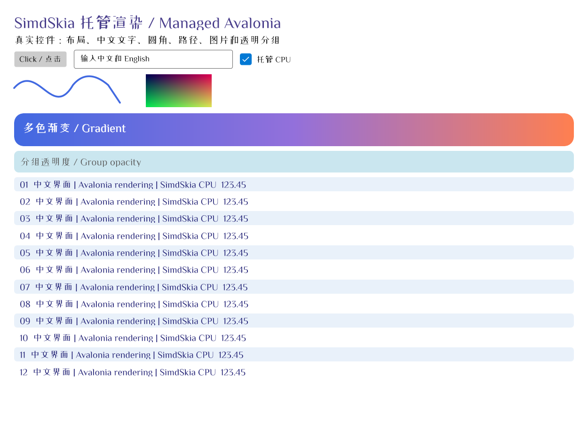

# SimdSkia.Avalonia

**用 C# 绘制图片，或为 Avalonia 应用更换渲染后端。**

SimdSkia 是一个 .NET 2D 渲染引擎，绘图无需加载 Google Skia 原生库。在控制台或服务端，可以用 `SKCanvas` 画图并输出 PNG。在 Avalonia 项目里，可以通过调整包引用和启动代码来切换后端，继续使用原有的 XAML 和视图模型。

简体中文 · [English](https://github.com/donet-org-cn/SimdSkia/blob/main/README.en.md) · .NET 10 · [正式版 0.1.4](https://github.com/donet-org-cn/SimdSkia/blob/main/docs/RELEASE-0.1.4.md) · [MIT](https://github.com/donet-org-cn/SimdSkia/blob/main/LICENSE)

## 按用途开始

| 你要做什么 | 安装哪个包 | 从哪里开始 |
| --- | --- | --- |
| 在 .NET 程序里画图、生成 PNG | [SimdSkia](https://www.nuget.org/packages/SimdSkia/0.1.4) | [运行绘图示例](#生成-png) |
| 为 Windows、Linux 或 macOS 上的 Avalonia 应用切换后端 | [SimdSkia.Avalonia.Desktop](https://www.nuget.org/packages/SimdSkia.Avalonia.Desktop/0.1.4) | [迁移现有项目](#迁移现有项目) · [运行窗口示例](#运行桌面窗口示例) |
| 为 Avalonia Android 应用接入 CPU 渲染 | [SimdSkia.Avalonia.Android](https://www.nuget.org/packages/SimdSkia.Avalonia.Android/0.1.4) | [配置 Android 启动项目](#avalonia-android) |
| 将现有 PDF 的页面转成图片 | [SimdSkia.Pdf](https://www.nuget.org/packages/SimdSkia.Pdf/0.1.4) | [读取和渲染 PDF](https://github.com/donet-org-cn/SimdSkia/blob/main/src/SimdSkia.Pdf/README.md) |

同一个项目直接引用多个 `SimdSkia.*` 包时，请统一版本。

## 生成 PNG

只需安装 `SimdSkia`。这个示例会在位图上画出圆角矩形和圆形，再保存为 PNG。

```sh
dotnet new console --framework net10.0 -o SimdSkiaDemo
cd SimdSkiaDemo
dotnet add package SimdSkia --version 0.1.4
```

将 `Program.cs` 替换为以下代码。`SkiaSharp` 是 SimdSkia 兼容层提供的命名空间。

```csharp
using SkiaSharp;

using var bitmap = new SKBitmap(320, 180);
using var canvas = new SKCanvas(bitmap);
canvas.Clear(SKColors.White);

using var paint = new SKPaint { Color = new SKColor(62, 90, 220), IsAntialias = true };
canvas.DrawRoundRect(SKRect.Create(24, 24, 272, 132), 24, 24, paint);
paint.Color = SKColors.White;
canvas.DrawCircle(160, 90, 32, paint);

using var png = bitmap.Encode(SKEncodedImageFormat.Png, 100)
    ?? throw new InvalidOperationException("PNG encoding failed.");
using var output = File.Create("hello-simdskia.png");
png.SaveTo(output);
```

运行 `dotnet run` 后，当前目录会生成 `hello-simdskia.png`。

## Avalonia 桌面

### 迁移现有项目

1. 在启动项目中运行 `dotnet add package SimdSkia.Avalonia.Desktop --version 0.1.4`，并将 Avalonia 系列包统一为同一个已验证版本。下方示例使用 `12.1.5`。
2. 移除直接引用的 `Avalonia.Desktop`、`Avalonia.Skia` 和 `Avalonia.Fonts.Inter`（如有）。同时检查第三方控件是否依赖原版 Skia 后端或 `ISkiaSharpApiLeaseFeature`。
3. 添加 `using SimdSkia.Avalonia;`，把启动链中的 `.UsePlatformDetect()` 替换为 `.UseSimdSkiaDesktop()`。如果原来调用了 `.WithInterFont()`，也一并移除。

### 运行桌面窗口示例

在空目录创建 `Demo.csproj`。

```xml
<Project Sdk="Microsoft.NET.Sdk">
  <PropertyGroup>
    <OutputType>WinExe</OutputType>
    <TargetFramework>net10.0</TargetFramework>
    <ImplicitUsings>enable</ImplicitUsings>
  </PropertyGroup>
  <ItemGroup>
    <PackageReference Include="SimdSkia.Avalonia.Desktop" Version="0.1.4" />
    <PackageReference Include="Avalonia" Version="[12.1.5]" />
    <PackageReference Include="Avalonia.Themes.Fluent" Version="[12.1.5]" />
  </ItemGroup>
</Project>
```

在同一目录创建 `Program.cs`。

```csharp
using Avalonia;
using Avalonia.Controls;
using Avalonia.Controls.ApplicationLifetimes;
using Avalonia.Themes.Fluent;
using SimdSkia.Avalonia;

internal static class Program
{
    [STAThread]
    public static void Main(string[] args) => AppBuilder.Configure<App>()
        .UseSimdSkiaDesktop()
        .StartWithClassicDesktopLifetime(args);
}

public sealed class App : Application
{
    public override void Initialize() => Styles.Add(new FluentTheme());

    public override void OnFrameworkInitializationCompleted()
    {
        if (ApplicationLifetime is IClassicDesktopStyleApplicationLifetime desktop)
        {
            desktop.MainWindow = new Window
            {
                Title = "Hello SimdSkia",
                Width = 480,
                Height = 240,
                Content = new TextBlock { Text = "Hello, Avalonia!", Margin = new Thickness(24) }
            };
        }

        base.OnFrameworkInitializationCompleted();
    }
}
```

```sh
dotnet restore
dotnet run
```

下图来自 Avalonia 控件示例的 Direct2D 验证，包含输入框、渐变、曲线和中英文文字。使用中文时，需要安装含相应字形的受支持静态 TrueType 字体，或通过 `FontFiles` 指定字体。[控件示例源码](https://github.com/donet-org-cn/SimdSkia/blob/main/examples/CrossPlatform/Program.cs) · [截图与测试记录](https://github.com/donet-org-cn/SimdSkia/blob/main/docs/DESKTOP-GPU-2026-10-22.md)



### 桌面平台与渲染后端

| 平台 | `.UseSimdSkiaDesktop()` 的默认行为 |
| --- | --- |
| Windows | 优先使用 Direct2D 和原生交换链，可回退到 CPU |
| Linux | 在 X11 或 XWayland 下优先使用硬件 Vulkan，可回退到 CPU |
| macOS | 使用 CPU 渲染，由 Avalonia 原生宿主处理窗口 |

可用 `.UseSimdSkiaDesktop(options => options.UseCpu())` 显式选用 CPU。基础适配器 `.UseSimdSkia()` 与离屏位图使用 CPU。桌面窗口已验证 Avalonia `12.1.0`–`12.1.5`，更新版本需要回归验证。[平台行为与回退](https://github.com/donet-org-cn/SimdSkia/blob/main/docs/GPU-PREFERRED-2026-11-07.md) · [Avalonia 版本验证](https://github.com/donet-org-cn/SimdSkia/blob/main/docs/AVALONIA-VERSION-COMPATIBILITY.md)

桌面应用可用目标平台的 Native AOT 工具链发布。例如在 Windows x64 上运行 `dotnet publish -c Release -r win-x64 -p:PublishAot=true`。Linux x64 和 macOS ARM64 分别使用 `linux-x64` 和 `osx-arm64`。[0.1.2 的 AOT 体积对照与复现步骤](https://github.com/donet-org-cn/SimdSkia/blob/main/examples/DefaultAvaloniaAot/README.md)

## Avalonia Android

在目标为 `net10.0-android36.0` 的启动项目中安装 `SimdSkia.Avalonia.Android`，统一使用 Avalonia `12.1.5`，并在 `CreateAppBuilder()` 中调用 `.UseSimdSkiaAndroid()`。从官方模板迁移时，移除直接引用的 `Avalonia.Android`，并按示例配置 Activity 的 AppCompat 主题和字体。[Android 接入步骤与示例](https://github.com/donet-org-cn/SimdSkia/blob/main/examples/Mobile.Android/README.md)

Android 当前使用 CPU/SIMD 渲染。发布记录分别列出了 Android 16 ARM64 源码真机验证，以及 NuGet 包消费端的 Release 和 Mono AOT 构建验证。iOS 窗口呈现仍待实现。[真机报告](https://github.com/donet-org-cn/SimdSkia/blob/main/docs/ANDROID-2026-11-09.md) · [包验收](https://github.com/donet-org-cn/SimdSkia/blob/main/docs/NUGET-PREVIEW.md)

## 兼容性与性能

- **渲染实现。** CPU 光栅化支持 SIMD 加速，字体处理、基础文字排版和图像编解码也由 C# 实现。[架构](https://github.com/donet-org-cn/SimdSkia/blob/main/docs/ARCHITECTURE.md) · [第三方依赖](https://github.com/donet-org-cn/SimdSkia/blob/main/docs/DEPENDENCIES.md)
- **SkiaSharp 源码兼容。** 以 SkiaSharp `3.119.4` 为基线，签名审计匹配了 3,235 项中的 3,230 项。迁移时应重新编译依赖 `SK*` 类型的代码，并检查原生句柄、像素输出和自定义控件的行为。兼容层与原版 `SkiaSharp.dll` 的程序集标识不同。[API 审计](https://github.com/donet-org-cn/SimdSkia/blob/main/docs/PUBLIC-API-FINAL-2026-11-07.md) · [兼容性报告](https://github.com/donet-org-cn/SimdSkia/blob/main/docs/COMPATIBILITY.md)
- **文档处理。** `SKDocument.CreatePdf` 可导出多页栅格 PDF。需要读取和渲染 PDF 页面时，另装基于 PdfPig 0.1.16 的 `SimdSkia.Pdf`，其读取能力限于文档列出的子集。[PDF 使用说明](https://github.com/donet-org-cn/SimdSkia/blob/main/src/SimdSkia.Pdf/README.md) · [文档示例](https://github.com/donet-org-cn/SimdSkia/blob/main/examples/Documents/README.md)
- **渲染差异。** 部分 JPEG、文字和曲线场景仍与原版有差异。CPU 与 GPU 的耗时和内存占用取决于后端和场景，报告分别记录了 GPU 提交和实际完成的耗时。[画质与测试](https://github.com/donet-org-cn/SimdSkia/blob/main/docs/VALIDATION.md) · [性能与内存](https://github.com/donet-org-cn/SimdSkia/blob/main/docs/PERFORMANCE-HOTSPOTS-2026-11-07.md)

## 从源码运行示例

在仓库根目录使用 .NET SDK `10.0.403` 或 `global.json` 允许的兼容版本。

```sh
dotnet run --project examples/Rectangle -c Release
dotnet run --project examples/CrossPlatform -c Release -- --controls
```

第一个示例逐像素验证矩形并写出 `artifacts/rectangle.ppm`，第二个示例打开 Avalonia 控件窗口。[公共 API 示例](https://github.com/donet-org-cn/SimdSkia/blob/main/examples/Compatibility99/README.md) · [更新日志](https://github.com/donet-org-cn/SimdSkia/blob/main/docs/RELEASE-NOTES.md)

欢迎在 [GitHub Issues](https://github.com/donet-org-cn/SimdSkia/issues) 反馈问题。若能附上包版本、系统、渲染后端和最小复现，会更容易定位。
